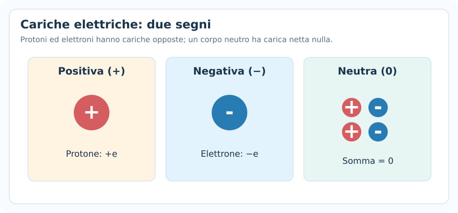
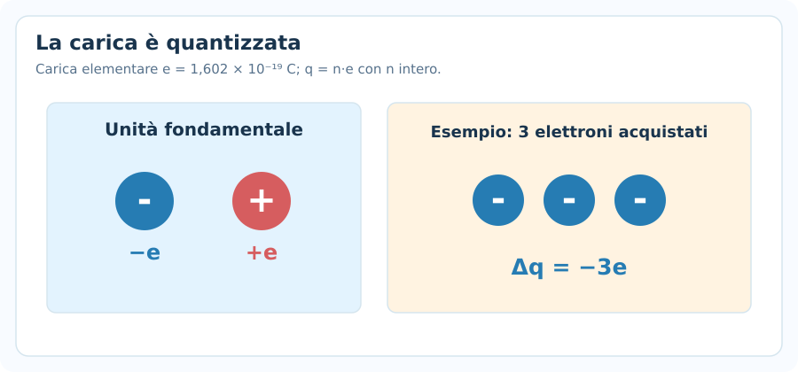
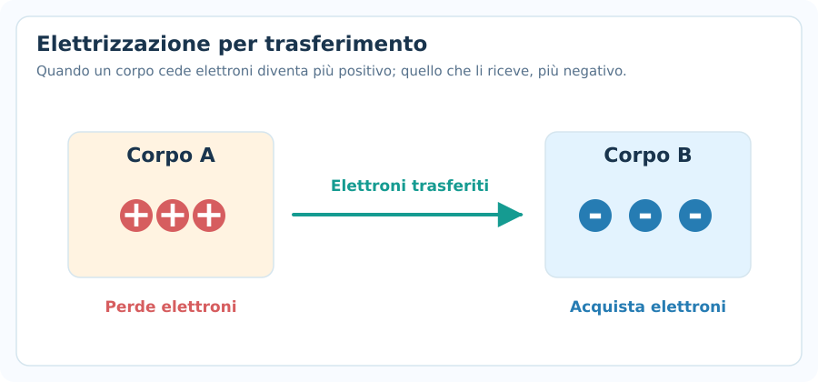
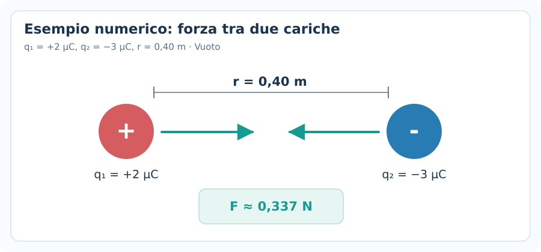
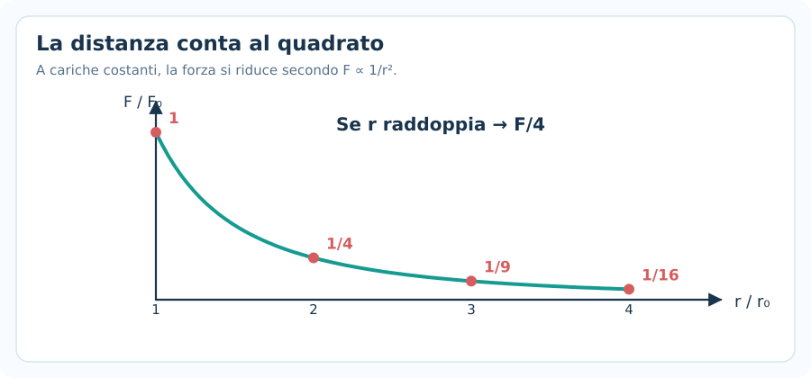
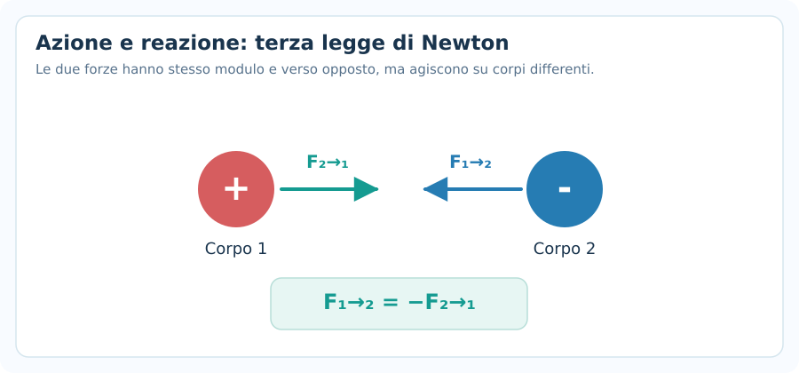
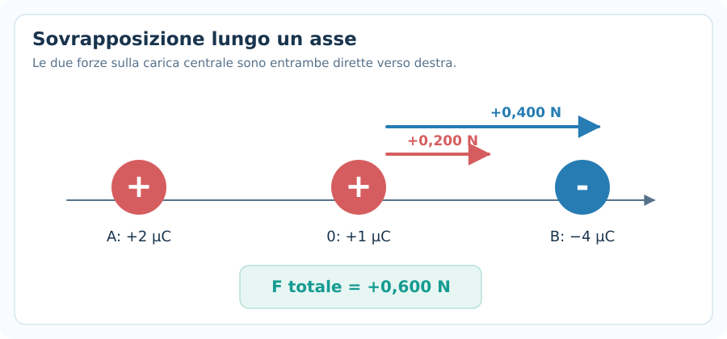
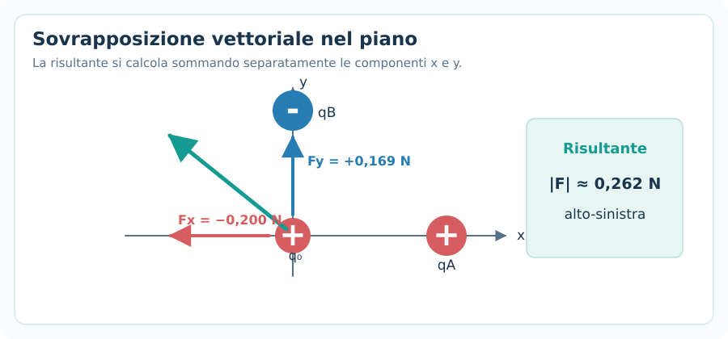

# Carica elettrica e legge di Coulomb

> **Fisica — Informatica UPO · Elettromagnetismo · Nota 01**  
> Prerequisiti: vettori, forze e secondo principio di Newton.  
> **Obiettivo:** riconoscere il segno delle cariche, calcolare il modulo della forza elettrica e determinarne direzione e verso, anche con più cariche.

## 1. Che cosa studia l'elettrostatica?

L'**elettrostatica** studia le cariche elettriche e le interazioni tra cariche **ferme** rispetto al sistema di riferimento considerato. La forza elettrica può essere **attrattiva** o **repulsiva**, a differenza della forza gravitazionale fra masse ordinarie, che è attrattiva.

Esistono due segni di carica:

- **Positiva** ($+$), come quella del protone.
- **Negativa** ($-$), come quella dell'elettrone.

Un corpo è **elettricamente neutro** quando la somma delle sue cariche è zero; può comunque contenere moltissimi protoni ed elettroni.

> [!important] Da ricordare
> Cariche dello **stesso segno si respingono**; cariche di **segno opposto si attraggono**.

---

## 2. Proprietà della carica elettrica

### 2.1 Unità di misura

Nel Sistema Internazionale la carica si misura in **coulomb** ($\mathrm{C}$). Negli esercizi si incontrano spesso i sottomultipli:

| Unità | Equivalenza |
|---|---|
| $1\ \mathrm{mC}$ | $10^{-3}\ \mathrm{C}$ |
| $1\ \mathrm{\mu C}$ | $10^{-6}\ \mathrm{C}$ |
| $1\ \mathrm{nC}$ | $10^{-9}\ \mathrm{C}$ |
| $1\ \mathrm{pC}$ | $10^{-12}\ \mathrm{C}$ |

**Prima di calcolare con Coulomb, convertire sempre le cariche in coulomb.**

### 2.2 Quantizzazione

La carica elettrica di un corpo isolato è un multiplo intero della carica elementare:

$$
\boxed{q=ne,\qquad n\in\mathbb{Z}}
$$

con

$$
\boxed{e\approx1{,}602\cdot10^{-19}\ \mathrm{C}}
$$

La carica del protone è $+e$, quella dell'elettrone $-e$. Un corpo che **acquista** elettroni diventa più negativo; se **perde** elettroni diventa più positivo.

**Esempio.** Un corpo acquista $N=5\cdot10^{12}$ elettroni:

$$
\Delta q=-Ne=-5\cdot10^{12}\cdot1{,}602\cdot10^{-19}
$$

$$
\boxed{\Delta q\approx-8{,}01\cdot10^{-7}\ \mathrm{C}=-0{,}801\ \mathrm{\mu C}}
$$

### 2.3 Conservazione

In un sistema isolato, la **carica elettrica totale si conserva**:

$$
\boxed{\sum_i q_{i,\mathrm{iniz}}=\sum_i q_{i,\mathrm{fin}}}
$$

I processi ordinari di elettrizzazione **trasferiscono** cariche fra corpi, non le creano dal nulla.

---

## 3. Elettrizzazione e materiali

Un oggetto può essere elettrizzato, per esempio, tramite:

1. **Strofinio:** lo scambio di elettroni fra due materiali può lasciare uno positivo e l'altro negativo.
2. **Contatto:** cariche possono redistribuirsi fra corpi a contatto.
3. **Induzione:** un corpo carico vicino a un conduttore provoca una separazione delle cariche; per ottenere una carica netta permanente occorrono ulteriori passaggi, come una messa a terra controllata.

### Conduttori e isolanti

- Nei **conduttori** (ad esempio molti metalli), alcune cariche possono muoversi facilmente all'interno del materiale.
- Negli **isolanti**, la mobilità delle cariche è molto più limitata.

Un oggetto isolante può comunque polarizzarsi, cioè presentare una piccola separazione locale delle cariche, senza acquisire una carica netta.

---

## 4. Legge di Coulomb

Due cariche puntiformi $q_1$ e $q_2$, a distanza $r$, interagiscono nel vuoto con una forza di modulo:

$$
\boxed{F=k\frac{|q_1q_2|}{r^2}}
$$

Dove:

- $F$: **modulo** della forza elettrica ($\mathrm{N}$).
- $q_1,q_2$: cariche elettriche ($\mathrm{C}$).
- $r$: distanza fra le cariche ($\mathrm{m}$).
- $k$: costante di Coulomb nel vuoto.

$$
\boxed{k\approx8{,}99\cdot10^9\ \mathrm{N\,m^2/C^2}}
$$

Equivalentemente:

$$
k=\frac{1}{4\pi\varepsilon_0}
$$

con $\varepsilon_0\approx8{,}854\cdot10^{-12}\ \mathrm{F/m}$ (permittività del vuoto).

### Direzione e verso

La forza agisce **lungo la retta che congiunge le cariche**:

- Se $q_1q_2>0$, le cariche si **respingono**.
- Se $q_1q_2<0$, le cariche si **attraggono**.

La formula con il valore assoluto dà il **modulo positivo** della forza; il verso va stabilito separatamente dal disegno.

> [!warning] Errore tipico
> Non interpretare il segno meno nel prodotto $q_1q_2$ come una “forza di modulo negativo”. Il modulo $F$ è sempre non negativo; **il segno delle cariche determina il verso**.

### Quando vale

La forma indicata vale esattamente per **cariche puntiformi nel vuoto**. È una buona approssimazione per cariche molto piccole rispetto alla distanza; anche per distribuzioni sfericamente simmetriche, in punti esterni, si può usare una carica equivalente al centro. In materiali diversi dal vuoto occorre considerare la permittività del mezzo.

---

## 5. Esempio: due cariche a distanza nota

Due cariche puntiformi si trovano nel vuoto:

$$
q_1=+2{,}0\ \mathrm{\mu C},\quad
q_2=-3{,}0\ \mathrm{\mu C},\quad
r=0{,}40\ \mathrm{m}
$$

**Passaggio 1 — Conversione:**

$$
q_1=2{,}0\cdot10^{-6}\ \mathrm{C},\qquad
q_2=-3{,}0\cdot10^{-6}\ \mathrm{C}
$$

**Passaggio 2 — Modulo della forza:**

$$
F=8{,}99\cdot10^9\cdot\frac{|(2{,}0\cdot10^{-6})(-3{,}0\cdot10^{-6})|}{(0{,}40)^2}
$$

$$
\boxed{F\approx0{,}337\ \mathrm{N}}
$$

**Passaggio 3 — Verso:** cariche di segno opposto, quindi **attrazione**: ogni carica è tirata verso l'altra.

---

## 6. Dipendenza dalla distanza e dalle cariche

Da Coulomb:

$$
F\propto\frac{1}{r^2}
$$

A cariche invariate:

| Nuova distanza | Nuova forza |
|---|---|
| $2r$ | $F/4$ |
| $3r$ | $F/9$ |
| $r/2$ | $4F$ |

A distanza invariata, la forza cresce proporzionalmente al **modulo del prodotto delle cariche**.

### Formula per confrontare due situazioni

Se cambiano distanza e cariche:

$$
\boxed{\frac{F_{\mathrm{nuova}}}{F_{\mathrm{iniz}}}=\frac{|q_1^{\prime}q_2^{\prime}|}{|q_1q_2|}\left(\frac{r_{\mathrm{iniz}}}{r_{\mathrm{nuova}}}\right)^2}
$$

Le cariche con apice indicano i **nuovi** valori. **Se cambiano solo le distanze**, il rapporto si semplifica a $(r_{\mathrm{iniz}}/r_{\mathrm{nuova}})^2$.

---

## 7. Terza legge di Newton e forza elettrica

L'interazione elettrica rispetta la terza legge di Newton:

$$
\boxed{\vec F_{1\to2}=-\vec F_{2\to1}}
$$

Le due forze hanno **lo stesso modulo** e **verso opposto**, ma agiscono su **corpi diversi**.

Questo rimane vero anche se $|q_1|\ne|q_2|$.

---

## 8. Principio di sovrapposizione

Quando sono presenti tre o più cariche, la forza totale su una carica è la **somma vettoriale** delle forze esercitate dalle altre cariche:

$$
\boxed{\vec F_{\mathrm{tot}}=\sum_i\vec F_i}
$$

Non devi sommare sempre e soltanto i moduli: devi prima stabilire **direzione e verso di ogni forza**.

### Metodo meccanico

1. **Scegli la carica** su cui calcolare la forza totale.
2. **Disegna** tutte le forze esercitate dalle altre cariche.
3. **Calcola il modulo** di ciascuna forza con Coulomb.
4. **Assegna il segno** se lavori su un asse, oppure scomponi in componenti $x,y$.
5. **Somma** e ricava modulo/direzione della risultante, se richiesti.

### Esempio: tre cariche sulla stessa retta

Disponiamo le cariche ai punti:

- $q_A=+2{,}0\ \mathrm{\mu C}$ in $x_A=0$.
- $q_0=+1{,}0\ \mathrm{\mu C}$ in $x_0=0{,}30\ \mathrm{m}$.
- $q_B=-4{,}0\ \mathrm{\mu C}$ in $x_B=0{,}60\ \mathrm{m}$.

Cerchiamo la forza **su $q_0$**.

La carica $q_A$ è positiva e **respinge $q_0$ verso destra**:

$$
F_{A\to0}=k\frac{|q_Aq_0|}{(0{,}30)^2}\approx0{,}200\ \mathrm{N}
$$

La carica $q_B$ è negativa e **attrae $q_0$ verso destra**:

$$
F_{B\to0}=k\frac{|q_Bq_0|}{(0{,}30)^2}\approx0{,}400\ \mathrm{N}
$$

Con asse $x$ positivo verso destra:

$$
F_{\mathrm{tot},x}=+0{,}200+0{,}400
$$

$$
\boxed{\vec F_{\mathrm{tot}}\approx+0{,}600\ \mathrm{N}\,\hat x}
$$

> [!important] Controllo del verso
> Due cariche laterali non generano necessariamente forze opposte sulla carica centrale. Prima di sommare, guarda **segni e posizioni**.

---

## 9. Sovrapposizione in due dimensioni

Quando le cariche non si trovano sulla stessa retta, devi utilizzare le **componenti vettoriali**, come già fatto nella dinamica.

Per ogni forza:

$$
F_{ix}=F_i\cos\theta_i,\qquad F_{iy}=F_i\sin\theta_i
$$

I segni dipendono dall'orientamento dei vettori.

Poi:

$$
\boxed{F_x=\sum_iF_{ix},\qquad F_y=\sum_iF_{iy}}
$$

$$
\boxed{|\vec F|=\sqrt{F_x^2+F_y^2}}
$$

### Esempio con forze perpendicolari

Una carica $q_0=+1{,}0\ \mathrm{\mu C}$ è nell'origine; una carica $q_A=+2{,}0\ \mathrm{\mu C}$ si trova in $(0{,}30\ \mathrm{m},0)$ e una carica $q_B=-3{,}0\ \mathrm{\mu C}$ in $(0,0{,}40\ \mathrm{m})$.

- $q_A$ **respinge** $q_0$ verso **sinistra**: $F_{A\to0,x}\approx-0{,}200\ \mathrm{N}$.
- $q_B$ **attrae** $q_0$ verso **l'alto**: $F_{B\to0,y}\approx+0{,}169\ \mathrm{N}$.

Quindi:

$$
\vec F_{\mathrm{tot}}\approx(-0{,}200\,\hat x+0{,}169\,\hat y)\ \mathrm{N}
$$

$$
\boxed{|\vec F_{\mathrm{tot}}|\approx0{,}262\ \mathrm{N}}
$$

La risultante punta verso **alto-sinistra**. Se serve l'angolo, conviene utilizzare $\operatorname{atan2}(F_y,F_x)$ per riconoscere il quadrante corretto.

---

## 10. Punti di equilibrio della forza elettrica

Un corpo di prova posto in un punto può subire una forza totale nulla anche se le singole forze non sono nulle:

$$
\boxed{\sum_i\vec F_i=0}
$$

### Caso simmetrico

Due cariche **uguali e positive** collocate simmetricamente rispetto all'origine esercitano su una carica di prova posta nel punto medio due forze di uguale modulo e verso opposto: la risultante è nulla.

Questo garantisce il **bilancio delle forze in quel punto**, non necessariamente un equilibrio stabile per piccoli spostamenti.

### Attenzione

Se cerchi un punto in cui la forza netta è nulla, devi:

1. Stabilire **in quali regioni** le forze possono avere versi opposti.
2. Impostare $F_1=F_2$ soltanto dove le forze sono effettivamente opposte.
3. Controllare che la posizione trovata appartenga alla regione ipotizzata.

Non basta uguagliare i moduli senza aver prima analizzato i versi.

---

## 11. Collegamento con il campo elettrico

La legge di Coulomb calcola la forza tra cariche. Nella prossima nota introdurremo il **campo elettrico** $\vec E$, che permette di descrivere l'azione delle cariche sorgenti nello spazio.

Per una piccola carica di prova $q_0$:

$$
\boxed{\vec F=q_0\vec E}
$$

È importante non confondere:

- **Forza elettrica**: dipende dalla carica su cui agisce, si misura in $\mathrm{N}$.
- **Campo elettrico**: dipende dalle cariche sorgenti, si misura in $\mathrm{N/C}$.

Il segno della carica di prova determina se la forza ha il **medesimo verso** del campo ($q_0>0$) oppure il **verso opposto** ($q_0<0$).

---

## 12. Errori frequenti negli esercizi

| Errore | Come evitarlo |
|---|---|
| Dimenticare $\mathrm{\mu C}\to\mathrm C$ | Convertire prima: $1\ \mathrm{\mu C}=10^{-6}\ \mathrm C$ |
| Mettere un modulo negativo | Coulomb dà $F\ge0$; il segno indica **il verso** |
| Confondere distanza con coordinata | In Coulomb usare $r=|x_2-x_1|$ lungo l'asse |
| Dimenticare $r^2$ | Se la distanza raddoppia, la forza diventa **un quarto** |
| Sommare solo moduli | Prima disegnare e poi **sommare vettori** |
| Sbagliare il quadrante in 2D | Guardare segni di $F_x,F_y$ |
| Confondere forza su $q_1$ e su $q_2$ | Specificare sempre **la carica bersaglio** |
| Dire che una carica neutra contiene zero cariche | Neutralità significa **somma algebrica zero** |

---

## 13. Formulario essenziale

| Situazione | Relazione |
|---|---|
| Carica elementare | $e\approx1{,}602\cdot10^{-19}\ \mathrm C$ |
| Quantizzazione | $q=ne$ |
| Conservazione | $\sum q_{\mathrm i}=\sum q_{\mathrm f}$ |
| Forza di Coulomb (modulo) | $F=k|q_1q_2|/r^2$ |
| Costante nel vuoto | $k\approx8{,}99\cdot10^9\ \mathrm{N\,m^2/C^2}$ |
| Sovrapposizione | $\vec F_{\mathrm{tot}}=\sum_i\vec F_i$ |
| Componenti della risultante | $F_x=\sum F_{ix}$, $F_y=\sum F_{iy}$ |
| Modulo in 2D | $|\vec F|=\sqrt{F_x^2+F_y^2}$ |
| Terza legge di Newton | $\vec F_{1\to2}=-\vec F_{2\to1}$ |
| Legame con il campo | $\vec F=q_0\vec E$ |

---

## 14. Verifica della comprensione (senza soluzioni)

1. Due cariche positive si avvicinano: il modulo della forza aumenta o diminuisce? In quale verso agisce su ciascuna?
2. Una carica di $-4\ \mathrm{\mu C}$ è posta a $20\ \mathrm{cm}$ da una carica di $+1\ \mathrm{\mu C}$. Calcola il modulo della forza e descrivine il verso.
3. Una carica acquisisce $10^{13}$ elettroni: qual è la variazione della sua carica?
4. Due cariche identiche vengono allontanate fino al triplo della distanza: come cambia la forza?
5. Una carica positiva si trova tra una carica positiva alla sua sinistra e una negativa alla sua destra: in quali versi agiscono le due forze?
6. Due forze elettriche perpendicolari di moduli $3\ \mathrm N$ e $4\ \mathrm N$ agiscono sulla stessa carica: quanto vale il modulo della risultante?
7. Se due cariche esercitano l'una sull'altra forze uguali e opposte, è corretto dire che tali forze si annullano? Perché?

> [!tip] Metodo da portare all'esame
> **Dati e unità → disegno delle cariche → attrazione/repulsione → Coulomb per ogni coppia → somma vettoriale → controllo fisico del risultato.**
