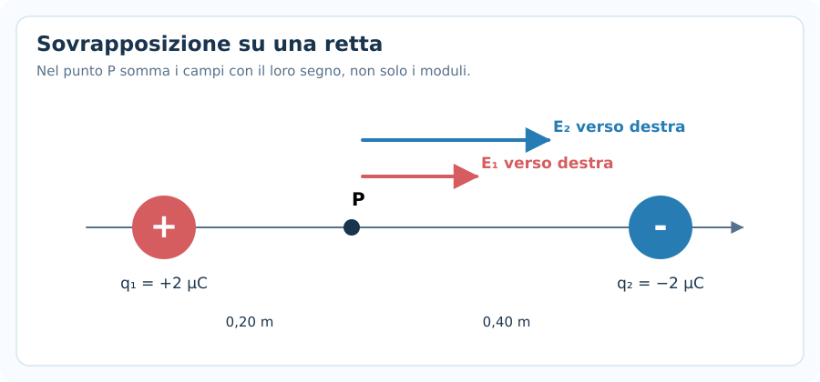
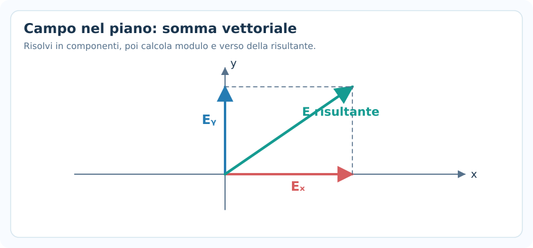
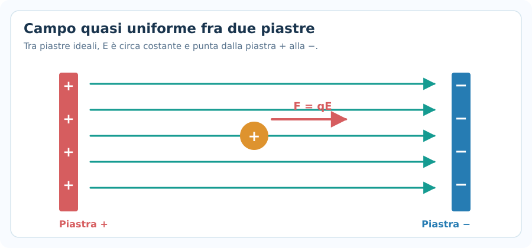
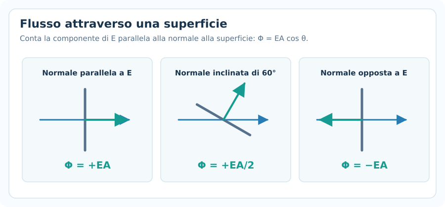
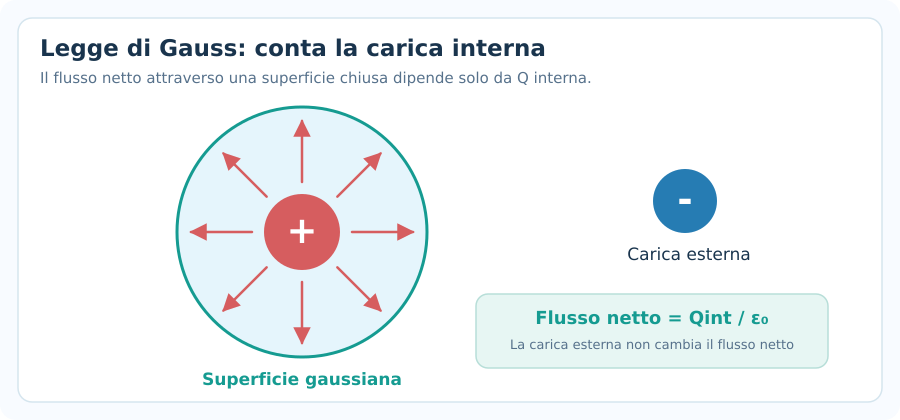
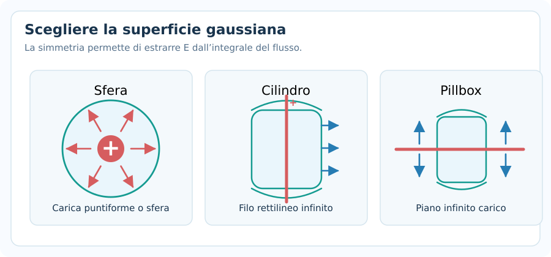
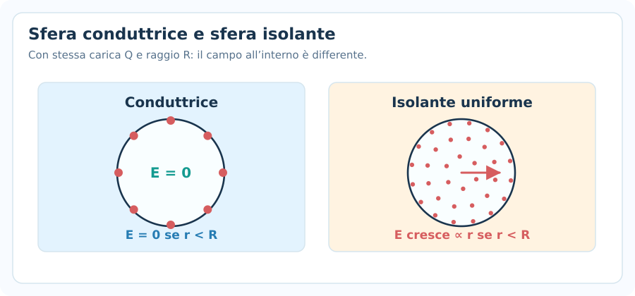

# Campo elettrico e legge di Gauss

> **Fisica — Informatica UPO · Elettromagnetismo · Nota 02**  
> **Prerequisiti:** legge di Coulomb, vettori, superfici e aree.  
> **Obiettivo:** determinare campo elettrico, forza su una carica, flusso elettrico e applicare Gauss nei casi di simmetria.

## 1. Dalla forza elettrica al campo elettrico

La **legge di Coulomb** calcola la forza esercitata tra due cariche. Il **campo elettrico**, invece, descrive l'effetto che una carica sorgente produce nello spazio **anche quando nel punto considerato non è presente alcuna carica di prova**.

Per definizione:

$$
\boxed{\vec E=\frac{\vec F}{q_0}}
$$

Dove:

- $\vec E$ è il campo elettrico nel punto considerato;
- $\vec F$ è la forza elettrica agente su una piccola carica di prova $q_0$;
- $q_0$ è una **carica di prova positiva** sufficientemente piccola da non alterare significativamente la distribuzione delle cariche sorgenti.

L'unità del campo elettrico nel Sistema Internazionale è:

$$
\boxed{[E]=\mathrm{N/C}}
$$

Una volta noto il campo elettrico, la forza su **qualsiasi carica puntiforme** $q$ è:

$$
\boxed{\vec F=q\vec E}
$$

### Direzione e verso

- Se $q>0$, la forza $\vec F$ ha **stesso verso** del campo $\vec E$.
- Se $q<0$, la forza $\vec F$ ha **verso opposto** al campo $\vec E$.

**Non confondere** il verso del campo, che si definisce rispetto a una carica di prova *positiva*, con quello della forza su una carica negativa.

> [!important] Differenza fondamentale
> Il **campo** è una proprietà della distribuzione delle cariche sorgenti. La **forza** dipende anche dalla carica che metti nel campo: $\vec F=q\vec E$.

---

## 2. Campo elettrico di una carica puntiforme

Nel vuoto, una carica puntiforme sorgente $Q$ genera a distanza $r$ un campo di **modulo**:

$$
\boxed{E=k\frac{|Q|}{r^2}}
$$

con:

$$
\boxed{k=\frac{1}{4\pi\varepsilon_0}\approx8{,}99\cdot10^9\ \mathrm{N\,m^2/C^2}}
$$

$$
\boxed{\varepsilon_0\approx8{,}85\cdot10^{-12}\ \mathrm{C^2/(N\,m^2)}}
$$

**Significato delle grandezze:** $Q$ è la carica sorgente, $r$ la distanza dal punto in cui si calcola il campo; $\varepsilon_0$ è la permittività elettrica del vuoto.

### Verso del campo

- Carica sorgente **positiva**: il campo punta **verso l'esterno**.
- Carica sorgente **negativa**: il campo punta **verso la carica**.

In forma vettoriale, indicando con $\hat r$ il versore che punta **dalla sorgente verso il punto di osservazione**:

$$
\boxed{\vec E=k\frac{Q}{r^2}\hat r}
$$

Qui $Q$ conserva il segno: per $Q<0$, il campo ha verso opposto a $\hat r$.

### Esempio svolto 1 — Una carica puntiforme

Una carica $Q=+3{,}0\ \mathrm{\mu C}$ è nel vuoto. Calcola $E$ a $r=0{,}30\ \mathrm{m}$.

**1. Converti la carica:**

$$
Q=3{,}0\cdot10^{-6}\ \mathrm{C}
$$

**2. Applica la formula:**

$$
E=8{,}99\cdot10^9\frac{3{,}0\cdot10^{-6}}{(0{,}30)^2}
$$

$$
\boxed{E\approx3{,}00\cdot10^5\ \mathrm{N/C}}
$$

**3. Specifica il verso:** essendo $Q$ positiva, il campo punta radialmente **verso l'esterno**.

### Dipendenza dalla distanza

$$
E\propto\frac1{r^2}
$$

Se la distanza raddoppia, il campo si riduce a un quarto. Se triplica, a un nono.

---

## 3. Linee del campo elettrico

Le **linee di campo** sono una rappresentazione grafica del campo elettrico:

- Il campo è **tangente** alle linee in ogni punto.
- Le frecce mostrano il verso della forza su una carica di prova positiva.
- Le linee escono dalle cariche positive e terminano sulle negative, oppure all'infinito.
- Dove il disegno mostra linee più fitte, il campo è qualitativamente più intenso.
- Due linee di campo **non si incrociano** in un punto in cui il campo ha direzione definita.

Le linee non sono traiettorie che una particella deve necessariamente seguire: il moto reale dipende anche dalla sua velocità iniziale e dalle altre forze.

---

## 4. Principio di sovrapposizione

Se ci sono più cariche sorgenti, il campo elettrico totale è la **somma vettoriale** dei campi prodotti separatamente:

$$
\boxed{\vec E_{\mathrm{tot}}=\sum_i\vec E_i}
$$

Attenzione: sommare i moduli $E_1+E_2$ è corretto **soltanto quando i campi hanno stesso verso**.

### 4.1 Cariche allineate: metodo meccanico

1. Disegna le cariche e il punto $P$ in cui trovare il campo.
2. Scegli l'asse $x$ positivo verso destra.
3. Determina **il verso di ciascun campo** nel punto $P$.
4. Calcola ogni modulo $E_i=k|Q_i|/r_i^2$.
5. Assegna il segno $+$ ai campi diretti a destra e $-$ a quelli diretti a sinistra.
6. Somma algebricamente i contributi.

### Esempio svolto 2 — Due cariche su una retta

Una carica $Q_1=+2{,}0\ \mathrm{\mu C}$ è in $x=0$; una carica $Q_2=-2{,}0\ \mathrm{\mu C}$ è in $x=0{,}60\ \mathrm{m}$. Calcola il campo nel punto $P$ con $x=0{,}20\ \mathrm{m}$.

Le distanze sono:

$$
r_1=0{,}20\ \mathrm{m},\qquad r_2=0{,}40\ \mathrm{m}
$$

Entrambi i contributi puntano **a destra**: il primo si allontana dalla carica positiva, il secondo punta verso la carica negativa.

$$
E_1=8{,}99\cdot10^9\frac{2\cdot10^{-6}}{(0{,}20)^2}\approx4{,}495\cdot10^5\ \mathrm{N/C}
$$

$$
E_2=8{,}99\cdot10^9\frac{2\cdot10^{-6}}{(0{,}40)^2}\approx1{,}124\cdot10^5\ \mathrm{N/C}
$$

Pertanto:

$$
\boxed{\vec E_{\mathrm{tot}}\approx+5{,}62\cdot10^5\ \mathrm{N/C}\ \hat x}
$$

Il segno positivo indica il verso verso destra, secondo l'asse scelto.

### 4.2 Cariche nel piano: componenti

Se i campi non sono allineati:

$$
\boxed{E_x=\sum_i E_{ix},\qquad E_y=\sum_i E_{iy}}
$$

Le componenti di un singolo campo sono:

$$
E_{ix}=E_i\cos\theta_i,\qquad E_{iy}=E_i\sin\theta_i
$$

I segni dipendono dal quadrante e dal verso del vettore. Il modulo risultante è:

$$
\boxed{E_{\mathrm{tot}}=\sqrt{E_x^2+E_y^2}}
$$

L'angolo va determinato considerando il **quadrante** di $(E_x,E_y)$, non soltanto il valore numerico di una tangente.

> [!warning] Errore frequente
> Il campo elettrico è un **vettore**: si combinano direzioni e versi. Non sommare automaticamente i moduli di due contributi perpendicolari.

---

## 5. Forza e accelerazione di una carica in un campo

Su una carica $q$ immersa in un campo elettrico $\vec E$ agisce:

$$
\boxed{\vec F=q\vec E}
$$

Se la forza elettrica è l'unica forza significativa, dalla seconda legge di Newton:

$$
\boxed{\vec a=\frac{q\vec E}{m}}
$$

### Esempio svolto 3 — Forza su una carica negativa

Una carica $q=-4{,}0\ \mathrm{nC}$ si trova in un campo uniforme $E=2{,}0\cdot10^4\ \mathrm{N/C}$ diretto a destra.

**Modulo della forza:**

$$
F=|q|E=4{,}0\cdot10^{-9}\cdot2{,}0\cdot10^4
$$

$$
\boxed{F=8{,}0\cdot10^{-5}\ \mathrm{N}}
$$

**Direzione:** verso **sinistra**, perché la carica è negativa.

---

## 6. Campo elettrico uniforme

Un campo elettrico è **uniforme** quando possiede lo stesso modulo, la stessa direzione e lo stesso verso nei punti considerati.

Un modello importante è quello delle **due grandi piastre piane parallele e oppositamente cariche**, lontano dai bordi. In tale regione il campo è approssimativamente uniforme, diretto dalla piastra positiva alla negativa.

Se la carica è positiva, la forza punta verso la piastra negativa; se è negativa, la forza punta verso la piastra positiva.

Se non agiscono altre forze e il campo è uniforme, l'accelerazione della carica è costante:

$$
\vec a=\frac{q\vec E}{m}
$$

Perciò si possono utilizzare anche le formule di **cinematica del moto uniformemente accelerato**.

> [!tip] Collegamento con i capitoli precedenti
> Campo elettrico $\Rightarrow$ forza elettrica $\Rightarrow$ accelerazione $\Rightarrow$ velocità e spostamento con Newton e cinematica.

---

## 7. Flusso del campo elettrico

Il **flusso elettrico** misura quanto un campo attraversa una superficie, tenendo conto della sua orientazione.

Per una superficie piana di area $A$ e un campo elettrico uniforme:

$$
\boxed{\Phi_E=\vec E\cdot\vec A=EA\cos\theta}
$$

Dove:

- $\vec A=A\hat n$ è il **vettore area**, perpendicolare alla superficie;
- $\theta$ è l'angolo fra il campo $\vec E$ e la **normale** alla superficie, **non** l'angolo con il piano;
- $\Phi_E$ è il flusso elettrico.

L'unità di misura è:

$$
\boxed{[\Phi_E]=\mathrm{N\,m^2/C}}
$$

### Segno del flusso

- $\theta=0^\circ$: $\Phi_E=+EA$ (**flusso positivo**).
- $\theta=90^\circ$: $\Phi_E=0$ (il campo è parallelo alla superficie).
- $\theta=180^\circ$: $\Phi_E=-EA$ (**flusso negativo**).

### Esempio svolto 4 — Flusso su un rettangolo

Un campo uniforme $E=500\ \mathrm{N/C}$ attraversa una superficie piana di area $A=0{,}20\ \mathrm{m^2}$. La normale forma un angolo di $60^\circ$ con il campo.

$$
\Phi_E=EA\cos60^\circ=500\cdot0{,}20\cdot0{,}5
$$

$$
\boxed{\Phi_E=+50\ \mathrm{N\,m^2/C}}
$$

### Superficie chiusa

Per una **superficie chiusa** si usa per convenzione la normale **uscente**. Il flusso netto si scrive:

$$
\boxed{\Phi_E=\oint_S\vec E\cdot d\vec A}
$$

Una linea di campo che **entra** contribuisce negativamente, una che **esce** positivamente. Il flusso netto è la somma dei contributi di tutta la superficie.

---

## 8. Legge di Gauss

La **legge di Gauss** lega il flusso netto attraverso una superficie chiusa alla carica totale racchiusa al suo interno:

$$
\boxed{\oint_S\vec E\cdot d\vec A=\frac{Q_{\mathrm{int}}}{\varepsilon_0}}
$$

Dove:

- $S$ è una qualsiasi superficie **chiusa** (anche immaginaria);
- $Q_{\mathrm{int}}$ è la **somma algebrica delle cariche dentro** la superficie;
- $\varepsilon_0$ è la permittività del vuoto.

### Conseguenze importanti

1. **Carica racchiusa positiva:** flusso netto positivo.
2. **Carica racchiusa negativa:** flusso netto negativo.
3. **Carica totale racchiusa nulla:** flusso netto zero, **ma il campo sui punti della superficie può essere non nullo**.
4. Le cariche **esterne** possono contribuire al campo locale sulla superficie, ma il loro contributo al **flusso netto** è zero.
5. La legge di Gauss vale sempre in elettrostatica, ma è semplice ricavare $E$ con essa solo in presenza di opportune **simmetrie**.

### Esempio svolto 5 — Calcolare il flusso senza conoscere la forma

Una superficie chiusa racchiude tre cariche:

$$
q_1=+4\ \mathrm{nC},\quad q_2=-1\ \mathrm{nC},\quad q_3=+2\ \mathrm{nC}
$$

La carica totale interna è:

$$
Q_{\mathrm{int}}=4-1+2=+5\ \mathrm{nC}=5\cdot10^{-9}\ \mathrm{C}
$$

Applicando Gauss:

$$
\Phi_E=\frac{5\cdot10^{-9}}{8{,}85\cdot10^{-12}}
$$

$$
\boxed{\Phi_E\approx+565\ \mathrm{N\,m^2/C}}
$$

Non serve conoscere il raggio o la forma della superficie chiusa: basta la **carica netta interna**.

---

## 9. Come scegliere una superficie gaussiana

Per ricavare il **campo elettrico** tramite Gauss, il problema deve avere una simmetria che renda semplice l'integrale del flusso.

| Distribuzione di carica | Simmetria | Superficie utile |
|---|---|---|
| Carica puntiforme isolata / sfera simmetrica | Sferica | **Sfera** |
| Filo rettilineo infinitamente lungo | Cilindrica | **Cilindro coassiale** |
| Piano infinitamente esteso | Piana | **Cilindro sottile** (pillbox) |

### Metodo meccanico per Gauss

1. Identifica la **simmetria** della distribuzione.
2. Disegna una **superficie chiusa immaginaria** coerente con la simmetria.
3. Stabilisci dove $E$ è costante e se il campo è parallelo o perpendicolare alle normali locali.
4. Calcola $Q_{\mathrm{int}}$ usando **solo** le cariche racchiuse.
5. Scrivi $\oint\vec E\cdot d\vec A=Q_{\mathrm{int}}/\varepsilon_0$.
6. Semplifica l'integrale usando la simmetria e ricava $E$.
7. Specifica **direzione e verso** (dipendono dal segno delle cariche).

> [!warning] Non confondere le due operazioni
> **Calcolare il flusso totale** con Gauss richiede solo $Q_{\mathrm{int}}$. **Calcolare il campo $E$** da Gauss richiede invece una simmetria che permetta di semplificare l'integrale.

---

## 10. Simmetria sferica: carica puntiforme e sfere

### 10.1 Carica puntiforme

Scegliamo una superficie gaussiana sferica di raggio $r$ centrata sulla carica $Q$.

Per simmetria, $E$ ha modulo costante sulla sfera ed è radiale. Pertanto:

$$
\Phi_E=E\cdot4\pi r^2=\frac{Q}{\varepsilon_0}
$$

In modulo:

$$
\boxed{E=\frac{|Q|}{4\pi\varepsilon_0r^2}=k\frac{|Q|}{r^2}}
$$

Ritroviamo la legge del campo di una carica puntiforme.

### 10.2 Sfera conduttrice carica in equilibrio elettrostatico

Per una **sfera conduttrice isolata**, di raggio $R$, con carica totale $Q$ e nessuna carica nella cavità eventualmente presente:

- Le cariche in eccesso risiedono sulla **superficie esterna**.
- Per $r<R$ all'interno del materiale conduttore, il campo è **nullo**.
- Per $r>R$, il campo è quello di una carica puntiforme $Q$ nel centro.

$$
\boxed{E(r)=\begin{cases}0 & 0\leq r<R,\\[2pt]k\dfrac{|Q|}{r^2} & r>R.\end{cases}}
$$

Appena all'esterno della superficie:

$$
\boxed{E(R^+)=k\frac{|Q|}{R^2}}
$$

### 10.3 Sfera isolante uniformemente carica

Supponiamo una sfera **isolante piena** di raggio $R$ con carica totale $Q$ distribuita uniformemente nel **volume**.

Per $r\geq R$:

$$
\boxed{E(r)=k\frac{|Q|}{r^2}}
$$

Per $0\leq r<R$, la frazione di carica racchiusa dalla superficie di raggio $r$ è proporzionale al volume:

$$
Q_{\mathrm{int}}=Q\frac{r^3}{R^3}
$$

Gauss dà:

$$
E\cdot4\pi r^2=\frac{|Q_{\mathrm{int}}|}{\varepsilon_0}
$$

Quindi:

$$
\boxed{E(r)=k\frac{|Q|\,r}{R^3}\qquad (r<R)}
$$

**All'interno di una sfera isolante uniforme, il campo aumenta linearmente con $r$** e vale zero al centro. Alla superficie raccorda il campo esterno.

### Esempio svolto 6 — Sfera isolante uniforme

Una sfera isolante ha $Q=+8{,}0\ \mathrm{nC}$ e raggio $R=0{,}20\ \mathrm{m}$. Trova il campo a $r_1=0{,}10\ \mathrm{m}$ e $r_2=0{,}40\ \mathrm{m}$ dal centro.

**Punto interno** ($r_1<R$):

$$
E_1=k\frac{Qr_1}{R^3}=8{,}99\cdot10^9\frac{8\cdot10^{-9}\cdot0{,}10}{(0{,}20)^3}
$$

$$
\boxed{E_1\approx899\ \mathrm{N/C}}
$$

**Punto esterno** ($r_2>R$):

$$
E_2=k\frac{Q}{r_2^2}=8{,}99\cdot10^9\frac{8\cdot10^{-9}}{(0{,}40)^2}
$$

$$
\boxed{E_2\approx449\ \mathrm{N/C}}
$$

Entrambi i campi sono **radiali verso l'esterno**, perché $Q>0$.

---

## 11. Simmetria cilindrica: filo infinito

Un **filo rettilineo idealmente infinito** ha densità lineare di carica $\lambda$:

$$
\boxed{\lambda=\frac{Q}{L}\qquad[\lambda]=\mathrm{C/m}}
$$

Scegliamo un cilindro gaussiano di raggio $r$ e lunghezza $L$, con asse coincidente con il filo.

Per simmetria, il campo è radiale e di modulo costante sulla superficie laterale; sulle basi è parallelo ai piani delle basi, quindi il flusso attraverso le basi è zero.

$$
E(2\pi rL)=\frac{\lambda L}{\varepsilon_0}
$$

Da cui:

$$
\boxed{E=\frac{|\lambda|}{2\pi\varepsilon_0r}}
$$

Il campo è diretto radialmente **verso l'esterno** se $\lambda>0$, **verso il filo** se $\lambda<0$.

> [!important] Confronto con una carica puntiforme
> - Carica puntiforme: $E\propto 1/r^2$.
> - Filo infinito: $E\propto 1/r$.
>
> La dipendenza diversa nasce dalla **geometria** della distribuzione di carica.

---

## 12. Simmetria piana: piano infinito e piastre

Una **lastra piana idealmente infinita** con carica uniformemente distribuita ha densità superficiale:

$$
\boxed{\sigma=\frac{Q}{A}\qquad[\sigma]=\mathrm{C/m^2}}
$$

Per un **singolo piano ideale infinitamente esteso**, non conduttore, con carica superficiale uniforme, si usa un cilindro sottile che attraversa il piano. Il campo è perpendicolare al piano e ha lo stesso modulo sui due lati.

Il flusso attraversa le due basi, quindi:

$$
2EA=\frac{\sigma A}{\varepsilon_0}
$$

$$
\boxed{E=\frac{|\sigma|}{2\varepsilon_0}}
$$

Il valore è **indipendente dalla distanza** dal piano, nel modello ideale infinito.

### Due piani paralleli con cariche opposte

Due grandi piani con densità $+\sigma$ e $-\sigma$, idealmente infiniti, producono per sovrapposizione:

- **Tra i piani**: i campi si sommano, quindi $E=|\sigma|/\varepsilon_0$.
- **All'esterno**: i campi si compensano, quindi $E=0$.

$$
\boxed{E_{\mathrm{tra\ piastre}}=\frac{|\sigma|}{\varepsilon_0}}
$$

Nel modello di due piastre reali molto estese rispetto alla distanza, queste relazioni sono buone approssimazioni **lontano dai bordi**.

### Superficie di un conduttore

In equilibrio elettrostatico, **appena all'esterno** della superficie di un conduttore il campo normale soddisfa, nel vuoto:

$$
\boxed{E_{\perp}=\frac{|\sigma|}{\varepsilon_0}}
$$

Qui $\sigma$ è la **densità superficiale locale** della carica del conduttore. Non confondere questa relazione con quella di un piano isolante infinitamente esteso, che dà $|\sigma|/(2\varepsilon_0)$ su ciascun lato.

---

## 13. Conduttori in equilibrio elettrostatico

Quando le cariche libere di un conduttore hanno raggiunto l'equilibrio:

1. **Nel materiale conduttore** il campo elettrico è nullo: $\vec E=0$.
2. Le cariche libere in eccesso si trovano sulle superfici del conduttore.
3. Il campo elettrico immediatamente all'esterno è **perpendicolare** alla superficie; una componente tangenziale sposterebbe le cariche.
4. Un conduttore in equilibrio è **equipotenziale** (approfondiremo il potenziale nella nota successiva).

Se il conduttore possiede cavità con cariche al loro interno, la distribuzione sulle superfici va studiata con attenzione: non si può affermare indiscriminatamente che tutta la carica si trovi sempre solo all'esterno.

---

## 14. Gauss e sovrapposizione: quando usarli?

**Usa la sovrapposizione** quando sono note poche cariche puntiformi, soprattutto su un asse o nel piano:

$$
\vec E_{\mathrm{tot}}=\sum_i\vec E_i
$$

**Usa Gauss** quando la distribuzione possiede un'elevata simmetria (sferica, cilindrica o piana) e vuoi trovare il campo in funzione della distanza:

$$
\oint_S\vec E\cdot d\vec A=\frac{Q_{\mathrm{int}}}{\varepsilon_0}
$$

**Usa direttamente Gauss per il flusso** se conosci $Q_{\mathrm{int}}$: la superficie può anche essere irregolare.

### Tabella operativa per l'esame

| Indizio nel testo | Come partire |
|---|---|
| "Campo elettrico nel punto P" generato da cariche puntiformi | $E_i=k|Q_i|/r_i^2$ + versi + somma vettoriale |
| "Forza su una carica q" immersa nel campo | $\vec F=q\vec E$ |
| "Accelerazione della particella" | $\vec a=q\vec E/m$, se solo forza elettrica |
| "Flusso su una superficie piana" | $\Phi_E=EA\cos\theta$ |
| "Flusso attraverso superficie chiusa" | $\Phi_E=Q_{\mathrm{int}}/\varepsilon_0$ |
| "Sfera conduttrice", $r<R$ | $E=0$ nel materiale |
| "Sfera isolante uniformemente carica", $r<R$ | $E=k|Q|r/R^3$ |
| "Filo infinitamente lungo" | $E=|\lambda|/(2\pi\varepsilon_0 r)$ |
| "Piano infinito carico" | $E=|\sigma|/(2\varepsilon_0)$ |
| "Due piastre grandi e opposte" | $E\simeq|\sigma|/\varepsilon_0$ all'interno |

---

## 15. Errori frequenti

### 1. Confondere il segno della carica sorgente e della carica di prova

Il **segno della sorgente $Q$** determina il verso del campo. Il **segno della carica $q$** determina il verso della forza $\vec F=q\vec E$.

### 2. Confondere campo e forza

$$
[E]=\mathrm{N/C},\qquad[F]=\mathrm{N}
$$

Il campo $E$ non è una forza: per ottenere una forza devi moltiplicare per una carica.

### 3. Sommare i moduli senza considerare i versi

Due campi uguali e opposti hanno risultante **zero**, non il doppio.

### 4. Usare un angolo rispetto al piano nel calcolo del flusso

In $\Phi_E=EA\cos\theta$, l'angolo è quello con la **normale** alla superficie.

### 5. Pensare che flusso nullo significhi campo nullo

$\Phi_E=0$ su una superficie chiusa significa $Q_{\mathrm{int}}=0$, **non necessariamente $\vec E=0$ in tutti i suoi punti**.

### 6. Confondere una superficie gaussiana con un oggetto fisico

La superficie gaussiana è una costruzione **matematica** che scegliamo liberamente per applicare il teorema.

### 7. Applicare $E=Q/(\varepsilon_0A)$ a qualunque superficie

Si può estrarre $E$ dall'integrale di Gauss solo quando le condizioni di simmetria lo permettono, tenendo conto del verso della normale.

### 8. Usare sempre la formula del campo esterno anche dentro le sfere

Per $r<R$ le formule dipendono dal tipo di sfera: **conduttrice** oppure **isolante con carica distribuita nel volume**.

### 9. Dimenticare le unità

$$
1\ \mathrm{\mu C}=10^{-6}\ \mathrm{C},\quad 1\ \mathrm{nC}=10^{-9}\ \mathrm{C}
$$

Converti sempre distanze in metri, aree in $\mathrm{m^2}$ e cariche in coulomb prima di sostituire.

---

## 16. Formulario essenziale

| Grandezza / caso | Formula |
|---|---|
| Definizione di campo | $\vec E=\vec F/q_0$ |
| Campo di carica puntiforme | $E=k|Q|/r^2$ |
| Costante di Coulomb | $k=1/(4\pi\varepsilon_0)$ |
| Sovrapposizione | $\vec E=\sum_i\vec E_i$ |
| Forza in un campo | $\vec F=q\vec E$ |
| Accelerazione (solo forza elettrica) | $\vec a=q\vec E/m$ |
| Flusso uniforme, superficie piana | $\Phi_E=EA\cos\theta$ |
| Gauss | $\oint\vec E\cdot d\vec A=Q_{\mathrm{int}}/\varepsilon_0$ |
| Sfera conduttrice, interno | $E=0$ |
| Sfera isolante uniforme, interno | $E=k|Q|r/R^3$ |
| Sfera, esterno | $E=k|Q|/r^2$ |
| Filo infinito | $E=|\lambda|/(2\pi\varepsilon_0r)$ |
| Piano infinito isolante | $E=|\sigma|/(2\varepsilon_0)$ |
| Due piani opposti, regione interna | $E=|\sigma|/\varepsilon_0$ |

---

## 17. Verifica della comprensione

1. Una carica sorgente negativa produce, in un punto alla sua destra, un campo diretto verso destra o verso sinistra?
2. Se il modulo della carica sorgente raddoppia, come cambia il campo a distanza fissata?
3. In un punto i due campi valgono $+300\ \mathrm{N/C}$ e $-500\ \mathrm{N/C}$ lungo $x$: qual è il campo risultante?
4. Una carica negativa è immersa in un campo diretto verso l'alto: in che verso agisce la forza?
5. Una superficie piana è parallela alle linee del campo: qual è il flusso attraverso di essa?
6. Una superficie chiusa contiene cariche $+4\ \mathrm{nC}$ e $-4\ \mathrm{nC}$. Il flusso netto è zero? Il campo deve essere zero ovunque sulla superficie?
7. Perché una superficie sferica gaussiana è utile attorno a una carica puntiforme?
8. Perché una sfera conduttrice e una sfera isolante uniformemente carica hanno campi diversi al loro interno?
9. Come cambia il campo di un filo infinito se raddoppi $r$?
10. Qual è la differenza tra il campo di un singolo piano uniformemente carico e quello tra due piastre oppositamente cariche?

**Obiettivo finale:** riconoscere rapidamente se un esercizio chiede una forza, un campo, un flusso oppure un'applicazione di Gauss; scegliere la formula appropriata e controllare sempre direzione e verso.
