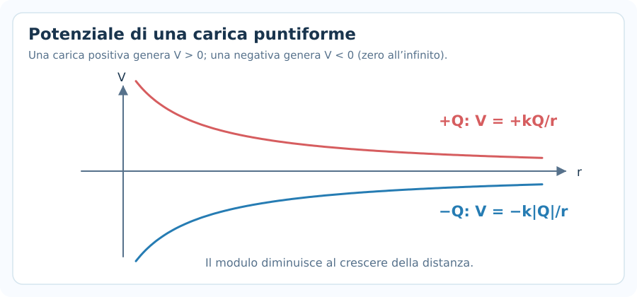
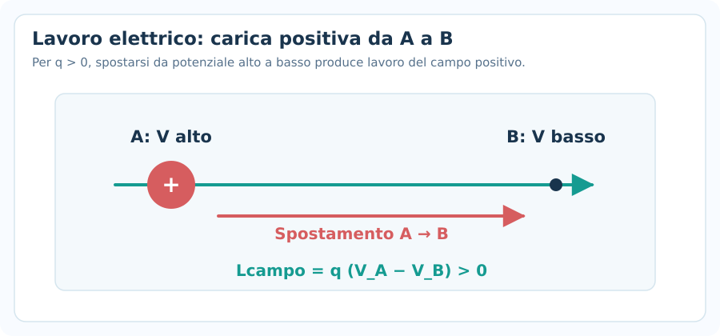
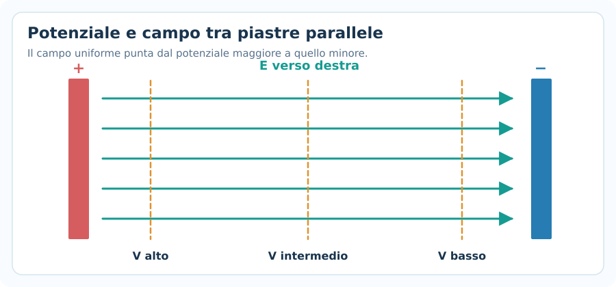
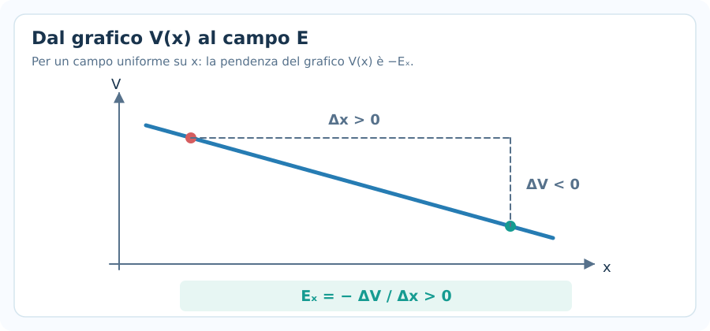
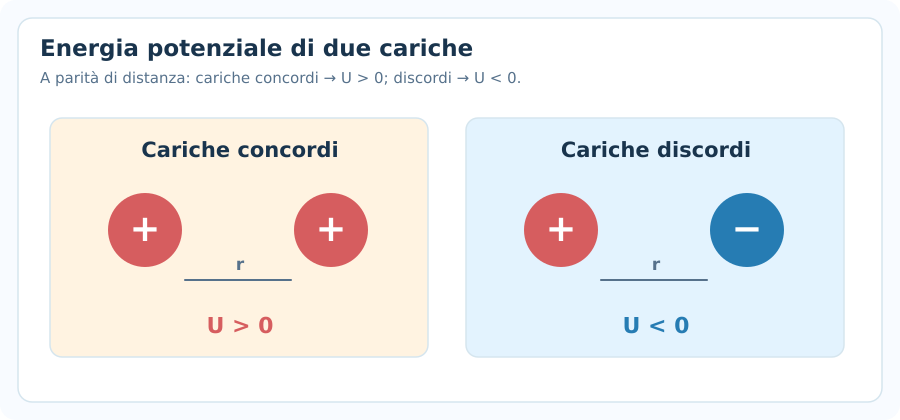
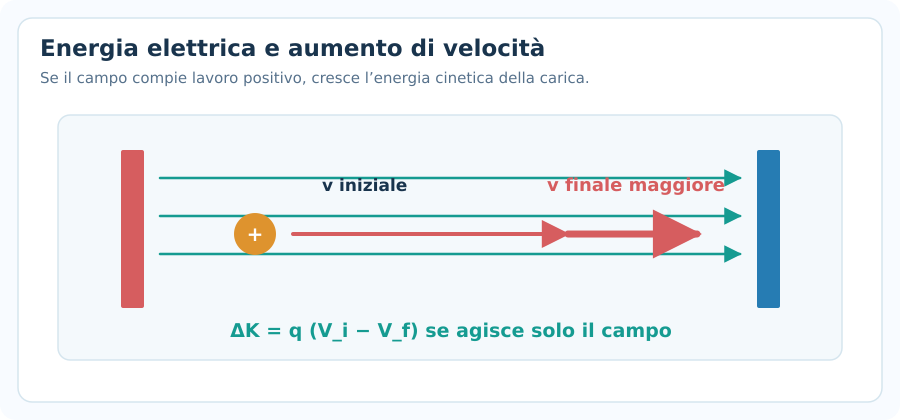
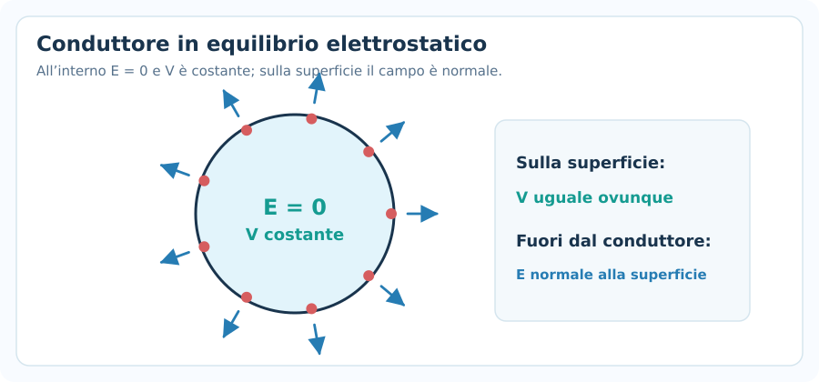

# Potenziale elettrico ed energia potenziale

> **Fisica — Informatica UPO · Elettromagnetismo · Nota 03**  
> **Prerequisiti:** legge di Coulomb, campo elettrico, lavoro ed energia meccanica.  
> **Obiettivo:** calcolare potenziali e differenze di potenziale, determinare il lavoro del campo elettrico e risolvere problemi energetici con cariche puntiformi e campi uniformi.

## 1. Perché introdurre il potenziale elettrico?

Nella nota precedente abbiamo studiato il **campo elettrico** $\vec E$, che consente di calcolare la forza su una carica:

$$
\vec F=q\vec E
$$

Il **potenziale elettrico** $V$ descrive invece l'energia potenziale elettrica **per unità di carica**. È una grandezza **scalare**, non un vettore.

Questo è il vantaggio principale: quando più cariche generano un potenziale, i loro contributi si **sommano algebricamente**, senza scomporli lungo gli assi.

> [!important] Da ricordare
> Il **campo elettrico** è un vettore e determina una forza. Il **potenziale elettrico** è uno scalare e permette di studiare lavoro ed energia.

---

## 2. Energia potenziale elettrica

La forza elettrostatica è **conservativa**: il lavoro compiuto dal campo dipende soltanto dalle posizioni iniziale e finale, non dal percorso seguito.

Associamo quindi al sistema una **energia potenziale elettrica** $U$, misurata in joule ($\mathrm{J}$).

Tra due posizioni $A$ e $B$:

$$
\boxed{L_{\mathrm{campo},A\to B}=U_A-U_B=-\Delta U}
$$

con:

$$
\boxed{\Delta U=U_B-U_A}
$$

Se il campo elettrico compie lavoro positivo, l'energia potenziale diminuisce; se compie lavoro negativo, aumenta.

### Analogia con la gravità

In meccanica hai già utilizzato $U_g=mgh$ e la relazione $L_g=-\Delta U_g$. Il ragionamento è identico: un campo conservativo può trasformare energia potenziale in cinetica.

**Attenzione:** non confondere energia potenziale $U$ con il potenziale elettrico $V$. Il primo si misura in joule, il secondo in volt.

---

## 3. Definizione di potenziale elettrico

Fissato un riferimento per l'energia potenziale, il potenziale elettrico in un punto è:

$$
\boxed{V=\frac{U}{q}}
$$

Dove $q\ne0$ è la carica che, posta in quel punto, possiede energia potenziale $U$. Equivalentemente:

$$
\boxed{U=qV}
$$

**Il potenziale $V$ è una proprietà delle cariche sorgenti**, mentre l'energia potenziale $U$ dipende anche dalla carica $q$ che viene posta nel campo.

L'unità di misura nel Sistema Internazionale è il **volt**:

$$
\boxed{1\ \mathrm{V}=1\ \mathrm{J/C}}
$$

Quindi:

- $V$ si misura in $\mathrm{V}$ (volt);
- $U$ si misura in $\mathrm{J}$ (joule);
- $q$ si misura in $\mathrm{C}$ (coulomb).

### La scelta dello zero

L'energia potenziale e il potenziale sono definiti **a meno di una costante additiva**: per ottenere un valore numerico dobbiamo scegliere un riferimento. Spesso, per distribuzioni localizzate di cariche, si pone $V(\infty)=0$.

Negli esercizi, però, sono soprattutto le **differenze di potenziale** a determinare il lavoro delle forze elettriche.

---

## 4. Potenziale di una carica puntiforme

Una carica puntiforme sorgente $Q$ genera, nel vuoto, a distanza $r$ il potenziale:

$$
\boxed{V(r)=k\frac{Q}{r}}
$$

Dove:

- $k=8{,}99\cdot10^9\ \mathrm{N\,m^2/C^2}$;
- $Q$ è la carica sorgente **con il suo segno**;
- $r>0$ è la distanza dalla sorgente;
- abbiamo scelto $V(\infty)=0$.

### Segno del potenziale

- Se $Q>0$, il potenziale è positivo.
- Se $Q<0$, il potenziale è negativo.

Il potenziale di una carica puntiforme varia come $1/r$, mentre il **modulo del campo** varia come $1/r^2$:

$$
\boxed{V\propto\frac1r\qquad E\propto\frac1{r^2}}
$$

**Se raddoppi la distanza**, il potenziale si dimezza; il campo diventa un quarto.

### Esempio svolto 1 — Potenziale a una data distanza

Una carica $Q=+4{,}0\ \mathrm{\mu C}$ si trova nel vuoto. Calcola il potenziale a $r=0{,}20\ \mathrm{m}$.

Converti:

$$
Q=4{,}0\cdot10^{-6}\ \mathrm{C}
$$

Applica la formula:

$$
V=8{,}99\cdot10^9\frac{4{,}0\cdot10^{-6}}{0{,}20}
$$

$$
\boxed{V\approx1{,}80\cdot10^5\ \mathrm{V}}
$$

Il risultato è **positivo** perché la carica sorgente è positiva.

---

## 5. Differenza di potenziale

La **differenza di potenziale** tra i punti $A$ e $B$ si definisce:

$$
\boxed{\Delta V=V_B-V_A}
$$

Poiché $U=qV$, se la carica $q$ è costante:

$$
\boxed{\Delta U=q\Delta V=q(V_B-V_A)}
$$

Dalla relazione $L_{\mathrm{campo}}=-\Delta U$:

$$
\boxed{L_{\mathrm{campo},A\to B}=q(V_A-V_B)}
$$

### Interpretazione dei segni

Una carica **positiva** tende ad accelerare spontaneamente verso potenziali minori (se agisce soltanto il campo elettrico).

Una carica **negativa** tende invece ad accelerare verso potenziali maggiori, perché per $q<0$ la forza è opposta a $\vec E$.

La direzione del moto effettivo dipende comunque anche dalla velocità iniziale e dalle altre forze.

### Esempio svolto 2 — Lavoro del campo

Una carica $q=+2{,}0\ \mathrm{nC}$ si sposta da un punto con $V_A=1200\ \mathrm{V}$ a un punto con $V_B=200\ \mathrm{V}$.

$$
q=2{,}0\cdot10^{-9}\ \mathrm{C}
$$

$$
\Delta V=200-1200=-1000\ \mathrm{V}
$$

$$
\Delta U=q\Delta V=(2{,}0\cdot10^{-9})(-1000)
$$

$$
\boxed{\Delta U=-2{,}0\cdot10^{-6}\ \mathrm{J}}
$$

$$
\boxed{L_{\mathrm{campo}}=+2{,}0\cdot10^{-6}\ \mathrm{J}}
$$

**Controllo:** il campo ha compiuto lavoro positivo, dunque l'energia potenziale è diminuita.

---

## 6. Superfici equipotenziali

Una **superficie equipotenziale** è un insieme di punti con lo stesso valore di potenziale elettrico:

$$
\boxed{V_A=V_B\quad\Rightarrow\quad\Delta V=0}
$$

Ne consegue che, per lo spostamento di una carica tra due punti equipotenziali:

$$
\boxed{L_{\mathrm{campo}}=-q\Delta V=0}
$$

In elettrostatica, le superfici equipotenziali sono **perpendicolari alle linee di campo** nei punti in cui $\vec E\ne0$.

Per una carica puntiforme le superfici equipotenziali sono **sfere concentriche**; in un disegno piano le rappresentiamo con cerchi.

### Attenzione

Lo spostamento lungo un'equipotenziale non cambia l'energia potenziale elettrica, ma una particella **non è obbligata** a muoversi lungo le linee di campo o lungo le equipotenziali.

---

## 7. Relazione tra campo elettrico e potenziale

Il campo elettrico punta, in ogni punto in cui è non nullo, nella direzione di **massima diminuzione del potenziale**.

In forma generale:

$$
\boxed{\vec E=-\vec\nabla V}
$$

In una sola dimensione:

$$
\boxed{E_x=-\frac{dV}{dx}}
$$

Non occorre padroneggiare le derivate per tutti gli esercizi introduttivi: è soprattutto importante ricordare il **segno meno**.

### Campo uniforme

Se $E_x$ è costante tra due punti posti lungo l'asse $x$:

$$
\boxed{V_B-V_A=-E_x(x_B-x_A)}
$$

Ovvero:

$$
\boxed{\Delta V=-E_x\Delta x}
$$

Se ci spostiamo **nel verso del campo** per una distanza $d$:

$$
\boxed{V_B=V_A-Ed}
$$

In modulo:

$$
\boxed{E=\frac{|\Delta V|}{d}}
$$

**Questa ultima formula vale quando il campo è uniforme e $d$ è la distanza lungo la sua direzione.** Non va applicata automaticamente al campo di una carica puntiforme.

### Esempio svolto 3 — Campo fra piastre

Due piastre parallele distano $d=0{,}020\ \mathrm{m}$ e presentano una differenza di potenziale di modulo $600\ \mathrm{V}$.

Trascurando gli effetti ai bordi:

$$
E=\frac{600}{0{,}020}
$$

$$
\boxed{E=3{,}0\cdot10^4\ \mathrm{V/m}}
$$

Il campo punta dalla piastra a **potenziale maggiore** a quella a **potenziale minore**.

### Unità di misura del campo

Le due unità sono equivalenti:

$$
\boxed{1\ \mathrm{N/C}=1\ \mathrm{V/m}}
$$

---

## 8. Potenziale generato da più cariche

Il principio di sovrapposizione vale anche per il potenziale.

Se nel vuoto sono presenti più cariche puntiformi $Q_1,Q_2,\dots$, il potenziale totale nel punto $P$ è:

$$
\boxed{V(P)=k\sum_i\frac{Q_i}{r_i}}
$$

Dove $r_i$ è la distanza tra la carica $Q_i$ e il punto $P$, e si assume zero del potenziale all'infinito.

**Le cariche vanno inserite con il segno.** A differenza del campo, i potenziali si sommano come numeri, non come vettori.

### Esempio svolto 4 — Due cariche

Nel vuoto, una carica $Q_1=+2{,}0\ \mathrm{\mu C}$ dista $0{,}30\ \mathrm{m}$ da $P$, mentre $Q_2=-1{,}0\ \mathrm{\mu C}$ dista $0{,}15\ \mathrm{m}$ da $P$.

$$
V(P)=8{,}99\cdot10^9\left(\frac{2{,}0\cdot10^{-6}}{0{,}30}+\frac{-1{,}0\cdot10^{-6}}{0{,}15}\right)
$$

Le due frazioni sono opposte, quindi:

$$
\boxed{V(P)=0\ \mathrm{V}}
$$

> [!warning] Errore frequente
> **Potenziale nullo non significa campo nullo.** Il potenziale è uno scalare e può annullarsi anche dove i contributi vettoriali al campo non si compensano.

---

## 9. Energia potenziale elettrica di due cariche

Per due cariche puntiformi $q_1$ e $q_2$ nel vuoto, separate da una distanza $r$, scegliendo l'energia nulla a distanza infinita:

$$
\boxed{U=k\frac{q_1q_2}{r}}
$$

**Le due cariche conservano il segno nella formula.**

- Cariche dello **stesso segno**: $U>0$.
- Cariche di **segno opposto**: $U<0$.

La differenza $\Delta U$ resta la grandezza utile per calcolare il lavoro durante un avvicinamento o un allontanamento.

### Esempio svolto 5 — Energia di due cariche

Due cariche $q_1=+2{,}0\ \mathrm{\mu C}$ e $q_2=-3{,}0\ \mathrm{\mu C}$ sono a distanza $r=0{,}20\ \mathrm{m}$.

$$
U=8{,}99\cdot10^9\frac{(2{,}0\cdot10^{-6})(-3{,}0\cdot10^{-6})}{0{,}20}
$$

$$
\boxed{U\approx-0{,}270\ \mathrm{J}}
$$

Il segno negativo è coerente con il fatto che le cariche **si attraggono**.

### Più di due cariche

Per una configurazione di cariche puntiformi:

$$
\boxed{U_{\mathrm{tot}}=k\sum_{i<j}\frac{q_iq_j}{r_{ij}}}
$$

Ogni coppia va contata **una sola volta**.

---

## 10. Conservazione dell'energia in elettrostatica

Se agisce solo la forza elettrica, che è conservativa:

$$
\boxed{K_i+U_i=K_f+U_f}
$$

Dunque:

$$
\boxed{\Delta K=-\Delta U=L_{\mathrm{campo}}}
$$

Usando il potenziale:

$$
\boxed{\frac12mv_f^2-\frac12mv_i^2=q(V_i-V_f)}
$$

Per una particella che parte **da ferma**, se il lavoro del campo è positivo:

$$
\boxed{v_f=\sqrt{\frac{2q(V_i-V_f)}{m}}}
$$

**Attenzione:** sotto radice deve esserci una quantità non negativa. Per una carica negativa può essere $V_f>V_i$, quindi il prodotto $q(V_i-V_f)$ resta positivo.

### Esempio svolto 6 — Particella positiva accelerata

Una particella di massa $m=2{,}0\cdot10^{-6}\ \mathrm{kg}$ e carica $q=+1{,}0\ \mathrm{\mu C}$ parte da ferma e attraversa una differenza di potenziale da $V_i=500\ \mathrm{V}$ a $V_f=100\ \mathrm{V}$. Trascuriamo altre forze.

$$
\Delta K=q(V_i-V_f)=10^{-6}(500-100)=4{,}0\cdot10^{-4}\ \mathrm{J}
$$

$$
\frac12mv_f^2=4{,}0\cdot10^{-4}
$$

$$
\boxed{v_f=20\ \mathrm{m/s}}
$$

---

## 11. Elettronvolt: unità di energia

L'**elettronvolt** ($\mathrm{eV}$) è un'unità di **energia**, non di potenziale.

Per definizione:

$$
\boxed{1\ \mathrm{eV}=1{,}602\cdot10^{-19}\ \mathrm{J}}
$$

È l'energia pari al **modulo** della variazione di energia potenziale di una carica elementare quando attraversa una differenza di potenziale di $1\ \mathrm{V}$.

Valori utili:

$$
\boxed{e=1{,}602\cdot10^{-19}\ \mathrm{C}}
$$

$$
\boxed{m_e=9{,}11\cdot10^{-31}\ \mathrm{kg}}
$$

### Esempio svolto 7 — Energia di un elettrone

Un elettrone parte da fermo ed è accelerato da un campo elettrico attraverso una differenza di potenziale di **modulo** $250\ \mathrm{V}$, nel verso in cui il campo compie lavoro positivo.

Il guadagno di energia cinetica è:

$$
\Delta K=e\cdot250=250\ \mathrm{eV}
$$

In joule:

$$
\Delta K=250\cdot1{,}602\cdot10^{-19}
$$

$$
\boxed{\Delta K\approx4{,}01\cdot10^{-17}\ \mathrm{J}}
$$

Se trascuriamo effetti relativistici:

$$
v_f=\sqrt{\frac{2\Delta K}{m_e}}\approx\boxed{9{,}38\cdot10^6\ \mathrm{m/s}}
$$

---

## 12. Conduttori in equilibrio elettrostatico

Un **conduttore** in equilibrio elettrostatico presenta queste proprietà:

- Il campo elettrico all'interno del materiale conduttore è nullo: $\vec E=0$.
- Il potenziale è **costante** in tutto il conduttore (materiale e superficie).
- Il campo elettrico appena all'esterno, se presente, è **perpendicolare** alla superficie.
- In un conduttore isolato senza cariche nelle cavità, la carica libera in eccesso risiede sulla superficie esterna.

### Sfera conduttrice carica

Per una sfera conduttrice isolata di raggio $R$, con carica totale $Q$ e riferimento $V(\infty)=0$:

$$
\boxed{V(r)=\begin{cases}
k\dfrac{Q}{R}, & r\le R \\
k\dfrac{Q}{r}, & r\ge R
\end{cases}}
$$

Il potenziale è continuo sulla superficie $r=R$. Il campo **nel materiale conduttore** è nullo.

### Collegamento con Gauss

Nella nota precedente abbiamo imparato a trovare il campo di una sfera usando Gauss. Qui vediamo che, dove $E=0$, il potenziale non varia: è **costante**, non necessariamente zero.

---

## 13. Lavoro del campo e lavoro di una forza esterna

Per una trasformazione lenta, senza cambiamenti di energia cinetica, una forza esterna che sposta la carica contro o a favore del campo deve compiere lavoro opposto al lavoro elettrico:

$$
\boxed{L_{\mathrm{est}}=-L_{\mathrm{campo}}=\Delta U}
$$

Questa uguaglianza richiede che, nel bilancio, non ci siano altre forze che compiono lavoro e che $\Delta K=0$.

Non confondere quindi:

| Quantità | Formula |
|---|---|
| Lavoro della forza elettrica | $L_{\mathrm{campo}}=-\Delta U=q(V_A-V_B)$ |
| Variazione di energia potenziale | $\Delta U=q(V_B-V_A)$ |
| Lavoro esterno quasi statico | $L_{\mathrm{est}}=\Delta U$ |

### Esempio

Una carica positiva è spostata lentamente da un punto a potenziale minore a uno a potenziale maggiore. In tal caso $\Delta U>0$: il lavoro del campo è negativo, mentre l'agente esterno compie lavoro positivo.

---

## 14. Come riconoscere la formula giusta all'esame

| Se l'esercizio chiede... | Parti da... |
|---|---|
| Potenziale prodotto da una carica | $V=kQ/r$ |
| Potenziale prodotto da più cariche | $V=k\sum_i Q_i/r_i$ |
| Energia potenziale di una carica $q$ nel campo | $U=qV$ |
| Energia di due cariche puntiformi | $U=kq_1q_2/r$ |
| Differenza di potenziale | $\Delta V=V_B-V_A$ |
| Lavoro della forza elettrica | $L=q(V_A-V_B)$ |
| Cambio di energia potenziale | $\Delta U=q\Delta V$ |
| Campo uniforme fra piastre | $E=|\Delta V|/d$ |
| Velocità dopo un'accelerazione elettrica | $\Delta K=q(V_i-V_f)$ |
| Energia in elettronvolt | $E(\mathrm{J})=E(\mathrm{eV})\cdot1{,}602\cdot10^{-19}$ |
| Superficie equipotenziale | $\Delta V=0\Rightarrow L_{\mathrm{campo}}=0$ |
| Potenziale della sfera conduttrice | $kQ/R$ dentro, $kQ/r$ fuori |

---

## 15. Metodo meccanico per gli esercizi

**1. Identifica la richiesta.** Ti chiedono forza, campo, potenziale, lavoro, energia o velocità? Non sono la stessa cosa.

**2. Disegna sorgenti e punti.** Se compaiono più cariche, scrivi accanto a ciascuna il segno e la distanza dal punto di osservazione.

**3. Scegli la relazione.** Per trovare $V$ somma contributi scalari; per trovare $\vec E$ somma vettori; per il lavoro usa $q(V_A-V_B)$.

**4. Scegli chiaramente gli stati.** Annota $A$ come iniziale e $B$ come finale. Scrivi sempre $\Delta V=V_B-V_A$ e $\Delta U=U_B-U_A$ prima di sostituire.

**5. Converti le unità.** $\mathrm{\mu C}=10^{-6}\ \mathrm C$, $\mathrm{nC}=10^{-9}\ \mathrm C$, $\mathrm{cm}=10^{-2}\ \mathrm m$.

**6. Controlla segni e risultato.** Per una carica positiva che si muove nel verso del campo, $V$ diminuisce e il campo compie lavoro positivo.

**7. Controlla l'unità finale.** Potenziale in volt; lavoro ed energia in joule; campo in $\mathrm{N/C}$ o $\mathrm{V/m}$.

---

## 16. Errori frequenti

### Confondere $V$ e $U$

$V$ è il potenziale in volt. $U$ è l'energia potenziale in joule. Sono legati da $U=qV$.

### Dimenticare il segno della carica

Nelle formule $V=kQ/r$ e $\Delta U=q\Delta V$ le cariche vanno inserite **con il segno**.

### Credere che il campo sia nullo quando $V=0$

Il potenziale può annullarsi per cancellazione algebrica anche dove il campo non è nullo.

### Usare sempre $E=V/d$

Questa espressione non è generale: per il campo uniforme si usa il **modulo della differenza di potenziale** diviso la distanza **lungo il campo**.

### Scambiare lavoro ed energia potenziale

$$
\boxed{L_{\mathrm{campo}}=-\Delta U}
$$

Hanno segni opposti per una forza conservativa.

### Ritenere il potenziale positivo per definizione

Il potenziale è uno scalare **con segno** e il suo valore dipende dal riferimento scelto.

### Usare $V=kQ/r$ senza scegliere il riferimento

Questa espressione assume che il potenziale di una carica puntiforme isolata sia zero all'infinito.

---

## 17. Formulario essenziale

### Potenziale di una carica puntiforme

$$
\boxed{V=k\frac{Q}{r}}
$$

### Sovrapposizione

$$
\boxed{V(P)=k\sum_i\frac{Q_i}{r_i}}
$$

### Energia potenziale

$$
\boxed{U=qV\qquad U_{12}=k\frac{q_1q_2}{r}}
$$

### Differenza di potenziale e lavoro

$$
\boxed{\Delta V=V_B-V_A}
$$

$$
\boxed{\Delta U=q\Delta V\qquad L_{\mathrm{campo}}=-\Delta U}
$$

### Campo uniforme

$$
\boxed{\Delta V=-E_x\Delta x}
$$

### Conservazione dell'energia meccanica

$$
\boxed{\Delta K=q(V_i-V_f)}
$$

### Elettronvolt

$$
\boxed{1\ \mathrm{eV}=1{,}602\cdot10^{-19}\ \mathrm{J}}
$$

---

## 18. Verifica della comprensione

1. Una carica $Q<0$ genera un potenziale positivo o negativo, scegliendo $V(\infty)=0$?
2. Se raddoppia la distanza da una carica puntiforme, come cambiano $V$ ed $E$?
3. Due cariche generano potenziali uguali e opposti in un punto: il campo deve essere zero?
4. Qual è il lavoro del campo per spostare una carica su una superficie equipotenziale?
5. Una carica positiva si sposta spontaneamente verso un potenziale maggiore o minore, se parte da ferma e agisce solo il campo?
6. Per un elettrone accelerato, qual è il rapporto tra il segno di $\Delta V$ e quello di $\Delta K$?
7. Due piastre distano $3\ \mathrm{cm}$ e hanno $|\Delta V|=900\ \mathrm{V}$. Quanto vale il modulo del campo uniforme?
8. Un conduttore isolato in equilibrio ha $\vec E=0$ nel materiale: il suo potenziale è necessariamente zero?
9. Perché il lavoro del campo è $-\Delta U$ e non $+\Delta U$?
10. Quale grandezza è espressa in elettronvolt: potenziale, campo o energia?

**Obiettivo:** distinguere senza esitazioni campo, potenziale, energia potenziale e lavoro, e saper passare dall'uno all'altro con attenzione ai segni.
