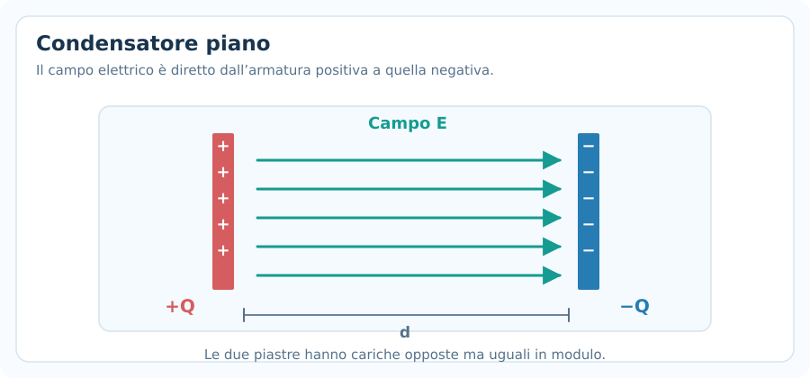
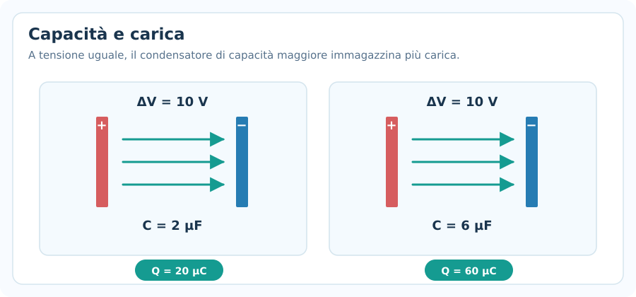
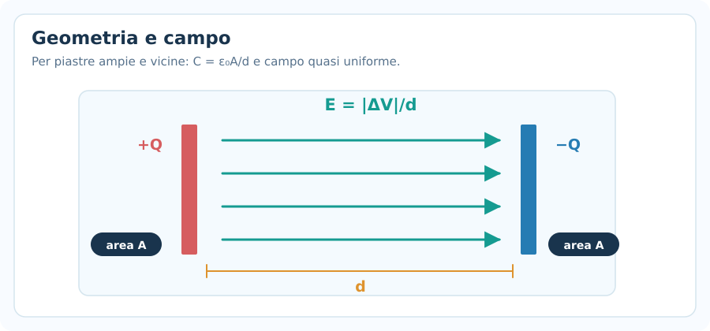
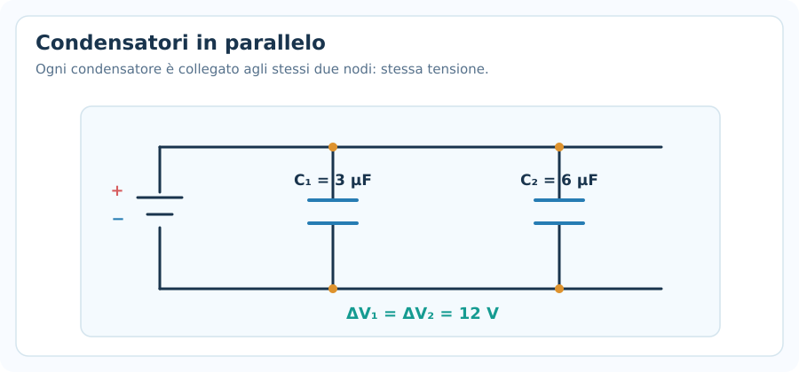
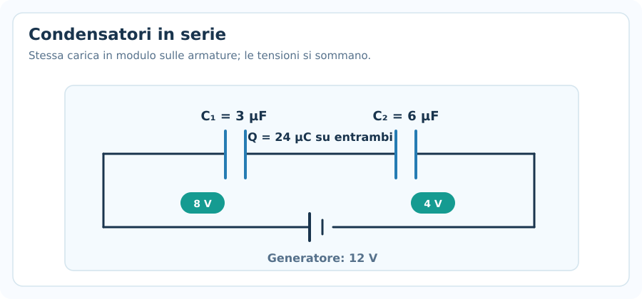
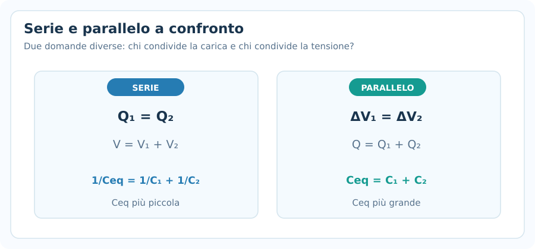
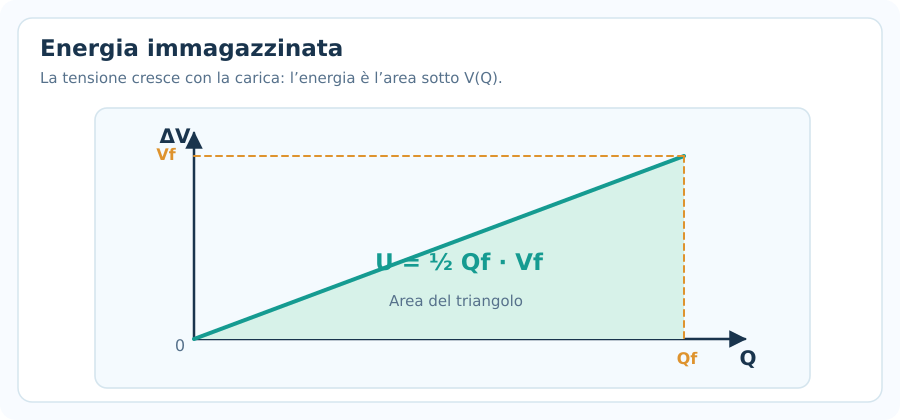
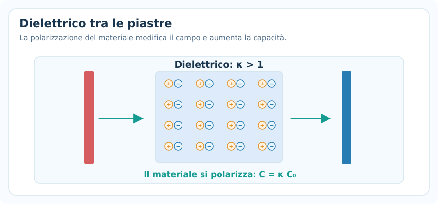
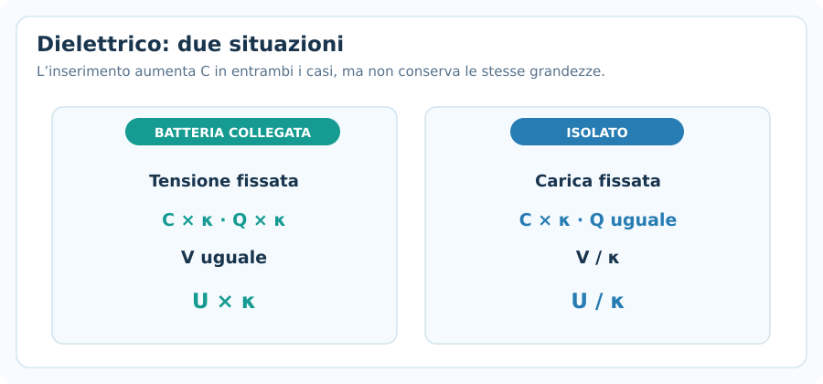
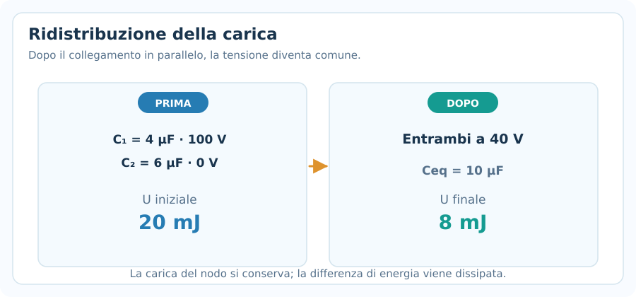

# Condensatori ed energia elettrostatica

> **Fisica — Informatica UPO · Elettromagnetismo · Nota 04**  
> **Prerequisiti:** cariche elettriche, campo elettrico, potenziale e differenza di potenziale, conservazione dell'energia.  
> **Obiettivo:** riconoscere le proprietà di un condensatore, calcolarne la capacità e l'energia, analizzare collegamenti in serie/parallelo e distinguere i problemi con dielettrico a batteria collegata o scollegata.

## 1. Che cos'è un condensatore?

Un **condensatore** è un componente capace di immagazzinare **carica elettrica separata** ed **energia elettrostatica**. Un modello comune è il **condensatore piano**, costituito da due piastre conduttrici affacciate, separate da aria, vuoto o da un materiale isolante (**dielettrico**).

Quando si collega il condensatore a un generatore, sulle armature si accumulano cariche di uguale modulo e segno opposto:

- Armatura positiva: $+Q$.
- Armatura negativa: $-Q$.
- Carica netta del condensatore ideale: $+Q-Q=0$.

Nel seguito **$Q$ indica il modulo della carica di una singola armatura** (non la somma dei moduli delle due cariche).

> [!important] Concetto fisico
> Il condensatore non crea carica: **separa** cariche positive e negative. L'energia è associata al campo elettrico tra le armature.

---

## 2. Capacità elettrica

La **capacità elettrica** $C$ descrive quanta carica può essere accumulata per ogni unità di differenza di potenziale tra le armature:

$$
\boxed{C=\frac{Q}{|\Delta V|}}
$$

Dove:

- $C$: capacità, in **farad** ($\mathrm{F}$).
- $Q$: modulo della carica presente su un'armatura, in coulomb ($\mathrm{C}$).
- $|\Delta V|$: modulo della differenza di potenziale tra le armature, in volt ($\mathrm{V}$).

Le formule inverse sono:

$$
\boxed{Q=C|\Delta V|} \qquad
\boxed{|\Delta V|=\frac{Q}{C}}
$$

Nel condensatore lineare ideale, $C$ dipende dalla **geometria** e dal **materiale tra le piastre**; non dipende dalla carica o dalla tensione applicata, finché si resta nel modello lineare.

### Unità di misura e prefissi

$$
\boxed{1\ \mathrm{F}=1\ \mathrm{C/V}}
$$

| Prefisso | Equivalenza |
|---|---|
| millifarad | $1\ \mathrm{mF}=10^{-3}\ \mathrm{F}$ |
| microfarad | $1\ \mu\mathrm{F}=10^{-6}\ \mathrm{F}$ |
| nanofarad | $1\ \mathrm{nF}=10^{-9}\ \mathrm{F}$ |
| picofarad | $1\ \mathrm{pF}=10^{-12}\ \mathrm{F}$ |

**Esempio.** Un condensatore da $5\ \mu\mathrm{F}$ è sottoposto a una differenza di potenziale di $12\ \mathrm{V}$. Quanto vale la carica su ciascuna armatura (in modulo)?

$$
Q=C|\Delta V|=(5\cdot10^{-6})(12)=6\cdot10^{-5}\ \mathrm{C}
$$

$$
\boxed{Q=60\ \mu\mathrm{C}}
$$

---

## 3. Condensatore piano nel vuoto

Per due piastre parallele, di area $A$ e separate da una distanza $d$ piccola rispetto alle loro dimensioni (così possiamo trascurare gli **effetti di bordo**):

$$
\boxed{C_0=\varepsilon_0\frac{A}{d}}
$$

Dove:

- $A$: area di **una** piastra, in $\mathrm{m^2}$.
- $d$: distanza fra le piastre, in $\mathrm{m}$.
- $\varepsilon_0\simeq8{,}854\cdot10^{-12}\ \mathrm{F/m}$: permittività elettrica del vuoto.

### Dipendenze meccaniche

- Se $A$ **raddoppia**, la capacità **raddoppia**.
- Se $d$ **raddoppia**, la capacità **si dimezza**.
- Se $A$ e $d$ raddoppiano insieme, la capacità **non cambia**.

Il campo elettrico fra piastre ideali, se uniforme, soddisfa:

$$
\boxed{E=\frac{|\Delta V|}{d}}
$$

E, in vuoto, il campo generato dalle cariche (trascurando i bordi) è:

$$
\boxed{E=\frac{Q}{\varepsilon_0 A}}
$$

Queste relazioni sono coerenti perché $Q=C_0|\Delta V|$.

### Esempio completo

Un condensatore piano nel vuoto ha:

$$
A=0{,}020\ \mathrm{m^2},\quad d=1{,}0\ \mathrm{mm},\quad |\Delta V|=100\ \mathrm{V}
$$

1. **Convertire la distanza:** $d=1{,}0\cdot10^{-3}\ \mathrm{m}$.
2. **Capacità:**

$$
C_0=8{,}854\cdot10^{-12}\frac{0{,}020}{0{,}001}
\simeq1{,}77\cdot10^{-10}\ \mathrm{F}=177\ \mathrm{pF}
$$

3. **Carica su una piastra:**

$$
Q=C_0|\Delta V|\simeq1{,}77\cdot10^{-8}\ \mathrm{C}=17{,}7\ \mathrm{nC}
$$

4. **Campo elettrico:**

$$
E=\frac{100}{0{,}001}=\boxed{1{,}0\cdot10^5\ \mathrm{V/m}}
$$

---

## 4. Condensatori in parallelo

Due o più condensatori sono **in parallelo** quando ogni condensatore è collegato agli **stessi due nodi** del circuito.

Questo impone la stessa differenza di potenziale ai loro capi:

$$
\boxed{\Delta V_1=\Delta V_2=\cdots=\Delta V}
$$

Le cariche sui condensatori invece possono essere differenti:

$$
Q_1=C_1|\Delta V|,\qquad Q_2=C_2|\Delta V|
$$

La carica totale fornita al gruppo, intesa come somma dei moduli sulle armature positive, è:

$$
Q_{\mathrm{tot}}=Q_1+Q_2+\cdots
$$

Perciò:

$$
\boxed{C_{\mathrm{eq,par}}=C_1+C_2+\cdots+C_n}
$$

### Esempio

$C_1=3\ \mu\mathrm{F}$ e $C_2=6\ \mu\mathrm{F}$ sono collegati **in parallelo** a $12\ \mathrm{V}$.

$$
C_{\mathrm{eq}}=3+6=\boxed{9\ \mu\mathrm{F}}
$$

$$
Q_1=3\cdot12=36\ \mu\mathrm{C},\qquad Q_2=6\cdot12=72\ \mu\mathrm{C}
$$

$$
\boxed{Q_{\mathrm{tot}}=108\ \mu\mathrm{C}}
$$

> [!important] Riconoscimento rapido
> **Parallelo:** tensione uguale, cariche generalmente diverse, capacità equivalente **maggiore** di ciascuna delle capacità singole.

---

## 5. Condensatori in serie

Due o più condensatori sono **in serie** quando sono collegati uno dopo l'altro, senza ramificazioni nei nodi intermedi, e i conduttori intermedi sono inizialmente neutri e isolati dall'esterno.

In questa configurazione, i moduli delle cariche sono uguali:

$$
\boxed{Q_1=Q_2=\cdots=Q}
$$

La tensione complessiva è la somma delle cadute di potenziale orientate in modo coerente:

$$
|\Delta V|=|\Delta V_1|+|\Delta V_2|+\cdots
$$

Poiché $|\Delta V_i|=Q/C_i$:

$$
\boxed{\frac{1}{C_{\mathrm{eq,serie}}}=\frac{1}{C_1}+\frac{1}{C_2}+\cdots+\frac{1}{C_n}}
$$

Per due condensatori si può usare direttamente:

$$
\boxed{C_{\mathrm{eq,serie}}=\frac{C_1C_2}{C_1+C_2}}
$$

### Esempio

Due condensatori $C_1=3\ \mu\mathrm{F}$ e $C_2=6\ \mu\mathrm{F}$ sono in **serie** e collegati a $12\ \mathrm{V}$.

**1. Capacità equivalente**

$$
C_{\mathrm{eq}}=\frac{3\cdot6}{3+6}=\boxed{2\ \mu\mathrm{F}}
$$

**2. Carica su ciascuno**

$$
Q=C_{\mathrm{eq}}|\Delta V|=2\cdot12=\boxed{24\ \mu\mathrm{C}}
$$

**3. Tensione sui singoli condensatori**

$$
|\Delta V_1|=\frac{24}{3}=\boxed{8\ \mathrm{V}}
$$

$$
|\Delta V_2|=\frac{24}{6}=\boxed{4\ \mathrm{V}}
$$

**Controllo:** $8+4=12\ \mathrm{V}$.

> [!warning] Errore frequente
> **In serie** è la **carica** a essere uguale (nel caso standard), **non la tensione**. La capacità equivalente in serie è minore di ciascuna capacità positiva del gruppo.

---

## 6. Riepilogo: serie e parallelo

| Proprietà | Serie | Parallelo |
|---|---|---|
| Grandezza uguale | $Q$ | $|\Delta V|$ |
| Grandezza che si somma | Tensioni | Cariche |
| Capacità equivalente | $1/C_{\mathrm{eq}}=\sum 1/C_i$ | $C_{\mathrm{eq}}=\sum C_i$ |
| Verifica intuitiva | $C_{\mathrm{eq}}<\min C_i$ | $C_{\mathrm{eq}}>\max C_i$ |

### Metodo meccanico per una rete di condensatori

1. Identifica i **nodi** e i gruppi davvero in serie o in parallelo.
2. Calcola le capacità equivalenti, partendo dai gruppi più interni.
3. Trova la **carica** o la **tensione** del gruppo equivalente.
4. Torna indietro: in **serie** trasporta la carica, in **parallelo** trasporta la tensione.
5. Controlla che le cariche/tensioni soddisfino le relazioni di partenza.

**Attenzione:** non tutti i circuiti si riducono a semplici blocchi di serie/parallelo; la presenza di ponti richiede un'analisi dei nodi più accurata.

---

## 7. Energia immagazzinata

Un condensatore carico contiene energia elettrostatica $U$.

Per un condensatore lineare ideale, in condizioni quasi statiche:

$$
\boxed{U=\frac12Q|\Delta V|}
$$

Utilizzando $Q=C|\Delta V|$, otteniamo tre forme **equivalenti**:

$$
\boxed{U=\frac12C(\Delta V)^2=\frac{Q^2}{2C}=\frac12Q|\Delta V|}
$$

- $U$ si misura in **joule** ($\mathrm{J}$).
- È una grandezza **non negativa** nel modello ideale, se poniamo $U=0$ a condensatore scarico.
- La formula **non è** $U=Q\Delta V$: manca il fattore $1/2$.

### Perché compare $1/2$?

Durante la carica, la tensione del condensatore parte da zero e cresce fino al valore finale. Il lavoro reversibile necessario è:

$$
U=\int_0^Q\frac{q}{C}\,dq=\frac{Q^2}{2C}
$$

Equivalentemente, $U$ è **l'area sotto la retta** $\Delta V=Q/C$ nel grafico tensione–carica.

### Esempio

Un condensatore da $10\ \mu\mathrm{F}$ è caricato a $12\ \mathrm{V}$.

$$
U=\frac12C(\Delta V)^2=\frac12(10\cdot10^{-6})(12)^2
$$

$$
\boxed{U=7{,}2\cdot10^{-4}\ \mathrm{J}=720\ \mu\mathrm{J}}
$$

### Energia del condensatore piano

Sostituendo $C=\varepsilon A/d$ ed $E=|\Delta V|/d$:

$$
U=\frac12\varepsilon E^2(Ad)
$$

Poiché $Ad$ è il volume tra le piastre, la **densità di energia** in un mezzo lineare uniforme è:

$$
\boxed{u=\frac{U}{Ad}=\frac12\varepsilon E^2}
$$

---

## 8. Dielettrici

Un **dielettrico** è un materiale isolante che si **polarizza** quando viene posto in un campo elettrico. I dipoli elettrici microscopici orientati o indotti modificano il campo e il comportamento del condensatore.

Un dielettrico lineare omogeneo che riempia tutto lo spazio tra le piastre è descritto dalla costante dielettrica relativa $\kappa$ (o $\varepsilon_r$):

$$
\boxed{\varepsilon=\kappa\varepsilon_0}
$$

Per il condensatore piano:

$$
\boxed{C=\kappa\varepsilon_0\frac{A}{d}=\kappa C_0}
$$

Con $\kappa>1$, la **capacità aumenta**.

> [!important] Cosa rimane costante?
> Non basta dire “inserisco un dielettrico”: bisogna sapere **se la batteria rimane collegata**. I risultati cambiano perché, nei due casi, cambia la grandezza vincolata.

---

## 9. Dielettrico: batteria collegata oppure scollegata?

Supponiamo di riempire completamente il condensatore con un dielettrico, aumentando la capacità da $C_0$ a $C'=\kappa C_0$, senza cambiare $A$ e $d$.

### Caso A — Batteria collegata: tensione costante

Il generatore mantiene $|\Delta V|$ **costante**.

$$
C'=\kappa C_0
$$

$$
Q'=C'|\Delta V|=\boxed{\kappa Q_0}
$$

$$
U'=\frac12C'(\Delta V)^2=\boxed{\kappa U_0}
$$

Il campo fra le piastre rimane $E=|\Delta V|/d$ nel modello di condensatore piano ideale.

La batteria può fornire carica ed energia aggiuntive al sistema.

### Caso B — Batteria scollegata: carica costante

Supponiamo che il condensatore sia stato caricato e poi isolato elettricamente: la carica libera sulle piastre resta **costante**.

$$
Q'=Q_0
$$

$$
|\Delta V|'=\frac{Q_0}{\kappa C_0}=\boxed{\frac{|\Delta V|_0}{\kappa}}
$$

$$
U'=\frac{Q_0^2}{2\kappa C_0}=\boxed{\frac{U_0}{\kappa}}
$$

Il campo si riduce a $E'=E_0/\kappa$, se la geometria non cambia.

### Tabella da imparare a riconoscere

| Grandezza | Batteria collegata | Condensatore isolato |
|---|---|---|
| Costante | $\Delta V$ | $Q$ |
| $C'$ | $\kappa C_0$ | $\kappa C_0$ |
| $Q'$ | $\kappa Q_0$ | $Q_0$ |
| $|\Delta V|'$ | $|\Delta V|_0$ | $|\Delta V|_0/\kappa$ |
| $U'$ | $\kappa U_0$ | $U_0/\kappa$ |

### Esempio

Un condensatore da $C_0=2\ \mu\mathrm{F}$ viene caricato a $12\ \mathrm{V}$. Inseriamo un dielettrico con $\kappa=3$.

Inizialmente:

$$
Q_0=24\ \mu\mathrm{C}, \qquad U_0=\frac12(2\cdot10^{-6})12^2=144\ \mu\mathrm{J}
$$

In entrambi i casi la nuova capacità è:

$$
C'=3\cdot2=\boxed{6\ \mu\mathrm{F}}
$$

**Se la batteria è collegata:** $|\Delta V|'=12\ \mathrm{V}$, $Q'=72\ \mu\mathrm{C}$, $U'=432\ \mu\mathrm{J}$.

**Se è scollegata:** $Q'=24\ \mu\mathrm{C}$, $|\Delta V|'=4\ \mathrm{V}$, $U'=48\ \mu\mathrm{J}$.

---

## 10. Condensatori inizialmente carichi collegati tra loro

Due condensatori possono essere collegati in parallelo **dopo essere stati caricati separatamente**. In questo caso non possiamo attribuire automaticamente a entrambi le tensioni iniziali: dopo il collegamento, la tensione comune si assesta.

Se si collegano **armature della stessa polarità**, il sistema è isolato e non vi sono apporti dall'esterno, la carica algebrica sul nodo positivo si conserva:

$$
Q_{\mathrm{tot,iniz}}=C_1V_1+C_2V_2
$$

$$
\boxed{V_f=\frac{C_1V_1+C_2V_2}{C_1+C_2}}
$$

Qui $V_1$ e $V_2$ sono **tensioni con segno riferite alla stessa orientazione dei terminali**. Per collegamenti con polarità opposte, i segni vanno adeguati.

### Esempio

Un condensatore da $4\ \mu\mathrm{F}$ è inizialmente a $100\ \mathrm{V}$, un secondo da $6\ \mu\mathrm{F}$ è scarico. Li colleghiamo in parallelo con le polarità concordi, senza generatore.

$$
V_f=\frac{(4)(100)+(6)(0)}{4+6}=\boxed{40\ \mathrm{V}}
$$

Energia prima:

$$
U_i=\tfrac12(4\cdot10^{-6})100^2=\boxed{0{,}020\ \mathrm{J}}
$$

Energia finale:

$$
U_f=\tfrac12(10\cdot10^{-6})40^2=\boxed{0{,}008\ \mathrm{J}}
$$

La differenza ($0{,}012\ \mathrm{J}$) non “sparisce”: durante la ridistribuzione della carica viene dissipata (ad esempio come calore), e può in parte essere emessa come radiazione nel modello reale. È quindi **la carica**, non l'energia elettrostatica del gruppo, a conservarsi nel bilancio appena utilizzato.

---

## 11. Capacità di una sfera conduttrice isolata (approfondimento)

Una sfera conduttrice isolata di raggio $R$, nel vuoto, ha potenziale (rispetto all'infinito):

$$
V=k\frac{Q}{R}=\frac{Q}{4\pi\varepsilon_0R}
$$

Da $C=Q/V$ segue:

$$
\boxed{C=4\pi\varepsilon_0R}
$$

La capacità cresce **linearmente** con il raggio. Questo è un risultato distinto dalla formula del condensatore piano; non bisogna mescolare le due geometrie.

---

## 12. Metodo meccanico per gli esercizi

1. **Riconosci la situazione:** condensatore singolo, piano, gruppo serie/parallelo, dielettrico oppure collegamento successivo di condensatori carichi.
2. **Scrivi i dati in SI:** $\mu\mathrm{F}\to10^{-6}\mathrm{F}$, $\mathrm{mm}\to10^{-3}\mathrm{m}$, $\mathrm{cm^2}\to10^{-4}\mathrm{m^2}$.
3. **Individua ciò che è costante:** in serie la carica (nel caso standard), in parallelo la tensione; con dielettrico batteria collegata $\Delta V$, scollegata $Q$.
4. **Calcola prima $C$ oppure $C_{\mathrm{eq}}$** se non è noto.
5. **Trova la grandezza base** con $Q=C|\Delta V|$.
6. **Calcola l'energia** con la forma più comoda: $U=\frac12C(\Delta V)^2$ oppure $U=Q^2/(2C)$.
7. **Controlla la coerenza:** in parallelo $C_{\mathrm{eq}}$ aumenta, in serie diminuisce; $U\ge0$; tensioni e cariche rispettano i vincoli.

---

## 13. Errori frequenti

### Errore 1 — Trattare la carica totale come $2Q$

Le piastre contengono $+Q$ e $-Q$: $Q$ nella formula $Q=C|\Delta V|$ è il **modulo su un'armatura**, non $2Q$.

### Errore 2 — Confondere serie e parallelo

- **Serie:** stessa carica, tensioni da sommare.
- **Parallelo:** stessa tensione, cariche da sommare.

### Errore 3 — Usare $U=C(\Delta V)^2$

Manca il fattore **$1/2$**:

$$
\boxed{U=\tfrac12 C(\Delta V)^2}
$$

### Errore 4 — Usare centimetri quadrati come se fossero metri quadrati

$$
1\ \mathrm{cm^2}=10^{-4}\ \mathrm{m^2}
$$

### Errore 5 — Non distinguere carica fissata e tensione fissata

Con un dielettrico $C$ cresce sempre nel modello lineare, ma **l'energia può crescere o diminuire** a seconda del vincolo esterno.

### Errore 6 — Applicare le formule del condensatore piano a qualsiasi condensatore

$C=\varepsilon A/d$ richiede piastre approssimativamente parallele con effetti di bordo trascurabili; geometrie diverse hanno relazioni differenti.

### Errore 7 — Affermare che l'energia elettrostatica sia sempre conservata nella ridistribuzione

Quando condensatori a tensioni diverse vengono collegati, può verificarsi dissipazione: va conservata la **carica dei nodi isolati**, non necessariamente la somma delle energie iniziali dei condensatori.

---

## 14. Formulario essenziale

| Situazione | Formula |
|---|---|
| Definizione di capacità | $C=Q/|\Delta V|$ |
| Carica | $Q=C|\Delta V|$ |
| Condensatore piano nel vuoto | $C_0=\varepsilon_0 A/d$ |
| Con dielettrico | $C=\kappa\varepsilon_0 A/d$ |
| Campo uniforme tra piastre | $E=|\Delta V|/d$ |
| Parallelo | $C_{\mathrm{eq}}=\sum_i C_i$ |
| Serie | $1/C_{\mathrm{eq}}=\sum_i1/C_i$ |
| Serie di due | $C_{\mathrm{eq}}=C_1C_2/(C_1+C_2)$ |
| Energia | $U=\tfrac12C(\Delta V)^2=Q^2/(2C)$ |
| Densità di energia nel dielettrico lineare | $u=\tfrac12\varepsilon E^2$ |
| Dielettrico, batteria collegata | $\Delta V$ costante |
| Dielettrico, condensatore isolato | $Q$ costante |
| Tensione finale dopo collegamento parallelo | $V_f=(C_1V_1+C_2V_2)/(C_1+C_2)$ |
| Sfera conduttrice isolata | $C=4\pi\varepsilon_0R$ |

---

## 15. Verifica della comprensione

1. Due condensatori da $4\ \mu\mathrm{F}$ e $8\ \mu\mathrm{F}$ sono in parallelo. Qual è la capacità equivalente?
2. Gli stessi condensatori sono in serie. La capacità equivalente è maggiore o minore di $4\ \mu\mathrm{F}$?
3. Un condensatore da $2\ \mu\mathrm{F}$ ha una tensione di $9\ \mathrm{V}$. Qual è la carica su ciascuna armatura (in modulo)?
4. In un condensatore piano, che cosa accade a $C$ se la distanza $d$ raddoppia?
5. Due condensatori sono in serie. Quale grandezza è uguale nel caso standard: carica o tensione?
6. Un condensatore isolato riceve un dielettrico $\kappa=4$. Come variano $C$, $Q$, $|\Delta V|$ ed $U$?
7. Ripeti la domanda precedente quando il condensatore rimane collegato a una batteria ideale.
8. Perché nell'energia del condensatore compare un fattore $1/2$?
9. Se due condensatori inizialmente a tensioni diverse vengono collegati fra loro, perché l'energia elettrostatica finale può essere minore di quella iniziale?
10. Nel problema delle due capacità $3\ \mu\mathrm{F}$ e $6\ \mu\mathrm{F}$ in serie a $12\ \mathrm{V}$, qual è la tensione su quella da $3\ \mu\mathrm{F}$?

> **Prossima nota:** corrente elettrica e legge di Ohm. In seguito useremo i condensatori anche nei **circuiti RC**, quando introdurremo la variazione di carica e tensione nel tempo.
