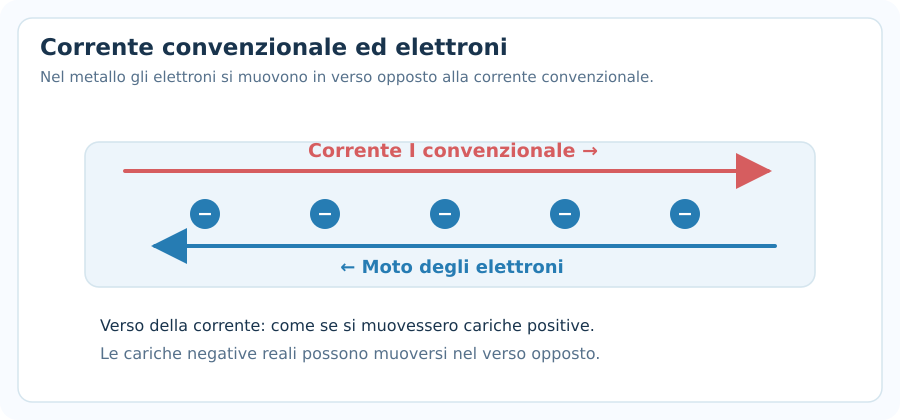
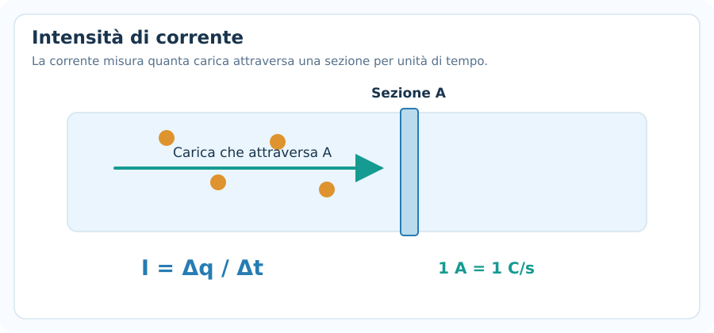
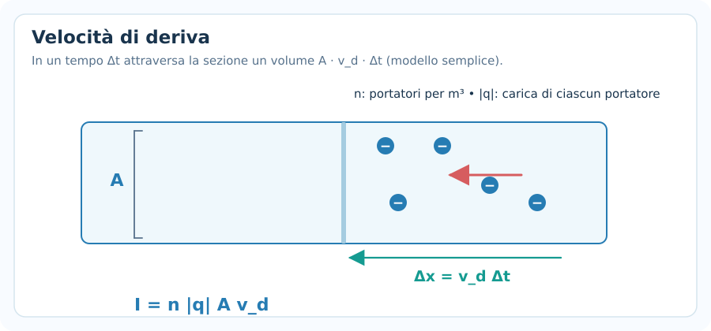
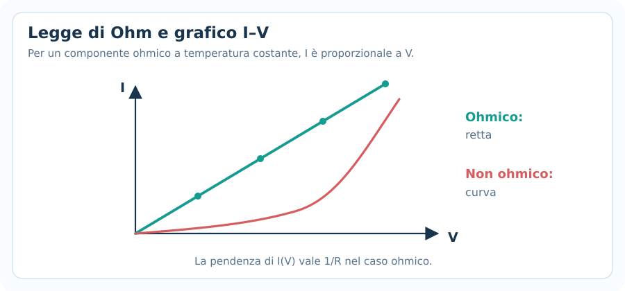
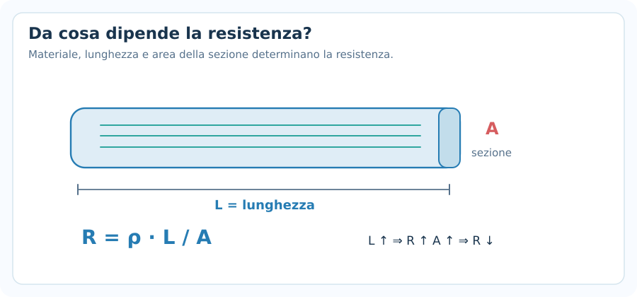
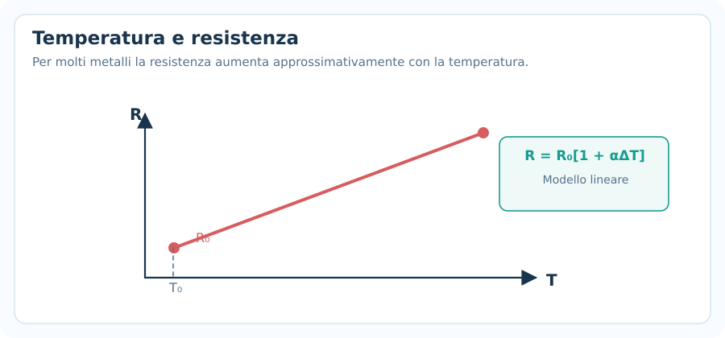
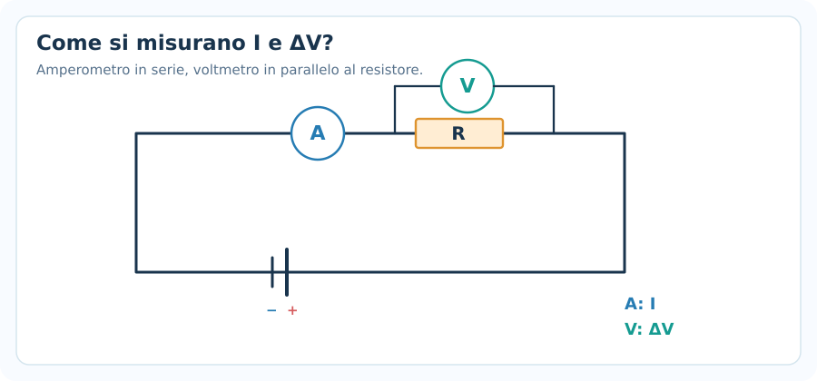
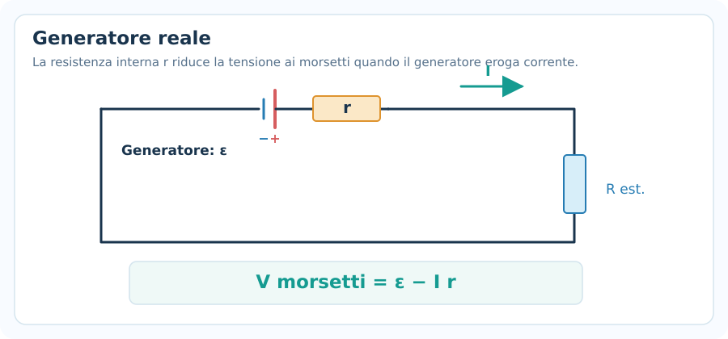
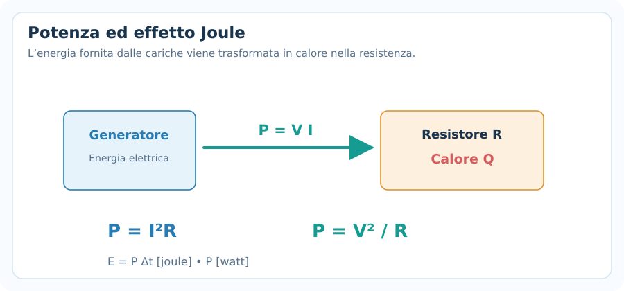

# Corrente elettrica e legge di Ohm

> **Fisica — Informatica UPO · Elettromagnetismo · Nota 05**  
> **Prerequisiti:** carica elettrica, campo elettrico, differenza di potenziale, lavoro, energia, condensatori.  
> **Obiettivo:** interpretare la corrente, applicare la legge di Ohm, ricavare la resistenza dalla geometria del conduttore e risolvere problemi su potenza ed energia elettrica. I collegamenti complessi saranno approfonditi nella nota successiva sui circuiti.

## 1. Dall'elettrostatica alla corrente

Nell'**elettrostatica** abbiamo studiato principalmente cariche ferme. Nell'**elettrodinamica** studiamo le cariche in movimento e la corrente elettrica.

Per avere una corrente in un materiale occorrono **portatori di carica mobili** e condizioni che ne producano un moto netto ordinato. Nei metalli i portatori mobili sono soprattutto gli **elettroni**; in una soluzione elettrolitica possono essere ioni positivi e negativi.

Il campo elettrico all'interno di un conduttore reale percorso da corrente può essere non nullo: è proprio ciò che permette una corrente stazionaria in presenza di resistenza. **Non confondere** questa situazione con il conduttore in equilibrio elettrostatico, nel quale il campo interno è nullo.

### Corrente convenzionale e moto degli elettroni

Per convenzione, il **verso della corrente** è quello in cui si muoverebbero cariche **positive**. In un conduttore metallico gli elettroni hanno carica negativa, quindi il loro moto medio di deriva ha verso **opposto** alla corrente convenzionale.

> [!important] Regola sui versi
> Se in un filo metallico gli elettroni si muovono mediamente verso sinistra, la corrente convenzionale è diretta verso destra. Per la maggior parte degli esercizi sui circuiti si utilizza il **verso convenzionale**.

---

## 2. Intensità della corrente elettrica

La **corrente elettrica** misura la carica che attraversa una superficie di controllo nell'unità di tempo.

Per corrente media nell'intervallo $\Delta t$:

$$
\boxed{I_{\mathrm{media}}=\frac{\Delta q}{\Delta t}}
$$

Dove:
- $I$: intensità di corrente, in **ampere** ($\mathrm{A}$);
- $\Delta q$: quantità di carica **con segno appropriato al verso scelto** che attraversa la sezione, in coulomb ($\mathrm{C}$);
- $\Delta t$: intervallo di tempo, in secondi ($\mathrm{s}$).

In valore assoluto, se il flusso di carica è monodirezionale, la quantità $|\Delta q|/\Delta t$ fornisce il modulo della corrente.

La corrente **istantanea** si definisce, nel limite continuo, con:

$$
\boxed{I=\frac{dq}{dt}}
$$

Nei problemi elementari con corrente costante:

$$
\boxed{\Delta q=I\Delta t}
$$

### Unità e prefissi

$$
\boxed{1\ \mathrm{A}=1\ \mathrm{C/s}}
$$

| Unità | Conversione |
|---|---|
| $1\ \mathrm{mA}$ | $10^{-3}\ \mathrm{A}$ |
| $1\ \mu\mathrm{A}$ | $10^{-6}\ \mathrm{A}$ |
| $1\ \mathrm{kA}$ | $10^3\ \mathrm{A}$ |
| $1\ \mathrm{min}$ | $60\ \mathrm{s}$ |

### Esempio 1 — Carica che attraversa un filo

Un conduttore è attraversato da una corrente costante $I=0{,}40\ \mathrm{A}$ per $2\ \mathrm{min}$. Quanta carica attraversa una sezione?

$$
\Delta t=2\cdot60=120\ \mathrm{s}
$$

$$
\Delta q=I\Delta t=0{,}40\cdot120
$$

$$
\boxed{\Delta q=48\ \mathrm{C}}
$$

### Esempio 2 — Numero di elettroni

Quanti elettroni corrispondono, in valore assoluto, alla carica $48\ \mathrm{C}$?

Il modulo della carica elementare è $e\simeq1{,}602\cdot10^{-19}\ \mathrm{C}$.

$$
N=\frac{|\Delta q|}{e}=\frac{48}{1{,}602\cdot10^{-19}}
$$

$$
\boxed{N\simeq3{,}00\cdot10^{20}\ \text{elettroni}}
$$

> [!warning] Da non confondere
> Una corrente di $1\ \mathrm{A}$ non significa che si muova un solo elettrone al secondo: significa che attraverso la sezione transita una quantità di carica di **1 coulomb ogni secondo**.

---

## 3. Densità di corrente e velocità di deriva

### Densità di corrente

In un filo con sezione uniforme $A$ e corrente distribuita uniformemente, la densità di corrente in modulo è:

$$
\boxed{J=\frac{I}{A}}
$$

Dove $J$ si misura in $\mathrm{A/m^2}$.

La densità di corrente $\vec J$ è in generale un **vettore**; la formula precedente riguarda il caso di flusso uniforme e perpendicolare alla sezione.

### Velocità di deriva

Gli elettroni in un metallo possiedono un moto microscopico disordinato molto rapido. Sotto l'azione del campo elettrico acquistano anche una **piccola velocità media netta**, detta **velocità di deriva** $v_d$.

Per un solo tipo di portatore, con concentrazione numerica $n$ (numero per unità di volume), carica di modulo $|q|$ e sezione $A$:

$$
\boxed{I=n|q|A v_d}
$$

Per gli elettroni metallici, $|q|=e$. Pertanto:

$$
\boxed{v_d=\frac{I}{neA}}
$$

### Origine della formula

Durante $\Delta t$ i portatori percorrono mediamente $\Delta x=v_d\Delta t$. Il volume che attraversa la sezione è $A\Delta x$, quindi il numero di portatori è:

$$
N=nAv_d\Delta t
$$

Il modulo della carica trasportata è $|\Delta q|=N|q|$, e dividendo per $\Delta t$:

$$
I=\frac{|\Delta q|}{\Delta t}=n|q|A v_d
$$

### Esempio 3 — Velocità di deriva

Un filo metallico ha $n=8{,}5\cdot10^{28}\ \mathrm{m^{-3}}$, area $A=1{,}0\ \mathrm{mm^2}$ ed è attraversato da $I=1{,}5\ \mathrm{A}$.

Convertiamo l'area:

$$
A=1{,}0\cdot10^{-6}\ \mathrm{m^2}
$$

$$
v_d=\frac{1{,}5}{(8{,}5\cdot10^{28})(1{,}602\cdot10^{-19})(1{,}0\cdot10^{-6})}
$$

$$
\boxed{v_d\simeq1{,}10\cdot10^{-4}\ \mathrm{m/s}}
$$

La velocità di deriva può essere molto piccola: questo **non** implica che l'effetto elettrico impieghi ore ad arrivare all'altra estremità del circuito. La propagazione del campo e dei segnali elettromagnetici è un fenomeno distinto dalla deriva dei singoli elettroni.

---

## 4. Differenza di potenziale e resistenza elettrica

La **differenza di potenziale** tra due punti è legata al lavoro per unità di carica. Un generatore mantiene una differenza di potenziale che può mettere in moto i portatori in un circuito chiuso.

La **resistenza elettrica** di un componente descrive quanto esso si oppone alla corrente, in un dato regime di funzionamento.

Per un resistore ohmico:

$$
\boxed{R=\frac{|\Delta V|}{|I|}}
$$

L'unità SI è l'**ohm**:

$$
\boxed{1\ \Omega=1\ \mathrm{V/A}}
$$

### Legge di Ohm

Per un **conduttore ohmico**, mantenuto a temperatura e condizioni fisiche costanti, vale:

$$
\boxed{\Delta V=RI}
$$

Con la convenzione passiva si intende $\Delta V$ come **caduta di tensione nel verso della corrente** attraverso il resistore, così $R>0$ e $I>0$ in modulo.

Formule inverse:

$$
\boxed{I=\frac{\Delta V}{R}}\qquad \boxed{R=\frac{\Delta V}{I}}
$$

La legge di Ohm **non è una relazione valida senza condizioni per ogni dispositivo**: diodi, lampadine a filamento quando la temperatura cambia sensibilmente e altri elementi possono avere una caratteristica corrente-tensione non lineare.

### Grafico corrente-tensione

Se rappresentiamo $I$ sull'asse verticale e $V$ su quello orizzontale, per un resistore ohmico:

$$
I=\frac{1}{R}V
$$

Otteniamo una **retta passante per l'origine**, con pendenza $1/R$.

Se invece rappresentiamo $V$ sull'asse verticale e $I$ su quello orizzontale, la pendenza della retta è $R$.

### Esempio 4 — Legge di Ohm

Un resistore di $R=150\ \Omega$ è collegato a una differenza di potenziale di $12\ \mathrm{V}$.

$$
I=\frac{12}{150}=0{,}080\ \mathrm{A}
$$

$$
\boxed{I=80\ \mathrm{mA}}
$$

### Esempio 5 — Ricavare la resistenza

Un dispositivo ohmico è attraversato da $I=0{,}25\ \mathrm{A}$ quando ai suoi capi sono presenti $\Delta V=9\ \mathrm{V}$.

$$
R=\frac{9}{0{,}25}
$$

$$
\boxed{R=36\ \Omega}
$$

---

## 5. Resistività: geometria e materiale

La resistenza di un filo omogeneo e cilindrico o prismatico, di sezione uniforme, si calcola con:

$$
\boxed{R=\rho_e\frac{L}{A}}
$$

Dove:
- $\rho_e$: **resistività elettrica**, in $\Omega\,\mathrm{m}$;
- $L$: lunghezza del conduttore, in $\mathrm{m}$;
- $A$: area della sezione trasversale, in $\mathrm{m^2}$.

**Uso $\rho_e$ per distinguerla dalla densità di massa $\rho$, già studiata nei fluidi.** In molti testi la resistività viene indicata semplicemente con $\rho$.

Formule inverse:

$$
\boxed{\rho_e=R\frac{A}{L}}\qquad
\boxed{L=\frac{RA}{\rho_e}}\qquad
\boxed{A=\frac{\rho_e L}{R}}
$$

Se la sezione è circolare:

$$
\boxed{A=\pi r^2=\frac{\pi d^2}{4}}
$$

### Conseguenze immediate

A materiale e temperatura invariati:

- Se la lunghezza $L$ **raddoppia**, $R$ raddoppia.
- Se la sezione $A$ **raddoppia**, $R$ si dimezza.
- Se il diametro $d$ **raddoppia**, l'area quadruplica e la resistenza diventa **un quarto**.

La **conducibilità elettrica** $\sigma$ è l'inverso della resistività:

$$
\boxed{\sigma=\frac1{\rho_e}}
$$

L'unità di $\sigma$ è $\mathrm{S/m}$ (siemens per metro).

### Esempio 6 — Resistenza di un filo

Un filo di rame ha resistività approssimativa $\rho_e=1{,}7\cdot10^{-8}\ \Omega\,\mathrm{m}$ a temperatura ambiente, lunghezza $L=10\ \mathrm{m}$ e sezione $A=1{,}0\ \mathrm{mm^2}$.

$$
A=1{,}0\cdot10^{-6}\ \mathrm{m^2}
$$

$$
R=\frac{(1{,}7\cdot10^{-8})\cdot10}{1{,}0\cdot10^{-6}}
$$

$$
\boxed{R\simeq0{,}17\ \Omega}
$$

### Legame microscopico con il campo elettrico

Per un materiale ohmico omogeneo e isotropo, in condizioni appropriate, vale la **forma locale della legge di Ohm**:

$$
\boxed{\vec J=\sigma\vec E}
$$

oppure:

$$
\boxed{\vec E=\rho_e\vec J}
$$

Con campo uniforme lungo un filo, $\Delta V=EL$ e $I=JA$, da cui segue:

$$
R=\frac{\Delta V}{I}=\frac{EL}{JA}=\rho_e\frac{L}{A}
$$

---

## 6. Dipendenza della resistenza dalla temperatura

Per molti **metalli**, in un intervallo di temperatura non troppo ampio, la resistenza varia approssimativamente secondo:

$$
\boxed{R(T)=R_0[1+\alpha(T-T_0)]}
$$

Dove:
- $R_0$: resistenza alla temperatura di riferimento $T_0$;
- $\alpha$: coefficiente termico della resistenza, in $\mathrm{K^{-1}}$ (oppure $\mathrm{°C^{-1}}$ per una differenza di temperatura);
- $T-T_0=\Delta T$: variazione di temperatura.

Per molti metalli a temperature ordinarie $\alpha>0$: aumentando la temperatura aumenta la resistenza. **Non è universale**: semiconduttori e altri materiali possono avere comportamenti differenti.

### Esempio 7 — Riscaldamento di un resistore

Un resistore ha $R_0=100\ \Omega$ a $T_0=20\ ^\circ\mathrm C$. Assumiamo $\alpha=0{,}0040\ \mathrm{°C^{-1}}$. Calcolare la resistenza a $70\ ^\circ\mathrm C$.

$$
\Delta T=70-20=50\ ^\circ\mathrm C
$$

$$
R=100[1+(0{,}0040)(50)]
$$

$$
\boxed{R=120\ \Omega}
$$

---

## 7. Circuito elettrico elementare

Un **circuito** è un insieme di componenti collegati tramite conduttori. Nel modello più semplice troviamo un **generatore ideale** e un **resistore**.

Il generatore mantiene una differenza di potenziale; il resistore dissipa energia elettrica. Un circuito chiuso permette la presenza di una corrente stazionaria, se esiste una forza elettromotrice applicata e non intervengono altri effetti transitori.

### Misurare la corrente e la tensione

- L'**amperometro ideale** ha resistenza nulla e si collega **in serie** al ramo del quale si vuole misurare la corrente.
- Il **voltmetro ideale** ha resistenza infinita e si collega **in parallelo** ai due terminali del componente di cui si vuole misurare la differenza di potenziale.

> [!warning] Attenzione al collegamento
> Inserire un amperometro direttamente in parallelo a una batteria può creare un percorso di bassissima resistenza e risultare pericoloso nei circuiti reali. La figura serve a ricordare il collegamento corretto.

### Esempio 8 — Una batteria e una resistenza

Un generatore ideale da $9\ \mathrm{V}$ alimenta un resistore $R=3\ \Omega$. Nei fili ideali la caduta di tensione è trascurabile.

$$
I=\frac{V}{R}=\frac{9}{3}
$$

$$
\boxed{I=3\ \mathrm{A}}
$$

Il circuito sviluppato fino a qui è volutamente semplice. Nella nota successiva studieremo **resistori in serie e parallelo**, le **leggi di Kirchhoff** e i circuiti con più rami.

---

## 8. Forza elettromotrice e generatore reale

La **forza elettromotrice** ($\mathcal E$), nonostante il nome, **non è una forza**: rappresenta l'energia fornita dal generatore per unità di carica che attraversa il suo interno:

$$
\boxed{\mathcal E=\frac{W_{\mathrm{generatore}}}{q}}
$$

Si misura in **volt**. Un generatore reale può essere rappresentato, nel modello elementare, come una sorgente ideale $\mathcal E$ in serie con una **resistenza interna** $r$.

Se la batteria sta **erogando** corrente $I$, la tensione ai morsetti è:

$$
\boxed{V_{\mathrm{morsetti}}=\mathcal E-Ir}
$$

La caduta $Ir$ è interna alla batteria. Se invece la batteria viene caricata, bisogna modificare il bilancio dei segni coerentemente con il verso di corrente scelto.

### Esempio 9 — Batteria reale

Una batteria con $\mathcal E=12\ \mathrm V$ e resistenza interna $r=0{,}50\ \Omega$ eroga $I=2\ \mathrm A$.

$$
V_{\mathrm{morsetti}}=12-(2)(0{,}50)
$$

$$
\boxed{V_{\mathrm{morsetti}}=11\ \mathrm V}
$$

Se il circuito esterno è soltanto un resistore $R$, allora:

$$
\mathcal E=I(R+r)
$$

$$
\boxed{I=\frac{\mathcal E}{R+r}}
$$

> [!important] Collegamento con la conservazione dell'energia
> Se la batteria eroga corrente, la potenza complessivamente fornita al circuito è $\mathcal EI$: una parte va al carico esterno ($V_{\mathrm{morsetti}}I$) e una parte viene dissipata nella resistenza interna ($I^2r$).

---

## 9. Potenza elettrica ed effetto Joule

La **potenza elettrica** rappresenta l'energia trasferita nell'unità di tempo:

$$
\boxed{P=\frac{\Delta E}{\Delta t}}
$$

Per un componente a due terminali con tensione $V$ e corrente $I$, adottando la **convenzione passiva** (corrente entrante dal terminale a potenziale più alto), la potenza assorbita è:

$$
\boxed{P=VI}
$$

L'unità SI è il **watt**:

$$
1\ \mathrm W=1\ \mathrm{J/s}
$$

Per un resistore ohmico, usando $V=RI$:

$$
\boxed{P=I^2R}
$$

oppure, sostituendo $I=V/R$:

$$
\boxed{P=\frac{V^2}{R}}
$$

Il **calore prodotto per effetto Joule** in un intervallo $\Delta t$, se le grandezze sono costanti e tutta la potenza viene dissipata termicamente, vale:

$$
\boxed{E_{\mathrm{Joule}}=I^2R\Delta t=P\Delta t}
$$

### Esempio 10 — Potenza dissipata

Un resistore $R=20\ \Omega$ è attraversato da $I=0{,}50\ \mathrm A$.

$$
P=I^2R=(0{,}50)^2\cdot20
$$

$$
\boxed{P=5{,}0\ \mathrm W}
$$

Se la situazione dura $3\ \mathrm{min}=180\ \mathrm s$:

$$
E=P\Delta t=5{,}0\cdot180
$$

$$
\boxed{E=900\ \mathrm J}
$$

### Esempio 11 — Costo energetico, kilowattora

Un dispositivo da $1000\ \mathrm W$ funziona per $2\ \mathrm h$.

$$
E=P\Delta t=1\ \mathrm{kW}\cdot2\ \mathrm h
$$

$$
\boxed{E=2\ \mathrm{kWh}=7{,}2\cdot10^6\ \mathrm J}
$$

Ricorda:

$$
\boxed{1\ \mathrm{kWh}=3{,}6\cdot10^6\ \mathrm J}
$$

### A tensione costante o corrente costante?

Attenzione alla grandezza mantenuta fissa:

- Se $V$ è costante: $P=V^2/R$, quindi **aumentando $R$, diminuisce $P$**.
- Se $I$ è costante: $P=I^2R$, quindi **aumentando $R$, aumenta $P$**.

Non c'è contraddizione: nei due casi stiamo imponendo condizioni differenti.

---

## 10. Come riconoscere il tipo di esercizio

| Il testo parla di… | Parti da… |
|---|---|
| carica che passa in un tempo | $I=\Delta q/\Delta t$ |
| numero di elettroni | $N=|\Delta q|/e$ |
| corrente e sezione del filo | $J=I/A$ |
| portatori per volume e deriva | $I=n|q|Av_d$ |
| tensione e resistenza | $V=RI$ |
| sezione, lunghezza e materiale | $R=\rho_e L/A$ |
| temperatura del resistore | $R=R_0(1+\alpha\Delta T)$ |
| batteria reale che eroga corrente | $V=\mathcal E-Ir$ |
| potenza di un componente | $P=VI$ |
| potenza di un resistore | $P=I^2R=V^2/R$ |
| energia trasformata in calore | $E=P\Delta t$ |

### Metodo meccanico in sei passaggi

1. **Elenca i dati** e scrivi le unità SI: $\mathrm{A}$, $\mathrm{V}$, $\Omega$, $\mathrm s$, $\mathrm{m^2}$.
2. **Individua l'incognita**: carica, corrente, resistenza, tensione, potenza, energia oppure velocità di deriva.
3. **Riconosci l'oggetto fisico**: filo metallico, resistore, generatore reale, circuito ideale.
4. **Scegli il modello**: Ohm soltanto se il comportamento è ohmico; resistività per filo omogeneo; potenza per i bilanci energetici.
5. **Sostituisci i numeri alla fine**, dopo aver isolato l'incognita.
6. **Controlla unità e coerenza fisica**: una resistenza maggiore a tensione costante dà una corrente minore; la potenza dissipata da un resistore è non negativa.

---

## 11. Errori frequenti

### 11.1 Confondere corrente e carica

La carica è misurata in $\mathrm C$, la corrente in $\mathrm A=\mathrm{C/s}$. Non sono la stessa grandezza.

### 11.2 Dimenticare la conversione del tempo

Se $I$ è in ampere, il tempo in $\Delta q=I\Delta t$ deve essere in **secondi**.

### 11.3 Usare mA come se fossero A

$$
250\ \mathrm{mA}=0{,}250\ \mathrm A
$$

### 11.4 Confondere verso della corrente con quello degli elettroni

Nei metalli le direzioni sono opposte. Per i circuiti si usa normalmente la corrente convenzionale.

### 11.5 Confondere resistività con resistenza

- $\rho_e$ dipende dal **materiale** e dalla **temperatura**.
- $R$ dipende anche da **lunghezza** e **sezione** del conduttore.

### 11.6 Usare millimetri quadrati senza conversione

$$
1\ \mathrm{mm^2}=10^{-6}\ \mathrm{m^2}
$$

### 11.7 Dimenticare il quadrato della corrente

$$
P=I^2R
$$

Non $P=IR$ (che ha unità di volt, non watt).

### 11.8 Applicare Ohm a qualsiasi dispositivo

Per un componente **non ohmico** può non esistere una resistenza costante valida per tutte le tensioni.

### 11.9 Confondere forza elettromotrice con forza meccanica

$\mathcal E$ si misura in **volt**, non in newton.

### 11.10 Applicare indistintamente tutte le formule della potenza

Le formule $I^2R$ e $V^2/R$ presuppongono un **resistore ohmico**, mentre $VI$ ha significato più generale se si specifica correttamente il verso di corrente e la convenzione dei segni.

---

## 12. Formulario essenziale

### Corrente elettrica

$$
\boxed{I=\frac{\Delta q}{\Delta t}}\qquad
\boxed{\Delta q=I\Delta t}
$$

### Portatori e deriva

$$
\boxed{J=\frac{I}{A}}\qquad
\boxed{I=n|q|Av_d}
$$

### Legge di Ohm

$$
\boxed{V=RI}\qquad \boxed{I=\frac{V}{R}}\qquad \boxed{R=\frac{V}{I}}
$$

### Resistività

$$
\boxed{R=\rho_e\frac{L}{A}}\qquad \boxed{A=\pi r^2}
$$

### Resistenza e temperatura

$$
\boxed{R=R_0(1+\alpha\Delta T)}
$$

### Generatore reale che eroga corrente

$$
\boxed{V_{\mathrm{morsetti}}=\mathcal E-Ir}
$$

### Potenza

$$
\boxed{P=VI=I^2R=\frac{V^2}{R}}
$$

Le ultime due uguaglianze sono valide per un resistore ohmico.

### Energia elettrica trasferita

$$
\boxed{E=P\Delta t}
$$

---

## 13. Domande di verifica

1. Che differenza c'è tra la **corrente convenzionale** e il moto medio degli elettroni in un metallo?
2. Una corrente di $0{,}20\ \mathrm A$ dura $3\ \mathrm{min}$. Quanta carica attraversa una sezione?
3. Perché un campo elettrico può essere presente in un filo percorso da corrente, anche se in un conduttore in equilibrio elettrostatico è nullo?
4. Se raddoppio la tensione ai capi di un resistore ohmico mantenendo $R$ costante, che cosa succede alla corrente?
5. Se raddoppio il **diametro** di un filo, mantenendo uguali lunghezza e materiale, come varia la sua resistenza?
6. Qual è la differenza tra **resistenza $R$** e **resistività $\rho_e$**?
7. Perché l'amperometro si collega in serie e il voltmetro in parallelo?
8. Una batteria reale eroga corrente: perché la tensione ai morsetti può essere minore della sua forza elettromotrice?
9. Se la tensione è costante, aumentando $R$ la potenza dissipata aumenta o diminuisce?
10. Quali ipotesi giustificano l'uso di $R=\rho_e L/A$ e della legge di Ohm?

> **Obiettivo finale:** saper riconoscere la grandezza richiesta e scegliere fra corrente, Ohm, resistività e potenza **senza confonderne le unità o le condizioni di validità**.
