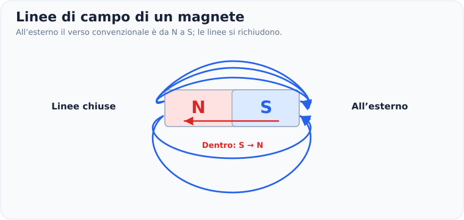
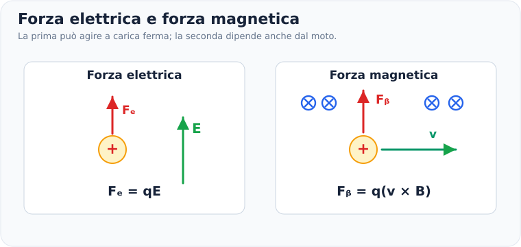
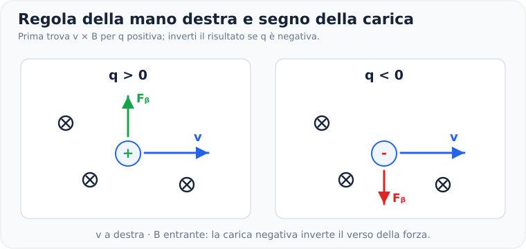
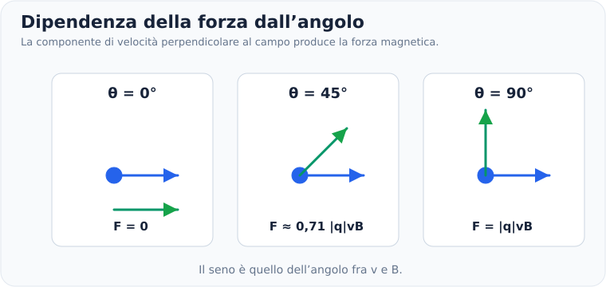
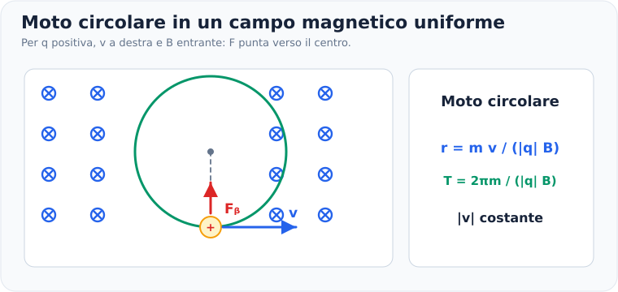
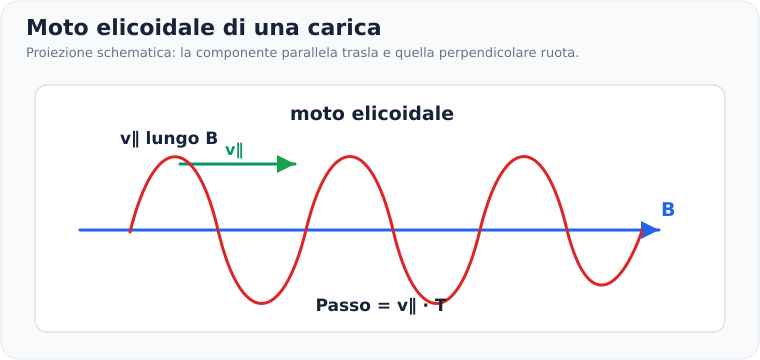
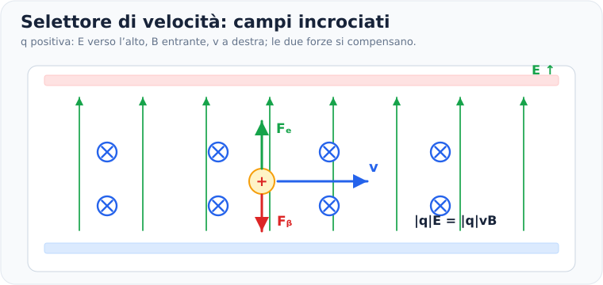
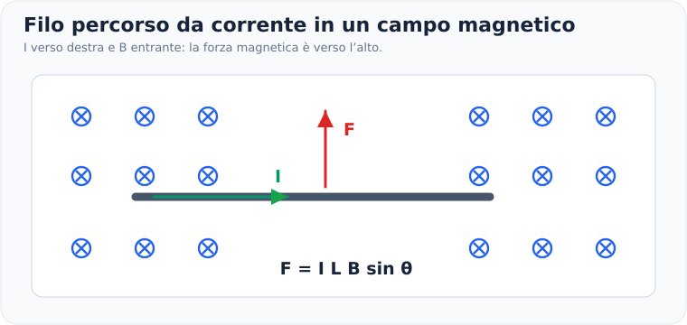
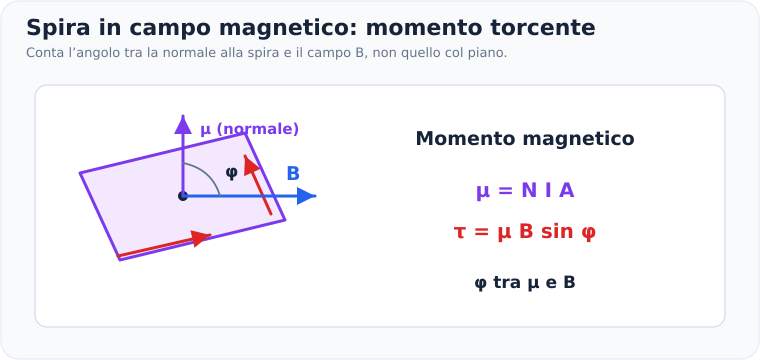

# Campo magnetico e forza di Lorentz

> **Fisica — Informatica UPO · Elettromagnetismo · Nota 08**  
> **Prerequisiti:** vettori e prodotto vettoriale, moto circolare uniforme, secondo principio di Newton, campo elettrico e corrente.  
> **Obiettivo:** distinguere campo elettrico e magnetico, trovare modulo/direzione/verso delle forze magnetiche, descrivere il moto delle cariche e risolvere esercizi con particelle e fili percorsi da corrente.

## 1. Che cos'è il campo magnetico?

Il **campo magnetico** è una grandezza vettoriale, indicata con $\vec B$, che descrive gli effetti magnetici prodotti da magneti, correnti elettriche e, più in generale, cariche in movimento.

Il campo magnetico può esercitare una forza su:

- una **carica elettrica in movimento**, quando la velocità non è parallela al campo;
- un **filo percorso da corrente**;
- un **dipolo magnetico**, come una piccola spira percorsa da corrente.

Una carica elettrica **ferma** non subisce una forza magnetica dovuta al solo campo $\vec B$.

> [!important] Prima distinzione
> Il campo elettrico $\vec E$ può esercitare una forza su una carica anche ferma: $\vec F_E=q\vec E$.  
> Il campo magnetico $\vec B$ esercita la forza $\vec F_B=q\vec v\times\vec B$, quindi conta anche la velocità.

---

## 2. Linee del campo magnetico

Le **linee di campo magnetico** rappresentano qualitativamente la direzione e il verso di $\vec B$:

- in ogni punto il vettore $\vec B$ è **tangente** alla linea di campo;
- le linee **non si incrociano**;
- dove il disegno mostra linee più fitte, il campo è rappresentato come più intenso;
- le linee magnetiche sono **chiuse**: non iniziano né terminano su cariche magnetiche isolate.

Per un magnete a barra, **all'esterno** le linee convenzionalmente escono dal polo nord e rientrano nel polo sud; **all'interno** del magnete si richiudono dal sud al nord.

### Campo uniforme

Un campo si dice **uniforme** quando $\vec B$ mantiene lo stesso modulo, la stessa direzione e lo stesso verso in tutti i punti della regione considerata.

Lo rappresentiamo mediante frecce parallele, equidistanti e orientate nello stesso verso.

---

## 3. Come rappresentare i vettori perpendicolari al foglio

In elettromagnetismo molti esercizi utilizzano i simboli:

- $\odot$ — vettore **uscente** dal foglio, verso di noi (punta della freccia);
- $\otimes$ — vettore **entrante** nel foglio, lontano da noi (coda della freccia).

> [!tip] Metodo visivo
> Immagina una freccia vista frontalmente: la **punta** appare come un punto; le **penne posteriori** come una croce.

Questi simboli possono rappresentare campo magnetico, velocità, forza o corrente, a seconda del problema.

---

## 4. Unità di misura e grandezze utili

L'unità SI del campo magnetico è il **tesla** ($\mathrm T$).

Dalla forza magnetica su una carica, nel caso perpendicolare, segue:

$$
\boxed{1\ \mathrm T=1\ \frac{\mathrm N\,\mathrm s}{\mathrm C\,\mathrm m}}
$$

Dalla forza su un filo:

$$
\boxed{1\ \mathrm T=1\ \frac{\mathrm N}{\mathrm A\,\mathrm m}}
$$

La conversione più frequente è:

$$
1\ \mathrm{mT}=10^{-3}\ \mathrm T,\qquad
1\ \mathrm{\mu T}=10^{-6}\ \mathrm T.
$$

**Costanti da conoscere o trovare nel formulario:**

| Grandezza | Simbolo | Valore |
|---|---|---:|
| Carica elementare | $e$ | $1{,}602\cdot10^{-19}\ \mathrm C$ |
| Massa dell'elettrone | $m_e$ | $9{,}109\cdot10^{-31}\ \mathrm{kg}$ |
| Massa del protone | $m_p$ | $1{,}673\cdot10^{-27}\ \mathrm{kg}$ |

La carica del protone è $+e$, quella dell'elettrone è $-e$.

---

## 5. Forza di Lorentz: campo elettrico e magnetico

Quando una carica $q$ si muove con velocità $\vec v$ in presenza contemporaneamente di un campo elettrico $\vec E$ e di un campo magnetico $\vec B$, la forza totale è:

$$
\boxed{\vec F=q(\vec E+\vec v\times\vec B)}
$$

Si può scomporre in:

$$
\boxed{\vec F_E=q\vec E}
$$

$$
\boxed{\vec F_B=q(\vec v\times\vec B)}
$$

Il simbolo $\times$ indica il **prodotto vettoriale**. Non è una moltiplicazione ordinaria: il risultato è un vettore perpendicolare sia a $\vec v$ sia a $\vec B$.

### Modulo della sola forza magnetica

Il modulo vale:

$$
\boxed{F_B=|q|\,vB\sin\theta}
$$

Dove:

- $|q|$: modulo della carica in coulomb;
- $v$: modulo della velocità in $\mathrm{m/s}$;
- $B$: modulo del campo in tesla;
- $\theta$: **angolo fra i vettori** $\vec v$ e $\vec B$.

Il valore assoluto $|q|$ serve a ottenere il **modulo positivo** della forza. Il segno della carica, invece, determina il suo **verso**.

---

## 6. Direzione e verso: regola della mano destra

Per una **carica positiva** il verso di $\vec v\times\vec B$ si trova usando la mano destra:

1. Indice nella direzione di $\vec v$.
2. Medio nella direzione di $\vec B$.
3. Pollice nella direzione della forza $\vec F_B$.

Per una **carica negativa**, il verso della forza è **opposto** al risultato della mano destra.

### Esempio di direzione

Una carica positiva si muove verso **destra**, mentre il campo magnetico è **entrante nel foglio**.

- $\vec v$ è verso destra;
- $\vec B$ è entrante ($\otimes$);
- per $q>0$, $\vec F_B$ è **verso l'alto**;
- per $q<0$, $\vec F_B$ è **verso il basso**.

> [!warning] Errore frequente
> Non stabilire il verso della forza guardando soltanto il segno della carica. Prima calcola $\vec v\times\vec B$, poi, se $q<0$, inverti il risultato.

---

## 7. Dipendenza dall'angolo

La forza magnetica dipende dall'angolo tra velocità e campo:

$$
F_B=|q|vB\sin\theta.
$$

**Tre casi importanti:**

| Angolo | Risultato | Interpretazione |
|---|---|---|
| $\theta=0^\circ$ | $F_B=0$ | velocità parallela al campo |
| $\theta=90^\circ$ | $F_B=|q|vB$ | forza massima |
| $\theta=180^\circ$ | $F_B=0$ | velocità antiparallela al campo |

Se la velocità ha componenti parallela e perpendicolare al campo:

$$
\boxed{v_{\parallel}=v\cos\theta,\qquad v_{\perp}=v\sin\theta}
$$

in termini di moduli quando $0\le\theta\le90^\circ$. La forza magnetica dipende solo dalla **componente perpendicolare**:

$$
\boxed{F_B=|q|v_{\perp}B}
$$

### Esempio svolto — Modulo della forza

Un protone ha velocità $v=3{,}0\cdot10^6\ \mathrm{m/s}$ in un campo $B=0{,}20\ \mathrm T$, perpendicolare al moto.

$$
F_B=e vB=1{,}602\cdot10^{-19}\cdot3{,}0\cdot10^6\cdot0{,}20.
$$

$$
\boxed{F_B\approx9{,}61\cdot10^{-14}\ \mathrm N}
$$

Se l'angolo diventasse $30^\circ$, mantenendo gli stessi dati, la forza sarebbe **la metà**, perché $\sin30^\circ=0{,}5$.

---

## 8. Il campo magnetico compie lavoro?

La forza magnetica è sempre **perpendicolare alla velocità istantanea**:

$$
\vec F_B\cdot\vec v=0.
$$

La potenza istantanea della forza magnetica è quindi:

$$
\boxed{\mathcal P_B=\vec F_B\cdot\vec v=0}
$$

Di conseguenza, **il solo campo magnetico statico non modifica l'energia cinetica** di una carica puntiforme:

$$
\boxed{\Delta K=0\quad\Longrightarrow\quad |v_f|=|v_i|}
$$

Può cambiare **direzione** della velocità, ma non il suo **modulo**.

Questo non vale per la forza elettrica in generale: $\vec F_E=q\vec E$ può compiere lavoro e modificare l'energia cinetica.

> [!important] Collegamento con la meccanica
> È lo stesso principio del moto circolare uniforme: una forza centripeta cambia il verso della velocità, non il suo modulo.

---

## 9. Moto circolare in un campo magnetico uniforme

Consideriamo una carica che entra in una regione con campo magnetico **uniforme** e velocità iniziale **perpendicolare** a $\vec B$. Supponiamo che agisca solo la forza magnetica e che il moto sia non relativistico.

La forza ha modulo costante:

$$
F_B=|q|vB.
$$

Poiché è perpendicolare alla velocità, agisce da **forza centripeta**:

$$
\boxed{F_B=F_c}
$$

$$
|q|vB=\frac{mv^2}{r}.
$$

Semplificando una velocità $v\ne0$:

$$
\boxed{r=\frac{mv}{|q|B}}
$$

Questa è la formula del **raggio della traiettoria circolare**.

### Cosa succede modificando i dati?

- Se la massa $m$ **raddoppia**, il raggio raddoppia.
- Se la velocità $v$ **raddoppia**, il raggio raddoppia.
- Se $|q|$ **raddoppia**, il raggio si dimezza.
- Se il campo $B$ **raddoppia**, il raggio si dimezza.

**Attenzione:** cariche di segno opposto curvano in **versi opposti** per la stessa $\vec v$ e lo stesso $\vec B$.

---

## 10. Periodo, pulsazione e frequenza ciclotronica

Dal moto circolare uniforme:

$$
T=\frac{2\pi r}{v}.
$$

Sostituendo il raggio magnetico:

$$
T=\frac{2\pi}{v}\frac{mv}{|q|B}.
$$

Quindi:

$$
\boxed{T=\frac{2\pi m}{|q|B}}
$$

La frequenza vale:

$$
\boxed{f=\frac1T=\frac{|q|B}{2\pi m}}
$$

E la pulsazione (frequenza angolare):

$$
\boxed{\omega=\frac{|q|B}{m}}
$$

**Osservazione importante:** nel modello non relativistico, periodo e frequenza **non dipendono dalla velocità**.

### Esempio svolto — Elettrone in un campo uniforme

Un elettrone entra perpendicolarmente in un campo $B=0{,}50\ \mathrm T$, con $v=2{,}0\cdot10^6\ \mathrm{m/s}$.

**Raggio:**

$$
r=\frac{m_ev}{eB}=
\frac{9{,}109\cdot10^{-31}\cdot2{,}0\cdot10^6}{1{,}602\cdot10^{-19}\cdot0{,}50}
$$

$$
\boxed{r\approx2{,}27\cdot10^{-5}\ \mathrm m}
$$

**Periodo:**

$$
T=\frac{2\pi m_e}{eB}
$$

$$
\boxed{T\approx7{,}14\cdot10^{-11}\ \mathrm s}
$$

Il segno negativo dell'elettrone **cambia il senso della rotazione**, non il valore positivo di $r$ o $T$.

---

## 11. Moto elicoidale: velocità obliqua al campo

Se la velocità iniziale forma un angolo non nullo e diverso da $90^\circ$ con il campo uniforme, si scompone in:

- $v_{\perp}$: produce un **moto circolare**;
- $v_{\parallel}$: produce un **moto rettilineo uniforme** lungo il campo.

La sovrapposizione genera una **traiettoria a elica**.

Il raggio dell'elica dipende dalla componente perpendicolare:

$$
\boxed{r=\frac{m v_{\perp}}{|q|B}}
$$

Il periodo del moto circolare resta:

$$
\boxed{T=\frac{2\pi m}{|q|B}}
$$

Il **passo dell'elica** (distanza percorsa lungo il campo in un giro) è:

$$
\boxed{h=v_{\parallel}T}
$$

### Esempio

Un protone ha $v_{\perp}=3{,}0\cdot10^5\ \mathrm{m/s}$ e $v_{\parallel}=2{,}0\cdot10^5\ \mathrm{m/s}$ in un campo $B=0{,}10\ \mathrm T$.

$$
r=\frac{m_p v_{\perp}}{eB}\approx\boxed{3{,}13\cdot10^{-2}\ \mathrm m}
$$

$$
T=\frac{2\pi m_p}{eB}\approx6{,}56\cdot10^{-7}\ \mathrm s
$$

$$
h=v_{\parallel}T\approx\boxed{0{,}131\ \mathrm m}
$$

---

## 12. Campi elettrico e magnetico incrociati: selettore di velocità

In alcuni esercizi una particella attraversa contemporaneamente un campo elettrico e uno magnetico perpendicolari, con velocità perpendicolare a entrambi.

Possiamo orientare i campi in modo che la forza elettrica e quella magnetica siano **opposte**.

Se la particella procede **senza deviazione**:

$$
\vec F_E+\vec F_B=\vec0.
$$

In modulo, quando i campi e la velocità sono reciprocamente perpendicolari:

$$
|q|E=|q|vB.
$$

Semplificando $|q|$:

$$
\boxed{v=\frac{E}{B}}
$$

### Esempio

Un selettore presenta $E=5{,}0\cdot10^4\ \mathrm{N/C}$ e $B=0{,}20\ \mathrm T$.

$$
v=\frac{5{,}0\cdot10^4}{0{,}20}
$$

$$
\boxed{v=2{,}5\cdot10^5\ \mathrm{m/s}}
$$

> [!warning] Condizioni da verificare
> La formula $v=E/B$ non è universale: richiede un selettore con forza elettrica e magnetica opposte, campi perpendicolari e traiettoria non deviata.

---

## 13. Forza magnetica su un filo percorso da corrente

Il campo magnetico esercita una forza anche su un tratto di filo percorso da **corrente elettrica**.

Per un tratto rettilineo di lunghezza vettoriale $\vec L$, percorso da corrente $I$ in un campo uniforme:

$$
\boxed{\vec F=I\,\vec L\times\vec B}
$$

Il vettore $\vec L$ è orientato nel verso **convenzionale della corrente**.

Il modulo della forza è:

$$
\boxed{F=ILB\sin\theta}
$$

Dove $\theta$ è l'angolo tra il filo orientato secondo la corrente e $\vec B$.

### Casi limite

- Filo parallelo al campo: $\theta=0^\circ\Rightarrow F=0$.
- Filo perpendicolare al campo: $\theta=90^\circ\Rightarrow F=ILB$.

### Esempio svolto

Un filo rettilineo è attraversato da corrente $I=4{,}0\ \mathrm A$. Il tratto immerso nel campo è lungo $L=0{,}30\ \mathrm m$. Il campo vale $B=0{,}50\ \mathrm T$ e forma un angolo di $30^\circ$ con il filo.

$$
F=ILB\sin30^\circ
$$

$$
F=4{,}0\cdot0{,}30\cdot0{,}50\cdot0{,}5
$$

$$
\boxed{F=0{,}30\ \mathrm N}
$$

### Collegamento con le cariche

Il filo contiene molte cariche in movimento. La forza complessiva sul conduttore è la risultante delle forze magnetiche sulle cariche mobili, trasmesse al reticolo materiale del conduttore.

---

## 14. Spira percorsa da corrente e momento torcente

Una **spira** è un circuito chiuso percorso da corrente. In un campo uniforme, le forze magnetiche sui suoi lati possono formare una **coppia** che tende a ruotarla.

Il vettore **momento magnetico** della spira è:

$$
\boxed{\vec\mu=NI A\,\hat n}
$$

Dove:

- $N$: numero di spire;
- $I$: corrente elettrica;
- $A$: area di ciascuna spira;
- $\hat n$: normale alla superficie, orientata con la regola della mano destra rispetto al verso della corrente.

Per una spira rigida in campo magnetico uniforme, il momento torcente è:

$$
\boxed{\vec\tau=\vec\mu\times\vec B}
$$

Il modulo vale:

$$
\boxed{\tau=NIAB\sin\phi}
$$

con $\phi$ angolo **fra la normale alla spira** e il campo $\vec B$ (non fra il piano della spira e il campo).

L'energia potenziale magnetica del dipolo in un campo uniforme è:

$$
\boxed{U=-\vec\mu\cdot\vec B=-\mu B\cos\phi}
$$

Il momento tende a orientare $\vec\mu$ lungo $\vec B$.

### Esempio

Una bobina ha $N=50$ spire, ciascuna di area $A=0{,}020\ \mathrm{m^2}$; è percorsa da $I=0{,}30\ \mathrm A$ e immersa in un campo $B=0{,}25\ \mathrm T$. Calcola il momento torcente **massimo**.

$$
\tau_{\max}=NIAB
$$

$$
\tau_{\max}=50\cdot0{,}30\cdot0{,}020\cdot0{,}25
$$

$$
\boxed{\tau_{\max}=0{,}075\ \mathrm{N\,m}}
$$

---

## 15. Tabella di riconoscimento rapido

| Che cosa chiede il problema? | Da dove partire |
|---|---|
| Forza su una carica mobile in un campo magnetico | $F_B=|q|vB\sin\theta$ |
| Direzione e verso della forza magnetica | $\vec F_B=q\vec v\times\vec B$ + mano destra |
| Forza totale in campi elettrico e magnetico | $\vec F=q(\vec E+\vec v\times\vec B)$ |
| Raggio della traiettoria circolare | $r=mv/(|q|B)$, con $v\perp B$ |
| Periodo del moto circolare | $T=2\pi m/(|q|B)$ |
| Frequenza di rotazione | $f=|q|B/(2\pi m)$ |
| Raggio di un'elica | $r=mv_{\perp}/(|q|B)$ |
| Passo dell'elica | $h=v_{\parallel}T$ |
| Velocità non deviata in selettore | $v=E/B$, nelle condizioni adatte |
| Forza su un filo | $F=ILB\sin\theta$ |
| Momento torcente su $N$ spire | $\tau=NIAB\sin\phi$ |
| Lavoro del solo campo magnetico su carica | $L_B=0$ |

---

## 16. Metodo meccanico per gli esercizi

### Passo 1 — Identifica l'oggetto

La forza agisce su una **carica mobile**, su un **filo** o su una **spira**? Le formule cambiano.

### Passo 2 — Disegna i vettori

Indica $\vec v$, $\vec B$, eventuale $\vec E$ e il segno di $q$. Usa esplicitamente $\odot$ e $\otimes$ per le direzioni fuori dal foglio.

### Passo 3 — Controlla l'angolo

È $0^\circ$, $90^\circ$ o un valore intermedio? L'angolo è **fra i vettori** della formula.

### Passo 4 — Scegli la legge fisica

- Forza su carica: Lorentz.
- Rotazione: forza magnetica uguale alla centripeta.
- Campi incrociati senza deviazione: somma delle forze nulla.
- Filo o spira: forza o momento magnetico.

### Passo 5 — Trova prima il modulo

Usa $|q|$ per calcolare un modulo positivo e sostituisci i valori SI: $\mathrm C$, $\mathrm{m/s}$, $\mathrm T$, $\mathrm{kg}$.

### Passo 6 — Trova il verso separatamente

Usa la mano destra per $\vec v\times\vec B$ o $\vec L\times\vec B$. **Inverti per $q<0$** nel caso della carica puntiforme.

### Passo 7 — Controlla fisicamente il risultato

- La forza è perpendicolare al moto?
- Il raggio cresce se la velocità cresce?
- Il campo magnetico da solo conserva la velocità in modulo?
- L'unità di misura finale è corretta?

---

## 17. Errori frequenti da evitare

### Confondere forza elettrica e magnetica

La forza elettrica è $q\vec E$. Quella magnetica è $q\vec v\times\vec B$.

### Dimenticare il seno

Se $\vec v$ non è perpendicolare a $\vec B$, $F_B\neq |q|vB$ in generale: serve $\sin\theta$.

### Usare $q$ negativo per il modulo

Il **modulo** è positivo: $F_B=|q|vB\sin\theta$. Il segno determina il verso vettoriale.

### Confondere $\odot$ e $\otimes$

$\odot$ significa uscente; $\otimes$ entrante.

### Pensare che il campo magnetico aumenti la velocità

La sola forza magnetica compie lavoro nullo: può cambiare la traiettoria, non l'energia cinetica di una carica puntiforme.

### Applicare il raggio circolare a una velocità obliqua

Con velocità obliqua, per il **raggio** devi usare $v_{\perp}$, non tutto $v$.

### Usare il segno della carica nella formula del periodo

Il periodo è positivo: $T=2\pi m/(|q|B)$.

### Confondere la normale con il piano della spira

In $\tau=NIAB\sin\phi$, $\phi$ è l'angolo tra $\vec\mu$ (normale) e $\vec B$.

### Applicare la formula del selettore senza equilibrio

$v=E/B$ vale solo quando le forze si annullano e i vettori hanno la geometria richiesta.

### Confondere campo magnetico e flusso magnetico

Il campo è $\vec B$ e si misura in tesla; il **flusso magnetico** sarà approfondito nelle note sull'induzione elettromagnetica.

---

## 18. Formulario essenziale

**Forza di Lorentz:**

$$
\boxed{\vec F=q(\vec E+\vec v\times\vec B)}
$$

**Forza magnetica — modulo:**

$$
\boxed{F_B=|q|vB\sin\theta}
$$

**Moto circolare — raggio:**

$$
\boxed{r=\frac{mv}{|q|B}\qquad (\vec v\perp\vec B)}
$$

**Periodo e frequenza:**

$$
\boxed{T=\frac{2\pi m}{|q|B},\qquad f=\frac{|q|B}{2\pi m}}
$$

**Moto elicoidale:**

$$
\boxed{r=\frac{mv_{\perp}}{|q|B},\qquad h=v_{\parallel}T}
$$

**Selettore di velocità:**

$$
\boxed{v=\frac EB\quad\text{(forze opposte e percorso non deviato)}}
$$

**Filo percorso da corrente:**

$$
\boxed{F=ILB\sin\theta}
$$

**Spira:**

$$
\boxed{\tau=NIAB\sin\phi}
$$

---

## 19. Verifica della comprensione

1. Una carica positiva si muove verso destra e $\vec B$ è entrante nel foglio. Qual è il verso della forza magnetica? E se la carica è negativa?
2. Se un protone entra in un campo magnetico uniforme **parallelamente** alle linee di campo, quale forza magnetica subisce?
3. Se raddoppio il campo magnetico mantenendo invariati massa, carica e velocità perpendicolare, come cambia il raggio?
4. Perché una particella può cambiare direzione anche se la sua energia cinetica rimane costante?
5. Quale componente della velocità determina il passo di un'elica? Quale ne determina il raggio?
6. In un selettore di velocità, quali condizioni permettono di imporre $|q|E=|q|vB$?
7. Una spira è immersa in campo magnetico uniforme. In quale posizione il momento torcente è massimo: normale parallela o perpendicolare a $\vec B$?
8. Per una carica negativa, il raggio della traiettoria deve risultare negativo?

**Obiettivo:** saper scegliere la formula e determinare il **verso vettoriale** prima di iniziare i calcoli.

---

## 20. Collegamenti alle altre note

- [[1. Carica elettrica e legge di Coulomb]] — segno e modulo delle cariche.
- [[2. Campo elettrico e legge di Gauss]] — forza elettrica e campi uniformi.
- [[3. Potenziale elettrico ed energia potenziale]] — lavoro della forza elettrica.
- [[5. Corrente elettrica e legge di Ohm]] — corrente e conduttori.
- **Prossime note:** campo prodotto da correnti (Biot–Savart e Ampère), flusso magnetico e induzione di Faraday–Lenz.
