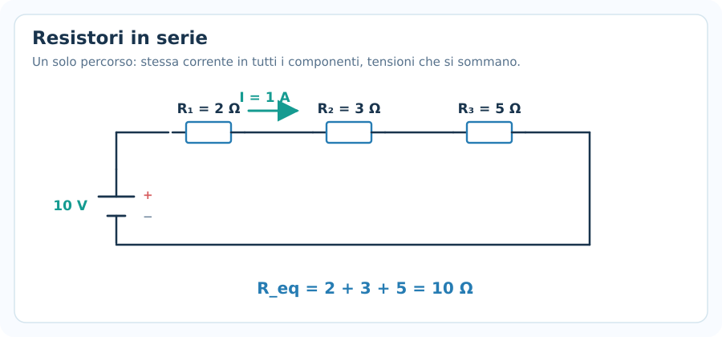
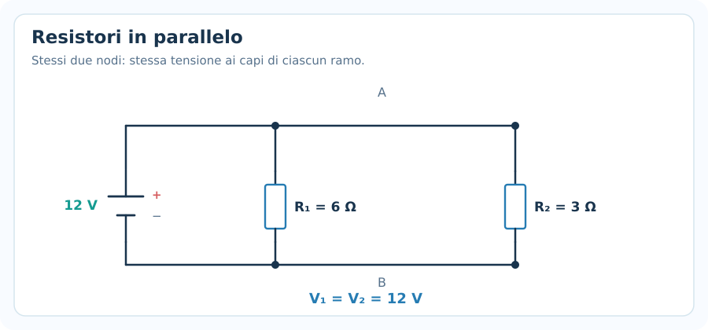
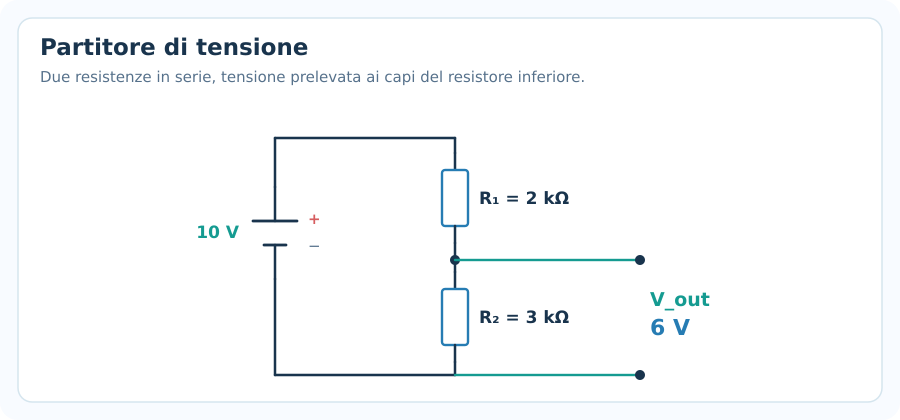
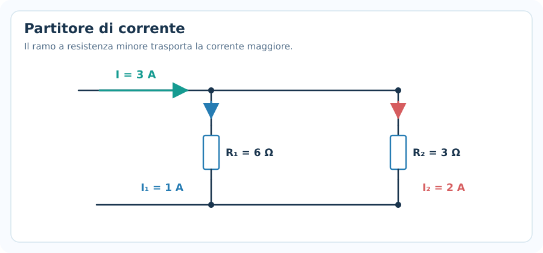
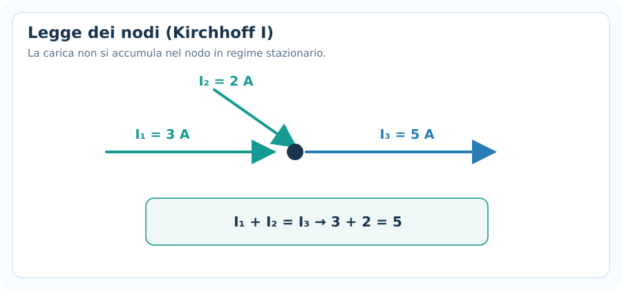
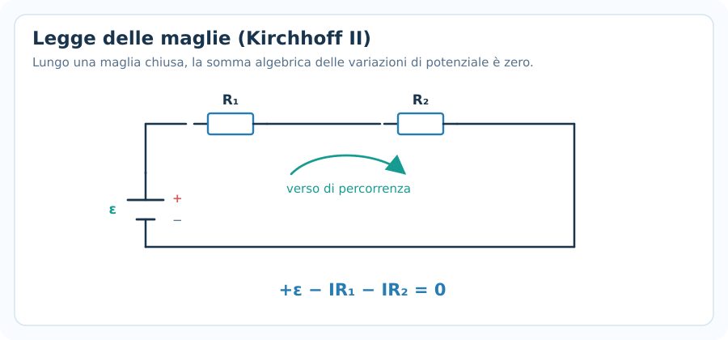
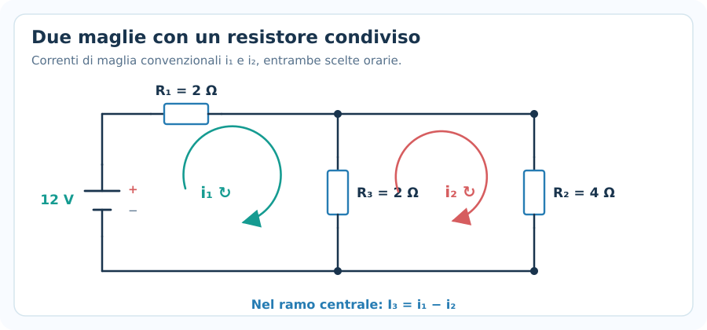
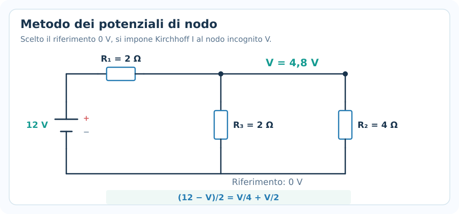
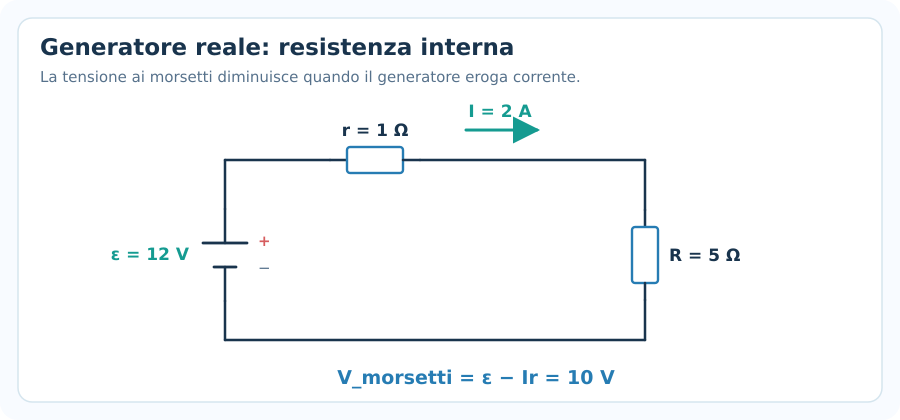
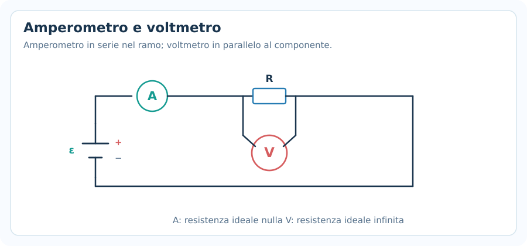

# Circuiti elettrici e leggi di Kirchhoff

> **Fisica — Informatica UPO · Elettromagnetismo · Nota 06**  
> **Prerequisiti:** corrente elettrica, differenza di potenziale, legge di Ohm, potenza elettrica.  
> **Obiettivo:** ridurre reti di resistori, applicare correttamente le leggi dei nodi e delle maglie e impostare sistemi di equazioni senza errori di segno.

## 1. Che cos'è un circuito elettrico?

Un **circuito elettrico** è un insieme di componenti collegati da conduttori in cui può circolare corrente. Negli esercizi studieremo soprattutto circuiti a **corrente continua (DC)** in **regime stazionario**.

I componenti principali sono:

- **Generatore di tensione:** mantiene una differenza di potenziale tra i propri morsetti.
- **Resistore:** ostacola il passaggio di corrente e dissipa energia.
- **Fili ideali:** sono considerati a resistenza nulla; tutti i punti dello stesso tratto di filo ideale hanno lo stesso potenziale.
- **Interruttore:** apre o chiude un collegamento.

Le tre grandezze più importanti sono:

| Grandezza | Simbolo | Unità |
|---|---|---|
| Corrente | $I$ | ampere ($\mathrm{A}$) |
| Tensione / differenza di potenziale | $V$ oppure $\Delta V$ | volt ($\mathrm{V}$) |
| Resistenza | $R$ | ohm ($\Omega$) |

La relazione fondamentale per un resistore ohmico è:

$$
\boxed{\Delta V=RI}
$$

> [!important] Prima di fare calcoli
> In uno schema elettrico, due punti uniti soltanto da **fili ideali** appartengono allo **stesso nodo** anche se il filo è disegnato con molte curve.

---

## 2. Nodi, rami e maglie

### Nodo

Un **nodo** è un insieme di punti collegati da fili ideali senza componenti intermedi. Tutti i punti del nodo hanno lo stesso potenziale.

### Ramo

Un **ramo** è una porzione di circuito compresa fra due nodi e può contenere uno o più componenti in serie.

### Percorso chiuso e maglia

Un **percorso chiuso** è un cammino che parte da un punto e torna allo stesso punto. Negli esercizi con le correnti di maglia, si scelgono in genere le **maglie elementari**, ossia percorsi chiusi che non racchiudono altre maglie.

**Le due leggi di Kirchhoff si applicano a:**

- Nodi → conservazione della carica.
- Maglie chiuse → conservazione dell'energia.

---

## 3. Resistori in serie

Due o più resistori sono **in serie** se sono attraversati **dalla stessa corrente**: fra loro non esistono diramazioni in cui la corrente possa dividersi.

### Proprietà principali

**Corrente uguale:**

$$
\boxed{I_1=I_2=\cdots=I}
$$

**Somma delle tensioni:**

$$
\boxed{V_{\mathrm{tot}}=V_1+V_2+\cdots}
$$

Applicando Ohm a ciascun resistore:

$$
V_{\mathrm{tot}}=IR_1+IR_2+\cdots
$$

$$
V_{\mathrm{tot}}=I(R_1+R_2+\cdots)
$$

Da cui la **resistenza equivalente**:

$$
\boxed{R_{\mathrm{eq}}=R_1+R_2+\cdots+R_n}
$$

### Esempio — Tre resistenze in serie

Un generatore ideale da $10\ \mathrm{V}$ alimenta $R_1=2\ \Omega$, $R_2=3\ \Omega$ e $R_3=5\ \Omega$ collegati in serie.

**1. Resistenza equivalente**

$$
R_{\mathrm{eq}}=2+3+5=10\ \Omega
$$

**2. Corrente**

$$
I=\frac{10}{10}=\boxed{1\ \mathrm{A}}
$$

**3. Cadute di tensione**

$$
V_1=2\ \mathrm{V},\qquad V_2=3\ \mathrm{V},\qquad V_3=5\ \mathrm{V}
$$

Controllo: $2+3+5=10\ \mathrm{V}$.

> [!warning] Errore frequente
> In serie **non** è la tensione a essere uguale sui resistori, ma la corrente.

---

## 4. Resistori in parallelo

Due resistori sono **in parallelo** quando i rispettivi terminali sono collegati agli stessi due nodi.

### Proprietà principali

**Tensione uguale:**

$$
\boxed{V_1=V_2=\cdots=V}
$$

**Somma delle correnti:**

$$
\boxed{I_{\mathrm{tot}}=I_1+I_2+\cdots}
$$

Da Ohm:

$$
\frac{V}{R_{\mathrm{eq}}}=\frac{V}{R_1}+\frac{V}{R_2}+\cdots
$$

Semplificando $V$:

$$
\boxed{\frac{1}{R_{\mathrm{eq}}}=\frac{1}{R_1}+\frac{1}{R_2}+\cdots+\frac{1}{R_n}}
$$

### Due resistori in parallelo

Per due soli resistori vale la scorciatoia:

$$
\boxed{R_{\mathrm{eq}}=\frac{R_1R_2}{R_1+R_2}}
$$

### Esempio

Con $R_1=6\ \Omega$ e $R_2=3\ \Omega$ in parallelo a $12\ \mathrm{V}$:

$$
R_{\mathrm{eq}}=\frac{6\cdot3}{6+3}=\boxed{2\ \Omega}
$$

Le correnti nei rami sono:

$$
I_1=\frac{12}{6}=2\ \mathrm{A},\qquad I_2=\frac{12}{3}=4\ \mathrm{A}
$$

$$
I_{\mathrm{tot}}=2+4=\boxed{6\ \mathrm{A}}
$$

Controllo alternativo: $12/2=6\ \mathrm{A}$.

> [!important] Controllo immediato
> Una resistenza equivalente di resistori **in parallelo positivi** deve essere **minore della più piccola resistenza** del gruppo.

---

## 5. Come ridurre circuiti misti

Un circuito **misto** contiene gruppi in serie e in parallelo.

### Metodo meccanico

1. Individua due resistori che condividono gli stessi due nodi: sono in parallelo.
2. Individua componenti attraversati necessariamente dalla stessa corrente: sono in serie.
3. Sostituisci un gruppo con la sua resistenza equivalente.
4. Ripeti finché resta un resistore equivalente complessivo.
5. Trova la corrente totale con Ohm.
6. Torna indietro, ricostruendo tensioni e correnti dei gruppi originari.

### Esempio — Serie con un gruppo parallelo

Un generatore da $10{,}8\ \mathrm{V}$ alimenta $R_3=3\ \Omega$ in serie a un parallelo formato da $R_1=4\ \Omega$ e $R_2=6\ \Omega$.

**Parallelo:**

$$
R_{12}=\frac{4\cdot6}{4+6}=2{,}4\ \Omega
$$

**Totale:**

$$
R_{\mathrm{eq}}=3+2{,}4=5{,}4\ \Omega
$$

**Corrente totale:**

$$
I=\frac{10{,}8}{5{,}4}=\boxed{2\ \mathrm{A}}
$$

**Tensione sul resistore in serie:**

$$
V_3=IR_3=2\cdot3=6\ \mathrm{V}
$$

**Tensione sul parallelo:**

$$
V_{12}=10{,}8-6=4{,}8\ \mathrm{V}
$$

**Correnti nei rami:**

$$
I_1=\frac{4{,}8}{4}=1{,}2\ \mathrm{A},\quad
I_2=\frac{4{,}8}{6}=0{,}8\ \mathrm{A}
$$

Controllo: $1{,}2+0{,}8=2\ \mathrm{A}$.

**Attenzione:** non tutti i circuiti possono essere semplificati solo con serie e parallelo; in quel caso servono Kirchhoff o il metodo dei nodi.

---

## 6. Partitore di tensione

Un **partitore di tensione** è costituito, nel caso più semplice, da due resistenze in serie alimentate da una tensione $V_{\mathrm{in}}$.

Dato che la corrente è identica:

$$
I=\frac{V_{\mathrm{in}}}{R_1+R_2}
$$

La tensione ai capi di $R_2$ è:

$$
V_{\mathrm{out}}=IR_2
$$

Quindi:

$$
\boxed{V_{\mathrm{out}}=V_{\mathrm{in}}\frac{R_2}{R_1+R_2}}
$$

### Esempio

Con $V_{\mathrm{in}}=10\ \mathrm{V}$, $R_1=2\ \mathrm{k\Omega}$ e $R_2=3\ \mathrm{k\Omega}$:

$$
V_{\mathrm{out}}=10\cdot\frac{3}{2+3}=\boxed{6\ \mathrm{V}}
$$

**Condizione:** la formula semplice vale quando non c'è un carico aggiuntivo collegato in parallelo a $R_2$. Se compare un carico, devi considerare il parallelo risultante.

---

## 7. Partitore di corrente

In due resistenze in parallelo la corrente si divide **in proporzione inversa alle resistenze**.

Sia $I$ la corrente totale che entra nel parallelo. Per due rami:

$$
\boxed{I_1=I\frac{R_2}{R_1+R_2}}
$$

$$
\boxed{I_2=I\frac{R_1}{R_1+R_2}}
$$

**Attenzione ai pedici:** nella formula della corrente del ramo 1, al numeratore compare la resistenza **dell'altro ramo**.

### Esempio

Con $I=3\ \mathrm{A}$, $R_1=6\ \Omega$, $R_2=3\ \Omega$:

$$
I_1=3\frac{3}{6+3}=\boxed{1\ \mathrm{A}}
$$

$$
I_2=3\frac{6}{6+3}=\boxed{2\ \mathrm{A}}
$$

Controllo: $I_1+I_2=3\ \mathrm{A}$.

---

## 8. Prima legge di Kirchhoff: legge dei nodi

La prima legge di Kirchhoff è una conseguenza della **conservazione della carica**.

In un nodo di un circuito stazionario non si accumula carica elettrica.

Quindi:

$$
\boxed{\sum I_{\mathrm{entranti}}=\sum I_{\mathrm{uscenti}}}
$$

Oppure, usando le correnti algebriche con una convenzione coerente:

$$
\boxed{\sum_k I_k=0}
$$

### Esempio

Entrano in un nodo $3\ \mathrm{A}$ e $2\ \mathrm{A}$. Esce una corrente incognita $I_3$.

$$
3+2=I_3
$$

$$
\boxed{I_3=5\ \mathrm{A}}
$$

### Se il risultato è negativo

Puoi **scegliere liberamente** il verso iniziale di una corrente incognita. Se ottieni, ad esempio, $I=-2\ \mathrm{A}$, significa che **la corrente reale scorre nel verso opposto** a quello ipotizzato, con modulo $2\ \mathrm{A}$.

Non è un errore da correggere cambiando arbitrariamente il segno.

---

## 9. Seconda legge di Kirchhoff: legge delle maglie

La seconda legge di Kirchhoff è la conseguenza della **conservazione dell'energia** nei circuiti a parametri concentrati, quando non intervengono flussi magnetici variabili non rappresentati da elementi circuitali.

Percorrendo una maglia chiusa, la somma algebrica delle differenze di potenziale è zero:

$$
\boxed{\sum_{\mathrm{maglia}}\Delta V=0}
$$

### Come scegliere i segni

Scegli un verso di percorrenza, ad esempio orario, e segui queste regole:

| Elemento attraversato | Attraversamento | Contributo $\Delta V$ |
|---|---|---|
| Generatore ideale | Da $-$ a $+$ | $+\mathcal E$ |
| Generatore ideale | Da $+$ a $-$ | $-\mathcal E$ |
| Resistore | Nel verso della corrente assunta | $-IR$ |
| Resistore | Contro il verso della corrente assunta | $+IR$ |

Per un generatore ideale e due resistenze in serie, scegliendo il verso della corrente:

$$
+\mathcal E-IR_1-IR_2=0
$$

Da cui:

$$
\boxed{I=\frac{\mathcal E}{R_1+R_2}}
$$

### Perché il segno di un resistore dipende dal verso?

La corrente convenzionale in un resistore ohmico scorre dal potenziale maggiore al potenziale minore. Se attraversi il resistore nel verso della corrente, il potenziale **diminuisce** di $IR$.

> [!warning] Regola pratica sui segni
> Prima scegli i versi; **poi non cambiarli durante la risoluzione**. Una corrente negativa indicherà un verso reale opposto a quello inizialmente scelto.

---

## 10. Metodo meccanico per un circuito non riducibile

Quando non riesci a ridurre il circuito soltanto con serie e parallelo:

1. **Disegna chiaramente i nodi** e contrassegna con un punto i collegamenti elettrici effettivi.
2. **Assegna un verso arbitrario alle correnti** nei rami, oppure scegli le correnti di maglia.
3. **Scrivi le equazioni dei nodi** per conservare la carica.
4. **Scegli le maglie indipendenti** e stabilisci il verso di percorrenza di ciascuna.
5. **Scrivi la legge delle maglie** mantenendo i segni scelti.
6. **Risolvi il sistema di equazioni** e interpreta eventuali correnti negative.
7. **Controlla:** correnti entranti/uscienti, somma delle tensioni, potenza fornita e dissipata.

Non è necessario scrivere tutte le equazioni dei nodi: una risulterà dipendente dalle altre. Analogamente, si seleziona un insieme sufficiente di maglie indipendenti.

---

## 11. Metodo delle correnti di maglia

In un circuito planare puoi introdurre una corrente di maglia incognita per ogni maglia elementare indipendente.

Le correnti di maglia **sono variabili matematiche scelte da te**: una corrente fisica in un ramo comune a due maglie è la somma algebrica delle due correnti di maglia.

### Esempio completo con due maglie

Consideriamo lo schema illustrato:

- Generatore ideale $\mathcal E=12\ \mathrm{V}$.
- Resistore superiore $R_1=2\ \Omega$.
- Resistore centrale condiviso $R_3=2\ \Omega$.
- Resistore destro $R_2=4\ \Omega$.

Scegliamo **entrambe le correnti di maglia in verso orario**, $i_1$ e $i_2$.

Nel resistore centrale, la corrente assunta verso il basso è:

$$
I_3=i_1-i_2
$$

### Equazione della maglia sinistra

Attraversando il generatore dal polo negativo al positivo e poi i resistori:

$$
12-2i_1-2(i_1-i_2)=0
$$

$$
\boxed{4i_1-2i_2=12}
$$

### Equazione della maglia destra

Nel resistore destro scorre $i_2$; il resistore centrale viene attraversato in verso contrario alla corrente $i_1-i_2$:

$$
-4i_2-2(i_2-i_1)=0
$$

$$
\boxed{-2i_1+6i_2=0}
$$

### Risoluzione del sistema

$$
\begin{cases}
4i_1-2i_2=12\\
-2i_1+6i_2=0
\end{cases}
$$

Dalla seconda:

$$
i_1=3i_2
$$

Sostituendo nella prima:

$$
12i_2-2i_2=12\quad\Rightarrow\quad
\boxed{i_2=1{,}2\ \mathrm{A}}
$$

Quindi:

$$
\boxed{i_1=3{,}6\ \mathrm{A}}
$$

La corrente nel resistore centrale è:

$$
\boxed{I_3=i_1-i_2=2{,}4\ \mathrm{A}}
$$

**Controllo con la legge dei nodi:**

$$
3{,}6=1{,}2+2{,}4\ \mathrm{A}
$$

Il sistema è coerente.

---

## 12. Metodo dei potenziali di nodo

Un'alternativa spesso più veloce alle correnti di maglia è il **metodo dei nodi**.

Si sceglie un nodo come riferimento, ponendo:

$$
\boxed{V_{\mathrm{rif}}=0}
$$

Le incognite diventano i **potenziali degli altri nodi**, non le correnti nei rami.

### Corrente attraverso una resistenza tra due nodi

Se il resistore $R$ collega i nodi di potenziale $V_a$ e $V_b$, la corrente assunta da $a$ verso $b$ è:

$$
\boxed{I_{a\to b}=\frac{V_a-V_b}{R}}
$$

Questa formula deriva direttamente dalla legge di Ohm.

### Esempio sul circuito precedente

Scegliamo il nodo inferiore come riferimento $0\ \mathrm{V}$. Il morsetto positivo del generatore vale $12\ \mathrm{V}$. Il nodo superiore comune ai resistori di destra ha tensione incognita $V$.

La corrente che arriva al nodo da sinistra è:

$$
I_1=\frac{12-V}{2}
$$

Le correnti che escono verso il basso sono:

$$
I_2=\frac{V}{4},\qquad I_3=\frac{V}{2}
$$

Kirchhoff al nodo:

$$
\frac{12-V}{2}=\frac{V}{4}+\frac{V}{2}
$$

Moltiplichiamo per 4:

$$
24-2V=V+2V
$$

$$
\boxed{V=4{,}8\ \mathrm{V}}
$$

Ricaviamo le correnti:

$$
I_1=\frac{12-4{,}8}{2}=\boxed{3{,}6\ \mathrm{A}}
$$

$$
I_2=\frac{4{,}8}{4}=\boxed{1{,}2\ \mathrm{A}}
$$

$$
I_3=\frac{4{,}8}{2}=\boxed{2{,}4\ \mathrm{A}}
$$

Sono gli stessi risultati del metodo delle maglie.

### Quando conviene usare i nodi?

- Quando ci sono pochi nodi essenziali.
- Quando molte resistenze sono collegate a un unico nodo.
- Quando vuoi ottenere subito i potenziali e le differenze di tensione.

Per i generatori ideali posti tra due nodi incogniti può essere necessario utilizzare un **supernodo**; nei problemi introduttivi spesso basta un nodo di riferimento opportuno.

---

## 13. Generatori reali e resistenza interna

Un generatore reale possiede una **resistenza interna** $r$.

Un modello semplice è una forza elettromotrice ideale $\mathcal E$ in serie a $r$.

Se il generatore **eroga** una corrente $I$ verso il carico, la sua tensione ai morsetti vale:

$$
\boxed{V_{\mathrm{morsetti}}=\mathcal E-Ir}
$$

Per un unico resistore esterno $R$:

$$
\boxed{I=\frac{\mathcal E}{R+r}}
$$

### Esempio

Dati: $\mathcal E=12\ \mathrm{V}$, $r=1\ \Omega$, $R=5\ \Omega$.

$$
I=\frac{12}{5+1}=\boxed{2\ \mathrm{A}}
$$

$$
V_{\mathrm{morsetti}}=12-2\cdot1=\boxed{10\ \mathrm{V}}
$$

Controllo: $V_R=IR=2\cdot5=10\ \mathrm{V}$.

> [!important] Convenzione
> Quando il generatore **viene caricato**, il verso della corrente si inverte nel modello e la relazione ai morsetti può diventare $V=\mathcal E+Ir$, considerando $I$ positivo entrante nel polo positivo. Non usare automaticamente il segno meno senza identificare il funzionamento.

---

## 14. Amperometri e voltmetri

### Amperometro

Misura la corrente in un ramo e si collega **in serie** al componente o al ramo di interesse.

Un amperometro **ideale** ha resistenza nulla:

$$
\boxed{R_A=0}
$$

### Voltmetro

Misura la differenza di potenziale fra due punti e si collega **in parallelo** al componente.

Un voltmetro **ideale** ha resistenza infinita:

$$
\boxed{R_V\to\infty}
$$

### Perché?

- Se un amperometro avesse resistenza elevata, cambierebbe significativamente la corrente che vuole misurare.
- Se un voltmetro avesse resistenza piccola, assorbirebbe molta corrente e altererebbe il circuito.

**Attenzione:** collegare un amperometro direttamente ai morsetti di una batteria può creare un cortocircuito ed essere pericoloso nella pratica.

---

## 15. Potenza ed energia nei circuiti

Per un componente che assorbe energia elettrica, con corrente entrante nel morsetto a potenziale maggiore:

$$
\boxed{P=VI}
$$

Per un resistore ohmico:

$$
\boxed{P=I^2R=\frac{V^2}{R}}
$$

L'energia dissipata durante un intervallo $\Delta t$ con potenza costante è:

$$
\boxed{E=P\Delta t}
$$

### Controllo delle potenze

Nel circuito dell'esempio a due maglie:

- Il generatore eroga $12\cdot3{,}6=43{,}2\ \mathrm{W}$.
- $R_1$ dissipa $(3{,}6)^2\cdot2=25{,}92\ \mathrm{W}$.
- $R_2$ dissipa $(1{,}2)^2\cdot4=5{,}76\ \mathrm{W}$.
- $R_3$ dissipa $(2{,}4)^2\cdot2=11{,}52\ \mathrm{W}$.

Somma delle dissipazioni:

$$
25{,}92+5{,}76+11{,}52=\boxed{43{,}2\ \mathrm{W}}
$$

**Potenza fornita = potenza assorbita**, nel modello ideale: ottimo controllo finale.

---

## 16. Collegamento con i condensatori: regime continuo

I circuiti possono contenere anche condensatori, già introdotti nella nota precedente.

Un condensatore ideale soddisfa:

$$
\boxed{q=CV}
$$

La corrente è legata alla variazione della carica:

$$
\boxed{I_C=\frac{dq}{dt}=C\frac{dV_C}{dt}}
$$

Per una **sorgente continua** dopo che è trascorso un tempo sufficientemente lungo, il circuito può raggiungere un regime stazionario in cui la tensione sul condensatore è costante:

$$
\frac{dV_C}{dt}=0\quad\Rightarrow\quad\boxed{I_C=0}
$$

Quindi, in regime DC stazionario, il condensatore ideale si comporta come un **circuito aperto**.

**Durante la carica o scarica non è così:** la corrente può essere diversa da zero. Lo studieremo in dettaglio nella nota sui **circuiti RC**.

---

## 17. Errori più frequenti negli esercizi

### 1. Scambiare serie e parallelo

- Serie → stessa corrente.
- Parallelo → stessa tensione.

Non basta che due resistori siano disegnati affiancati per essere in parallelo: devono essere collegati agli **stessi due nodi**.

### 2. Sommare le resistenze in parallelo

Per due resistori:

$$
R_{\mathrm{eq}}=\frac{R_1R_2}{R_1+R_2}
$$

Non $R_1+R_2$.

### 3. Sbagliare i segni in una maglia

Il segno dipende da **come attraversi il componente** rispetto al verso scelto, non dal fatto che si trovi a sinistra o a destra nel disegno.

### 4. Trattare come errore una corrente negativa

Un risultato negativo indica semplicemente **verso reale opposto** a quello assunto.

### 5. Dimenticare che un resistore condiviso contiene due correnti di maglia

Se due correnti di maglia attraversano lo stesso resistore in versi opposti:

$$
I_{\mathrm{ramo}}=i_1-i_2
$$

Non $i_1$ e non necessariamente $i_2$.

### 6. Confondere i prefissi

$$
1\ \mathrm{k\Omega}=10^3\ \Omega
$$

$$
1\ \mathrm{mA}=10^{-3}\ \mathrm{A}
$$

Per esempio, $10\ \mathrm{V}/(2\ \mathrm{k\Omega})=5\ \mathrm{mA}$.

### 7. Non controllare la conservazione della corrente

In un nodo deve sempre valere:

$$
\sum I_{\mathrm{entranti}}=\sum I_{\mathrm{uscenti}}
$$

### 8. Applicare il partitore di tensione sotto carico senza adattarlo

Se un componente è collegato fra l'uscita del partitore e il nodo di riferimento, può modificare la resistenza equivalente del ramo inferiore.

### 9. Confondere energia e potenza

- Potenza: $P$ in watt.
- Energia: $E=P\Delta t$ in joule.

### 10. Presumere sempre resistori ohmici

La legge $V=RI$ con $R$ costante è il modello di un **resistore ohmico**. Per componenti non lineari serve la loro caratteristica corrente–tensione.

---

## 18. Come riconoscere il procedimento giusto all'esame

| Quando il testo parla di… | Parti da… |
|---|---|
| Resistori attraversati dalla stessa corrente | Serie: $R_{\mathrm{eq}}=\sum R_i$ |
| Resistori sugli stessi due nodi | Parallelo: $1/R_{\mathrm{eq}}=\sum 1/R_i$ |
| Tensione su una resistenza in serie | Partitore di tensione |
| Corrente in due rami paralleli | Partitore di corrente |
| Correnti che confluiscono in un nodo | Kirchhoff I |
| Più generatori o più percorsi chiusi | Kirchhoff II |
| Due maglie con resistore condiviso | Correnti di maglia; $I_{\mathrm{comune}}=i_1-i_2$ (con versi opposti) |
| Pochi nodi incogniti | Metodo dei potenziali di nodo |
| Batteria con resistenza interna | $I=\mathcal E/(R+r)$ nel caso semplice |
| Dissipazione su un resistore | $P=I^2R=V^2/R$ |
| Misurare corrente o tensione | Amperometro in serie, voltmetro in parallelo |

---

## 19. Formulario essenziale

### Legge di Ohm

$$
\boxed{V=RI}
$$

### Serie

$$
\boxed{R_{\mathrm{eq}}=\sum_i R_i}
$$

### Parallelo

$$
\boxed{\frac{1}{R_{\mathrm{eq}}}=\sum_i\frac1{R_i}}
$$

### Partitore di tensione (senza carico)

$$
\boxed{V_{\mathrm{out}}=V_{\mathrm{in}}\frac{R_2}{R_1+R_2}}
$$

### Partitore di corrente (due rami)

$$
\boxed{I_1=I\frac{R_2}{R_1+R_2}}
$$

### Kirchhoff — nodi

$$
\boxed{\sum I_{\mathrm{entranti}}=\sum I_{\mathrm{uscenti}}}
$$

### Kirchhoff — maglie

$$
\boxed{\sum_{\mathrm{maglia}}\Delta V=0}
$$

### Generatore reale (in erogazione)

$$
\boxed{V_{\mathrm{morsetti}}=\mathcal E-Ir}
$$

### Potenza

$$
\boxed{P=VI=I^2R=\frac{V^2}{R}}
$$

---

## 20. Verifica della comprensione

Prova prima a rispondere **senza guardare le formule**.

1. Tre resistori da $2\ \Omega$, $3\ \Omega$ e $5\ \Omega$ sono in serie. Qual è la resistenza equivalente? La corrente nei tre resistori è diversa?
2. Due resistenze da $4\ \Omega$ e $12\ \Omega$ sono in parallelo. Calcola la resistenza equivalente.
3. Un generatore da $9\ \mathrm{V}$ alimenta in serie due resistori da $1\ \mathrm{k\Omega}$ e $2\ \mathrm{k\Omega}$. Qual è la tensione sul secondo?
4. Entrano in un nodo $4\ \mathrm{A}$ e $1\ \mathrm{A}$. Da un ramo escono $3\ \mathrm{A}$. Quanto esce dall'altro?
5. Un circuito ha un generatore ideale da $12\ \mathrm{V}$ e resistenze da $2\ \Omega$ e $4\ \Omega$ in serie. Scrivi l'equazione della maglia usando un verso orario.
6. Due correnti di maglia assunte orarie valgono $i_1=5\ \mathrm{A}$ e $i_2=2\ \mathrm{A}$. Quanto vale la corrente nel resistore condiviso, prendendo positivo il verso di $i_1$?
7. Un generatore reale ha $\mathcal E=12\ \mathrm{V}$, $r=2\ \Omega$, carico $R=4\ \Omega$. Calcola la corrente e la tensione ai morsetti.
8. Perché una corrente negativa trovata in un sistema di Kirchhoff non implica che la soluzione sia sbagliata?
9. Se un resistore dissipa $8\ \mathrm{W}$ per $30\ \mathrm{s}$, quanta energia viene dissipata?
10. Perché un voltmetro ideale va collegato in parallelo e non in serie?

> [!tip] Preparazione UPO
> Per i problemi più semplici basta **serie/parallelo + Ohm**. Se non puoi ridurre direttamente il circuito, imposta **nodi e maglie**. Usa i controlli finali sulle correnti e sulle potenze: ti fanno scoprire rapidamente errori di segno o di algebra.
