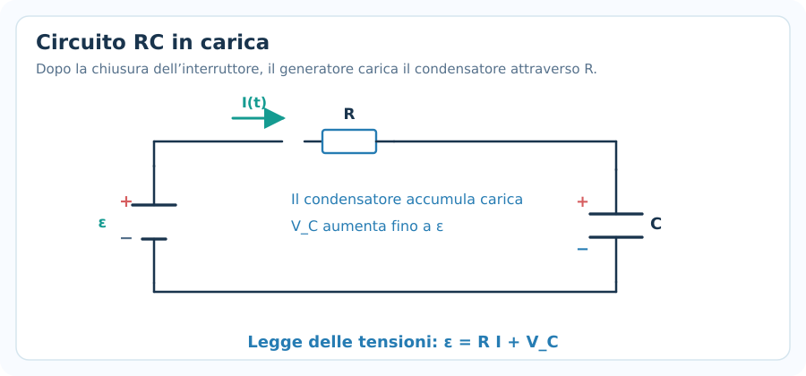
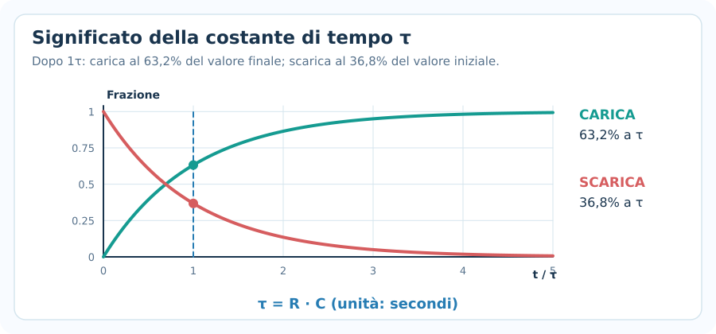
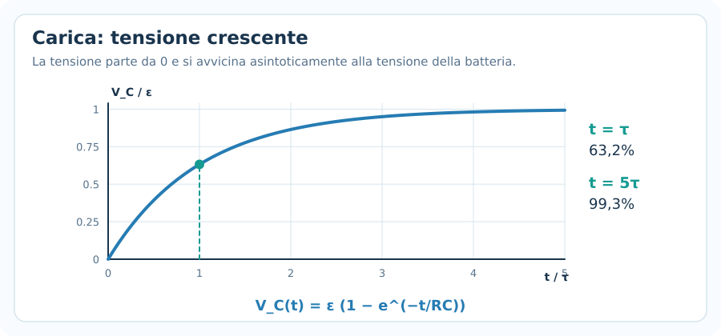
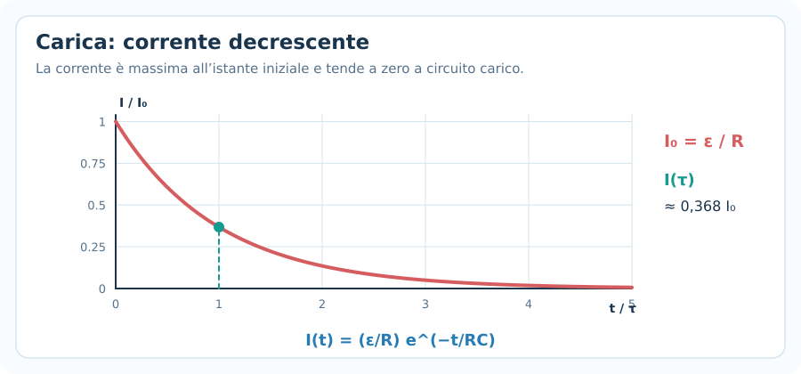
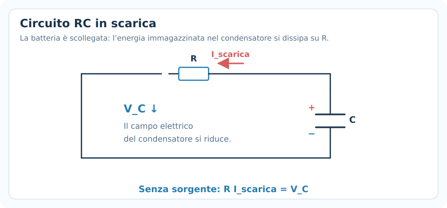
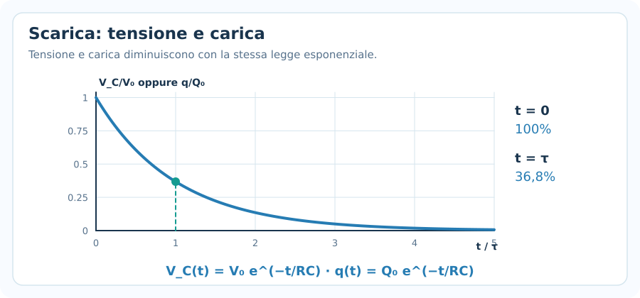
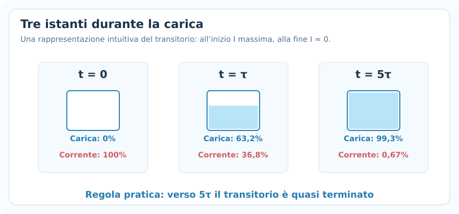
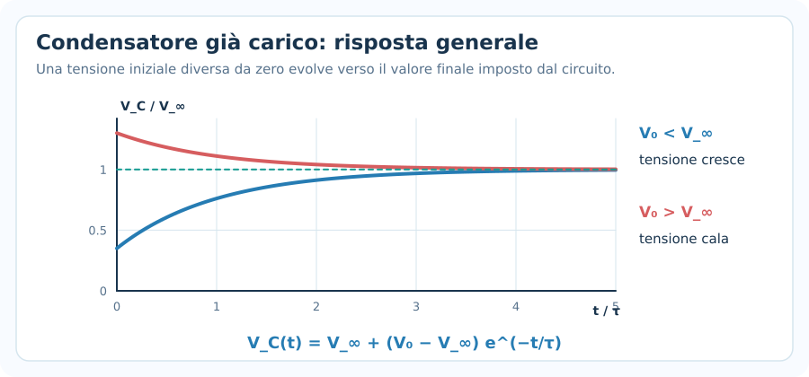
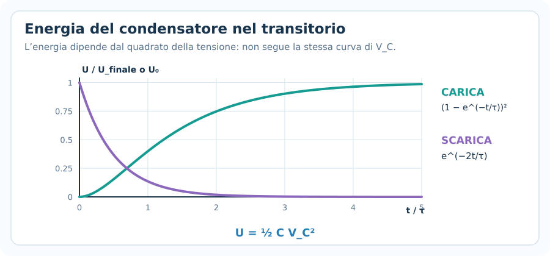
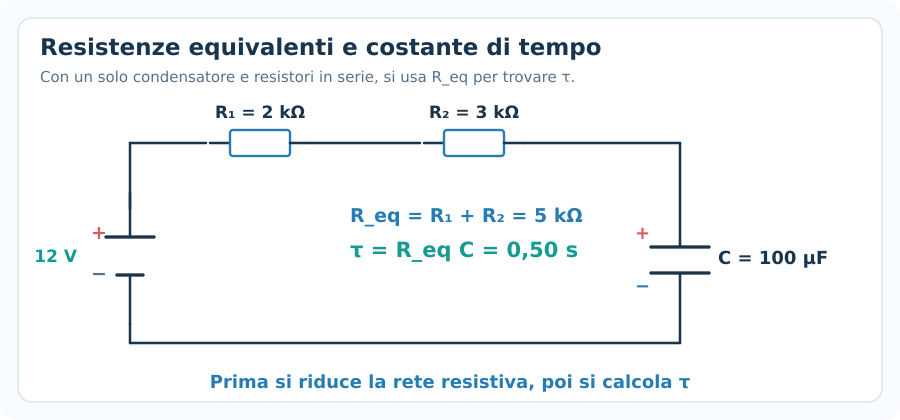

# Circuiti RC

> **Fisica — Informatica UPO · Elettromagnetismo · Nota 07**  
> **Prerequisiti:** condensatori, legge di Ohm, leggi di Kirchhoff, corrente e tensione.  
> **Obiettivo:** riconoscere carica e scarica di un condensatore, usare correttamente la costante di tempo $\tau=RC$, interpretare le leggi esponenziali e risolvere gli esercizi sui transitori.

## 1. Che cos'è un circuito RC?

Un **circuito RC** contiene almeno un **resistore** ($R$) e un **condensatore** ($C$).

Quando si collega o si scollega un generatore, la tensione sul condensatore e la corrente generalmente **cambiano nel tempo**: questa fase è detta **regime transitorio**.

Il comportamento deriva da due leggi già studiate:

- **Legge di Ohm** per il resistore: $V_R=RI$.
- **Definizione di capacità** del condensatore: $q=CV_C$.

Assumiamo, salvo indicazione contraria, resistore e condensatore ideali, collegamenti ideali, generatore di tensione costante e capacità costante.

> [!important] Idea fondamentale
> Un condensatore ideale **non può cambiare istantaneamente la propria tensione**: per variare la carica sulle sue armature deve fluire corrente per un intervallo di tempo.
>
> In un circuito RC la resistenza regola la rapidità con cui questa carica viene trasferita.

---

## 2. Il circuito RC in carica

Consideriamo un generatore ideale di tensione costante $\mathcal{E}$, un resistore $R$ e un condensatore $C$, collegati in serie.

Prima di chiudere l'interruttore, supponiamo che il condensatore sia **scarico**:

$$
q(0)=0,\qquad V_C(0)=0.
$$

Dopo la chiusura del circuito:

1. La batteria mette in movimento le cariche.
2. Il condensatore accumula progressivamente carica sulle armature.
3. La differenza di potenziale $V_C$ aumenta.
4. La corrente diminuisce, perché la tensione disponibile sul resistore diminuisce.
5. Dopo un tempo sufficientemente lungo, il condensatore è praticamente carico e la corrente è quasi nulla.

### Cosa rimane vero in ogni istante?

Applicando la seconda legge di Kirchhoff:

$$
\boxed{\mathcal{E}=V_R(t)+V_C(t)}
$$

Con $V_R=RI$:

$$
\boxed{\mathcal{E}=RI(t)+V_C(t)}
$$

**La tensione del generatore si ripartisce fra resistore e condensatore.** La ripartizione cambia continuamente nel transitorio.

---

## 3. Formula della carica del condensatore

Nel caso di **condensatore inizialmente scarico**, le tre formule fondamentali sono:

**Carica sulle armature:**

$$
\boxed{q(t)=C\mathcal{E}\left(1-e^{-t/(RC)}\right)}
$$

**Tensione sul condensatore:**

$$
\boxed{V_C(t)=\mathcal{E}\left(1-e^{-t/(RC)}\right)}
$$

**Corrente nel circuito:**

$$
\boxed{I(t)=\frac{\mathcal{E}}{R}\,e^{-t/(RC)}}
$$

Le formule hanno questa struttura:

- $q(t)$ e $V_C(t)$ **crescono** da zero verso un valore massimo.
- $I(t)$ **decresce** dal suo valore iniziale verso zero.

### Valori iniziali e finali

All'istante $t=0^+$, subito dopo la chiusura:

$$
\boxed{q(0)=0,\quad V_C(0)=0,\quad I(0)=\frac{\mathcal{E}}{R}}
$$

Per $t\to\infty$:

$$
\boxed{q_\infty=C\mathcal{E},\quad V_{C,\infty}=\mathcal{E},\quad I_\infty=0}
$$

**Attenzione:** un condensatore può essere carico anche quando **non scorre più corrente** nel circuito.

### Tensione sul resistore

Dalla legge di Ohm:

$$
V_R(t)=RI(t)
$$

Perciò:

$$
\boxed{V_R(t)=\mathcal{E}e^{-t/(RC)}}
$$

Durante la carica $V_C$ aumenta e $V_R$ diminuisce. La loro somma resta $\mathcal{E}$.

---

## 4. Da dove vengono le formule? (Kirchhoff)

Questo passaggio permette di **ricostruire le formule**, invece di memorizzarle soltanto.

La legge delle maglie è:

$$
\mathcal{E}=RI+\frac{q}{C}
$$

La corrente di carica è la variazione di carica nell'unità di tempo:

$$
I=\frac{dq}{dt}
$$

Sostituendo:

$$
\boxed{R\frac{dq}{dt}+\frac{q}{C}=\mathcal{E}}
$$

Questa è un'**equazione differenziale del primo ordine**. La sua soluzione, con $q(0)=0$, è:

$$
q(t)=C\mathcal{E}(1-e^{-t/(RC)})
$$

Derivando la carica nel tempo otteniamo la corrente:

$$
I(t)=\frac{dq}{dt}=\frac{\mathcal{E}}{R}e^{-t/(RC)}
$$

> [!tip] Per gli esercizi UPO
> Normalmente non serve risolvere l'equazione differenziale da zero: è più importante saper **identificare carica o scarica**, sostituire i dati corretti e verificare i limiti a $t=0$ e $t\to\infty$.

---

## 5. Costante di tempo $\tau$

La **costante di tempo** del circuito RC semplice è:

$$
\boxed{\tau=RC}
$$

Dove:

- $R$ è espresso in ohm ($\Omega$).
- $C$ è espresso in farad ($\mathrm{F}$).
- $\tau$ è espresso in secondi ($\mathrm{s}$).

### Significato fisico

Più $\tau$ è grande, più lentamente avviene il transitorio.

- Aumentare **$R$** riduce la corrente e rallenta la carica/scarica.
- Aumentare **$C$** aumenta la carica da trasferire per una data variazione di tensione e rallenta il transitorio.

Dopo un tempo $\tau$:

**Durante la carica:**

$$
\frac{V_C(\tau)}{\mathcal{E}}=1-e^{-1}\approx\boxed{0{,}632}
$$

Il condensatore ha raggiunto circa il **63,2%** della tensione finale.

**Durante la scarica:**

$$
\frac{V_C(\tau)}{V_0}=e^{-1}\approx\boxed{0{,}368}
$$

Rimane circa il **36,8%** della tensione iniziale.

### Valori utili

| Tempo | Carica: $V_C/V_\infty$ | Scarica: $V_C/V_0$ |
|---|---:|---:|
| $0$ | $0\%$ | $100\%$ |
| $\tau$ | $63{,}2\%$ | $36{,}8\%$ |
| $2\tau$ | $86{,}5\%$ | $13{,}5\%$ |
| $3\tau$ | $95{,}0\%$ | $5{,}0\%$ |
| $5\tau$ | $99{,}3\%$ | $0{,}67\%$ |

**Regola pratica:** dopo circa $5\tau$ il transitorio si considera *quasi terminato*.

La tensione non raggiunge esattamente il valore limite in un tempo finito nel modello ideale.

### Conversione veloce delle unità

$$
1\ \mathrm{k\Omega}\cdot1\ \mathrm{\mu F}=10^{-3}\ \mathrm{s}=1\ \mathrm{ms}
$$

Per esempio:

$$
R=2\ \mathrm{k\Omega},\qquad C=100\ \mathrm{\mu F}
$$

$$
\tau=2000\cdot100\cdot10^{-6}=\boxed{0{,}20\ \mathrm{s}}
$$

---

## 6. Come leggere i grafici della carica

### Tensione e carica

Il grafico di $V_C(t)$ ha un andamento **esponenziale crescente**.

$$
V_C(t)=\mathcal{E}(1-e^{-t/\tau})
$$

Il valore finale è $\mathcal{E}$, non $0$.

Poiché $q=CV_C$, anche la carica segue la stessa forma del grafico:

$$
q(t)=q_\infty(1-e^{-t/\tau})
$$

### Corrente

La corrente segue un andamento **esponenziale decrescente**.

$$
I(t)=I_0 e^{-t/\tau},\qquad I_0=\frac{\mathcal{E}}R
$$

All'inizio la corrente è massima; a condensatore carico è nulla.

> [!warning] Errore frequente
> Non confondere le curve: **durante la carica del condensatore la corrente diminuisce**, mentre la tensione del condensatore aumenta.

---

## 7. Il circuito RC in scarica

Supponiamo che il condensatore sia già carico e che la batteria venga scollegata. Il condensatore rimane collegato a un resistore.

Il condensatore fornisce energia al resistore: la carica sulle armature e la tensione diminuiscono nel tempo.

Chiamiamo:

- $V_0$: tensione iniziale sul condensatore.
- $Q_0=CV_0$: carica iniziale.
- $\tau=RC$: costante di tempo.

Le formule fondamentali sono:

**Tensione:**

$$
\boxed{V_C(t)=V_0e^{-t/(RC)}}
$$

**Carica:**

$$
\boxed{q(t)=Q_0e^{-t/(RC)}}
$$

**Modulo della corrente di scarica:**

$$
\boxed{I_{\mathrm{scarica}}(t)=\frac{V_0}{R}e^{-t/(RC)}}
$$

### Verso e segno della corrente

Durante la scarica, la corrente scorre **in verso opposto** a quello che aveva durante la carica, nello stesso ramo.

Se scegli come verso positivo quello della **corrente di carica**, la corrente di scarica ha segno negativo:

$$
\boxed{I(t)=-\frac{V_0}{R}e^{-t/\tau}}
$$

Se invece scegli come positivo il **verso effettivo della scarica**, la corrente riportata nella formula precedente come $I_{\mathrm{scarica}}$ è positiva.

### Da Kirchhoff alla legge di scarica

Assumendo positiva la carica residua $q$ sulla piastra inizialmente positiva e positiva la corrente nel verso della scarica:

$$
I_{\mathrm{scarica}}=-\frac{dq}{dt}
$$

La maglia senza batteria dà:

$$
RI_{\mathrm{scarica}}=\frac{q}{C}
$$

Quindi:

$$
R\frac{dq}{dt}+\frac{q}{C}=0
$$

La soluzione è proprio:

$$
q(t)=Q_0e^{-t/(RC)}
$$

---

## 8. Grafico della scarica

Durante la scarica, $q(t)$ e $V_C(t)$ hanno la stessa forma esponenziale decrescente.

All'istante iniziale:

$$
V_C(0)=V_0,\qquad q(0)=Q_0
$$

Dopo un tempo molto lungo:

$$
V_C\to0,\qquad q\to0,\qquad I\to0
$$

Il tempo caratteristico è identico a quello della carica **solo se** il prodotto $RC$ del percorso di scarica è uguale.

Se la scarica avviene attraverso una resistenza diversa da quella usata per caricare il condensatore, cambia anche $\tau$.

---

## 9. Confronto rapido: carica e scarica

| Grandezza | Carica da zero con batteria $\mathcal E$ | Scarica da $V_0$ |
|---|---|---|
| Tensione $V_C(t)$ | $\mathcal{E}(1-e^{-t/\tau})$ | $V_0e^{-t/\tau}$ |
| Carica $q(t)$ | $C\mathcal{E}(1-e^{-t/\tau})$ | $CV_0e^{-t/\tau}$ |
| Modulo della corrente | $(\mathcal{E}/R)e^{-t/\tau}$ | $(V_0/R)e^{-t/\tau}$ |
| Tensione all'inizio | $0$ | $V_0$ |
| Tensione alla fine | $\mathcal{E}$ | $0$ |
| Corrente alla fine | $0$ | $0$ |

Il termine $1-e^{-t/\tau}$ compare quando una grandezza **cresce da zero verso un valore limite**.

Il termine $e^{-t/\tau}$ compare quando una grandezza **decresce verso zero**.

### Tre istanti da visualizzare

Non serve sapere a memoria tutta la tabella: sono fondamentali il comportamento iniziale, quello finale e il significato di $\tau$.

---

## 10. Esempio completo — Carica di un condensatore

Un generatore ideale da $12\ \mathrm V$ alimenta un circuito con:

$$
R=2{,}0\ \mathrm{k\Omega},\qquad C=100\ \mathrm{\mu F}
$$

Il condensatore è inizialmente scarico. Calcolare:

1. La costante di tempo.
2. La carica finale.
3. La corrente iniziale.
4. La tensione sul condensatore dopo un tempo $t=\tau$.
5. La corrente allo stesso istante.

### 1. Costante di tempo

$$
\tau=RC=(2000)(100\cdot10^{-6})
$$

$$
\boxed{\tau=0{,}20\ \mathrm{s}}
$$

### 2. Carica finale

$$
q_\infty=C\mathcal{E}
$$

$$
q_\infty=(100\cdot10^{-6})(12)
$$

$$
\boxed{q_\infty=1{,}20\cdot10^{-3}\ \mathrm C=1{,}20\ \mathrm{mC}}
$$

### 3. Corrente iniziale

$$
I_0=\frac{\mathcal{E}}R=\frac{12}{2000}
$$

$$
\boxed{I_0=0{,}006\ \mathrm A=6{,}00\ \mathrm{mA}}
$$

### 4. Tensione dopo una costante di tempo

$$
V_C(\tau)=12(1-e^{-1})
$$

$$
\boxed{V_C(\tau)\approx7{,}59\ \mathrm V}
$$

La carica allo stesso istante è:

$$
q(\tau)=CV_C(\tau)\approx\boxed{0{,}759\ \mathrm{mC}}
$$

### 5. Corrente dopo una costante di tempo

$$
I(\tau)=6{,}00\,e^{-1}\ \mathrm{mA}
$$

$$
\boxed{I(\tau)\approx2{,}21\ \mathrm{mA}}
$$

**Controllo con Kirchhoff:**

$$
V_R(\tau)=RI(\tau)\approx4{,}41\ \mathrm V
$$

$$
V_R(\tau)+V_C(\tau)\approx4{,}41+7{,}59=12\ \mathrm V
$$

Il bilancio torna.

---

## 11. Esempio completo — Scarica di un condensatore

Un condensatore è inizialmente a $V_0=10\ \mathrm V$. Viene scaricato attraverso:

$$
R=100\ \mathrm{k\Omega},\qquad C=47\ \mathrm{\mu F}
$$

Calcolare la tensione residua e il modulo della corrente dopo $t=9{,}4\ \mathrm s$.

### 1. Costante di tempo

$$
\tau=RC=(100\cdot10^3)(47\cdot10^{-6})
$$

$$
\boxed{\tau=4{,}7\ \mathrm s}
$$

Notiamo che:

$$
t=9{,}4\ \mathrm s=2\tau
$$

### 2. Tensione residua

$$
V_C(t)=V_0e^{-t/\tau}=10e^{-2}
$$

$$
\boxed{V_C(9{,}4\ \mathrm s)\approx1{,}35\ \mathrm V}
$$

### 3. Corrente nel verso della scarica

$$
I_{\mathrm{scarica}}(t)=\frac{V_C(t)}R
$$

$$
I_{\mathrm{scarica}}=\frac{1{,}353}{100000}
$$

$$
\boxed{I_{\mathrm{scarica}}\approx13{,}5\ \mathrm{\mu A}}
$$

È possibile ricavare anche la carica residua:

$$
q(t)=CV_C(t)\approx\boxed{63{,}6\ \mathrm{\mu C}}
$$

---

## 12. Trovare il tempo necessario per raggiungere una certa tensione

Nei problemi può essere richiesto **dopo quanto tempo** si raggiunge una percentuale della tensione iniziale o finale.

Occorre isolare il tempo usando il **logaritmo naturale** $\ln$.

### Durante la carica

$$
V_C(t)=\mathcal{E}(1-e^{-t/\tau})
$$

Dividiamo per $\mathcal E$:

$$
\frac{V_C}{\mathcal E}=1-e^{-t/\tau}
$$

Isoliamo l'esponenziale:

$$
e^{-t/\tau}=1-\frac{V_C}{\mathcal E}
$$

Applichiamo il logaritmo:

$$
-\frac{t}{\tau}=\ln\left(1-\frac{V_C}{\mathcal E}\right)
$$

Quindi:

$$
\boxed{t=-RC\ln\left(1-\frac{V_C}{\mathcal E}\right)}
$$

Questa formula vale per una carica da $0$ con tensione finale $\mathcal E$ e $0\leq V_C<\mathcal E$.

**Esempio: raggiungere il 90% della tensione finale**

$$
t=-\tau\ln(1-0{,}90)=\tau\ln10
$$

$$
\boxed{t\approx2{,}303\tau}
$$

Se $\tau=0{,}20\ \mathrm s$:

$$
\boxed{t\approx0{,}461\ \mathrm s}
$$

### Durante la scarica

Partiamo da:

$$
V_C(t)=V_0e^{-t/\tau}
$$

Dividendo per $V_0$ e applicando il logaritmo:

$$
\boxed{t=RC\ln\left(\frac{V_0}{V_C}\right)}
$$

**Esempio: tempo di dimezzamento**

$$
\frac{V_C}{V_0}=\frac12
$$

$$
t=\tau\ln2
$$

$$
\boxed{t_{1/2}\approx0{,}693\tau}
$$

> [!warning] Attenzione
> Il condensatore **non** perde metà della tensione ogni intervallo di tempo $\tau$.
>
> Dopo un intervallo $\tau$ conserva circa il $36{,}8\%$ del valore che aveva all'inizio di quell'intervallo. Il tempo per dimezzarsi è $\tau\ln2$.

---

## 13. Condensatore inizialmente carico: formula generale

Le formule della carica da zero e della scarica fino a zero sono casi particolari di una formula molto utile.

Se il condensatore parte dalla tensione $V_0$ e tende verso una tensione finale costante $V_\infty$:

$$
\boxed{V_C(t)=V_\infty+(V_0-V_\infty)e^{-t/\tau}}
$$

Per il circuito RC semplice, $\tau=RC$.

### I due casi già studiati

**Carica da zero verso $\mathcal E$:**

$$
V_0=0,\qquad V_\infty=\mathcal E
$$

$$
V_C(t)=\mathcal E(1-e^{-t/\tau})
$$

**Scarica verso zero:**

$$
V_\infty=0
$$

$$
V_C(t)=V_0e^{-t/\tau}
$$

### Esempio — Condensatore già a 5 V

Un condensatore parte da $V_0=5\ \mathrm V$ e viene collegato a una batteria da $12\ \mathrm V$ attraverso:

$$
R=4\ \mathrm{k\Omega},\qquad C=50\ \mathrm{\mu F}
$$

La costante di tempo è:

$$
\tau=4000\cdot50\cdot10^{-6}=0{,}20\ \mathrm s
$$

La tensione dopo $t=\tau$ è:

$$
V_C(\tau)=12+(5-12)e^{-1}
$$

$$
\boxed{V_C(\tau)\approx9{,}42\ \mathrm V}
$$

La corrente iniziale è determinata dalla **differenza** fra tensione del generatore e tensione iniziale del condensatore:

$$
I(0)=\frac{12-5}{4000}=\boxed{1{,}75\ \mathrm{mA}}
$$

> [!important] Controllo iniziale
> Se il condensatore è già carico, **non usare** automaticamente $I_0=\mathcal E/R$. Occorre considerare la tensione iniziale $V_0$.

---

## 14. Energia immagazzinata e dissipata

L'energia elettrostatica immagazzinata in un condensatore è:

$$
\boxed{U_C=\frac12CV_C^2=\frac{q^2}{2C}}
$$

### Durante la carica

Per $V_0=0$:

$$
U_C(t)=\frac12C\mathcal E^2(1-e^{-t/\tau})^2
$$

Alla fine:

$$
\boxed{U_{C,\infty}=\frac12C\mathcal E^2}
$$

### Durante la scarica

Per un condensatore inizialmente a tensione $V_0$:

$$
U_C(t)=\frac12CV_0^2e^{-2t/\tau}
$$

L'energia decresce con $e^{-2t/\tau}$, non con $e^{-t/\tau}$.

### Dove finisce l'energia durante la scarica?

Nel circuito RC ideale senza generatore, tutta l'energia inizialmente immagazzinata viene dissipata come calore sul resistore:

$$
\boxed{E_{\mathrm{diss}}=\frac12CV_0^2}
$$

### Energia fornita dalla batteria durante la carica

Nel caso di condensatore inizialmente scarico, generatore ideale di tensione costante e resistore:

$$
E_{\mathrm{batt}}=\mathcal E\,q_\infty=C\mathcal E^2
$$

Di questa energia:

$$
U_{C,\infty}=\frac12C\mathcal E^2
$$

viene immagazzinata nel condensatore e:

$$
E_{\mathrm{diss}}=\frac12C\mathcal E^2
$$

viene dissipata nel resistore durante la carica ideale.

**La resistenza modifica quanto dura il processo, ma non queste due quote energetiche nel modello ideale descritto.**

---

## 15. Resistenze equivalenti nei circuiti RC

Se nel circuito sono presenti più resistori, bisogna capire attraverso quale resistenza **si carica o si scarica** il condensatore.

### Resistori in serie

Se $R_1$ e $R_2$ sono in serie nel percorso della corrente:

$$
R_{\mathrm{eq}}=R_1+R_2
$$

$$
\boxed{\tau=R_{\mathrm{eq}}C}
$$

**Esempio:**

$$
R_1=2\ \mathrm{k\Omega},\quad R_2=3\ \mathrm{k\Omega},\quad C=100\ \mathrm{\mu F}
$$

$$
\tau=(2000+3000)(100\cdot10^{-6})
$$

$$
\boxed{\tau=0{,}50\ \mathrm s}
$$

### Reti con diramazioni

Se ci sono più rami, non è sempre corretto sommare tutte le resistenze.

Per circuiti lineari con **un solo condensatore**, si può usare la **resistenza equivalente vista dal condensatore** ($R_{\mathrm{th}}$), ottenuta disattivando le sorgenti indipendenti nel circuito resistivo:

- Generatore ideale di tensione indipendente $\to$ **cortocircuito**.
- Generatore ideale di corrente indipendente $\to$ **circuito aperto**.

Poi:

$$
\boxed{\tau=R_{\mathrm{th}}C}
$$

Questo è un metodo più generale, utile nei circuiti non riducibili immediatamente a una singola resistenza in serie.

**Attenzione:** circuiti con più condensatori indipendenti possono avere più costanti di tempo; non sempre si possono descrivere con una sola legge esponenziale.

---

## 16. Interpretazione del regime stazionario

Dopo un tempo molto lungo sotto una tensione continua costante, un condensatore ideale raggiunge una tensione costante.

Poiché:

$$
I=C\frac{dV_C}{dt}
$$

se la tensione non varia:

$$
\frac{dV_C}{dt}=0\quad\Longrightarrow\quad\boxed{I=0}
$$

**Nel regime stazionario in corrente continua, il condensatore ideale si comporta come un circuito aperto.**

Questo non significa che $V_C=0$: il condensatore può mantenere una tensione non nulla.

### All'inizio della carica

Se il condensatore è **inizialmente scarico**:

$$
V_C(0^+)=0
$$

Nell'istante iniziale, nel semplice circuito serie alimentato da una batteria ideale, il condensatore ha caduta di tensione nulla. In questo senso lo si tratta **come un cortocircuito istantaneo per il calcolo della corrente iniziale**.

> [!warning] Precisione fisica
> Non è un filo in ogni situazione: questa analogia vale per l'istante iniziale di **un condensatore inizialmente scarico** in un modello ideale. La tensione del condensatore non può saltare da $0$ a un valore diverso istantaneamente.

---

## 17. Metodo meccanico per risolvere gli esercizi RC

**1. Disegna la situazione** e individua batteria, condensatore, resistori e interruttore.

**2. Individua la condizione iniziale:** il condensatore è scarico? Ha già una tensione $V_0$?

**3. Determina il valore finale** della tensione $V_\infty$, generalmente usando il regime stazionario.

**4. Calcola la resistenza vista dal condensatore** e la costante di tempo:

$$
\tau=R_{\mathrm{eq}}C
$$

**5. Scegli la formula:**

- Da $0$ a $\mathcal E$ $\to$ carica.
- Da $V_0$ a $0$ $\to$ scarica.
- Da $V_0$ a $V_\infty$ $\to$ risposta generale.

**6. Sostituisci i dati in unità SI**: ohm, farad e secondi.

**7. Controlla $t=0$ e $t\to\infty$**: sono i controlli più efficaci per individuare un errore di formula.

**8. Se cerchi il tempo**, usa il logaritmo naturale.

---

## 18. Errori frequenti negli esercizi

### 1. Confondere carica e scarica

Una tensione crescente da zero richiede il fattore $1-e^{-t/\tau}$; una tensione decrescente verso zero richiede $e^{-t/\tau}$.

### 2. Pensare che la corrente cresca durante la carica

Nel circuito RC serie con batteria costante e condensatore inizialmente scarico, la corrente è **massima all'inizio** e poi diminuisce.

### 3. Confondere $\tau$ con il tempo di carica completa

Dopo $\tau$ si raggiunge circa il **63%**, non il 100%. Dopo $5\tau$ siamo circa al **99,3%**.

### 4. Usare i microfarad senza convertirli

$$
1\ \mathrm{\mu F}=10^{-6}\ \mathrm F
$$

$$
1\ \mathrm{k\Omega}=10^3\ \Omega
$$

### 5. Mettere il segno meno anche nel modulo della corrente

Il segno dipende dal verso positivo scelto. Se l'esercizio domanda il **modulo** della corrente di scarica, il risultato è positivo.

### 6. Dimenticare la tensione iniziale

Se $V_0\ne0$, la formula della carica da zero **non** è direttamente applicabile.

### 7. Applicare la stessa $\tau$ a percorsi diversi

Se durante carica e scarica cambia la resistenza del percorso, cambia anche la costante di tempo.

### 8. Pensare che l'energia segua $e^{-t/\tau}$

Poiché $U_C\propto V_C^2$, durante la scarica:

$$
U_C(t)=U_0e^{-2t/\tau}
$$

### 9. Dire che il condensatore carico non ha tensione perché non circola corrente

Nel regime stazionario DC la corrente può essere nulla e la tensione sul condensatore uguale a quella del generatore.

### 10. Confondere l'unità di misura di $\tau$

$$
[\tau]=\Omega\cdot\mathrm F=\mathrm s
$$

La costante di tempo non si misura in coulomb o farad.

---

## 19. Come riconoscere la formula giusta all'esame

| Il testo chiede... | Formula / metodo |
|---|---|
| Costante di tempo | $\tau=RC$ |
| Carica finale | $q_\infty=C\mathcal E$ |
| Corrente iniziale durante carica da zero | $I_0=\mathcal E/R$ |
| Tensione durante la carica da zero | $V_C=\mathcal E(1-e^{-t/\tau})$ |
| Carica durante la carica da zero | $q=C\mathcal E(1-e^{-t/\tau})$ |
| Corrente durante la carica | $I=(\mathcal E/R)e^{-t/\tau}$ |
| Tensione durante la scarica | $V_C=V_0e^{-t/\tau}$ |
| Carica durante la scarica | $q=CV_0e^{-t/\tau}$ |
| Modulo corrente di scarica | $I_{\mathrm{scarica}}=(V_0/R)e^{-t/\tau}$ |
| Tempo per arrivare a $V_C$ in carica | $t=-\tau\ln(1-V_C/\mathcal E)$ |
| Tempo per scendere a $V_C$ in scarica | $t=\tau\ln(V_0/V_C)$ |
| Tensione iniziale non nulla | $V_C=V_\infty+(V_0-V_\infty)e^{-t/\tau}$ |
| Energia immagazzinata | $U_C=\frac12CV_C^2$ |
| Resistenze in serie | $R_{\mathrm{eq}}=\sum R_i$ |

---

## 20. Formulario essenziale

### Costante di tempo

$$
\boxed{\tau=RC}
$$

### Carica da zero

$$
\boxed{V_C(t)=\mathcal E(1-e^{-t/\tau})}
$$

$$
\boxed{q(t)=C\mathcal E(1-e^{-t/\tau})}
$$

$$
\boxed{I(t)=\frac{\mathcal E}{R}e^{-t/\tau}}
$$

### Scarica

$$
\boxed{V_C(t)=V_0e^{-t/\tau}}
$$

$$
\boxed{q(t)=CV_0e^{-t/\tau}}
$$

$$
\boxed{I_{\mathrm{scarica}}(t)=\frac{V_0}{R}e^{-t/\tau}}
$$

### Risposta generale

$$
\boxed{V_C(t)=V_\infty+(V_0-V_\infty)e^{-t/\tau}}
$$

### Energia

$$
\boxed{U_C=\frac12CV_C^2}
$$

### Tempi da ricordare

$$
\boxed{V_C(\tau)=63{,}2\%\ V_\infty\quad\text{(carica da zero)}}
$$

$$
\boxed{V_C(\tau)=36{,}8\%\ V_0\quad\text{(scarica)}}
$$

$$
\boxed{t_{1/2}=\tau\ln2\approx0{,}693\tau\quad\text{(scarica)}}
$$

---

## 21. Verifica della comprensione

Prova a rispondere prima di consultare il formulario:

1. Un circuito ha $R=10\ \mathrm{k\Omega}$ e $C=20\ \mathrm{\mu F}$. Quanto vale $\tau$?
2. Durante la carica da zero, la corrente nel resistore aumenta o diminuisce?
3. Dopo una costante di tempo, a quale percentuale della tensione finale arriva il condensatore in carica?
4. Durante la scarica, dopo una costante di tempo che percentuale della tensione iniziale rimane?
5. Se raddoppio $R$ e lascio invariato $C$, come cambia il tempo caratteristico?
6. Un condensatore carico, con corrente nulla in regime DC, ha necessariamente tensione nulla?
7. Qual è la formula da utilizzare se il condensatore parte da $5\ \mathrm V$ e tende a $12\ \mathrm V$?
8. Perché la curva dell'energia del condensatore non coincide con quella della sua tensione?
9. Come ricavo il tempo necessario per raggiungere il 90% della tensione finale durante la carica?
10. Qual è il controllo più rapido per capire se hai scelto la legge esponenziale giusta?

**Obiettivo finale:** riconoscere rapidamente l'andamento nel tempo e saper ricavare $V_C(t)$, $q(t)$, $I(t)$ oppure $t$ senza confondere condizioni iniziali, finali e versi delle correnti.
