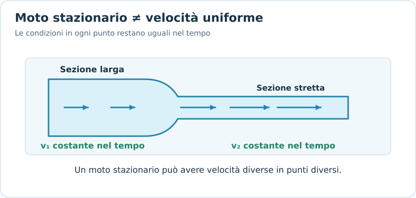
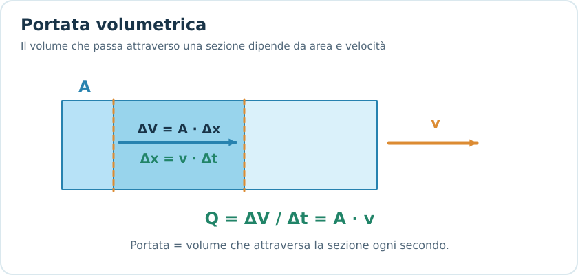
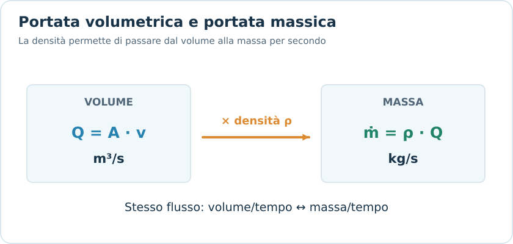
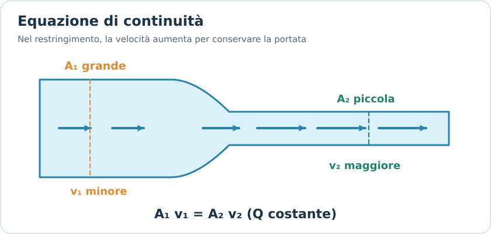
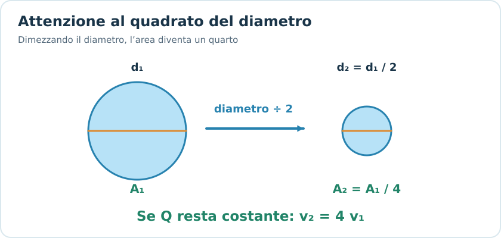
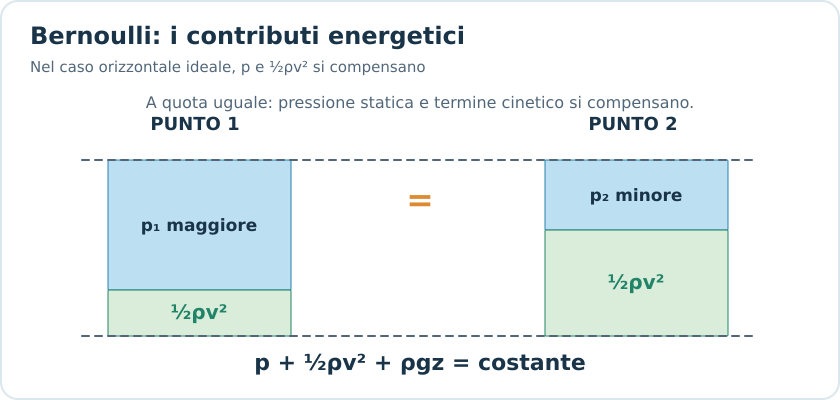
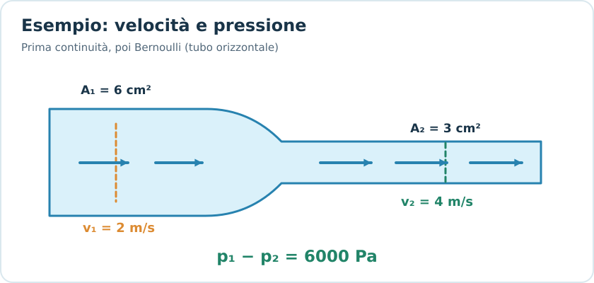
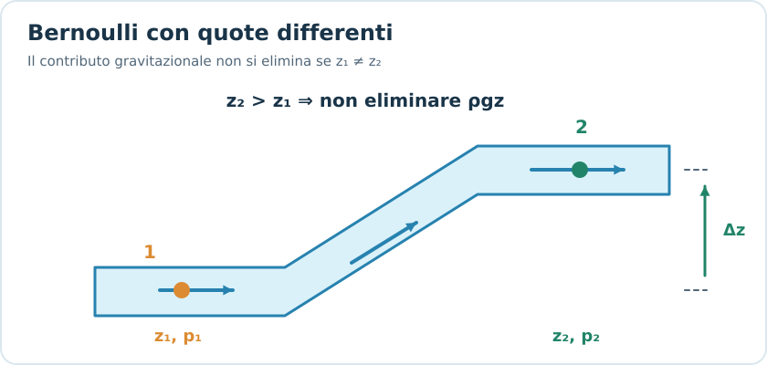
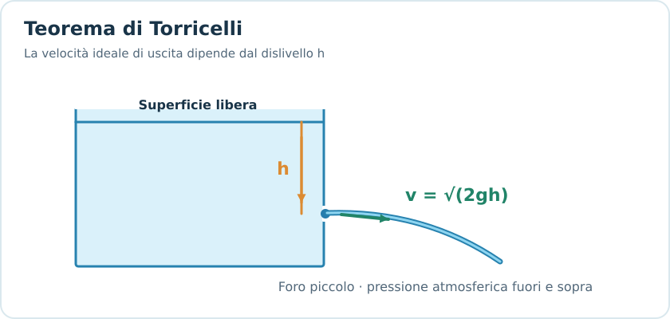
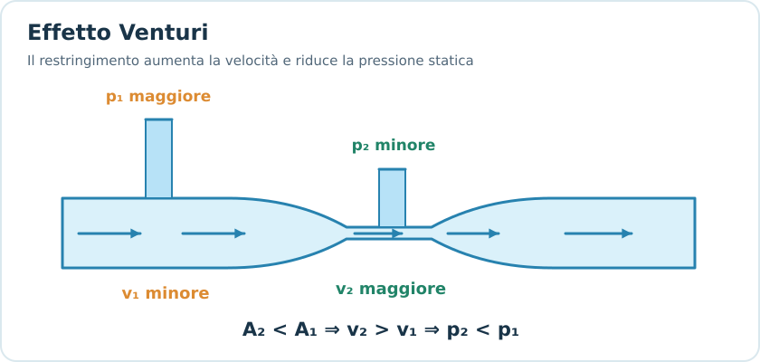

# Legge di Bernoulli

## 1. Introduzione alla fluidodinamica

La **fluidodinamica** studia il comportamento dei fluidi in movimento.

A differenza della fluidostatica, nella quale consideriamo fluidi in equilibrio, dobbiamo ora tenere conto anche della **velocità del fluido**.

Le grandezze fondamentali sono:

- **Densità** $\rho$: massa per unità di volume.
- **Pressione** $p$: forza normale per unità di superficie.
- **Velocità** $v$: velocità del fluido.
- **Portata volumetrica** $Q$: volume che attraversa una sezione nell'unità di tempo.
- **Quota** $z$: posizione verticale rispetto a un riferimento.

I due strumenti fondamentali della fluidodinamica ideale sono:

1. **Equazione di continuità**, derivata dalla conservazione della massa.
2. **Equazione di Bernoulli**, derivata dalla conservazione dell'energia meccanica.

---

## 2. Fluido ideale

Per affrontare gli esercizi introduttivi consideriamo spesso un **fluido ideale**.

Le ipotesi principali sono:

- **Incomprimibile:** la densità rimane costante.
- **Non viscoso:** trascuriamo le dissipazioni dovute all'attrito interno.
- **Moto stazionario:** in un determinato punto le grandezze del flusso non cambiano nel tempo.

Per applicare Bernoulli nella forma usuale consideriamo due punti lungo la stessa linea di corrente, in assenza di macchine che aggiungono o sottraggono energia e di perdite dissipative.

### Moto stazionario

*Nel moto stazionario v₁ e v₂ non variano nel tempo, ma possono essere diverse tra loro.*

Un moto è stazionario quando la velocità del fluido in un punto non cambia nel tempo.

Questo non significa che la velocità sia uguale in tutti i punti.

Per esempio, in un tubo che si restringe, l'acqua può avere velocità differenti nelle diverse sezioni pur mantenendo un moto stazionario.

> [!important] Distinzione
> **Stazionario** non significa **velocità costante nello spazio**.
>
> Significa che le condizioni del flusso in ogni punto non cambiano nel tempo.

---

## 3. Portata volumetrica

La **portata volumetrica** indica il volume di fluido che attraversa una sezione nell'unità di tempo.

$$
\boxed{Q=\frac{\Delta V}{\Delta t}}
$$

Dove:

- $Q$: portata volumetrica, in $\mathrm{m^3/s}$.
- $\Delta V$: volume transitato, in $\mathrm{m^3}$.
- $\Delta t$: intervallo di tempo, in $\mathrm{s}$.

### Formula con area e velocità

*In un tempo Δt il fluido percorre Δx = vΔt e attraversa un volume ΔV = AΔx.*

Consideriamo un fluido che attraversa una sezione di area $A$, perpendicolare alla direzione del moto, con velocità uniforme $v$.

In un intervallo $\Delta t$, il fluido percorre:

$$
\Delta x=v\Delta t
$$

Il volume transitato è:

$$
\Delta V=A\Delta x=Av\Delta t
$$

Quindi:

$$
Q=\frac{Av\Delta t}{\Delta t}
$$

Otteniamo:

$$
\boxed{Q=Av}
$$

Questa è una delle formule più utilizzate negli esercizi.

### Formule inverse

$$
\boxed{v=\frac{Q}{A}}
$$

$$
\boxed{A=\frac{Q}{v}}
$$

### Unità di misura

$$
[Q]=\mathrm{m^3/s}
$$

Conversioni utili:

$$
1\ \mathrm{L}=10^{-3}\ \mathrm{m^3}
$$

$$
1\ \mathrm{L/s}=10^{-3}\ \mathrm{m^3/s}
$$

$$
1\ \mathrm{L/min}=\frac{10^{-3}}{60}\ \mathrm{m^3/s}
$$

### Esempio

Un tubo ha sezione:

$$
A=0{,}020\ \mathrm{m^2}
$$

L'acqua attraversa il tubo con velocità:

$$
v=3\ \mathrm{m/s}
$$

Calcolare la portata.

$$
Q=Av
$$

$$
Q=0{,}020\cdot3
$$

$$
\boxed{Q=0{,}060\ \mathrm{m^3/s}}
$$

Convertendo in litri al secondo:

$$
\boxed{Q=60\ \mathrm{L/s}}
$$

---

## 4. Portata massica

*La portata massica è la portata volumetrica moltiplicata per la densità del fluido.*

Oltre alla portata volumetrica, possiamo definire la **portata massica**.

Essa rappresenta la massa di fluido che attraversa una sezione nell'unità di tempo:

$$
\boxed{\dot m=\frac{\Delta m}{\Delta t}}
$$

L'unità di misura è:

$$
[\dot m]=\mathrm{kg/s}
$$

Poiché:

$$
m=\rho V
$$

per un flusso con densità uniforme nella sezione:

$$
\boxed{\dot m=\rho Q=\rho Av}
$$

### Differenza tra le portate

| Grandezza | Significato | Unità |
|---|---|---|
| $Q$ | Volume nell'unità di tempo | $\mathrm{m^3/s}$ |
| $\dot m$ | Massa nell'unità di tempo | $\mathrm{kg/s}$ |

In un condotto senza perdite, ingressi o uscite laterali e con moto stazionario, **la portata massica si conserva**.

Se il fluido è anche incomprimibile, si conserva la portata volumetrica.

---

## 5. Equazione di continuità

*La velocità cresce nel restringimento perché A₁v₁ = A₂v₂.*

L'equazione di continuità esprime la **conservazione della massa** durante il moto del fluido.

Consideriamo un tubo che presenta due sezioni differenti:

- Sezione iniziale $A_1$.
- Sezione finale $A_2$.

Il fluido entra con velocità $v_1$ ed esce con velocità $v_2$.

In un moto stazionario senza perdite o diramazioni, la massa che entra nell'unità di tempo deve uguagliare quella che esce.

La relazione generale è:

$$
\boxed{\rho_1A_1v_1=\rho_2A_2v_2}
$$

### Fluido incomprimibile

Se la densità è costante:

$$
\rho_1=\rho_2
$$

Possiamo semplificare la densità:

$$
\boxed{A_1v_1=A_2v_2}
$$

Questa è l'**equazione di continuità per un fluido incomprimibile**.

Di conseguenza:

$$
\boxed{Q_1=Q_2}
$$

### Formule inverse

Per ricavare la velocità finale:

$$
\boxed{v_2=\frac{A_1}{A_2}v_1}
$$

Per ricavare la velocità iniziale:

$$
\boxed{v_1=\frac{A_2}{A_1}v_2}
$$

### Interpretazione fisica

Se il tubo si restringe:

$$
A_2<A_1
$$

allora:

$$
v_2>v_1
$$

**Il fluido deve aumentare la propria velocità quando attraversa una sezione più piccola.**

Viceversa, quando il tubo si allarga, la velocità diminuisce.

> [!important] Da ricordare
> Per un fluido incomprimibile in moto stazionario, senza diramazioni:
>
> **Sezione minore → velocità maggiore.**
>
> **Sezione maggiore → velocità minore.**

---

## 6. Esempio: tubo che si restringe

Un tubo orizzontale presenta due sezioni:

$$
A_1=8\ \mathrm{cm^2}
$$

$$
A_2=2\ \mathrm{cm^2}
$$

L'acqua attraversa la prima sezione con velocità:

$$
v_1=1{,}5\ \mathrm{m/s}
$$

Calcolare la velocità nella seconda sezione.

Utilizziamo:

$$
A_1v_1=A_2v_2
$$

Isoliamo $v_2$:

$$
v_2=\frac{A_1v_1}{A_2}
$$

Sostituendo:

$$
v_2=\frac{8\cdot1{,}5}{2}
$$

$$
\boxed{v_2=6\ \mathrm{m/s}}
$$

La sezione è diventata quattro volte più piccola, quindi la velocità è diventata quattro volte maggiore.

### Nota sulle unità

In questo caso possiamo utilizzare direttamente i $\mathrm{cm^2}$ perché stiamo calcolando un rapporto tra due aree espresse nella stessa unità.

Se invece volessimo calcolare la portata in $\mathrm{m^3/s}$, dovremmo convertire le superfici in $\mathrm{m^2}$.

---

## 7. Continuità con tubi circolari

*Nei tubi circolari A è proporzionale a d²: dimezzare d quadruplica v a parità di Q.*

Spesso gli esercizi forniscono raggi o diametri anziché aree.

Per un tubo circolare:

$$
\boxed{A=\pi r^2}
$$

Oppure, utilizzando il diametro:

$$
\boxed{A=\frac{\pi d^2}{4}}
$$

Dalla continuità:

$$
A_1v_1=A_2v_2
$$

Sostituendo le aree circolari:

$$
\pi r_1^2v_1=\pi r_2^2v_2
$$

Semplificando:

$$
\boxed{r_1^2v_1=r_2^2v_2}
$$

Quindi:

$$
\boxed{v_2=v_1\frac{r_1^2}{r_2^2}}
$$

Con i diametri:

$$
\boxed{v_2=v_1\frac{d_1^2}{d_2^2}}
$$

### Esempio

Il diametro di un tubo si dimezza:

$$
d_2=\frac{d_1}{2}
$$

La velocità finale diventa:

$$
v_2=v_1\frac{d_1^2}{(d_1/2)^2}
$$

$$
\boxed{v_2=4v_1}
$$

**Se dimezziamo il diametro, la velocità quadruplica**, nelle condizioni dell'equazione di continuità.

Questo perché l'area dipende dal quadrato del diametro.

---

## 8. Legge di Bernoulli

La **legge di Bernoulli** descrive la conservazione dell'energia meccanica lungo una linea di corrente di un fluido ideale.

Per un fluido incomprimibile, non viscoso e in moto stazionario, in assenza di perdite e macchine che scambiano energia con il fluido:

$$
\boxed{p+\frac12\rho v^2+\rho gz=\text{costante}}
$$

Dove:

- $p$: pressione statica, in $\mathrm{Pa}$.
- $\rho$: densità del fluido, in $\mathrm{kg/m^3}$.
- $v$: velocità del fluido, in $\mathrm{m/s}$.
- $g$: accelerazione gravitazionale.
- $z$: quota verticale, in $\mathrm{m}$.

### Significato dei tre termini

**1. Pressione statica**

$$
p
$$

Rappresenta il contributo energetico associato alla pressione del fluido.

**2. Termine cinetico**

$$
\frac12\rho v^2
$$

È l'energia cinetica per unità di volume del fluido.

Viene anche chiamato **pressione dinamica**.

**3. Termine gravitazionale**

$$
\rho gz
$$

È l'energia potenziale gravitazionale per unità di volume.

### Interpretazione

L'equazione di Bernoulli afferma che, nelle condizioni ideali indicate, la somma di questi tre contributi rimane costante lungo una linea di corrente.

**Non significa che pressione, velocità e quota siano ciascuna costanti.**

Significa che un aumento di un termine deve essere compensato dalla diminuzione di uno o più degli altri.

*A pari quota, maggiore velocità significa un termine cinetico maggiore e una pressione statica minore.*

---

## 9. Equazione di Bernoulli tra due punti

Consideriamo due punti dello stesso flusso, indicati con 1 e 2.

Applicando Bernoulli:

$$
\boxed{p_1+\frac12\rho v_1^2+\rho gz_1
=
p_2+\frac12\rho v_2^2+\rho gz_2}
$$

Questa è la forma più utile per gli esercizi.

### Ricavare la pressione finale

Isolando $p_2$:

$$
\boxed{
p_2=p_1+\frac12\rho(v_1^2-v_2^2)+\rho g(z_1-z_2)
}
$$

### Differenza di pressione

Riordinando:

$$
\boxed{
p_1-p_2=
\frac12\rho(v_2^2-v_1^2)+\rho g(z_2-z_1)
}
$$

### Attenzione ai segni

Conviene scrivere prima l'equazione completa, poi sostituire i dati.

In particolare:

- Se $z_2>z_1$, il secondo punto si trova più in alto.
- Se $v_2>v_1$, il fluido si muove più velocemente nel secondo punto.

Non bisogna assumere automaticamente che un aumento di quota implichi sempre una diminuzione della velocità: potrebbe cambiare anche la pressione.

---

## 10. Bernoulli in un tubo orizzontale

Se il tubo è orizzontale, i due punti si trovano alla stessa quota:

$$
z_1=z_2
$$

Di conseguenza:

$$
\rho gz_1=\rho gz_2
$$

I termini gravitazionali si semplificano.

Rimane:

$$
\boxed{p_1+\frac12\rho v_1^2
=
p_2+\frac12\rho v_2^2}
$$

Riordinando:

$$
\boxed{p_1-p_2=\frac12\rho(v_2^2-v_1^2)}
$$

### Interpretazione fisica

Nel flusso ideale orizzontale:

- Se la velocità aumenta, la pressione statica diminuisce.
- Se la velocità diminuisce, la pressione statica aumenta.

Questa relazione è particolarmente utile nei tubi che si restringono o si allargano.

### Collegamento con la continuità

Ricordiamo:

$$
A_1v_1=A_2v_2
$$

Se:

$$
A_2<A_1
$$

allora:

$$
v_2>v_1
$$

In un tubo orizzontale ideale, Bernoulli implica:

$$
\boxed{p_2<p_1}
$$

Quindi:

**Restringimento → velocità maggiore → pressione statica minore.**

> [!warning] Attenzione
> Questa conclusione vale nelle ipotesi indicate: flusso stazionario, incomprimibile, idealmente non viscoso e sezioni alla stessa quota, senza dispositivi che aggiungono energia.
>
> Non è una legge universale secondo cui un fluido più veloce debba avere sempre pressione minore in qualsiasi situazione.

---

## 11. Esempio: continuità e Bernoulli insieme

*Nell’esempio, l’area si dimezza, la velocità raddoppia e p₁ supera p₂ di 6000 Pa.*

Un tubo orizzontale trasporta acqua con densità:

$$
\rho=1000\ \mathrm{kg/m^3}
$$

Nella prima sezione:

$$
A_1=6\ \mathrm{cm^2}
$$

$$
v_1=2\ \mathrm{m/s}
$$

Nella seconda sezione:

$$
A_2=3\ \mathrm{cm^2}
$$

Calcolare:

1. La velocità nella seconda sezione.
2. La differenza di pressione $p_1-p_2$.

### Punto 1 — Velocità

Applichiamo la continuità:

$$
A_1v_1=A_2v_2
$$

$$
v_2=\frac{A_1}{A_2}v_1
$$

$$
v_2=\frac63\cdot2
$$

$$
\boxed{v_2=4\ \mathrm{m/s}}
$$

### Punto 2 — Differenza di pressione

Il tubo è orizzontale, quindi:

$$
p_1-p_2=\frac12\rho(v_2^2-v_1^2)
$$

Sostituendo:

$$
p_1-p_2=
\frac12\cdot1000\cdot(4^2-2^2)
$$

$$
p_1-p_2=500(16-4)
$$

$$
\boxed{p_1-p_2=6000\ \mathrm{Pa}}
$$

Questo significa che la pressione nella prima sezione è maggiore di $6000\ \mathrm{Pa}$ rispetto alla seconda.

### Metodo da ricordare

Negli esercizi di questo tipo:

1. Utilizziamo **continuità** per trovare la velocità incognita.
2. Utilizziamo **Bernoulli** per trovare la differenza di pressione.

---

## 12. Bernoulli con differenze di quota

*In un condotto che sale, si deve mantenere il termine ρgz per entrambi i punti.*

Se i due punti si trovano a quote differenti, non possiamo semplificare il termine $\rho gz$.

Dobbiamo utilizzare:

$$
p_1+\frac12\rho v_1^2+\rho gz_1
=
p_2+\frac12\rho v_2^2+\rho gz_2
$$

### Caso particolare: velocità uguali

Se:

$$
v_1=v_2
$$

i termini cinetici si semplificano.

Otteniamo:

$$
p_1+\rho gz_1=p_2+\rho gz_2
$$

Quindi:

$$
\boxed{p_1-p_2=\rho g(z_2-z_1)}
$$

Se il secondo punto è più alto, la sua pressione è minore.

### Collegamento con Stevino

Questa relazione coincide con quella della legge di Stevino, nelle condizioni considerate.

**La legge di Stevino può essere vista come un caso particolare del bilancio di Bernoulli quando non vi è variazione di velocità.**

Non significa, però, che un fluido in moto possa sempre essere trattato come un fluido in quiete.

---

## 13. Esempio: condotto verticale

L'acqua scorre in un tubo verticale a sezione costante.

Il punto 2 si trova $5\ \mathrm{m}$ più in alto del punto 1.

Supponiamo:

$$
v_1=v_2
$$

Calcolare la differenza di pressione tra i due punti, trascurando le perdite.

Da Bernoulli:

$$
p_1-p_2=\rho g(z_2-z_1)
$$

$$
p_1-p_2=1000\cdot9{,}81\cdot5
$$

$$
\boxed{p_1-p_2=49050\ \mathrm{Pa}}
$$

La pressione diminuisce salendo nel condotto.

---

## 14. Teorema di Torricelli

*Il foro si trova h sotto la superficie: in condizioni ideali il getto esce con v = √(2gh).*

Il **teorema di Torricelli** permette di calcolare la velocità con cui un liquido fuoriesce da un piccolo foro situato sotto la superficie libera di un serbatoio.

Nel modello ideale:

$$
\boxed{v=\sqrt{2gh}}
$$

Dove:

- $v$: velocità del liquido all'uscita del foro.
- $g$: accelerazione gravitazionale.
- $h$: dislivello verticale tra superficie libera del liquido e foro.

### Derivazione con Bernoulli

Consideriamo:

- Punto 1: superficie libera del serbatoio.
- Punto 2: foro di uscita.

Applichiamo Bernoulli:

$$
p_1+\frac12\rho v_1^2+\rho gz_1
=
p_2+\frac12\rho v_2^2+\rho gz_2
$$

Supponiamo che:

1. Il serbatoio sia aperto all'atmosfera.
2. Il getto esca nell'atmosfera.
3. La superficie del serbatoio sia molto più grande del foro.
4. Si trascurino le dissipazioni.

Abbiamo quindi:

$$
p_1=p_2=p_{\mathrm{atm}}
$$

E possiamo approssimare:

$$
v_1\approx0
$$

La relazione diventa:

$$
\rho gz_1=\frac12\rho v_2^2+\rho gz_2
$$

Semplificando la densità:

$$
g(z_1-z_2)=\frac12v_2^2
$$

Ponendo:

$$
h=z_1-z_2
$$

otteniamo:

$$
\boxed{v_2=\sqrt{2gh}}
$$

### Interpretazione

La velocità di uscita dipende dal dislivello tra il livello del liquido e il foro.

Nel modello ideale, **non dipende dalla densità del liquido**.

Questa è la stessa relazione utilizzata in cinematica per un corpo che cade da fermo attraverso un dislivello $h$.

---

## 15. Esempio: foro in un serbatoio

Un serbatoio contiene acqua.

Un piccolo foro si trova a:

$$
h=1{,}25\ \mathrm{m}
$$

sotto la superficie libera.

Calcolare la velocità ideale dell'acqua all'uscita.

Utilizziamo Torricelli:

$$
v=\sqrt{2gh}
$$

$$
v=\sqrt{2\cdot9{,}81\cdot1{,}25}
$$

$$
v=\sqrt{24{,}525}
$$

$$
\boxed{v\approx4{,}95\ \mathrm{m/s}}
$$

### Calcolare anche la portata

Se l'area del foro è nota, possiamo calcolare:

$$
Q=Av
$$

Per esempio, con:

$$
A=2\cdot10^{-4}\ \mathrm{m^2}
$$

otteniamo:

$$
Q=2\cdot10^{-4}\cdot4{,}95
$$

$$
\boxed{Q\approx9{,}90\cdot10^{-4}\ \mathrm{m^3/s}}
$$

Ovvero:

$$
\boxed{Q\approx0{,}990\ \mathrm{L/s}}
$$

Il risultato è ideale: nella realtà, la portata effettiva può essere inferiore a causa delle perdite e della contrazione del getto.

---

## 16. Effetto Venturi

*I tubi piezometrici mostrano una pressione statica più bassa nella strozzatura.*

L'**effetto Venturi** descrive il comportamento di un fluido quando attraversa un restringimento di un condotto.

In un tubo orizzontale ideale:

1. La sezione diminuisce.
2. La velocità aumenta per la continuità.
3. La pressione statica diminuisce per Bernoulli.

Le equazioni sono:

$$
A_1v_1=A_2v_2
$$

$$
p_1+\frac12\rho v_1^2=
p_2+\frac12\rho v_2^2
$$

Queste relazioni permettono, per esempio, di collegare una differenza di pressione alla velocità di un flusso.

### Interpretazione

Il restringimento non crea energia.

Una parte del contributo energetico associato alla pressione si trasforma in energia cinetica, aumentando la velocità del fluido.

Nei dispositivi reali, la viscosità provoca anche perdite di energia meccanica.

---

## 17. Applicazioni pratiche

### Misuratori Venturi

Permettono di stimare la portata misurando una differenza di pressione tra sezioni differenti.

### Serbatoi e fori di uscita

Il teorema di Torricelli consente di stimare la velocità di efflusso a partire dal dislivello.

### Condotte con sezioni differenti

L'equazione di continuità permette di ricavare come cambia la velocità del fluido.

### Sistemi idraulici e acquedotti

I bilanci di pressione, velocità e quota permettono di studiare il comportamento del fluido in diversi tratti della condotta.

Nei sistemi reali è spesso necessario considerare anche attriti, perdite di carico e pompe.

---

## 18. Limiti dell'equazione di Bernoulli

La forma ideale di Bernoulli non può essere utilizzata indiscriminatamente.

Bisogna prestare attenzione quando:

- La viscosità produce perdite significative.
- Il fluido è fortemente comprimibile.
- Il moto è fortemente instazionario.
- Tra i due punti è presente una pompa o una turbina.
- Si confrontano punti che non appartengono alla stessa linea di corrente, senza condizioni aggiuntive.

### Fluidi reali

Nei fluidi reali una parte dell'energia meccanica viene dissipata, soprattutto a causa della viscosità e delle turbolenze.

Per questo, in una condotta reale, non sempre possiamo scrivere:

$$
p_1+\frac12\rho v_1^2+\rho gz_1=
p_2+\frac12\rho v_2^2+\rho gz_2
$$

senza aggiungere termini che descrivano perdite o scambi di energia.

> [!important] Per l'esame
> Se il testo specifica **fluido ideale**, **attriti trascurabili**, **moto stazionario** e **densità costante**, puoi generalmente utilizzare la forma classica di Bernoulli lungo la stessa linea di corrente.
>
> Se il testo parla esplicitamente di perdite, pompe o dissipazione, occorre valutare un bilancio energetico più generale.

---

## 19. Errori frequenti negli esercizi

### 1. Confondere portata e velocità

$$
Q=Av
$$

La portata è un volume nell'unità di tempo, non una velocità.

- $Q$: $\mathrm{m^3/s}$.
- $v$: $\mathrm{m/s}$.

### 2. Pensare che restringendo un tubo diminuisca la velocità

Per un fluido incomprimibile in moto stazionario senza diramazioni:

$$
A_1v_1=A_2v_2
$$

Se l'area diminuisce, la velocità aumenta.

### 3. Dimenticare che l'area dipende dal quadrato del raggio

$$
A=\pi r^2
$$

Se il raggio si dimezza, l'area diventa un quarto.

### 4. Dimenticare il quadrato della velocità in Bernoulli

Il termine cinetico è:

$$
\frac12\rho v^2
$$

Non:

$$
\frac12\rho v
$$

### 5. Utilizzare Bernoulli orizzontale quando le quote sono differenti

Se:

$$
z_1\neq z_2
$$

bisogna mantenere i contributi gravitazionali:

$$
\rho gz_1
\qquad
\rho gz_2
$$

### 6. Confondere pressione statica e pressione dinamica

La pressione statica è $p$.

Il termine:

$$
\frac12\rho v^2
$$

è la pressione dinamica.

Non sono la stessa grandezza, anche se entrambe si misurano in pascal.

### 7. Aggiungere la pressione atmosferica quando si semplifica

Se due punti sono entrambi esposti alla stessa pressione atmosferica, i termini atmosferici possono cancellarsi nell'equazione di Bernoulli.

### 8. Applicare Torricelli senza verificarne le condizioni

La formula:

$$
v=\sqrt{2gh}
$$

non si applica automaticamente a qualsiasi foro.

La derivazione usuale richiede un serbatoio con superficie molto più ampia del foro, pressione uguale alla superficie e all'uscita, e perdite trascurabili.

### 9. Confondere differenza di pressione e pressione finale

Se trovi:

$$
p_1-p_2=6000\ \mathrm{Pa}
$$

non significa che:

$$
p_2=6000\ \mathrm{Pa}
$$

Per ricavare $p_2$ devi conoscere $p_1$:

$$
p_2=p_1-6000
$$

### 10. Utilizzare continuità senza verificare la densità

La forma generale della conservazione della massa è:

$$
\rho_1A_1v_1=\rho_2A_2v_2
$$

La forma:

$$
A_1v_1=A_2v_2
$$

richiede densità costante.

---

## 20. Come riconoscere la formula giusta all'esame

| Se il testo chiede... | Formula |
|---|---|
| Portata volumetrica | $Q=\Delta V/\Delta t$ |
| Portata da area e velocità | $Q=Av$ |
| Velocità da portata | $v=Q/A$ |
| Portata massica | $\dot m=\rho Q$ |
| Velocità in un restringimento | $A_1v_1=A_2v_2$ |
| Continuità per fluido comprimibile | $\rho_1A_1v_1=\rho_2A_2v_2$ |
| Pressione e velocità su tubo orizzontale | $p_1+\frac12\rho v_1^2=p_2+\frac12\rho v_2^2$ |
| Pressione tra punti a quote diverse | Bernoulli completo |
| Velocità di uscita da un piccolo foro | $v=\sqrt{2gh}$ |
| Portata dal foro | $Q=Av$ |
| Differenza di pressione su tubo orizzontale | $p_1-p_2=\frac12\rho(v_2^2-v_1^2)$ |

---

## 21. Formule fondamentali da ricordare

### Portata volumetrica

$$
\boxed{Q=\frac{\Delta V}{\Delta t}=Av}
$$

### Portata massica

$$
\boxed{\dot m=\rho Av}
$$

### Equazione di continuità

$$
\boxed{A_1v_1=A_2v_2}
$$

Per fluido incomprimibile in moto stazionario, senza diramazioni.

### Equazione di Bernoulli

$$
\boxed{
p+\frac12\rho v^2+\rho gz=\text{costante}
}
$$

### Bernoulli tra due punti

$$
\boxed{
p_1+\frac12\rho v_1^2+\rho gz_1
=
p_2+\frac12\rho v_2^2+\rho gz_2
}
$$

### Bernoulli per tubo orizzontale

$$
\boxed{
p_1+\frac12\rho v_1^2=
p_2+\frac12\rho v_2^2
}
$$

### Differenza di pressione

$$
\boxed{
p_1-p_2=\frac12\rho(v_2^2-v_1^2)
}
$$

Per tubo orizzontale ideale.

### Teorema di Torricelli

$$
\boxed{v=\sqrt{2gh}}
$$

---

## 22. Verifica della comprensione

Prima di passare agli esercizi sui fluidi, prova a rispondere:

1. Un tubo si restringe fino ad avere una sezione pari a un quarto di quella iniziale. Come cambia la velocità dell'acqua?
2. Se raddoppiamo il diametro di un tubo mantenendo la stessa portata, come cambia la velocità?
3. In un tubo orizzontale ideale, se la velocità dell'acqua aumenta, come cambia la pressione statica?
4. Perché in Bernoulli compare il termine $\frac12\rho v^2$?
5. Se due punti si trovano a quote differenti, perché non possiamo ignorare i termini $\rho gz$?
6. Se il foro di un serbatoio si trova a una profondità quattro volte maggiore, come cambia la velocità ideale di uscita?
7. Perché l'equazione di continuità deriva dalla conservazione della massa?
8. In un condotto reale molto lungo, perché la pressione potrebbe diminuire anche se la sezione e la quota rimangono costanti?

L'obiettivo è saper riconoscere quando utilizzare continuità, Bernoulli oppure entrambe.
