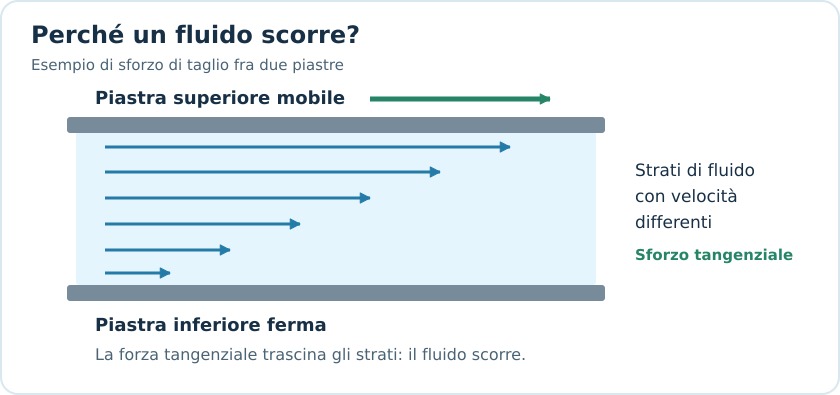
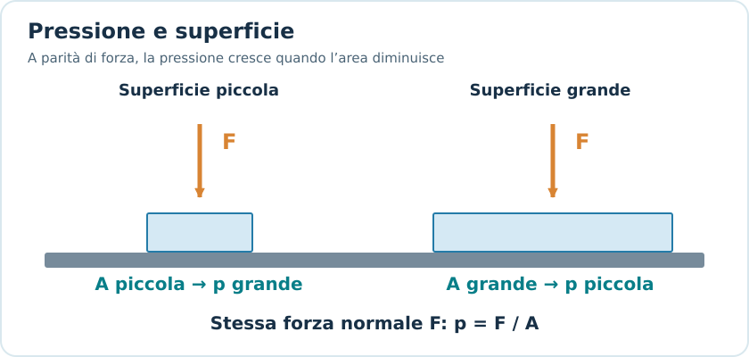
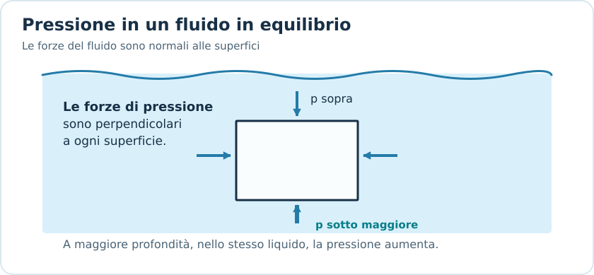
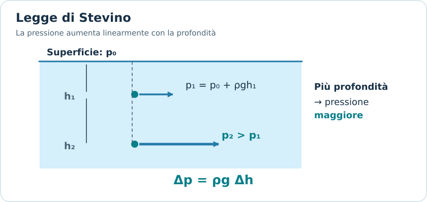
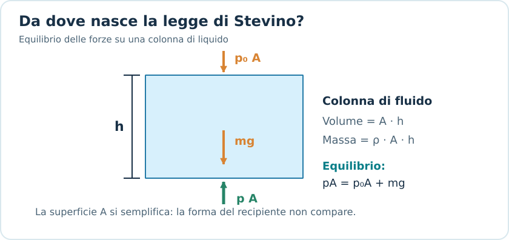
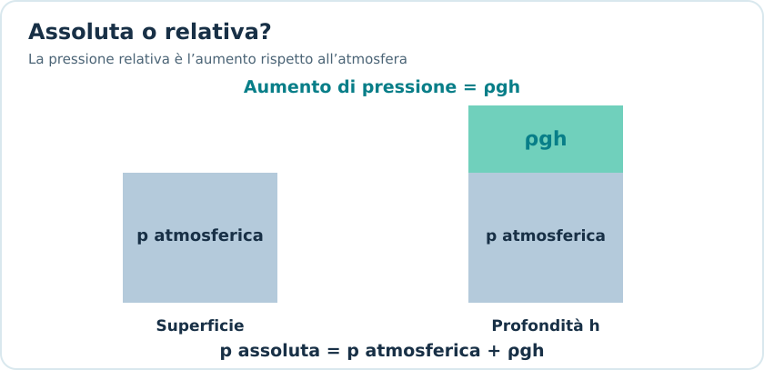
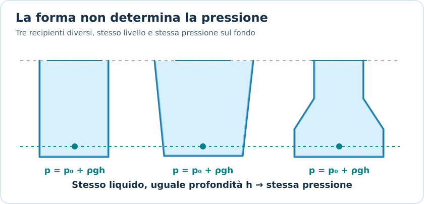
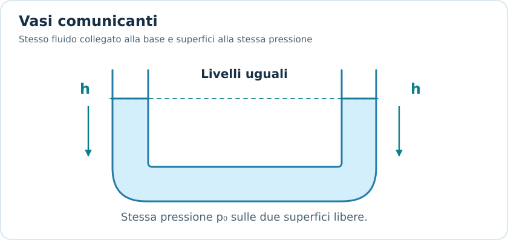
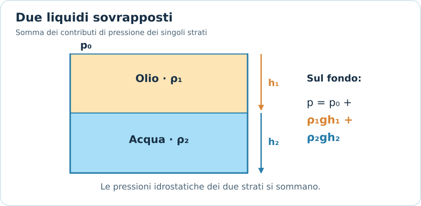

# Pressione e legge di Stevino

## 1. Introduzione ai fluidi

Un **fluido** è una sostanza che non possiede una forma propria e può deformarsi continuamente quando è sottoposta a uno sforzo di taglio.

I fluidi comprendono:

- **Liquidi:** hanno un volume pressoché costante e sono generalmente poco comprimibili.
- **Gas:** non hanno né forma né volume propri e sono generalmente comprimibili.

Lo studio dei fluidi si divide principalmente in:

1. **Fluidostatica:** studia i fluidi in equilibrio.
2. **Fluidodinamica:** studia i fluidi in movimento.

In questa nota ci concentriamo sulla fluidostatica.

---

## 2. Densità

La **densità** indica quanta massa è contenuta in un determinato volume.

Si definisce come:

$$
\boxed{\rho=\frac{m}{V}}
$$

Dove:

- $\rho$: densità, in $\mathrm{kg/m^3}$.
- $m$: massa, in $\mathrm{kg}$.
- $V$: volume, in $\mathrm{m^3}$.

Formule inverse:

$$
m=\rho V
$$

$$
V=\frac{m}{\rho}
$$

### Valori di riferimento

| Sostanza | Densità approssimativa |
|---|---:|
| Acqua dolce | $1000\ \mathrm{kg/m^3}$ |
| Acqua marina | $1025\ \mathrm{kg/m^3}$ |
| Olio | $900\ \mathrm{kg/m^3}$ |
| Mercurio | $13600\ \mathrm{kg/m^3}$ |
| Aria | $1{,}2\ \mathrm{kg/m^3}$ |

I valori dipendono dalla temperatura e, soprattutto per i gas, dalla pressione.

### Conversioni utili

$$
1\ \mathrm{L}=10^{-3}\ \mathrm{m^3}
$$

$$
1\ \mathrm{cm^3}=10^{-6}\ \mathrm{m^3}
$$

$$
1\ \mathrm{g/cm^3}=1000\ \mathrm{kg/m^3}
$$

**Esempio**

Un recipiente contiene $3\ \mathrm{L}$ di acqua. Qual è la massa dell'acqua?

Convertiamo:

$$
V=3\cdot10^{-3}\ \mathrm{m^3}
$$

Utilizziamo:

$$
m=\rho V
$$

$$
m=1000\cdot0{,}003
$$

$$
\boxed{m=3\ \mathrm{kg}}
$$

> [!important] Da ricordare
> La densità è una proprietà della sostanza: non coincide con la massa totale dell'oggetto.
>
> A parità di volume, una sostanza più densa ha una massa maggiore.

---

## 3. Pressione

La **pressione** misura la forza normale esercitata per unità di superficie.

Per una forza uniformemente distribuita:

$$
\boxed{p=\frac{F_{\perp}}{A}}
$$

Dove:

- $p$: pressione.
- $F_{\perp}$: modulo della forza perpendicolare alla superficie.
- $A$: area della superficie.

L'unità di misura nel Sistema Internazionale è il **pascal**:

$$
\boxed{1\ \mathrm{Pa}=1\ \mathrm{N/m^2}}
$$

### Formule inverse

$$
F_{\perp}=pA
$$

$$
A=\frac{F_{\perp}}{p}
$$

### Interpretazione fisica

A parità di forza:

- Una superficie **più piccola** produce una pressione maggiore.
- Una superficie **più grande** produce una pressione minore.

Questo spiega perché un coltello affilato taglia più facilmente e perché le ciaspole permettono di camminare sulla neve senza sprofondare troppo.

### Esempio

Una forza di $200\ \mathrm{N}$ agisce perpendicolarmente su una superficie di $0{,}05\ \mathrm{m^2}$.

$$
p=\frac{200}{0{,}05}
$$

$$
\boxed{p=4000\ \mathrm{Pa}}
$$

Se la superficie venisse dimezzata, a forza invariata la pressione raddoppierebbe.

### Pressione e direzione delle forze

La pressione è una grandezza **scalare**.

La forza di pressione esercitata da un fluido in quiete su una superficie, invece, è diretta perpendicolarmente alla superficie.

Per questo possiamo avere la stessa pressione che agisce su pareti orientate in direzioni differenti.

---

## 4. Pressione nei fluidi in equilibrio

Un fluido in quiete esercita una pressione sulle superfici con cui è a contatto e sulle superfici immaginarie al suo interno.

In un fluido statico:

- La pressione in un punto è la stessa in tutte le direzioni.
- La forza di pressione è perpendicolare alla superficie considerata.
- La pressione generalmente aumenta scendendo in profondità.

In un liquido omogeneo in equilibrio, soggetto a gravità uniforme, **due punti alla stessa profondità hanno la stessa pressione**.

Questo vale indipendentemente dalla forma del recipiente, purché i punti appartengano allo stesso sistema fluido in equilibrio.

---

## 5. Legge di Stevino

La **legge di Stevino** permette di calcolare come varia la pressione all'interno di un liquido in equilibrio.

Consideriamo un liquido di densità costante $\rho$, soggetto a un'accelerazione gravitazionale $g$ costante.

La pressione aumenta con la profondità secondo:

$$
\boxed{p=p_0+\rho gh}
$$

Dove:

- $p$: pressione alla profondità $h$.
- $p_0$: pressione alla superficie del liquido.
- $\rho$: densità del liquido.
- $g$: accelerazione gravitazionale.
- $h$: profondità misurata verticalmente dalla superficie.

### Interpretazione

Il termine:

$$
\rho gh
$$

rappresenta l'aumento di pressione rispetto alla superficie.

La pressione cresce:

- Linearmente con la profondità $h$.
- Linearmente con la densità $\rho$.
- Linearmente con l'accelerazione gravitazionale $g$.

### Differenza di pressione

Tra due punti dello stesso liquido, a profondità $h_1$ e $h_2$:

$$
p_1=p_0+\rho gh_1
$$

$$
p_2=p_0+\rho gh_2
$$

Sottraendo:

$$
\boxed{p_2-p_1=\rho g(h_2-h_1)}
$$

Oppure:

$$
\boxed{\Delta p=\rho g\Delta h}
$$

Questa formula è particolarmente utile quando il problema chiede la **differenza di pressione** tra due profondità.

### Da dove deriva la formula?

Immaginiamo una colonna verticale di liquido:

- Altezza $h$.
- Area di base $A$.
- Densità $\rho$.

Il suo volume è:

$$
V=Ah
$$

La massa è:

$$
m=\rho Ah
$$

Il peso della colonna vale:

$$
P=mg=\rho Ahg
$$

In equilibrio, la forza di pressione dal basso bilancia la forza di pressione dall'alto e il peso:

$$
pA=p_0A+\rho Ahg
$$

Dividendo per $A$:

$$
\boxed{p=p_0+\rho gh}
$$

Notiamo che l'area si semplifica: **la pressione idrostatica non dipende dall'area della colonna di liquido**.

---

## 6. Pressione assoluta e pressione relativa

È importante distinguere due tipi di pressione.

### Pressione assoluta

È la pressione misurata rispetto al vuoto.

Per un liquido con superficie esposta all'atmosfera:

$$
\boxed{p_{\mathrm{ass}}=p_{\mathrm{atm}}+\rho gh}
$$

La pressione atmosferica standard è circa:

$$
\boxed{p_{\mathrm{atm}}=101325\ \mathrm{Pa}}
$$

### Pressione relativa (o manometrica)

È la differenza tra la pressione del fluido e quella atmosferica.

$$
p_{\mathrm{rel}}=p_{\mathrm{ass}}-p_{\mathrm{atm}}
$$

Per un liquido aperto all'atmosfera:

$$
\boxed{p_{\mathrm{rel}}=\rho gh}
$$

### Differenza fondamentale

| Tipo | Formula |
|---|---|
| Assoluta | $p_{\mathrm{atm}}+\rho gh$ |
| Relativa all'atmosfera | $\rho gh$ |
| Differenza tra profondità | $\rho g\Delta h$ |

> [!warning] Attenzione all'esame
> Se viene richiesta la **pressione totale o assoluta** a una certa profondità in acqua esposta all'aria, bisogna includere la pressione atmosferica.
>
> Se viene richiesta la **pressione relativa**, si utilizza soltanto $\rho gh$.

---

## 7. Esempio svolto: pressione sott'acqua

Un subacqueo si trova a $5\ \mathrm{m}$ di profondità in acqua dolce.

Calcolare:

1. La pressione relativa.
2. La pressione assoluta.

Dati:

$$
\rho=1000\ \mathrm{kg/m^3}
$$

$$
g=9{,}81\ \mathrm{m/s^2}
$$

$$
h=5\ \mathrm{m}
$$

### 1. Pressione relativa

$$
p_{\mathrm{rel}}=\rho gh
$$

$$
p_{\mathrm{rel}}=1000\cdot9{,}81\cdot5
$$

$$
\boxed{p_{\mathrm{rel}}=49050\ \mathrm{Pa}}
$$

### 2. Pressione assoluta

$$
p_{\mathrm{ass}}=p_{\mathrm{atm}}+\rho gh
$$

$$
p_{\mathrm{ass}}=101325+49050
$$

$$
\boxed{p_{\mathrm{ass}}=150375\ \mathrm{Pa}}
$$

La pressione assoluta è circa $1{,}50\ \mathrm{bar}$.

### Conversione bar-pascal

$$
\boxed{1\ \mathrm{bar}=10^5\ \mathrm{Pa}}
$$

Un aumento di profondità di circa $10{,}2\ \mathrm{m}$ in acqua dolce corrisponde a un aumento di pressione di circa $1\ \mathrm{bar}$.

---

## 8. Conseguenze della legge di Stevino

### 8.1 La pressione dipende dalla profondità, non dalla forma

Consideriamo recipienti di forma diversa contenenti lo stesso liquido.

Se:

- La densità è uguale.
- La pressione alla superficie è uguale.
- La profondità è uguale.

Allora la pressione nei punti considerati è uguale.

$$
p_1=p_2=p_3
$$

Questo fenomeno è collegato al cosiddetto **paradosso idrostatico**.

### 8.2 La pressione aumenta con la profondità

Se raddoppiamo la profondità:

$$
\rho g(2h)=2\rho gh
$$

Quindi raddoppia la **pressione relativa**, non necessariamente la pressione assoluta.

### 8.3 La pressione aumenta con la densità

Alla stessa profondità:

$$
p_{\mathrm{rel}}=\rho gh
$$

Un liquido più denso produce una pressione relativa maggiore.

Per esempio, il mercurio produce una pressione idrostatica molto maggiore dell'acqua alla stessa profondità.

### 8.4 Vasi comunicanti

Due recipienti collegati alla base e contenenti lo stesso liquido in equilibrio, con entrambe le superfici alla stessa pressione atmosferica, raggiungono lo stesso livello.

Questo perché la pressione alla stessa quota, nel liquido comunicante, deve essere uguale.

Se invece i recipienti contengono liquidi di densità differenti, le altezze possono essere differenti.

---

## 9. Fluidi sovrapposti

Quando abbiamo più liquidi non mescolati, con densità differenti, la pressione si calcola sommando i contributi dei vari strati.

Per due strati:

$$
\boxed{p=p_0+\rho_1gh_1+\rho_2gh_2}
$$

Dove:

- $\rho_1$, $h_1$: densità e spessore verticale del primo strato.
- $\rho_2$, $h_2$: densità e spessore verticale del secondo strato.

**Esempio**

Un recipiente contiene:

- $2\ \mathrm{m}$ di olio, con $\rho_o=900\ \mathrm{kg/m^3}$.
- $3\ \mathrm{m}$ di acqua, con $\rho_a=1000\ \mathrm{kg/m^3}$.

Calcolare la pressione relativa sul fondo.

$$
p_{\mathrm{rel}}=\rho_ogh_o+\rho_agh_a
$$

$$
p_{\mathrm{rel}}=900\cdot9{,}81\cdot2+
1000\cdot9{,}81\cdot3
$$

$$
\boxed{p_{\mathrm{rel}}=47088\ \mathrm{Pa}}
$$

---

## 10. Errori frequenti negli esercizi

### Confondere massa e densità

$$
\rho=\frac{m}{V}
$$

La densità non è una forza e non si misura in newton.

### Usare centimetri al posto dei metri

Se la profondità è data in centimetri, convertirla prima di applicare Stevino.

$$
50\ \mathrm{cm}=0{,}50\ \mathrm{m}
$$

### Dimenticare la pressione atmosferica

La formula:

$$
p=\rho gh
$$

fornisce l'aumento di pressione rispetto alla superficie, non sempre la pressione assoluta.

### Confondere pressione e forza

$$
p=\frac{F}{A}
$$

La pressione si misura in pascal; la forza si misura in newton.

Se un esercizio chiede la forza esercitata su una superficie piana a pressione uniforme:

$$
F=pA
$$

Se invece la pressione cambia lungo una superficie estesa, non possiamo applicare direttamente questa formula usando un valore arbitrario di $p$: occorre considerare come varia la pressione.

### Pensare che la pressione dipenda dalla forma del contenitore

In condizioni idrostatiche, a pari profondità, densità e pressione superficiale, la pressione è la stessa.

---

## 11. Come riconoscere la formula giusta all'esame

| Se il testo chiede... | Formula |
|---|---|
| Densità | $\rho=m/V$ |
| Massa noto il volume | $m=\rho V$ |
| Pressione da una forza uniforme | $p=F_\perp/A$ |
| Forza dovuta a pressione uniforme | $F=pA$ |
| Pressione relativa a profondità $h$ | $p_{\mathrm{rel}}=\rho gh$ |
| Pressione assoluta | $p_{\mathrm{ass}}=p_0+\rho gh$ |
| Differenza di pressione | $\Delta p=\rho g\Delta h$ |
| Profondità da pressione relativa | $h=p_{\mathrm{rel}}/(\rho g)$ |
| Pressione sotto più liquidi | $p=p_0+\sum_i\rho_i gh_i$ |

---

## 12. Formule fondamentali da ricordare

### Densità

$$
\boxed{\rho=\frac{m}{V}}
$$

### Pressione

$$
\boxed{p=\frac{F_\perp}{A}}
$$

### Legge di Stevino

$$
\boxed{p=p_0+\rho gh}
$$

### Differenza di pressione

$$
\boxed{\Delta p=\rho g\Delta h}
$$

### Pressione relativa in un recipiente aperto

$$
\boxed{p_{\mathrm{rel}}=\rho gh}
$$

### Conversioni

$$
1\ \mathrm{Pa}=1\ \mathrm{N/m^2}
$$

$$
1\ \mathrm{bar}=10^5\ \mathrm{Pa}
$$

$$
1\ \mathrm{L}=10^{-3}\ \mathrm{m^3}
$$

---

## 13. Verifica della comprensione

Prima di passare al principio di Pascal, prova a rispondere:

1. Due recipienti di forma diversa contengono acqua alla stessa altezza. La pressione sul fondo è uguale?
2. Se raddoppio la profondità, raddoppia anche la pressione assoluta?
3. Due subacquei si trovano alla stessa profondità, uno in acqua dolce e uno in acqua marina. Chi subisce una pressione assoluta maggiore, supponendo uguale pressione alla superficie?
4. Perché la pressione si misura in $\mathrm{N/m^2}$ e non semplicemente in newton?
5. Se conosco una differenza di pressione e la densità del liquido, come posso ricavare la differenza di profondità?

L'obiettivo è saper scegliere le formule, non soltanto ricordarle.
