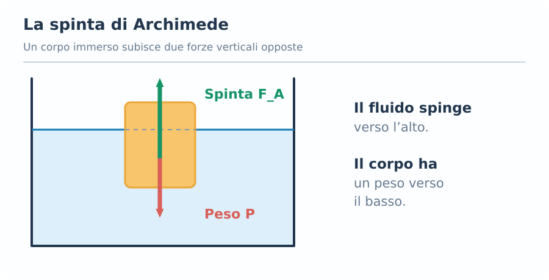
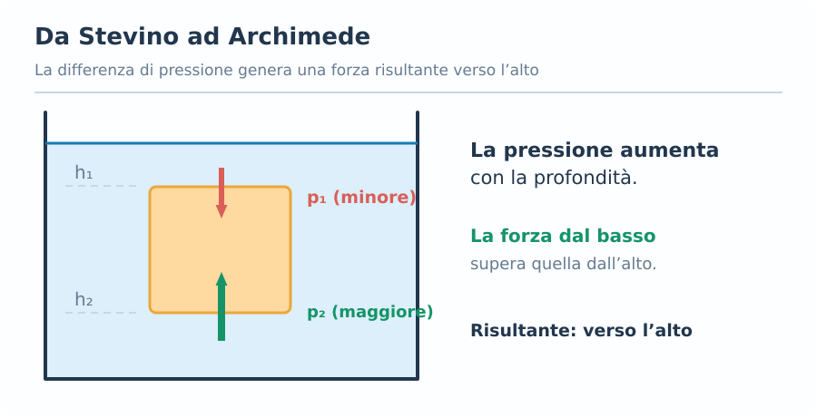
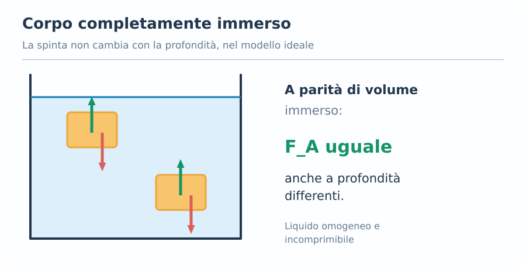
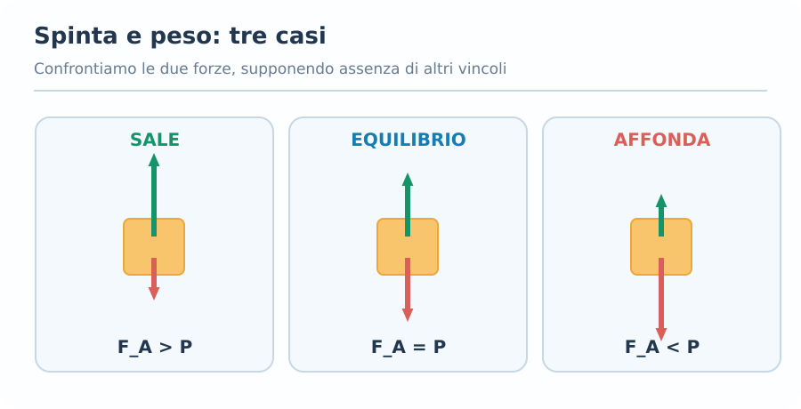
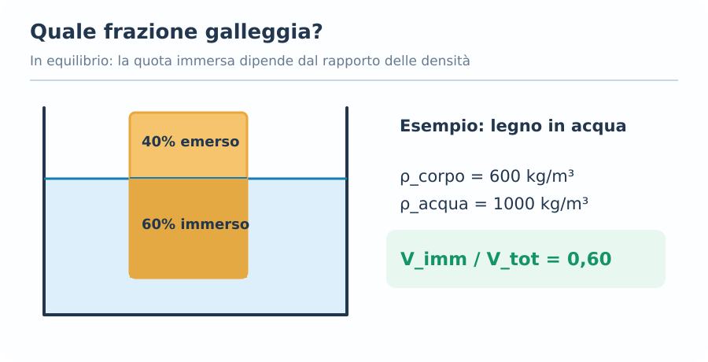
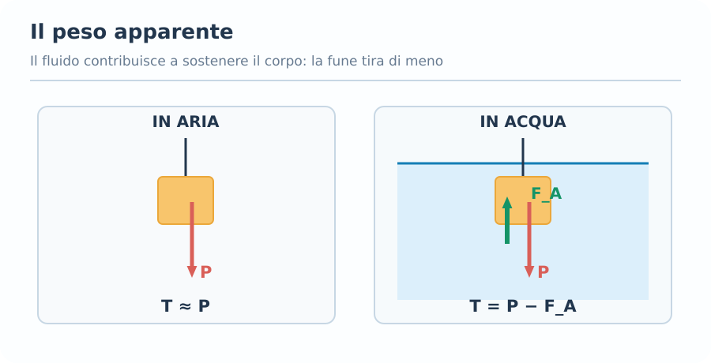
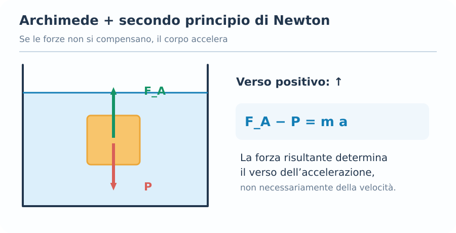
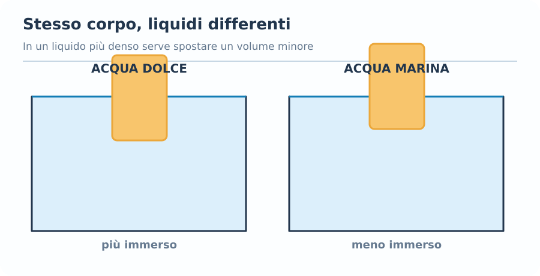

# Principio di Archimede

## 1. Introduzione

Quando un corpo viene immerso in un fluido, subisce una forza diretta verso l'alto chiamata **spinta di Archimede**, o **spinta idrostatica**.

Questa forza è responsabile di fenomeni come:

- Il galleggiamento delle navi.
- Il funzionamento dei sommergibili.
- La sensazione di pesare meno quando siamo immersi nell'acqua.
- La risalita di un pallone riempito di elio nell'aria.

La spinta di Archimede nasce dalla distribuzione della pressione nel fluido.

Il principio vale sia nei liquidi sia nei gas.

---

## 2. Enunciato del principio di Archimede

Il principio di Archimede afferma:

> Un corpo immerso totalmente o parzialmente in un fluido in equilibrio riceve una spinta verso l'alto pari al peso del fluido spostato.

La formula fondamentale è:

$$
\boxed{F_A=\rho_f g V_{\mathrm{imm}}}
$$

Dove:

- $F_A$: spinta di Archimede, in $\mathrm{N}$.
- $\rho_f$: densità del fluido, in $\mathrm{kg/m^3}$.
- $g$: accelerazione gravitazionale, in $\mathrm{m/s^2}$.
- $V_{\mathrm{imm}}$: volume di fluido spostato dal corpo, in $\mathrm{m^3}$.

### Interpretazione fisica

Il fluido esercita sul corpo una forza verso l'alto.

Il suo modulo dipende da:

1. Densità del fluido.
2. Volume di fluido spostato.
3. Accelerazione gravitazionale.

**Non dipende direttamente dalla massa del corpo.**

La massa del corpo, però, determina il suo peso e quindi influenza la possibilità che galleggi o affondi.

### Da dove viene la formula?

La massa del fluido spostato è:

$$
m_f=\rho_f V_{\mathrm{imm}}
$$

Il peso di questo fluido è:

$$
P_f=m_f g
$$

Sostituendo:

$$
P_f=\rho_f V_{\mathrm{imm}}g
$$

Poiché la spinta è uguale al peso del fluido spostato:

$$
\boxed{F_A=P_f=\rho_f gV_{\mathrm{imm}}}
$$

---

## 3. Origine della spinta: collegamento con Stevino

La spinta di Archimede nasce dal fatto che, in un fluido in equilibrio, la pressione aumenta con la profondità.

Secondo Stevino:

$$
p=p_0+\rho_f gh
$$

Consideriamo un blocco immerso in acqua, con:

- Superficie superiore di area $A$, alla profondità $h_1$.
- Superficie inferiore della stessa area, alla profondità $h_2$.
- Altezza del blocco $H=h_2-h_1$.

La pressione sulla superficie superiore è:

$$
p_1=p_0+\rho_f gh_1
$$

Quella sulla superficie inferiore è:

$$
p_2=p_0+\rho_f gh_2
$$

Poiché $h_2>h_1$:

$$
p_2>p_1
$$

La forza sulla superficie superiore è diretta verso il basso:

$$
F_1=p_1A
$$

La forza sulla superficie inferiore è diretta verso l'alto:

$$
F_2=p_2A
$$

La risultante verticale delle forze di pressione è:

$$
F_A=F_2-F_1
$$

$$
F_A=(p_2-p_1)A
$$

Utilizzando Stevino:

$$
F_A=\rho_f g(h_2-h_1)A
$$

Poiché:

$$
V=HA=(h_2-h_1)A
$$

otteniamo:

$$
\boxed{F_A=\rho_f gV}
$$

Le forze di pressione sulle pareti laterali del blocco si compensano.

**Conclusione:** la spinta di Archimede è la risultante delle forze di pressione esercitate dal fluido sulla superficie del corpo.

---

## 4. Corpo completamente immerso

Quando un corpo è completamente immerso in un fluido, il volume di fluido spostato coincide con il volume esterno del corpo.

$$
\boxed{V_{\mathrm{imm}}=V_c}
$$

Quindi:

$$
\boxed{F_A=\rho_f gV_c}
$$

### Esempio

Un blocco di volume:

$$
V_c=0{,}020\ \mathrm{m^3}
$$

è completamente immerso in acqua dolce.

Calcolare la spinta di Archimede.

Dati:

$$
\rho_f=1000\ \mathrm{kg/m^3}
$$

$$
g=9{,}81\ \mathrm{m/s^2}
$$

Applichiamo:

$$
F_A=\rho_f gV_c
$$

$$
F_A=1000\cdot9{,}81\cdot0{,}020
$$

$$
\boxed{F_A=196{,}2\ \mathrm{N}}
$$

### Osservazione importante

In un fluido omogeneo e incomprimibile, con $g$ costante, la spinta su un corpo rigido completamente immerso **non dipende dalla profondità**.

Se spostiamo il blocco da 2 metri a 10 metri di profondità, senza modificarne il volume, la spinta rimane uguale.

La pressione aumenta sia sopra sia sotto il blocco, ma la loro differenza rimane la stessa a parità di altezza del corpo.

---

## 5. Corpo parzialmente immerso

Quando un corpo galleggia sulla superficie di un liquido, soltanto una parte del suo volume è immersa.

In questo caso:

$$
V_{\mathrm{imm}}<V_c
$$

La formula rimane:

$$
\boxed{F_A=\rho_f gV_{\mathrm{imm}}}
$$

**Attenzione:** dobbiamo utilizzare il volume effettivamente immerso, non automaticamente il volume totale del corpo.

### Esempio

Un corpo galleggia in acqua con un volume immerso pari a:

$$
V_{\mathrm{imm}}=0{,}003\ \mathrm{m^3}
$$

La spinta vale:

$$
F_A=1000\cdot9{,}81\cdot0{,}003
$$

$$
\boxed{F_A=29{,}43\ \mathrm{N}}
$$

Se il corpo galleggia fermo e non agiscono altre forze verticali, questa spinta uguaglia il suo peso.

---

## 6. Confronto tra forza peso e spinta di Archimede

Su un corpo immerso, in assenza di altre forze, agiscono principalmente:

- **Forza peso $P$**, diretta verso il basso.
- **Spinta di Archimede $F_A$**, diretta verso l'alto.

Il peso del corpo è:

$$
\boxed{P=m_cg}
$$

La spinta è:

$$
\boxed{F_A=\rho_f gV_{\mathrm{imm}}}
$$

Scegliendo positivo verso l'alto, il secondo principio di Newton diventa:

$$
\sum F_y=ma_y
$$

$$
\boxed{F_A-P=ma_y}
$$

Se il corpo è in equilibrio:

$$
a_y=0
$$

Quindi:

$$
\boxed{F_A=P}
$$

### Tre situazioni

**1. Spinta maggiore del peso**

$$
F_A>P
$$

La risultante delle due forze è verso l'alto: il corpo accelera verso l'alto, se non intervengono altre forze.

**2. Spinta uguale al peso**

$$
F_A=P
$$

La risultante è nulla.

Il corpo è in equilibrio oppure continua a muoversi con velocità costante, se non agiscono altre forze.

**3. Spinta minore del peso**

$$
F_A
 [!important] Attenzione
> Non bisogna confondere il verso dell'accelerazione con quello della velocità.
>
> Un corpo che sta scendendo può avere una risultante verso l'alto e quindi rallentare, esattamente come nei problemi di dinamica già studiati.

---

## 7. Galleggiamento e densità

Per stabilire se un corpo omogeneo galleggia, affonda oppure rimane sospeso, possiamo confrontare la densità media del corpo con quella del fluido.

La densità media del corpo è:

$$
\rho_c=\frac{m_c}{V_c}
$$

La forza peso può quindi essere scritta come:

$$
P=\rho_c V_cg
$$

Se il corpo è completamente immerso:

$$
F_A=\rho_f V_cg
$$

Confrontando le due espressioni:

### Caso A — Corpo meno denso del fluido

$$
\boxed{\rho_c<\rho_f}
$$

Se inizialmente è completamente immerso, la spinta supera il peso.

Il corpo tende a risalire.

Se può raggiungere una superficie libera, si stabilizza galleggiando parzialmente immerso.

### Caso B — Corpo con densità uguale al fluido

$$
\boxed{\rho_c=\rho_f}
$$

Per un corpo completamente immerso:

$$
F_A=P
$$

Il corpo è in **equilibrio neutro**: in assenza di altre forze può rimanere sospeso nel fluido.

### Caso C — Corpo più denso del fluido

$$
\boxed{\rho_c>\rho_f}
$$

Per un corpo completamente immerso:

$$
P>F_A
$$

Il corpo tende ad affondare.

### Tabella riassuntiva

| Confronto delle densità | Comportamento |
|---|---|
| $\rho_c<\rho_f$ | Tende a risalire e può galleggiare |
| $\rho_c=\rho_f$ | Equilibrio neutro |
| $\rho_c>\rho_f$ | Tende ad affondare |

Queste conclusioni assumono che non agiscano sostegni, vincoli o altre forze rilevanti.

---

## 8. Frazione immersa di un corpo galleggiante

Questo è uno dei problemi più importanti sul principio di Archimede.

Consideriamo un corpo che galleggia in equilibrio su un liquido.

La forza peso è:

$$
P=m_cg
$$

Sostituendo $m_c=\rho_cV_c$:

$$
P=\rho_cV_cg
$$

La spinta di Archimede è:

$$
F_A=\rho_fV_{\mathrm{imm}}g
$$

Poiché il corpo galleggia in equilibrio:

$$
P=F_A
$$

Quindi:

$$
\rho_cV_cg=\rho_fV_{\mathrm{imm}}g
$$

Semplificando $g$:

$$
\rho_cV_c=\rho_fV_{\mathrm{imm}}
$$

Isolando il rapporto dei volumi:

$$
\boxed{\frac{V_{\mathrm{imm}}}{V_c}=\frac{\rho_c}{\rho_f}}
$$

Questa formula permette di trovare la **frazione del corpo immersa nel liquido**.

### Esempio

Un blocco di legno ha densità:

$$
\rho_c=600\ \mathrm{kg/m^3}
$$

Galleggia in acqua dolce:

$$
\rho_f=1000\ \mathrm{kg/m^3}
$$

Calcolare quale percentuale del suo volume rimane immersa.

$$
\frac{V_{\mathrm{imm}}}{V_c}=\frac{600}{1000}
$$

$$
\frac{V_{\mathrm{imm}}}{V_c}=0{,}60
$$

Quindi:

$$
\boxed{60\%\ \text{del volume è immerso}}
$$

Il restante:

$$
\boxed{40\%\ \text{del volume è emerso}}
$$

### Formula per la percentuale emersa

$$
\boxed{\frac{V_{\mathrm{emerso}}}{V_c}=1-\frac{\rho_c}{\rho_f}}
$$

Valida per un corpo liberamente galleggiante in equilibrio e immerso parzialmente in un solo liquido, trascurando la spinta dell'aria.

---

## 9. Esempio: trovare il volume immerso

Un oggetto di massa:

$$
m=5\ \mathrm{kg}
$$

galleggia in acqua dolce.

Calcolare il volume immerso.

Poiché galleggia in equilibrio:

$$
F_A=P
$$

Quindi:

$$
\rho_f gV_{\mathrm{imm}}=mg
$$

Semplificando $g$:

$$
\rho_fV_{\mathrm{imm}}=m
$$

Otteniamo:

$$
\boxed{V_{\mathrm{imm}}=\frac{m}{\rho_f}}
$$

Sostituendo:

$$
V_{\mathrm{imm}}=\frac{5}{1000}
$$

$$
\boxed{V_{\mathrm{imm}}=0{,}005\ \mathrm{m^3}}
$$

Convertendo in litri:

$$
\boxed{V_{\mathrm{imm}}=5\ \mathrm{L}}
$$

L'oggetto deve spostare 5 litri d'acqua per galleggiare in equilibrio.

Non abbiamo bisogno di conoscere il suo volume totale, purché sia sufficiente a permettere il galleggiamento.

---

## 10. Peso apparente

Quando un corpo viene immerso in un fluido, la spinta di Archimede si oppone alla forza peso.

Per questo il corpo può sembrare più leggero.

Il **peso apparente** è la forza necessaria a sostenere il corpo immerso in equilibrio, supponendo che agiscano soltanto peso, spinta e forza di sostegno.

$$
\boxed{P_{\mathrm{app}}=P-F_A}
$$

Sostituendo:

$$
\boxed{P_{\mathrm{app}}=mg-\rho_f gV_{\mathrm{imm}}}
$$

Se il corpo è completamente immerso:

$$
\boxed{P_{\mathrm{app}}=mg-\rho_f gV_c}
$$

### Esempio

Un corpo di massa:

$$
m=10\ \mathrm{kg}
$$

ha volume:

$$
V_c=0{,}004\ \mathrm{m^3}
$$

Viene immerso completamente in acqua.

**1. Calcoliamo il peso reale**

$$
P=mg=10\cdot9{,}81
$$

$$
P=98{,}1\ \mathrm{N}
$$

**2. Calcoliamo la spinta di Archimede**

$$
F_A=1000\cdot9{,}81\cdot0{,}004
$$

$$
F_A=39{,}24\ \mathrm{N}
$$

**3. Calcoliamo il peso apparente**

$$
P_{\mathrm{app}}=98{,}1-39{,}24
$$

$$
\boxed{P_{\mathrm{app}}=58{,}86\ \mathrm{N}}
$$

Il corpo continua ad avere una massa di $10\ \mathrm{kg}$, ma per sostenerlo in acqua basta una forza di $58{,}86\ \mathrm{N}$ verso l'alto.

### Attenzione

Se $F_A>P$, la differenza $P-F_A$ diventa negativa.

Questo non significa che il corpo abbia un peso fisico negativo: significa che, per mantenerlo immerso in equilibrio, è necessaria una forza di vincolo **verso il basso**.

---

## 11. Corpo immerso e accelerazione

Non tutti i problemi riguardano un corpo in equilibrio.

Se un corpo è libero di muoversi verticalmente in un fluido, possiamo applicare il secondo principio di Newton.

Scegliamo positivo verso l'alto:

$$
\boxed{F_A-P=ma}
$$

Sostituendo:

$$
\rho_f gV_{\mathrm{imm}}-mg=ma
$$

Isolando l'accelerazione:

$$
\boxed{a=\frac{\rho_f gV_{\mathrm{imm}}-mg}{m}}
$$

Per un corpo completamente immerso, con $m=\rho_cV_c$:

$$
a=\frac{\rho_f gV_c-\rho_c gV_c}{\rho_cV_c}
$$

Semplificando:

$$
\boxed{a=g\left(\frac{\rho_f}{\rho_c}-1\right)}
$$

Questa relazione vale trascurando la resistenza del fluido e qualsiasi altra forza.

### Esempio

Un corpo di densità:

$$
\rho_c=800\ \mathrm{kg/m^3}
$$

è completamente immerso in acqua, con:

$$
\rho_f=1000\ \mathrm{kg/m^3}
$$

Calcolare la sua accelerazione iniziale se viene lasciato libero, trascurando la resistenza dell'acqua.

$$
a=g\left(\frac{1000}{800}-1\right)
$$

$$
a=9{,}81(1{,}25-1)
$$

$$
\boxed{a\approx+2{,}45\ \mathrm{m/s^2}}
$$

Il segno positivo indica un'accelerazione verso l'alto.

Man mano che il corpo emerge, il volume immerso diminuisce e quindi cambia anche la spinta.

Per questo non possiamo necessariamente considerare costante questa accelerazione durante tutto il moto.

---

## 12. Trovare la densità di un corpo dal peso apparente

Alcuni problemi forniscono:

- Peso del corpo nell'aria, approssimato al peso reale.
- Peso apparente quando è completamente immerso in un liquido.

La differenza tra i due valori permette di ricavare la spinta:

$$
\boxed{F_A=P-P_{\mathrm{app}}}
$$

Dalla legge di Archimede:

$$
F_A=\rho_f gV_c
$$

Quindi:

$$
\boxed{V_c=\frac{P-P_{\mathrm{app}}}{\rho_f g}}
$$

La massa del corpo è:

$$
m=\frac{P}{g}
$$

La sua densità è:

$$
\rho_c=\frac{m}{V_c}
$$

Sostituendo:

$$
\boxed{\rho_c=\rho_f\frac{P}{P-P_{\mathrm{app}}}}
$$

Questa formula vale per un corpo completamente immerso e sostenuto in equilibrio, nelle ipotesi indicate.

### Esempio

Un oggetto pesa $50\ \mathrm{N}$ nell'aria e il suo peso apparente in acqua è $40\ \mathrm{N}$.

Calcolare la densità media dell'oggetto.

$$
\rho_c=1000\frac{50}{50-40}
$$

$$
\boxed{\rho_c=5000\ \mathrm{kg/m^3}}
$$

Il corpo è più denso dell'acqua e tende ad affondare se lasciato libero.

---

## 13. Corpi cavi e densità media

Non bisogna confondere la densità del materiale con la densità media dell'oggetto.

Una nave può essere costruita in acciaio, che è più denso dell'acqua, ma galleggiare ugualmente.

Questo perché possiede un grande volume interno occupato prevalentemente da aria.

Considerando l'intera nave:

$$
\boxed{\rho_{\mathrm{media}}=\frac{m_{\mathrm{totale}}}{V_{\mathrm{esterno}}}}
$$

Se la densità media è sufficientemente bassa, la nave può spostare una quantità d'acqua il cui peso uguaglia quello totale della nave prima di immergersi completamente.

**Il galleggiamento dipende dal peso totale e dal volume d'acqua spostato**, non soltanto dalla densità del materiale con cui è costruita la superficie esterna.

---

## 14. Liquidi di densità differenti

La spinta di Archimede dipende dalla densità del fluido.

$$
F_A=\rho_f gV_{\mathrm{imm}}
$$

A parità di volume immerso:

- Un liquido più denso esercita una spinta maggiore.
- Un liquido meno denso esercita una spinta minore.

### Esempio: acqua dolce e acqua marina

Un corpo galleggia prima in acqua dolce e poi in acqua marina.

L'acqua marina è generalmente più densa.

Per equilibrare lo stesso peso serve un volume immerso minore:

$$
V_{\mathrm{imm}}=\frac{m}{\rho_f}
$$

Quindi il corpo **galleggia leggermente più in alto nell'acqua marina**, a parità di altre condizioni.

### Corpo immerso in due liquidi

Se un oggetto occupa contemporaneamente volumi differenti in due liquidi non mescolati:

$$
\boxed{F_A=g(\rho_1V_1+\rho_2V_2)}
$$

Dove $V_1$ e $V_2$ sono i volumi effettivamente immersi nei rispettivi liquidi.

---

## 15. Collegamento tra Archimede, Stevino e Newton

I tre concetti studiati finora sono strettamente collegati.

### Stevino

Descrive la pressione in un liquido statico:

$$
p=p_0+\rho_f gh
$$

### Archimede

Descrive la risultante delle forze di pressione su un corpo immerso:

$$
F_A=\rho_f gV_{\mathrm{imm}}
$$

### Secondo principio di Newton

Permette di determinare l'equilibrio o l'accelerazione del corpo:

$$
\sum F_y=ma_y
$$

Per un corpo libero immerso:

$$
F_A-P=ma_y
$$

Quindi:

- **Stevino** spiega come varia la pressione.
- **Archimede** permette di calcolare la spinta risultante.
- **Newton** permette di descrivere il moto o l'equilibrio del corpo.

Non sono tre fenomeni indipendenti, ma strumenti per analizzare la stessa situazione fisica.

---

## 16. Errori frequenti negli esercizi

### 1. Utilizzare sempre il volume totale

La formula corretta contiene il volume di fluido spostato:

$$
F_A=\rho_f gV_{\mathrm{imm}}
$$

Solo quando il corpo è completamente immerso possiamo porre:

$$
V_{\mathrm{imm}}=V_c
$$

### 2. Utilizzare la densità del corpo nella spinta

Errato:

$$
F_A=\rho_cgV_{\mathrm{imm}}
$$

Corretto:

$$
\boxed{F_A=\rho_f gV_{\mathrm{imm}}}
$$

La densità nella formula di Archimede è quella del **fluido**, non quella del corpo.

### 3. Confondere peso e spinta

$$
P=mg
$$

$$
F_A=\rho_f gV_{\mathrm{imm}}
$$

Sono forze differenti, generalmente con versi opposti.

### 4. Affermare che la spinta sia sempre uguale al peso

$$
F_A=P
$$

Vale per un corpo liberamente galleggiante in equilibrio oppure in altre condizioni di equilibrio senza forze verticali aggiuntive.

Non vale automaticamente per qualsiasi corpo immerso.

### 5. Pensare che la spinta aumenti sempre con la profondità

Per un corpo rigido completamente immerso in un liquido omogeneo e incomprimibile, la spinta non aumenta soltanto perché il corpo si trova più in profondità.

È la differenza fra le pressioni sulle sue superfici a determinare la spinta.

### 6. Dimenticare i vincoli

Un corpo può essere:

- Sostenuto da una fune.
- Appoggiato sul fondo.
- Trattenuto verso il basso.
- Soggetto ad altre forze.

In questi casi bisogna includere tutte le forze nella seconda legge di Newton.

Non bisogna imporre automaticamente $F_A=P$.

### 7. Confondere massa e peso apparente

La massa di un corpo non diminuisce quando viene immerso in acqua.

È la forza necessaria a sostenerlo che può diminuire a causa della spinta idrostatica.

### 8. Errori nelle conversioni del volume

Ricordare:

$$
1\ \mathrm{L}=10^{-3}\ \mathrm{m^3}
$$

$$
1\ \mathrm{cm^3}=10^{-6}\ \mathrm{m^3}
$$

$$
1\ \mathrm{dm^3}=10^{-3}\ \mathrm{m^3}
$$

---

## 17. Come riconoscere la formula giusta all'esame

| Se il testo chiede... | Formula |
|---|---|
| Spinta di Archimede | $F_A=\rho_f gV_{\mathrm{imm}}$ |
| Peso del corpo | $P=mg$ |
| Densità del corpo | $\rho_c=m/V_c$ |
| Equilibrio di galleggiamento | $F_A=P$ |
| Volume immerso di un corpo galleggiante | $V_{\mathrm{imm}}=m/\rho_f$ |
| Frazione immersa | $V_{\mathrm{imm}}/V_c=\rho_c/\rho_f$ |
| Frazione emersa | $1-\rho_c/\rho_f$ |
| Peso apparente | $P_{\mathrm{app}}=P-F_A$ |
| Spinta da peso reale e apparente | $F_A=P-P_{\mathrm{app}}$ |
| Accelerazione verticale | $a=(F_A-P)/m$ |
| Densità da peso apparente | $\rho_c=\rho_fP/(P-P_{\mathrm{app}})$ |

Le formule vanno utilizzate rispettando le condizioni illustrate nelle sezioni precedenti.

---

## 18. Formule fondamentali da ricordare

### Principio di Archimede

$$
\boxed{F_A=\rho_f gV_{\mathrm{imm}}}
$$

### Forza peso

$$
\boxed{P=mg}
$$

### Equilibrio di galleggiamento

$$
\boxed{F_A=P}
$$

### Frazione immersa

$$
\boxed{\frac{V_{\mathrm{imm}}}{V_c}=\frac{\rho_c}{\rho_f}}
$$

### Peso apparente

$$
\boxed{P_{\mathrm{app}}=P-F_A}
$$

### Secondo principio di Newton

$$
\boxed{F_A-P=ma_y}
$$

---

## 19. Verifica della comprensione

Prima di passare alla fluidodinamica, prova a rispondere:

1. Un blocco viene immerso completamente in acqua. Se viene portato a una profondità doppia, la spinta aumenta?
2. Un corpo di densità $700\ \mathrm{kg/m^3}$ galleggia in acqua dolce. Quale frazione del suo volume è immersa?
3. Un oggetto pesa $100\ \mathrm{N}$ nell'aria e $75\ \mathrm{N}$ quando è immerso completamente in acqua. Quanto vale la spinta di Archimede?
4. Un corpo completamente immerso ha una densità maggiore di quella dell'acqua. Se viene lasciato libero, quale sarà il verso iniziale dell'accelerazione, trascurando la resistenza del fluido?
5. Una nave di acciaio può galleggiare. Perché non basta confrontare la densità dell'acciaio con quella dell'acqua?
6. Un oggetto galleggia in acqua dolce. Se viene trasferito in acqua marina, il volume immerso aumenta oppure diminuisce?
7. Qual è il collegamento fisico tra legge di Stevino e principio di Archimede?

L'obiettivo è riconoscere le forze agenti e distinguere le condizioni di equilibrio dai casi in cui il corpo accelera.
