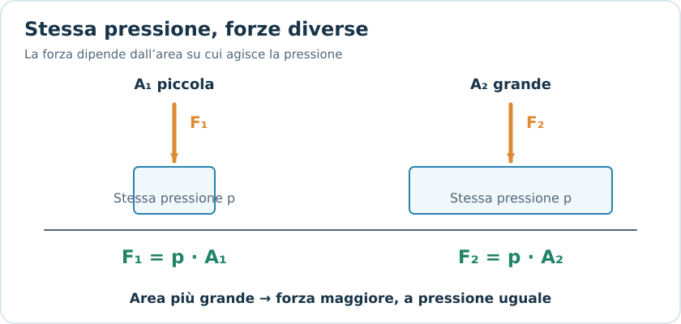
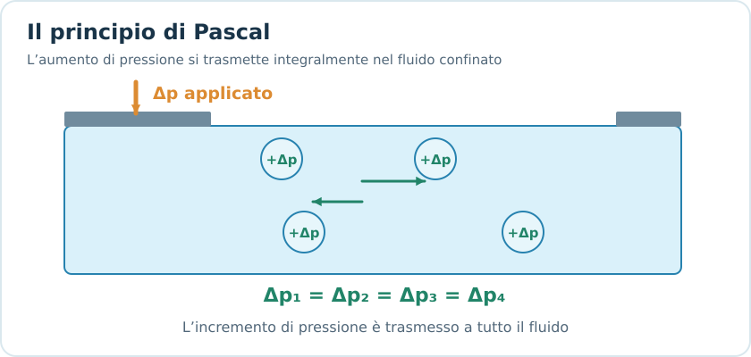
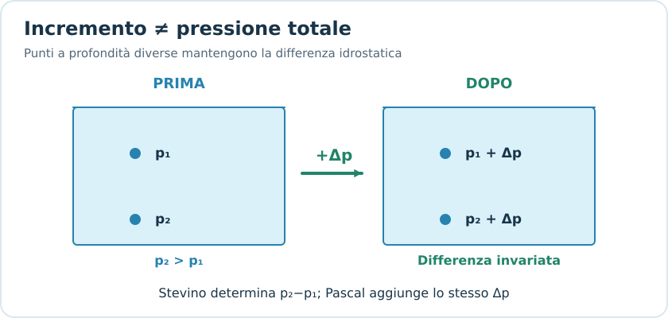
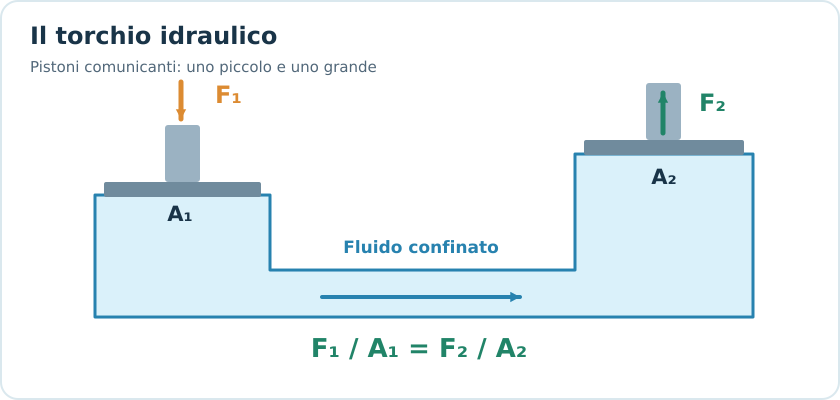
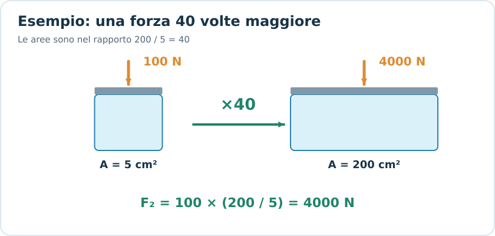
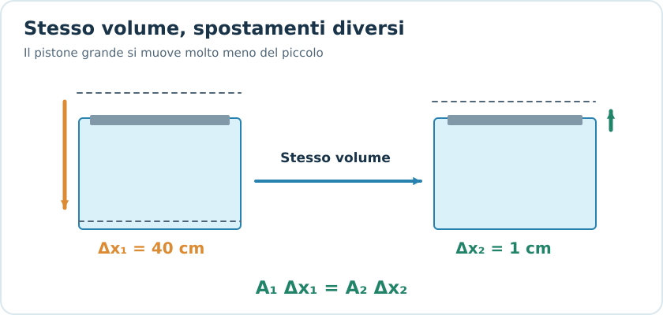
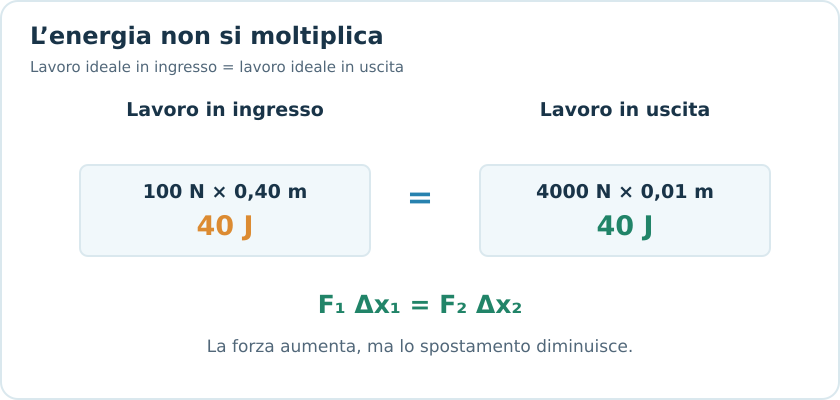
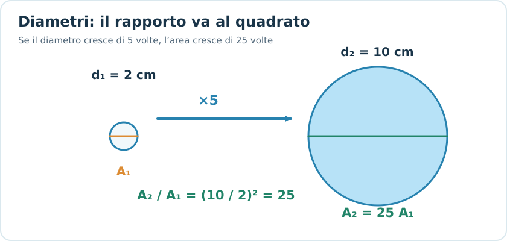
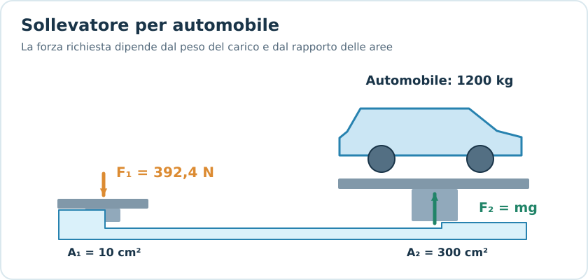
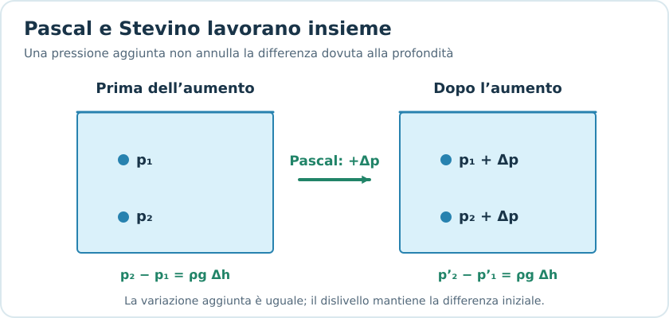

# Principio di Pascal

## 1. Introduzione

Il **principio di Pascal** descrive come viene trasmessa una variazione di pressione all'interno di un fluido confinato.

Il principio afferma:

> Una variazione di pressione applicata a un fluido confinato e in equilibrio viene trasmessa integralmente a tutti i punti del fluido e alle pareti del recipiente.

Questo principio è alla base del funzionamento di:

- Presse idrauliche.
- Sollevatori idraulici.
- Cric idraulici.
- Sistemi frenanti idraulici.

L'idea fondamentale è che **la pressione aggiuntiva si trasmette, mentre la forza risultante dipende dall'area su cui agisce**.

---

## 2. Richiamo: pressione

La pressione è definita come la forza normale esercitata per unità di superficie.

Per una forza uniformemente distribuita:

$$
\boxed{p=\frac{F}{A}}
$$

Dove:

- $p$: pressione, in pascal ($\mathrm{Pa}$).
- $F$: modulo della forza perpendicolare alla superficie, in newton ($\mathrm{N}$).
- $A$: area della superficie, in metri quadrati ($\mathrm{m^2}$).

Ricordiamo:

$$
1\ \mathrm{Pa}=1\ \mathrm{N/m^2}
$$

Formule inverse:

$$
F=pA
$$

$$
A=\frac{F}{p}
$$

### Interpretazione fisica

A parità di pressione, una superficie maggiore è soggetta a una forza maggiore.

*A parità di pressione, una superficie maggiore riceve una forza maggiore.*

Infatti:

$$
F=pA
$$

Questa relazione è alla base dei sistemi idraulici.

---

## 3. Enunciato e significato del principio di Pascal

*Applicando una variazione Δp a un fluido confinato, ogni punto riceve lo stesso incremento.*

Immaginiamo un recipiente chiuso contenente un liquido praticamente incomprimibile.

Se un pistone esercita una pressione aggiuntiva $\Delta p$ sul liquido, tale aumento si trasmette a tutti i punti del fluido.

$$
\boxed{\Delta p_1=\Delta p_2}
$$

Questo significa che **l'incremento di pressione è lo stesso**, indipendentemente dalla posizione considerata.

### Attenzione: variazione di pressione e pressione totale

*La pressione iniziale può variare con la profondità; Pascal trasmette lo stesso incremento.*

Il principio di Pascal non afferma che la pressione totale sia necessariamente identica in tutti i punti.

In presenza di gravità, infatti, la pressione varia con la profondità secondo la legge di Stevino:

$$
p=p_0+\rho gh
$$

Due punti a profondità differenti possono avere pressioni totali differenti.

Tuttavia, se aumentiamo la pressione alla superficie di una quantità $\Delta p$, in condizioni statiche ideali entrambi i punti subiscono lo stesso incremento.

$$
p'_1=p_1+\Delta p
$$

$$
p'_2=p_2+\Delta p
$$

**Il principio di Pascal riguarda quindi la trasmissione della variazione di pressione.**

---

## 4. Il torchio idraulico

*Il pistone piccolo trasmette una pressione che produce una forza maggiore sul pistone grande.*

Un **torchio idraulico** è costituito da due cilindri comunicanti, pieni di liquido, chiusi da pistoni mobili.

I pistoni hanno generalmente superfici differenti:

- Pistone piccolo: area $A_1$.
- Pistone grande: area $A_2$.

Sul primo pistone applichiamo una forza $F_1$.

La pressione aggiuntiva prodotta è:

$$
\Delta p=\frac{F_1}{A_1}
$$

Trascurando le perdite e considerando i due pistoni alla stessa quota, questa pressione si trasmette al secondo pistone.

Quindi:

$$
\frac{F_1}{A_1}=\frac{F_2}{A_2}
$$

Otteniamo la **formula fondamentale del torchio idraulico**:

$$
\boxed{\frac{F_1}{A_1}=\frac{F_2}{A_2}}
$$

Da cui:

$$
\boxed{F_2=F_1\frac{A_2}{A_1}}
$$

E, inversamente:

$$
\boxed{F_1=F_2\frac{A_1}{A_2}}
$$

Queste relazioni sono valide nel modello ideale, per le forze dovute alla pressione aggiuntiva trasmessa dal fluido.

### Interpretazione fisica

Se:

$$
A_2>A_1
$$

allora:

$$
F_2>F_1
$$

Il pistone grande esercita una forza maggiore rispetto al pistone piccolo.

Il rapporto:

$$
\boxed{\frac{F_2}{F_1}=\frac{A_2}{A_1}}
$$

è chiamato **vantaggio meccanico ideale**.

---

## 5. Esempio: sollevatore idraulico

*Nell’esempio degli appunti, 100 N sul pistone piccolo producono idealmente 4000 N sul grande.*

Un sollevatore possiede due pistoni:

- Area del pistone piccolo: $A_1=5\ \mathrm{cm^2}$.
- Area del pistone grande: $A_2=200\ \mathrm{cm^2}$.
- Forza applicata al pistone piccolo: $F_1=100\ \mathrm{N}$.

Calcolare la forza esercitata dal pistone grande.

Utilizziamo:

$$
F_2=F_1\frac{A_2}{A_1}
$$

Sostituendo:

$$
F_2=100\frac{200}{5}
$$

$$
\boxed{F_2=4000\ \mathrm{N}}
$$

### Interpretazione

Abbiamo applicato una forza di soli $100\ \mathrm{N}$ e ottenuto una forza di $4000\ \mathrm{N}$.

Il vantaggio meccanico è:

$$
\frac{F_2}{F_1}=40
$$

Il sistema moltiplica idealmente la forza per 40.

> [!important] Attenzione
> Questo non significa che il sistema produca energia dal nulla.
>
> L'aumento della forza viene compensato da uno spostamento minore del pistone grande.

---

## 6. Conservazione del volume e spostamento dei pistoni

*Aree diverse impongono spostamenti inversamente proporzionali: 40 cm contro 1 cm.*

Un liquido ideale incomprimibile conserva il proprio volume.

Quando il pistone piccolo si abbassa, sposta una certa quantità di liquido verso il pistone grande.

Il volume spostato dal primo pistone è:

$$
\Delta V_1=A_1\Delta x_1
$$

Il volume ricevuto dal secondo pistone è:

$$
\Delta V_2=A_2\Delta x_2
$$

Poiché i volumi sono uguali:

$$
\Delta V_1=\Delta V_2
$$

Quindi:

$$
\boxed{A_1\Delta x_1=A_2\Delta x_2}
$$

Da cui:

$$
\boxed{\Delta x_2=\frac{A_1}{A_2}\Delta x_1}
$$

### Interpretazione

Se il secondo pistone ha un'area maggiore, deve spostarsi di una distanza minore per ricevere lo stesso volume di liquido.

Il rapporto fra gli spostamenti è inverso rispetto a quello delle forze.

Infatti:

$$
\boxed{\frac{\Delta x_2}{\Delta x_1}=\frac{A_1}{A_2}}
$$

### Esempio

Riprendiamo il sollevatore precedente:

$$
A_1=5\ \mathrm{cm^2}
$$

$$
A_2=200\ \mathrm{cm^2}
$$

Il pistone piccolo scende di $40\ \mathrm{cm}$.

Quanto sale il pistone grande?

$$
\Delta x_2=\frac{5}{200}\cdot40
$$

$$
\boxed{\Delta x_2=1\ \mathrm{cm}}
$$

Il pistone piccolo si sposta di $40\ \mathrm{cm}$, mentre il pistone grande sale soltanto di $1\ \mathrm{cm}$.

---

## 7. Collegamento con lavoro ed energia

*La pressione permette di amplificare la forza, non il lavoro: 40 J entrano e 40 J escono.*

Un sistema idraulico ideale non crea energia.

Ricordiamo che il lavoro di una forza costante parallela allo spostamento è:

$$
L=F\Delta x
$$

Nel torchio idraulico ideale, in assenza di perdite e considerando gli spostamenti nella direzione delle rispettive forze:

$$
L_{\mathrm{in}}=L_{\mathrm{out}}
$$

Quindi:

$$
\boxed{F_1\Delta x_1=F_2\Delta x_2}
$$

### Perché questa relazione è coerente con Pascal?

Sappiamo che:

$$
F_2=F_1\frac{A_2}{A_1}
$$

E che:

$$
\Delta x_2=\Delta x_1\frac{A_1}{A_2}
$$

Moltiplicando:

$$
F_2\Delta x_2=
F_1\frac{A_2}{A_1}\cdot
\Delta x_1\frac{A_1}{A_2}
$$

Le aree si semplificano:

$$
\boxed{F_2\Delta x_2=F_1\Delta x_1}
$$

### Esempio numerico

Nel sollevatore precedente:

$$
F_1=100\ \mathrm{N}
$$

$$
\Delta x_1=0{,}40\ \mathrm{m}
$$

Il lavoro fornito è:

$$
L_{\mathrm{in}}=100\cdot0{,}40
$$

$$
\boxed{L_{\mathrm{in}}=40\ \mathrm{J}}
$$

Sul pistone grande:

$$
F_2=4000\ \mathrm{N}
$$

$$
\Delta x_2=0{,}01\ \mathrm{m}
$$

Il lavoro ottenuto è:

$$
L_{\mathrm{out}}=4000\cdot0{,}01
$$

$$
\boxed{L_{\mathrm{out}}=40\ \mathrm{J}}
$$

Quindi:

$$
L_{\mathrm{in}}=L_{\mathrm{out}}
$$

Il vantaggio del sistema consiste nell'amplificare la forza, non l'energia.

---

## 8. Pistoni circolari: calcolo delle aree

*Per pistoni circolari, il rapporto fra le aree è il quadrato del rapporto fra i diametri.*

Molti esercizi non forniscono direttamente le aree dei pistoni, ma i raggi oppure i diametri.

L'area di un pistone circolare è:

$$
\boxed{A=\pi r^2}
$$

Se è noto il diametro $d$:

$$
r=\frac{d}{2}
$$

Quindi:

$$
\boxed{A=\frac{\pi d^2}{4}}
$$

### Rapporto tra aree

Per due pistoni circolari:

$$
\frac{A_2}{A_1}=
\frac{\pi r_2^2}{\pi r_1^2}
$$

Semplificando:

$$
\boxed{\frac{A_2}{A_1}=\frac{r_2^2}{r_1^2}}
$$

Possiamo utilizzare anche i diametri:

$$
\boxed{\frac{A_2}{A_1}=\frac{d_2^2}{d_1^2}}
$$

**Questa è una scorciatoia particolarmente utile negli esercizi.**

### Esempio

Un torchio idraulico possiede:

- Pistone piccolo di diametro $d_1=2\ \mathrm{cm}$.
- Pistone grande di diametro $d_2=10\ \mathrm{cm}$.
- Forza applicata $F_1=80\ \mathrm{N}$.

Calcolare la forza sul secondo pistone.

$$
F_2=F_1\frac{d_2^2}{d_1^2}
$$

$$
F_2=80\frac{10^2}{2^2}
$$

$$
F_2=80\frac{100}{4}
$$

$$
\boxed{F_2=2000\ \mathrm{N}}
$$

Il diametro del secondo pistone è 5 volte maggiore, ma la sua area è 25 volte maggiore.

Per questo la forza viene moltiplicata per 25.

---

## 9. Forza necessaria a sollevare un carico

*Per sostenere idealmente 1200 kg bastano 392,4 N sul pistone piccolo, con A₂/A₁ = 30.*

Negli esercizi può essere fornita la massa di un oggetto anziché la forza che bisogna esercitare.

In questo caso, se il carico deve essere sostenuto in equilibrio, la forza verso l'alto deve uguagliare il suo peso:

$$
F_2=mg
$$

Utilizzando Pascal:

$$
\frac{F_1}{A_1}=\frac{mg}{A_2}
$$

Quindi:

$$
\boxed{F_1=mg\frac{A_1}{A_2}}
$$

### Esempio

Un sollevatore idraulico deve sostenere un'automobile di massa:

$$
m=1200\ \mathrm{kg}
$$

Le aree dei pistoni sono:

$$
A_1=10\ \mathrm{cm^2}
$$

$$
A_2=300\ \mathrm{cm^2}
$$

Calcolare la forza minima ideale necessaria per sostenere l'automobile.

**Passaggio 1 — Forza peso**

$$
P=mg
$$

$$
P=1200\cdot9{,}81=11772\ \mathrm{N}
$$

**Passaggio 2 — Principio di Pascal**

$$
F_1=P\frac{A_1}{A_2}
$$

$$
F_1=11772\frac{10}{300}
$$

$$
\boxed{F_1=392{,}4\ \mathrm{N}}
$$

Con una forza di circa $392\ \mathrm{N}$ possiamo idealmente sostenere un carico che pesa oltre $11000\ \mathrm{N}$.

**Nota:** si tratta di un modello ideale. Trascuriamo attrito, peso dei pistoni, perdite e differenze di quota rilevanti.

Per iniziare a sollevare il carico accelerandolo verso l'alto potrebbe essere necessaria una forza maggiore.

---

## 10. Collegamento tra Pascal e Stevino

*Pascal aggiunge lo stesso Δp ai punti, mentre Stevino continua a descriverne la differenza.*

Abbiamo studiato due leggi importanti:

### Legge di Stevino

$$
\boxed{p=p_0+\rho gh}
$$

Descrive come la pressione varia con la profondità di un fluido in equilibrio.

### Principio di Pascal

$$
\boxed{\Delta p_1=\Delta p_2}
$$

Descrive come una variazione di pressione viene trasmessa attraverso un fluido confinato.

### Come convivono le due leggi?

Supponiamo di avere due punti nello stesso liquido, uno più profondo dell'altro.

La differenza di pressione dovuta alla profondità è:

$$
p_2-p_1=\rho g(h_2-h_1)
$$

Se applichiamo una pressione aggiuntiva $\Delta p$:

$$
p'_1=p_1+\Delta p
$$

$$
p'_2=p_2+\Delta p
$$

La nuova differenza è:

$$
p'_2-p'_1=
(p_2+\Delta p)-(p_1+\Delta p)
$$

Quindi:

$$
\boxed{p'_2-p'_1=p_2-p_1}
$$

La variazione di pressione si trasmette integralmente, mentre la differenza idrostatica tra i punti rimane.

> [!important] All'esame
> Se i pistoni sono alla stessa quota, nel modello ideale utilizziamo direttamente:
>
> $$
> \frac{F_1}{A_1}=\frac{F_2}{A_2}
> $$
>
> Se il testo specifica differenze di altezza significative, bisogna valutare anche il contributo idrostatico $\rho g\Delta h$.

---

## 11. Pressione assoluta nei sistemi idraulici

Nei problemi sui torchi idraulici, spesso utilizziamo:

$$
p=\frac{F}{A}
$$

Ma la pressione effettivamente trasmessa dall'applicazione della forza è una **pressione aggiuntiva**.

Se su entrambi i pistoni agisce la stessa pressione atmosferica, i contributi atmosferici si compensano nel bilancio delle forze.

Per questo negli esercizi ideali è sufficiente utilizzare:

$$
\frac{F_1}{A_1}=\frac{F_2}{A_2}
$$

senza aggiungere ogni volta $p_{\mathrm{atm}}$.

Questo è coerente con la distinzione fra pressione assoluta e pressione relativa introdotta nella nota precedente.

---

## 12. Errori frequenti negli esercizi

### 1. Confondere forza e pressione

Il principio di Pascal trasmette la variazione di pressione, non impone forze uguali sui pistoni.

$$
\frac{F_1}{A_1}=\frac{F_2}{A_2}
$$

Se le aree differiscono, le forze differiscono.

### 2. Dimenticare il quadrato nel calcolo dell'area

Se il raggio raddoppia:

$$
A'=\pi(2r)^2=4\pi r^2
$$

L'area quadruplica, non raddoppia.

### 3. Confondere area e diametro

La relazione:

$$
\frac{F_2}{F_1}=\frac{d_2}{d_1}
$$

è sbagliata per pistoni circolari.

La relazione corretta è:

$$
\boxed{\frac{F_2}{F_1}=\frac{d_2^2}{d_1^2}}
$$

### 4. Dimenticare di convertire le unità

$$
1\ \mathrm{cm^2}=10^{-4}\ \mathrm{m^2}
$$

$$
1\ \mathrm{mm^2}=10^{-6}\ \mathrm{m^2}
$$

Se calcoliamo un rapporto fra due aree espresse nella stessa unità, possiamo lasciarle entrambe in $\mathrm{cm^2}$.

Se invece vogliamo una pressione in pascal, dobbiamo utilizzare i metri quadrati.

### 5. Pensare che venga moltiplicata anche l'energia

Una forza maggiore sul secondo pistone è accompagnata da uno spostamento minore.

Nel sistema ideale:

$$
F_1\Delta x_1=F_2\Delta x_2
$$

### 6. Confondere il principio di Pascal con la legge di Stevino

- **Pascal:** trasmissione di una variazione di pressione.
- **Stevino:** variazione della pressione con la profondità.

Le due leggi descrivono fenomeni differenti, ma possono comparire nello stesso problema.

---

## 13. Come riconoscere la formula giusta all'esame

| Se il testo chiede... | Formula |
|---|---|
| Pressione prodotta da una forza | $p=F/A$ |
| Forza del pistone grande | $F_2=F_1A_2/A_1$ |
| Forza del pistone piccolo | $F_1=F_2A_1/A_2$ |
| Vantaggio meccanico | $F_2/F_1=A_2/A_1$ |
| Area di un pistone circolare | $A=\pi r^2$ |
| Area nota dal diametro | $A=\pi d^2/4$ |
| Forza usando i diametri | $F_2=F_1d_2^2/d_1^2$ |
| Spostamento del secondo pistone | $\Delta x_2=A_1\Delta x_1/A_2$ |
| Lavoro nel sistema ideale | $F_1\Delta x_1=F_2\Delta x_2$ |
| Forza necessaria a sostenere una massa | $F_1=mgA_1/A_2$ |

---

## 14. Formule fondamentali da ricordare

### Pressione

$$
\boxed{p=\frac{F}{A}}
$$

### Principio di Pascal

$$
\boxed{\Delta p_1=\Delta p_2}
$$

### Torchio idraulico ideale

$$
\boxed{\frac{F_1}{A_1}=\frac{F_2}{A_2}}
$$

### Moltiplicazione della forza

$$
\boxed{F_2=F_1\frac{A_2}{A_1}}
$$

### Rapporto tra aree circolari

$$
\boxed{\frac{A_2}{A_1}=\frac{r_2^2}{r_1^2}=\frac{d_2^2}{d_1^2}}
$$

### Conservazione del volume

$$
\boxed{A_1\Delta x_1=A_2\Delta x_2}
$$

### Conservazione ideale del lavoro

$$
\boxed{F_1\Delta x_1=F_2\Delta x_2}
$$

---

## 15. Verifica della comprensione

Prima di passare al principio di Archimede, prova a rispondere:

1. Un torchio idraulico ha un pistone grande con area 10 volte maggiore rispetto a quello piccolo. Di quanto aumenta la forza?
2. Se il diametro del pistone grande è 3 volte quello del piccolo, di quanto aumenta la forza?
3. Un pistone piccolo scende di 20 cm. Se il pistone grande ha area 5 volte maggiore, di quanto sale?
4. Perché un torchio idraulico non viola il principio di conservazione dell'energia?
5. Se due punti dello stesso liquido si trovano a profondità differenti, il principio di Pascal impone che abbiano la stessa pressione assoluta?
6. In un sollevatore idraulico, se conosco la massa del carico anziché il suo peso, quale passaggio devo effettuare prima di applicare Pascal?

L'obiettivo è comprendere il rapporto tra **pressione, forza, superficie e spostamento**.
