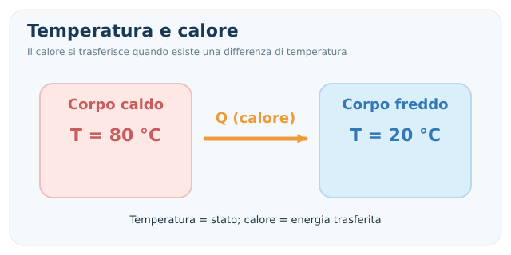
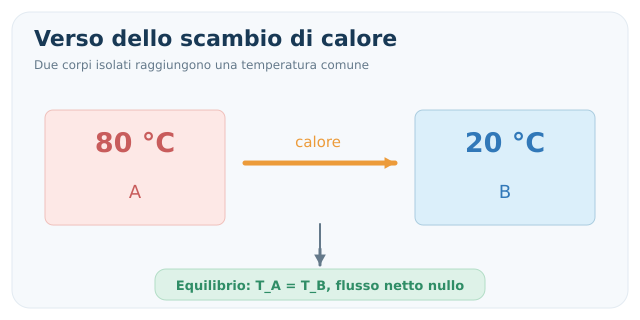
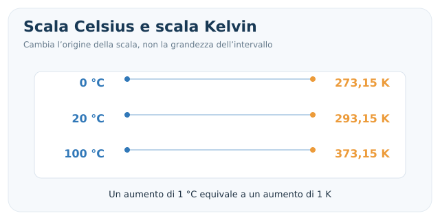
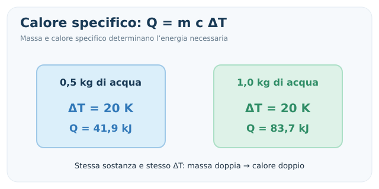
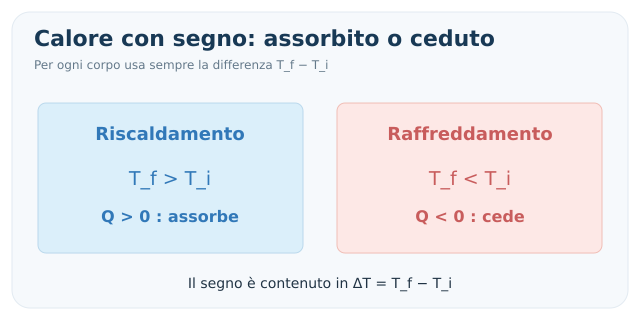
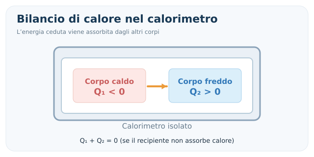
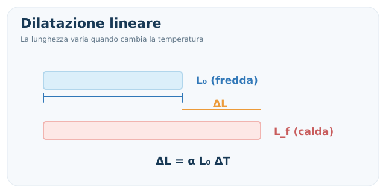
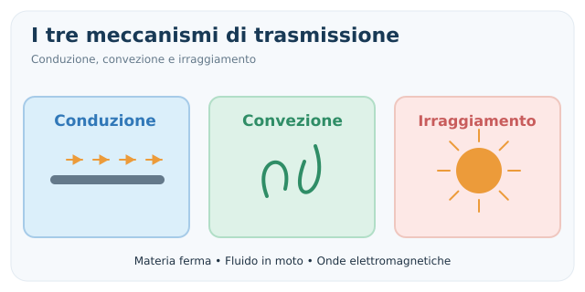

# Temperatura e calore

> [!abstract] Obiettivo della nota
> Comprendere la differenza tra **temperatura** e **calore**, riconoscere gli scambi energetici e risolvere gli esercizi su **calore specifico, capacità termica, calorimetria, equilibrio termico e dilatazione**. Il calore latente e le trasformazioni dei gas saranno approfonditi nelle note successive.

## 1. Temperatura, energia interna e calore

La **temperatura** è una grandezza fisica che descrive lo stato termico di un sistema e determina la direzione spontanea degli scambi di calore. A livello microscopico è collegata all'agitazione delle particelle, ma non coincide con l'energia interna totale del corpo.

Il **calore** ($Q$) è invece **energia trasferita** fra sistemi a causa di una differenza di temperatura. Non è una sostanza contenuta nei corpi: ciò che un corpo possiede è **energia interna** ($U$).

- **Temperatura**: indica lo stato termico; si misura in kelvin ($\mathrm K$), oppure in gradi Celsius ($^\circ\mathrm C$).
- **Calore**: energia in transito per differenza di temperatura; si misura in joule ($\mathrm J$).
- **Energia interna**: energia microscopica associata allo stato del sistema; si misura in joule.

> [!important] Da ricordare
> Due corpi possono avere **la stessa temperatura ma energie interne differenti** (per esempio perché hanno masse diverse). La temperatura non è la quantità di calore posseduta dal corpo.

---

## 2. Equilibrio termico e principio zero

Se poniamo a contatto due sistemi a temperature differenti, e permettiamo loro di scambiare energia soltanto sotto forma di calore, il trasferimento netto avviene spontaneamente dal corpo **più caldo** a quello **più freddo**.

Lo scambio prosegue finché i due sistemi raggiungono l'**equilibrio termico**: non c'è più trasferimento netto di calore tra loro.

$$
\boxed{T_A=T_B\quad\text{all'equilibrio termico}}
$$

### Principio zero della termodinamica

> Se il sistema A è in equilibrio termico con C e il sistema B è in equilibrio termico con C, allora A e B sono in equilibrio termico tra loro.

Il principio zero permette di definire operativamente la **temperatura** e di utilizzare un **termometro** come sistema di confronto.

### Attenzione

All'equilibrio le temperature sono uguali; **non** è necessario che i due corpi abbiano la stessa massa, lo stesso calore specifico o la stessa energia interna.

---

## 3. Scale termometriche e conversioni

### Celsius e kelvin

$$
\boxed{T(\mathrm K)=t(^\circ\mathrm C)+273{,}15}
$$

$$
\boxed{t(^\circ\mathrm C)=T(\mathrm K)-273{,}15}
$$

Lo **zero assoluto** corrisponde a $0\ \mathrm K=-273{,}15\ ^\circ\mathrm C$.

**Fondamentale:** un aumento di $1\ \mathrm K$ ha la stessa ampiezza di un aumento di $1\ ^\circ\mathrm C$. Perciò:

$$
\boxed{\Delta T(\mathrm K)=\Delta t(^\circ\mathrm C)}
$$

Non bisogna aggiungere $273{,}15$ a una **differenza di temperatura**.

### Fahrenheit (se richiesta)

$$
 t_F=\frac95t_C+32
$$

$$
 t_C=\frac59(t_F-32)
$$

### Esempi

- $20\ ^\circ\mathrm C =293{,}15\ \mathrm K$.
- Da $20\ ^\circ\mathrm C$ a $50\ ^\circ\mathrm C$: $\Delta T=30\ \mathrm K=30\ ^\circ\mathrm C$.

> [!warning] Esame
> Nei problemi con i **gas perfetti** dovrai utilizzare la temperatura assoluta, in kelvin. Nella formula $Q=mc\Delta T$ puoi usare differenze in kelvin oppure in gradi Celsius, purché coerenti.

---

## 4. Capacità termica e calore specifico

La quantità di energia richiesta per modificare la temperatura dipende da **quanto materiale abbiamo** e **da quale materiale è composto**.

### Capacità termica $C$

È l'energia necessaria per aumentare di un kelvin la temperatura di un determinato corpo, quando la capacità termica può essere considerata costante:

$$
\boxed{C=\frac{Q}{\Delta T}}
$$

Da cui:

$$
\boxed{Q=C\Delta T}
$$

Unità: $\mathrm{J/K}$.

### Calore specifico $c$

È la capacità termica **per unità di massa** di una sostanza:

$$
\boxed{c=\frac{Q}{m\Delta T}}
$$

Da cui ricaviamo la formula fondamentale della calorimetria:

$$
\boxed{Q=mc\Delta T}
$$

Dove:

- $Q$: calore scambiato, in joule;
- $m$: massa, in chilogrammi;
- $c$: calore specifico, in $\mathrm{J/(kg\,K)}$;
- $\Delta T=T_f-T_i$: variazione della temperatura.

La capacità termica del corpo è:

$$
\boxed{C=mc}
$$

### Alcuni valori indicativi

| Sostanza | $c\ [\mathrm{J/(kg\,K)}]$ |
|---|---:|
| Acqua liquida | $4186$ |
| Ghiaccio | $\approx2100$ |
| Alluminio | $\approx900$ |
| Ferro | $\approx450$ |
| Rame | $\approx385$ |

I valori possono dipendere dalla temperatura e dalle condizioni fisiche.

### Formule inverse

$$
\boxed{m=\frac{Q}{c\Delta T}}
\qquad
\boxed{c=\frac{Q}{m\Delta T}}
\qquad
\boxed{\Delta T=\frac{Q}{mc}}
$$

La relazione $Q=mc\Delta T$ si usa per il **riscaldamento o raffreddamento senza cambiamento di stato**, assumendo $c$ circa costante nell'intervallo considerato.

---

## 5. Segno del calore: assorbito o ceduto

Usando $Q=mc(T_f-T_i)$:

- Se $T_f>T_i$, allora $\Delta T>0$ e **$Q>0$**: il corpo **assorbe** calore.
- Se $T_f<T_i$, allora $\Delta T<0$ e **$Q<0$**: il corpo **cede** calore.

È utile distinguere:

- $Q$ **con segno**, per scrivere il bilancio energetico;
- $|Q|$, il **modulo** del calore scambiato, se il testo chiede soltanto «quanti joule» sono ceduti o assorbiti.

> [!warning] Errore comune
> Non mettere arbitrariamente un segno meno davanti a $mc\Delta T$: il segno è già determinato da $\Delta T=T_f-T_i$.

---

## 6. Esempio svolto: riscaldare l'acqua

**Testo.** Quanta energia serve per riscaldare $0{,}50\ \mathrm{kg}$ di acqua da $20\ ^\circ\mathrm C$ a $50\ ^\circ\mathrm C$? Trascuriamo le dispersioni.

**1. Dati**

$$
 m=0{,}50\ \mathrm{kg},\qquad c=4186\ \mathrm{J/(kg\,K)}
$$

$$
 \Delta T=50-20=30\ \mathrm K
$$

**2. Formula**

$$
 Q=mc\Delta T
$$

**3. Calcolo**

$$
 Q=0{,}50\cdot4186\cdot30
$$

$$
\boxed{Q=62790\ \mathrm J\approx62{,}8\ \mathrm{kJ}}
$$

Il calore è **positivo**, perché l'acqua si riscalda.

### Calorie e joule

Una conversione che talvolta compare nei problemi:

$$
\boxed{1\ \mathrm{cal}=4{,}184\ \mathrm J}
$$

La chilocaloria vale $1000\ \mathrm{cal}$ e quindi $4184\ \mathrm J$.

---

## 7. Calorimetria: bilancio degli scambi di calore

Un **calorimetro ideale** è un sistema termicamente isolato: il calore scambiato tra i corpi contenuti al suo interno non viene disperso verso l'ambiente.

Di conseguenza:

$$
\boxed{Q_1+Q_2+\cdots+Q_n=0}
$$

Il calore totale **ceduto** ha lo stesso modulo del calore totale **assorbito**.

### Due corpi senza cambiamenti di stato

Per due corpi che si portano alla stessa temperatura finale $T_f$:

$$
 m_1c_1(T_f-T_{1,i})+m_2c_2(T_f-T_{2,i})=0
$$

Da cui:

$$
\boxed{T_f=\frac{m_1c_1T_{1,i}+m_2c_2T_{2,i}}{m_1c_1+m_2c_2}}
$$

**Questa formula vale** se il sistema è isolato, i calori specifici sono costanti e non avvengono cambiamenti di stato.

### Caso particolare: stessa sostanza

Se i due corpi sono della stessa sostanza, $c_1=c_2$, dunque:

$$
\boxed{T_f=\frac{m_1T_{1,i}+m_2T_{2,i}}{m_1+m_2}}
$$

Se anche le masse sono uguali, la temperatura finale è la **media aritmetica** delle temperature iniziali.

> [!important] Controllo rapido
> In uno scambio fra due corpi isolati, **senza cambiamenti di stato**, la temperatura finale deve essere compresa tra le temperature iniziali.

---

## 8. Esempio svolto: mescolare due quantità d'acqua

**Testo.** Mescoliamo $0{,}20\ \mathrm{kg}$ di acqua a $80\ ^\circ\mathrm C$ con $0{,}30\ \mathrm{kg}$ di acqua a $20\ ^\circ\mathrm C$. Il recipiente è ideale e non disperde calore. Determinare $T_f$.

Poiché è la stessa sostanza:

$$
 T_f=\frac{m_1T_1+m_2T_2}{m_1+m_2}
$$

$$
 T_f=\frac{0{,}20\cdot80+0{,}30\cdot20}{0{,}20+0{,}30}
$$

$$
\boxed{T_f=44\ ^\circ\mathrm C}
$$

**Verifica con il bilancio:**

$$
 Q_\mathrm{calda}=0{,}20\cdot4186\cdot(44-80)\approx-30139\ \mathrm J
$$

$$
 Q_\mathrm{fredda}=0{,}30\cdot4186\cdot(44-20)\approx+30139\ \mathrm J
$$

$$
 Q_\mathrm{calda}+Q_\mathrm{fredda}=0
$$

L'acqua inizialmente calda **cede** esattamente l'energia che l'acqua fredda **assorbe**.

---

## 9. Calorimetro non ideale: capacità termica del recipiente

Se anche il contenitore si riscalda o si raffredda, dobbiamo includere il calore da esso scambiato.

Indicando con $C_\mathrm{cal}$ la sua capacità termica:

$$
\boxed{Q_\mathrm{cal}=C_\mathrm{cal}(T_f-T_{\mathrm{cal},i})}
$$

Il bilancio diventa, per esempio:

$$
\boxed{m_1c_1(T_f-T_{1,i})+m_2c_2(T_f-T_{2,i})+C_\mathrm{cal}(T_f-T_{\mathrm{cal},i})=0}
$$

In molti esercizi la capacità termica del calorimetro è dichiarata **trascurabile**: in quel caso il terzo termine si elimina.

### Metodo meccanico per gli esercizi di calorimetria

1. **Individua** tutti i corpi che scambiano calore (compreso il calorimetro, se richiesto).
2. **Scegli** un'unica incognita $T_f$.
3. **Scrivi** un termine $Q_i=m_ic_i(T_f-T_{i})$ per ciascun corpo.
4. **Imponi** $\sum_iQ_i=0$ se il sistema è isolato.
5. **Risolvi** e **controlla** che la temperatura finale sia fisicamente plausibile.

---

## 10. Dilatazione termica

Molti solidi aumentano le loro dimensioni quando aumenta la temperatura. Per variazioni moderate, possiamo utilizzare formule approssimate.

### Dilatazione lineare

Per una barra di lunghezza iniziale $L_0$:

$$
\boxed{\Delta L=\alpha L_0\Delta T}
$$

$$
\boxed{L_f=L_0(1+\alpha\Delta T)}
$$

Dove $\alpha$ è il **coefficiente di dilatazione lineare**, misurato in $\mathrm{K^{-1}}$.

### Dilatazione volumica

Per un volume iniziale $V_0$:

$$
\boxed{\Delta V=\beta V_0\Delta T}
$$

$$
\boxed{V_f=V_0(1+\beta\Delta T)}
$$

Per solidi isotropi e piccole variazioni di temperatura vale approssimativamente:

$$
\boxed{\beta\approx3\alpha}
$$

L'acqua in prossimità di $4\ ^\circ\mathrm C$ presenta un comportamento anomalo: non bisogna applicarle indiscriminatamente l'intuizione «scaldare significa sempre aumentare il volume».

### Esempio

Una barra metallica lunga $2{,}00\ \mathrm m$ ha $\alpha=12\cdot10^{-6}\ \mathrm{K^{-1}}$. La sua temperatura aumenta di $60\ \mathrm K$.

$$
\Delta L=12\cdot10^{-6}\cdot2{,}00\cdot60
$$

$$
\boxed{\Delta L=1{,}44\cdot10^{-3}\ \mathrm m=1{,}44\ \mathrm{mm}}
$$

---

## 11. Come si trasmette il calore

Esistono tre meccanismi fondamentali di trasferimento energetico dovuto a differenze di temperatura.

| Meccanismo | Che cosa succede | Esempio |
|---|---|---|
| **Conduzione** | Energia trasferita attraverso il materiale senza un movimento macroscopico della materia | Il manico di un cucchiaio metallico si scalda |
| **Convezione** | Trasferimento di energia accompagnato da movimento del fluido | Correnti in una pentola d'acqua |
| **Irraggiamento** | Energia trasferita per mezzo di radiazione elettromagnetica | Il Sole riscalda la Terra |

L'irraggiamento può avvenire **anche nel vuoto**; conduzione e convezione richiedono materia.

In questa prima nota ci interessa soprattutto **riconoscere** il meccanismo. Le formule per il flusso termico, se previste dal programma, possono essere aggiunte in un approfondimento specifico.

---

## 12. Attenzione ai cambiamenti di stato

La formula $Q=mc\Delta T$ **non descrive da sola** un passaggio di stato a temperatura costante.

Durante fusione, solidificazione, vaporizzazione o condensazione dobbiamo considerare anche il **calore latente**:

$$
\boxed{Q=\pm mL}
$$

Dove $L$ è il calore latente specifico, in $\mathrm{J/kg}$; il segno dipende dall'energia assorbita o ceduta.

**Esempio qualitativo:** fornendo calore a ghiaccio che sta fondendo a pressione atmosferica, parte dell'energia viene utilizzata per la fusione senza innalzare la temperatura finché la transizione non è completa.

Questo argomento verrà trattato in modo completo nella nota separata **`Calore latente.md`**.

---

## 13. Errori frequenti negli esercizi

### Confondere temperatura e calore

La temperatura si misura in $\mathrm K$ o $^\circ\mathrm C$; il calore in $\mathrm J$.

### Mettere $273{,}15$ nella differenza di temperatura

Una variazione di $20\ ^\circ\mathrm C$ è anche $20\ \mathrm K$, **non** $293{,}15\ \mathrm K$.

### Non convertire i grammi in chilogrammi

Se $c$ è espresso in $\mathrm{J/(kg\,K)}$, utilizzare la massa in chilogrammi: $250\ \mathrm g=0{,}250\ \mathrm{kg}$.

### Eliminare i segni nel bilancio

Se scriviamo $Q=mc(T_f-T_i)$, alcuni termini saranno positivi e altri negativi. Il bilancio è $\sum Q_i=0$, non la somma dei soli moduli.

### Dimenticare il calorimetro

Se viene fornita la sua capacità termica, includere $C_\mathrm{cal}\Delta T$.

### Applicare la media semplice sempre

La media aritmetica delle temperature vale solo in casi particolari, per esempio masse uguali della stessa sostanza. In generale occorre pesare con $mc$.

### Usare $Q=mc\Delta T$ durante una fusione

Se è presente un passaggio di stato, occorre valutare il calore latente e spesso suddividere il processo in fasi.

---

## 14. Come riconoscere la formula giusta all'esame

| Se il testo chiede... | Formula / metodo |
|---|---|
| Convertire Celsius in kelvin | $T=t+273{,}15$ |
| Variazione di temperatura | $\Delta T=T_f-T_i$ |
| Calore assorbito o ceduto (senza passaggio di stato) | $Q=mc\Delta T$ |
| Massa a partire dal calore | $m=Q/(c\Delta T)$ |
| Calore specifico incognito | $c=Q/(m\Delta T)$ |
| Capacità termica del corpo | $C=mc$ |
| Calore scambiato dal calorimetro | $Q_\mathrm{cal}=C_\mathrm{cal}\Delta T$ |
| Miscela isolata di corpi | $\sum Q_i=0$ |
| Due quantità della stessa sostanza | $T_f=(m_1T_1+m_2T_2)/(m_1+m_2)$ |
| Dilatazione lineare | $\Delta L=\alpha L_0\Delta T$ |
| Dilatazione volumica | $\Delta V=\beta V_0\Delta T$ |
| Passaggio di stato | $Q=\pm mL$ (nota successiva dedicata) |

---

## 15. Formulario essenziale

### Scale termometriche

$$
\boxed{T(\mathrm K)=t(^\circ\mathrm C)+273{,}15}
$$

$$
\boxed{\Delta T(\mathrm K)=\Delta t(^\circ\mathrm C)}
$$

### Calorimetria

$$
\boxed{Q=mc(T_f-T_i)}
\qquad
\boxed{C=mc}
$$

$$
\boxed{\sum_iQ_i=0\quad\text{(sistema termicamente isolato)}}
$$

### Dilatazione

$$
\boxed{\Delta L=\alpha L_0\Delta T}
\qquad
\boxed{\Delta V=\beta V_0\Delta T}
$$

### Conversione

$$
\boxed{1\ \mathrm{cal}=4{,}184\ \mathrm J}
$$

---

## 16. Verifica della comprensione

1. Un bicchiere e una vasca contengono acqua alla stessa temperatura. Hanno necessariamente la stessa energia interna? Perché?
2. Qual è la differenza fra $\Delta T=15\ ^\circ\mathrm C$ e una temperatura assoluta di $15\ \mathrm K$?
3. Se raddoppi la massa e lasci uguali $c$ e $\Delta T$, come cambia $Q$?
4. Due corpi isolati, uno a $80\ ^\circ\mathrm C$ e l'altro a $20\ ^\circ\mathrm C$, raggiungono $T_f=50\ ^\circ\mathrm C$ in ogni situazione?
5. Come imposti l'equazione se un corpo caldo viene messo in un calorimetro inizialmente più freddo, di capacità termica non trascurabile?
6. Perché $Q=mc\Delta T$ non basta per calcolare l'energia necessaria a trasformare ghiaccio a $0\ ^\circ\mathrm C$ in acqua a $0\ ^\circ\mathrm C$?

> [!summary] Concetto chiave
> **Il calore è energia scambiata, non temperatura.** Nei problemi di calorimetria identifica chi cede, chi assorbe e scrivi il bilancio energetico prima di sostituire i numeri.
