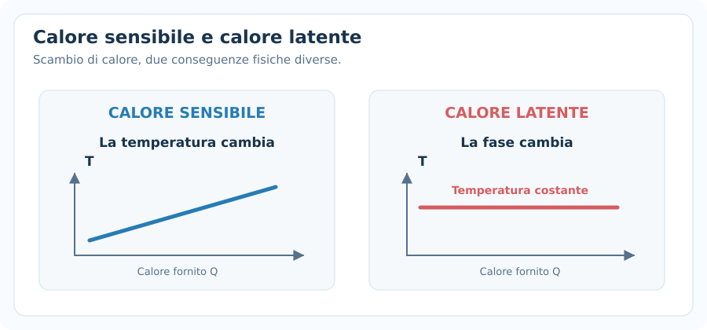
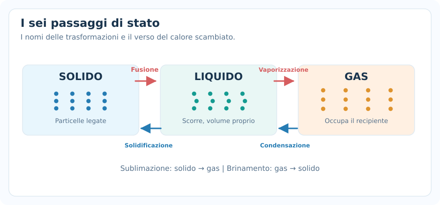
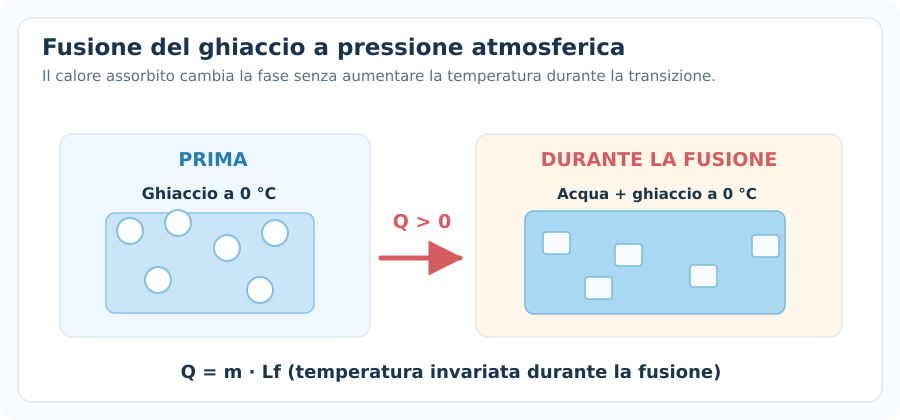
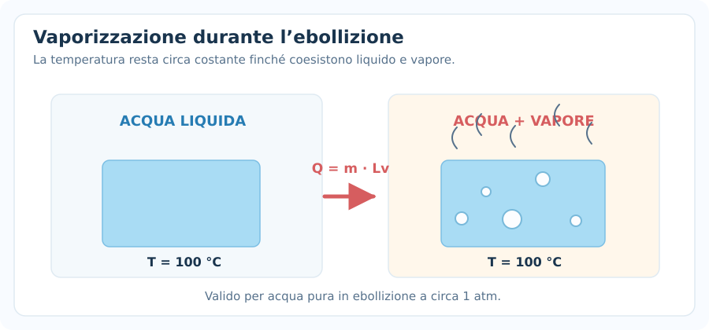
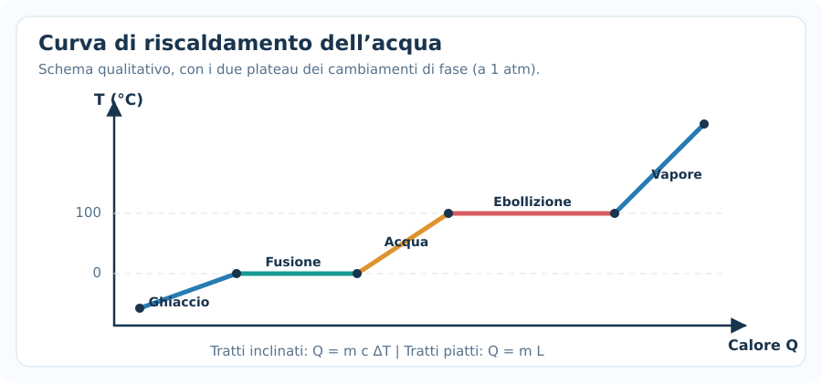
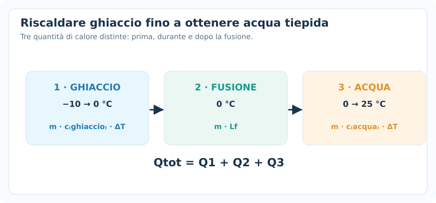
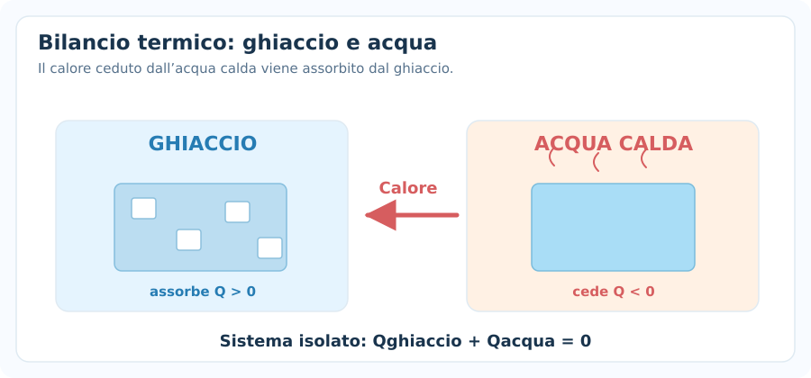
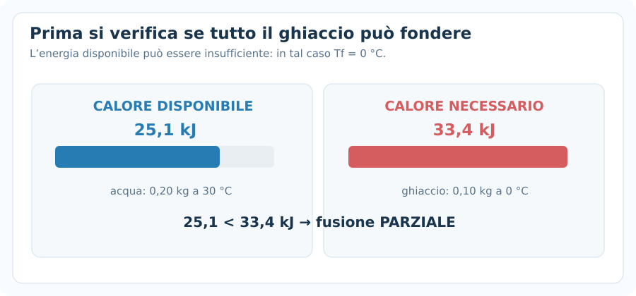
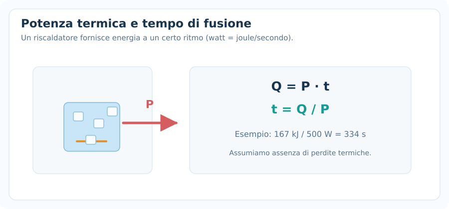
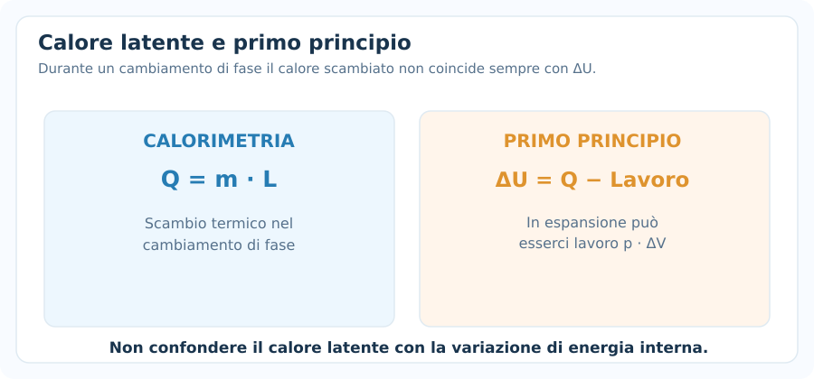

# Calore latente

> [!abstract] Obiettivo della nota
> Comprendere i **passaggi di stato**, distinguere il **calore sensibile** dal **calore latente** e risolvere i problemi su **fusione, solidificazione, ebollizione, condensazione e miscele acqua–ghiaccio**. Alla fine dovrai riconoscere quando usare $Q=mc\Delta T$, quando usare $Q=mL$ e come combinarli in un bilancio energetico.

## 1. Calore e temperatura: un richiamo

Il **calore** è energia trasferita a causa di una differenza di temperatura; la **temperatura** descrive lo stato termico di un sistema.

Non sono sinonimi: un corpo può assorbire calore **senza aumentare la propria temperatura**, se l'energia serve a provocare un cambiamento di fase.

### Calore sensibile

Quando il corpo rimane nella **stessa fase** e cambia temperatura, in assenza di altre trasformazioni rilevanti usiamo:

$$
\boxed{Q=mc\Delta T}
$$

Dove:

- $Q$: calore scambiato, in joule ($\mathrm J$).
- $m$: massa, in chilogrammi ($\mathrm{kg}$).
- $c$: calore specifico, in $\mathrm{J/(kg\cdot K)}$.
- $\Delta T=T_f-T_i$: variazione di temperatura, in kelvin o in gradi Celsius per le differenze.

Con la convenzione **calore assorbito positivo**:

- $Q>0$ se il corpo si riscalda;
- $Q<0$ se il corpo si raffredda.

### Calore latente

Quando una sostanza pura cambia fase alla temperatura di transizione, in equilibrio e a pressione fissata, il calore scambiato durante il passaggio è:

$$
\boxed{Q=mL}
$$

Qui $L>0$ è il **calore latente specifico** del cambiamento di fase, espresso in $\mathrm{J/kg}$. Nella formula con segno, per fusione o vaporizzazione $Q=+mL$; per solidificazione o condensazione $Q=-mL$.

> [!note] Notazione
> Nelle note sul primo principio la lettera $L$ indica il **lavoro**. In questa nota, invece, $L_f$ e $L_v$ indicano i **calori latenti specifici**. Sono grandezze diverse: il lavoro è in $\mathrm J$, il calore latente specifico in $\mathrm{J/kg}$. Alcuni testi usano $\lambda_f$ e $\lambda_v$ per evitare l’ambiguità.

> [!important] Regola immediata
> **Stessa fase + variazione di temperatura** $\rightarrow Q=mc\Delta T$.
>
> **Cambiamento di fase a temperatura costante** $\rightarrow Q=\pm mL$.
>
> In un esercizio con più passaggi, **somma i contributi uno per uno**.

---

## 2. Passaggi di stato

Le principali fasi della materia, nel modello introduttivo, sono **solido, liquido e gas**.

| Trasformazione | Da | A | Calore scambiato a pressione fissata |
|---|---|---|---|
| Fusione | Solido | Liquido | Assorbito ($Q>0$) |
| Solidificazione | Liquido | Solido | Ceduto ($Q<0$) |
| Vaporizzazione | Liquido | Gas | Assorbito ($Q>0$) |
| Condensazione (liquefazione) | Gas | Liquido | Ceduto ($Q<0$) |
| Sublimazione | Solido | Gas | Assorbito ($Q>0$) |
| Brinamento (deposizione) | Gas | Solido | Ceduto ($Q<0$) |

### Perché la temperatura resta costante durante il passaggio?

Durante un cambiamento di fase **in equilibrio**, per una sostanza pura e a pressione fissata, il calore scambiato serve a modificare lo stato di aggregazione, invece di far aumentare o diminuire la temperatura.

Per esempio, a pressione atmosferica ordinaria, una miscela di **ghiaccio e acqua in equilibrio** rimane a circa $0\,^{\circ}\mathrm C$ finché entrambe le fasi coesistono.

**Attenzione:** la temperatura di fusione o ebollizione **dipende dalla pressione**. I valori $0\,^{\circ}\mathrm C$ e $100\,^{\circ}\mathrm C$ dell'acqua sono riferimenti approssimati a $1\ \mathrm{atm}$.

---

## 3. Fusione e calore latente di fusione

Il **calore latente specifico di fusione** $L_f$ è il calore necessario per fondere $1\ \mathrm{kg}$ di sostanza già alla sua temperatura di fusione.

$$
\boxed{Q_{\mathrm{fus}}=+mL_f}
$$

Per solidificare la stessa massa, alla stessa pressione e temperatura di transizione, viene ceduta la stessa quantità di energia in modulo:

$$
\boxed{Q_{\mathrm{sol}}=-mL_f}
$$

Per l'acqua vicino a $0\,^{\circ}\mathrm C$ e a pressione atmosferica:

$$
\boxed{L_f\approx3{,}34\cdot10^5\ \mathrm{J/kg}}
$$

Ovvero $334\ \mathrm{kJ/kg}$.

### Esempio 1 — Ghiaccio a $0\,^{\circ}\mathrm C$

Quanta energia serve per fondere completamente $m=0{,}15\ \mathrm{kg}$ di ghiaccio già a $0\,^{\circ}\mathrm C$?

$$
Q=mL_f=0{,}15\cdot334000
$$

$$
\boxed{Q=50100\ \mathrm J=50{,}1\ \mathrm{kJ}}
$$

Non compare $mc\Delta T$, perché il ghiaccio **non deve essere prima riscaldato**.

---

## 4. Vaporizzazione e condensazione

Il **calore latente specifico di vaporizzazione** $L_v$ è il calore necessario per trasformare $1\ \mathrm{kg}$ di liquido in vapore alla temperatura di ebollizione, per la pressione considerata.

$$
\boxed{Q_{\mathrm{vap}}=+mL_v}
$$

Per la condensazione, quando il vapore diventa liquido:

$$
\boxed{Q_{\mathrm{cond}}=-mL_v}
$$

Per l'acqua a circa $100\,^{\circ}\mathrm C$ e a $1\ \mathrm{atm}$:

$$
\boxed{L_v\approx2{,}26\cdot10^6\ \mathrm{J/kg}}
$$

### Esempio 2 — Condensazione

Un vapore d'acqua alla temperatura di condensazione cede calore trasformandosi in $0{,}020\ \mathrm{kg}$ di acqua liquida a $100\,^{\circ}\mathrm C$.

$$
Q=-mL_v=-0{,}020\cdot2{,}26\cdot10^6
$$

$$
\boxed{Q=-45200\ \mathrm J}
$$

**Il vapore cede $45{,}2\ \mathrm{kJ}$.** Se il problema chiede *quanto calore riceve l'ambiente*, la risposta è invece $+45{,}2\ \mathrm{kJ}$.

### Evaporazione ed ebollizione: non sono la stessa cosa

- **Evaporazione:** avviene dalla superficie anche sotto la temperatura di ebollizione.
- **Ebollizione:** avviene con formazione di bolle nel volume del liquido quando le condizioni di pressione lo permettono.

La formula con $L_v$ tabulato a $100\,^{\circ}\mathrm C$ è destinata ai consueti problemi di **ebollizione/condensazione a 1 atm**, non a qualunque evaporazione a temperatura diversa.

---

## 5. Valori e unità da conoscere

| Grandezza | Simbolo | Valore approssimativo (acqua, condizioni indicate) |
|---|---|---:|
| Calore specifico ghiaccio | $c_g$ | $2100\ \mathrm{J/(kg\cdot K)}$ |
| Calore specifico acqua liquida | $c_a$ | $4186\ \mathrm{J/(kg\cdot K)}$ |
| Calore specifico vapore | $c_v$ | $2000\ \mathrm{J/(kg\cdot K)}$ |
| Calore latente di fusione | $L_f$ | $334000\ \mathrm{J/kg}$ a $0\,^{\circ}\mathrm C$ |
| Calore latente di vaporizzazione | $L_v$ | $2260000\ \mathrm{J/kg}$ a $100\,^{\circ}\mathrm C$ |

> [!note] Valori negli esercizi
> Se il testo fornisce valori propri, **usa quelli del testo**. Le cifre tabulate sono approssimazioni; i calori specifici dipendono dalla temperatura e dalla pressione.

### Controllo delle unità

Nel riscaldamento:

$$
[mc\Delta T]=\mathrm{kg}\cdot\frac{\mathrm J}{\mathrm{kg\cdot K}}\cdot\mathrm K=\mathrm J
$$

Nel passaggio di stato:

$$
[mL]=\mathrm{kg}\cdot\frac{\mathrm J}{\mathrm{kg}}=\mathrm J
$$

**Conversioni:** $1\ \mathrm{kJ}=1000\ \mathrm J$, $1\ \mathrm g=10^{-3}\ \mathrm{kg}$.

---

## 6. Curva di riscaldamento: i cinque tratti

Immaginiamo di partire con **ghiaccio sotto $0\,^{\circ}\mathrm C$** e fornire calore fino a ottenere **vapore sopra $100\,^{\circ}\mathrm C$**, a pressione atmosferica.

Si attraversano cinque stadi:

1. **Riscaldamento del ghiaccio:** da $T_i<0$ a $0\,^{\circ}\mathrm C$.
2. **Fusione:** da ghiaccio a acqua a $0\,^{\circ}\mathrm C$.
3. **Riscaldamento dell'acqua:** da $0$ a $100\,^{\circ}\mathrm C$.
4. **Vaporizzazione:** da acqua a vapore a $100\,^{\circ}\mathrm C$.
5. **Riscaldamento del vapore:** da $100\,^{\circ}\mathrm C$ alla temperatura finale.

Il calore totale è la somma:

$$
\boxed{Q_{\mathrm{tot}}=Q_1+Q_2+Q_3+Q_4+Q_5}
$$

con:

$$
\begin{aligned}
Q_1&=mc_g(0-T_i)\\
Q_2&=mL_f\\
Q_3&=mc_a(100-0)\\
Q_4&=mL_v\\
Q_5&=mc_v(T_f-100)
\end{aligned}
$$

I tratti obliqui della curva indicano variazione della temperatura; quelli orizzontali rappresentano il calore scambiato **a temperatura di transizione costante**.

> [!warning] Un errore frequente
> Non applicare $Q=mc\Delta T$ a un percorso che attraversa anche un cambiamento di fase **senza aggiungere** $mL$.

---

## 7. Esempio completo — Da ghiaccio freddo ad acqua tiepida

Portiamo $m=0{,}20\ \mathrm{kg}$ di ghiaccio da $-10\,^{\circ}\mathrm C$ ad acqua liquida a $25\,^{\circ}\mathrm C$.

**1. Riscaldiamo il ghiaccio da $-10$ a $0\,^{\circ}\mathrm C$.**

$$
Q_1=mc_g\Delta T=0{,}20\cdot2100\cdot10
$$

$$
\boxed{Q_1=4200\ \mathrm J}
$$

**2. Fondiamo completamente il ghiaccio a $0\,^{\circ}\mathrm C$.**

$$
Q_2=mL_f=0{,}20\cdot334000
$$

$$
\boxed{Q_2=66800\ \mathrm J}
$$

**3. Riscaldiamo l'acqua da $0$ a $25\,^{\circ}\mathrm C$.**

$$
Q_3=mc_a\Delta T=0{,}20\cdot4186\cdot25
$$

$$
\boxed{Q_3=20930\ \mathrm J}
$$

Sommiamo:

$$
Q_{\mathrm{tot}}=4200+66800+20930
$$

$$
\boxed{Q_{\mathrm{tot}}=91930\ \mathrm J\approx91{,}9\ \mathrm{kJ}}
$$

**Osservazione:** il contributo maggiore è la fusione. È il motivo per cui fondere il ghiaccio richiede molta energia anche quando la temperatura resta ferma.

---

## 8. Bilanci termici e miscele con ghiaccio

Negli esercizi di calorimetria si considerano spesso acqua calda e ghiaccio freddo o ghiaccio a $0\,^{\circ}\mathrm C$ in un recipiente isolato.

Se non ci sono scambi energetici con l'ambiente e trascuriamo il calore assorbito dal recipiente:

$$
\boxed{\sum_i Q_i=0}
$$

Con la nostra convenzione:

- Il corpo caldo **cede** calore: $Q<0$.
- Il corpo freddo **assorbe** calore: $Q>0$.

### Metodo meccanico: verificare prima se il ghiaccio fonde tutto

Quando mescoli acqua calda e ghiaccio, **non partire subito** dall'equazione con una temperatura finale ignota.

**Passaggio 1 — Energia disponibile:** calcola quanto calore l'acqua può cedere raffreddandosi fino a $0\,^{\circ}\mathrm C$:

$$
\boxed{Q_{\mathrm{disp}}=m_a c_a (T_a-0)}
$$

**Passaggio 2 — Energia necessaria:** se il ghiaccio è sottozero, trova prima il calore per portarlo a $0\,^{\circ}\mathrm C$; poi quello per fondere tutto:

$$
Q_{\mathrm{necess}}=m_gc_g(0-T_g)+m_gL_f
$$

Se il ghiaccio è già a zero, il primo termine è nullo.

**Passaggio 3 — Confronta:**

- $Q_{\mathrm{disp}}>Q_{\mathrm{necess}}$: tutto il ghiaccio fonde e il calore residuo riscalda l'acqua risultante; $T_f>0\,^{\circ}\mathrm C$.
- $Q_{\mathrm{disp}}=Q_{\mathrm{necess}}$: tutto il ghiaccio può fondere e l'acqua finale resta a $0\,^{\circ}\mathrm C$.
- $Q_{\mathrm{disp}}<Q_{\mathrm{necess}}$: non c'è energia sufficiente a fondere tutto; può rimanere ghiaccio a $0\,^{\circ}\mathrm C$, **purché l'energia raggiunga almeno la temperatura di fusione**. Se neppure questo avviene, occorre impostare il bilancio con temperature sottozero e verificare lo stato finale.

---

## 9. Esempio — Fusione completa nella miscela

Mescoliamo:

- $m_a=0{,}40\ \mathrm{kg}$ d'acqua a $40\,^{\circ}\mathrm C$;
- $m_g=0{,}10\ \mathrm{kg}$ di ghiaccio a $0\,^{\circ}\mathrm C$.

Consideriamo il recipiente idealmente isolato.

**Calore cedibile dall'acqua fino a $0\,^{\circ}\mathrm C$:**

$$
Q_{\mathrm{disp}}=0{,}40\cdot4186\cdot40=66976\ \mathrm J
$$

**Calore necessario a fondere il ghiaccio:**

$$
Q_{\mathrm{fus}}=0{,}10\cdot334000=33400\ \mathrm J
$$

Poiché $66976>33400$, **tutto il ghiaccio fonde**.

Il calore residuo è:

$$
Q_{\mathrm{res}}=66976-33400=33576\ \mathrm J
$$

Questo riscalda tutta l'acqua finale, di massa $0{,}50\ \mathrm{kg}$, partendo da $0\,^{\circ}\mathrm C$:

$$
Q_{\mathrm{res}}=(m_a+m_g)c_aT_f
$$

$$
T_f=\frac{33576}{0{,}50\cdot4186}
$$

$$
\boxed{T_f\approx16{,}0\,^{\circ}\mathrm C}
$$

**Controllo:** $T_f$ è compresa tra $0$ e $40\,^{\circ}\mathrm C$, come previsto.

---

## 10. Esempio — Fusione parziale

Mescoliamo in un recipiente isolato:

- $0{,}20\ \mathrm{kg}$ di acqua a $30\,^{\circ}\mathrm C$;
- $0{,}10\ \mathrm{kg}$ di ghiaccio a $0\,^{\circ}\mathrm C$.

Calore disponibile raffreddando l'acqua a zero:

$$
Q_{\mathrm{disp}}=0{,}20\cdot4186\cdot30=25116\ \mathrm J
$$

Calore per fondere completamente il ghiaccio:

$$
Q_{\mathrm{fus}}=0{,}10\cdot334000=33400\ \mathrm J
$$

Poiché $25116<33400$, **il ghiaccio non può fondere completamente**.

In equilibrio resta una miscela acqua–ghiaccio a:

$$
\boxed{T_f=0\,^{\circ}\mathrm C}
$$

La massa di ghiaccio fusa è:

$$
m_{\mathrm{fusa}}=\frac{Q_{\mathrm{disp}}}{L_f}=\frac{25116}{334000}
$$

$$
\boxed{m_{\mathrm{fusa}}\approx0{,}0752\ \mathrm{kg}}
$$

La massa ancora solida è:

$$
\boxed{m_{\mathrm{rimasta}}=0{,}10-0{,}0752\approx0{,}0248\ \mathrm{kg}}
$$

**Errore da evitare:** non usare una temperatura finale maggiore di zero quando resta ghiaccio in equilibrio con acqua liquida a pressione atmosferica.

---

## 11. Vapore caldo che condensa in acqua fredda

Questo tipo di problema combina **condensazione** e **raffreddamento** del liquido appena formato.

Supponiamo di immettere $m_v$ di vapore a $100\,^{\circ}\mathrm C$ in una quantità $m_a$ di acqua più fredda. Se il vapore **condensa tutto** e la temperatura finale $T_f$ è sotto $100\,^{\circ}\mathrm C$:

Calore ceduto dal vapore:

$$
Q_v=-m_vL_v-m_vc_a(100-T_f)
$$

Calore assorbito dall'acqua fredda:

$$
Q_a=m_ac_a(T_f-T_a)
$$

Nel sistema isolato:

$$
\boxed{Q_v+Q_a=0}
$$

### Esempio

Si introducono $0{,}020\ \mathrm{kg}$ di vapore saturo a $100\,^{\circ}\mathrm C$ in $0{,}30\ \mathrm{kg}$ d'acqua a $20\,^{\circ}\mathrm C$, in un calorimetro ideale.

Ipotizzando condensazione completa:

$$
0{,}30\cdot4186(T_f-20)=0{,}020\cdot2260000+0{,}020\cdot4186(100-T_f)
$$

Svolgendo:

$$
1255{,}8T_f-25116=45200+8372-83{,}72T_f
$$

$$
1339{,}52T_f=78688
$$

$$
\boxed{T_f\approx58{,}7\,^{\circ}\mathrm C}
$$

L'ipotesi è coerente: la temperatura finale è inferiore a $100\,^{\circ}\mathrm C$, quindi la condensazione totale è possibile.

---

## 12. Potenza termica, energia e tempo

Se un riscaldatore fornisce potenza costante $\mathcal P$ a un sistema:

$$
\boxed{\mathcal P=\frac{Q}{\Delta t}}
$$

Quindi:

$$
\boxed{Q=\mathcal P\Delta t}
$$

$$
\boxed{\Delta t=\frac{Q}{\mathcal P}}
$$

Dato che $1\ \mathrm W=1\ \mathrm{J/s}$, il risultato viene in secondi usando joule e watt.

### Esempio

Un riscaldatore ideale da $500\ \mathrm W$ fonde $0{,}50\ \mathrm{kg}$ di ghiaccio a $0\,^{\circ}\mathrm C$ senza riscaldare ulteriormente l'acqua.

$$
Q=mL_f=0{,}50\cdot334000=167000\ \mathrm J
$$

$$
\Delta t=\frac{167000}{500}
$$

$$
\boxed{\Delta t=334\ \mathrm s\approx5{,}57\ \mathrm{min}}
$$

Se solo una frazione $\eta$ della potenza elettrica si trasforma in calore utile al sistema, allora $\mathcal P_{\mathrm{utile}}=\eta\mathcal P_{\mathrm{elettrica}}$.

---

## 13. Collegamento con il primo principio della termodinamica

Nella precedente nota abbiamo usato, con $L_{\mathrm{gas}}$ lavoro svolto **dal sistema**:

$$
\boxed{\Delta U=Q-L_{\mathrm{gas}}}
$$

Il calore latente è il **calore scambiato** durante un cambiamento di fase. Non significa, in generale, che $\Delta U=mL$.

Per esempio, durante la vaporizzazione a pressione costante un fluido può **espandersi e compiere lavoro**:

$$
L_{\mathrm{gas}}=p\Delta V
$$

Di conseguenza:

$$
\Delta U=mL_v-p\Delta V
$$

se non ci sono altri tipi di lavoro e la trasformazione avviene a pressione esterna costante.

Il calore scambiato a pressione costante coincide con una variazione di **entalpia**, $Q_p=\Delta H$, nelle ipotesi usuali di solo lavoro $pV$.

> [!note] Per gli esercizi introduttivi
> Nei normali problemi di calorimetria si calcolano i calori sensibili e latenti con $Q=mc\Delta T$ e $Q=mL$. Se il testo chiede esplicitamente **energia interna** o **lavoro di espansione**, bisogna aggiungere il primo principio.

---

## 14. Errori frequenti

### 1. Usare $Q=mc\Delta T$ mentre il corpo cambia fase

Durante il passaggio di stato alla temperatura di transizione si usa $Q=\pm mL$; la temperatura non varia finché il cambiamento di fase avviene in equilibrio a pressione fissata.

### 2. Usare il calore specifico sbagliato

Ghiaccio, acqua liquida e vapore **non hanno lo stesso calore specifico**. Ogni fase ha il proprio valore.

### 3. Dimenticare il riscaldamento prima della fusione

Ghiaccio a $-15\,^{\circ}\mathrm C$ non fonde immediatamente: prima va portato a circa $0\,^{\circ}\mathrm C$ (a 1 atm).

### 4. Dimenticare il raffreddamento dopo la condensazione

Vapore a $100\,^{\circ}\mathrm C$ che diventa acqua a $30\,^{\circ}\mathrm C$ cede prima $mL_v$ e poi $mc_a(100-30)$.

### 5. Sbagliare il segno nei bilanci

Con $Q>0$ se assorbito, **fusione e vaporizzazione sono positive**; **condensazione e solidificazione sono negative**.

### 6. Supporre automaticamente che il ghiaccio fonda tutto

Verifica prima $Q_{\mathrm{disp}}$ rispetto a $Q_{\mathrm{necess}}$.

### 7. Usare grammi anziché chilogrammi

Se $L$ è in $\mathrm{J/kg}$, la massa deve essere in $\mathrm{kg}$.

### 8. Confondere calore latente e temperatura di ebollizione

Il valore di $L_v$ dipende dalle condizioni; inoltre non è corretto presumere che l'acqua bolla sempre a $100\,^{\circ}\mathrm C$ a qualunque pressione.

---

## 15. Metodo meccanico per gli esercizi

1. **Scrivi dati e unità SI:** massa in kg, energia in J, temperatura e differenze con attenzione.
2. **Individua lo stato iniziale e finale:** ghiaccio, acqua o vapore; temperatura di ciascuno.
3. **Dividi il percorso in fasi:** tratti $mc\Delta T$ e passaggi $mL$.
4. **Assegna i segni:** assorbe $Q>0$, cede $Q<0$.
5. **Se ci sono più corpi, imposta** $\sum Q_i=0$ **solo per il sistema isolato** e includi il calorimetro se richiesto.
6. **Se compare ghiaccio, controlla se può fondere tutto** prima di assumere una temperatura finale positiva.
7. **Risolvi e verifica:** risultato fisicamente sensato, fase finale compatibile, unità corrette.

---

## 16. Formulario rapido

| Cosa serve | Formula | Condizione |
|---|---|---|
| Riscaldamento o raffreddamento | $Q=mc\Delta T$ | Stessa fase |
| Fusione | $Q=+mL_f$ | Alla temperatura di fusione |
| Solidificazione | $Q=-mL_f$ | Alla temperatura di solidificazione |
| Vaporizzazione | $Q=+mL_v$ | Alla temperatura di transizione |
| Condensazione | $Q=-mL_v$ | Alla temperatura di transizione |
| Più passaggi | $Q_{\mathrm{tot}}=\sum_i Q_i$ | Sommare i tratti |
| Calorimetria isolata | $\sum_i Q_i=0$ | Senza scambi esterni |
| Ghiaccio fuso a 0 °C | $m_{\mathrm{fusa}}=Q_{\mathrm{disp}}/L_f$ | Fusione parziale, ghiaccio a 0 °C |
| Potenza di riscaldamento | $\mathcal P=Q/\Delta t$ | Potenza utile costante |
| Primo principio | $\Delta U=Q-L_{\mathrm{gas}}$ | $L_{\mathrm{gas}}>0$ in espansione |

### Valori frequenti dell'acqua (a pressione atmosferica)

$$
\boxed{c_g\approx2100\quad c_a\approx4186\quad c_v\approx2000\ \mathrm{J/(kg\cdot K)}}
$$

$$
\boxed{L_f\approx3{,}34\cdot10^5\quad L_v\approx2{,}26\cdot10^6\ \mathrm{J/kg}}
$$

---

## 17. Verifica della comprensione

1. Perché la temperatura di una miscela acqua–ghiaccio non aumenta mentre una parte del ghiaccio fonde, a pressione costante?
2. Un corpo assorbe $10\ \mathrm{kJ}$: quali informazioni servono per decidere se utilizzare $mc\Delta T$ oppure $mL$?
3. Quanto calore serve per fondere $50\ \mathrm g$ di ghiaccio già a $0\,^{\circ}\mathrm C$?
4. Se si mescolano acqua calda e ghiaccio, perché bisogna verificare se il ghiaccio fonde tutto prima di ricavare $T_f$?
5. Il vapore che condensa **assorbe** o **cede** calore?
6. In un riscaldamento completo da ghiaccio a vapore, quanti tratti si devono calcolare e perché?
7. Il calore latente di vaporizzazione può coincidere sempre con la variazione dell'energia interna? Spiega con il primo principio.

L'obiettivo è riconoscere **stato iniziale, stato finale e passaggi intermedi**, non memorizzare la soluzione di un solo problema.
