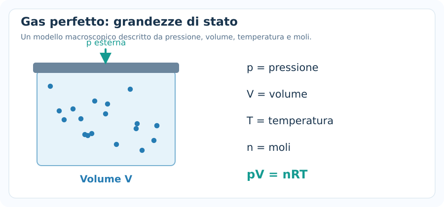
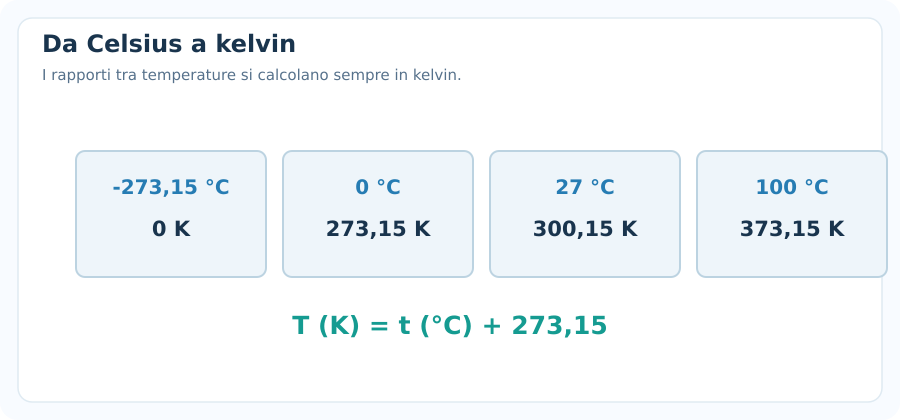
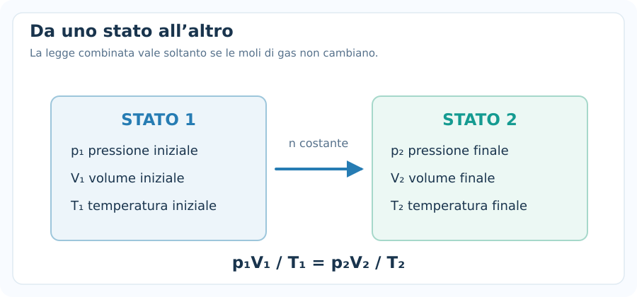
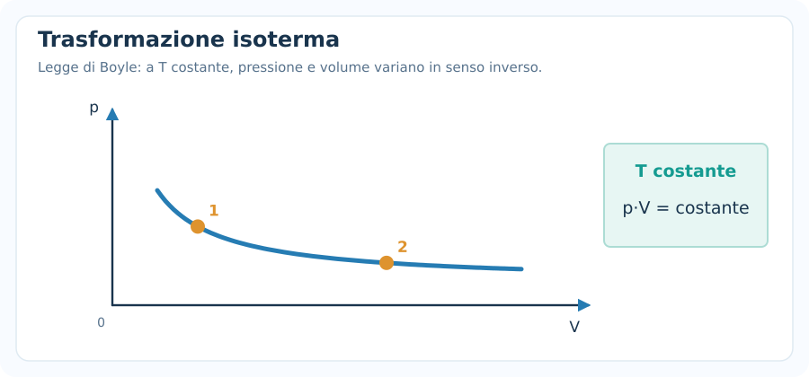
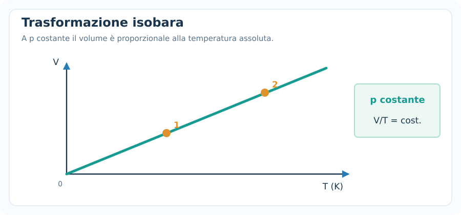
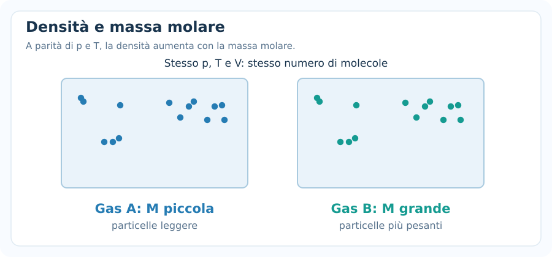
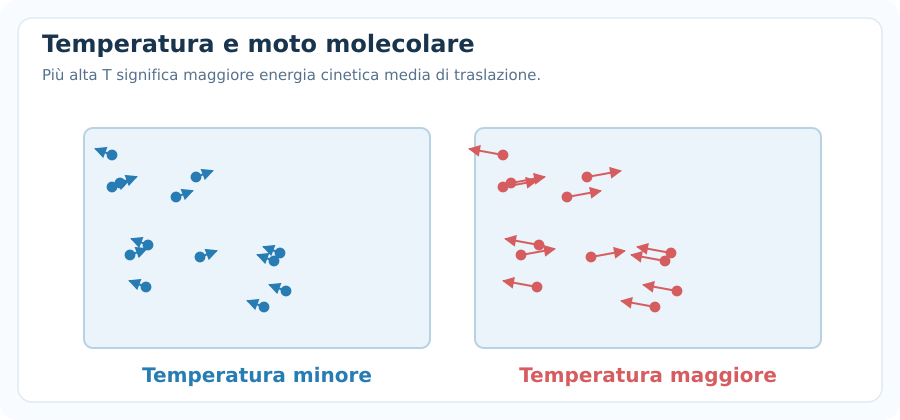

# Gas perfetti

> [!abstract] Obiettivo della nota
> Riconoscere le grandezze di stato di un gas, applicare l'equazione $pV=nRT$ e risolvere problemi con trasformazioni **isoterme, isobare e isocore**. Collegheremo inoltre il modello macroscopico alla teoria cinetica e all'energia interna, che ritroveremo nel primo principio della termodinamica.

## 1. Che cos'è un gas perfetto?

Un **gas perfetto** (o *ideale*) è un modello semplificato in cui:

- le molecole sono considerate puntiformi rispetto alle distanze che le separano;
- non interagiscono tra loro, tranne durante urti elastici;
- gli urti tra particelle e con le pareti sono elastici;
- il gas è costituito da un numero enorme di particelle in movimento disordinato.

Nei gas reali queste condizioni sono approssimazioni, generalmente migliori a **bassa pressione** e a **temperatura sufficientemente alta**, lontano dalla condensazione.

### Variabili di stato

Per descrivere lo stato macroscopico di una quantità di gas usiamo:

| Simbolo | Significato | Unità SI |
|---|---|---|
| $p$ | Pressione **assoluta** | pascal ($\mathrm{Pa}$) |
| $V$ | Volume del gas | metro cubo ($\mathrm{m^3}$) |
| $T$ | Temperatura assoluta | kelvin ($\mathrm{K}$) |
| $n$ | Quantità di sostanza | mole ($\mathrm{mol}$) |

> [!important] Fondamentale
> Nei calcoli dei gas perfetti la temperatura deve essere espressa in **kelvin** e la pressione in **valore assoluto**. Una pressione relativa (manometrica) va convertita in pressione assoluta.

---

## 2. Mole, massa molare e numero di particelle

La **mole** misura una quantità di sostanza. Una mole contiene esattamente il numero di Avogadro di entità elementari:

$$
\boxed{N_A=6{,}02214076\cdot10^{23}\ \mathrm{mol^{-1}}}
$$

Se $N$ è il numero di molecole:

$$
\boxed{n=\frac{N}{N_A}}
\qquad
\boxed{N=nN_A}
$$

Se conosciamo la massa $m$ e la **massa molare** $M$:

$$
\boxed{n=\frac{m}{M}}
\qquad
\boxed{m=nM}
$$

**Attenzione alle unità:** se $m$ è in grammi, $M$ deve essere in $\mathrm{g/mol}$; se $m$ è in chilogrammi, $M$ deve essere in $\mathrm{kg/mol}$.

**Esempio.** Quante moli ci sono in $32\ \mathrm{g}$ di ossigeno molecolare $\mathrm{O_2}$, la cui massa molare è $32\ \mathrm{g/mol}$?

$$
n=\frac{32}{32}=\boxed{1\ \mathrm{mol}}
$$

---

## 3. Temperatura in kelvin e pressioni

Il kelvin è la scala della temperatura assoluta. La conversione dalla scala Celsius è:

$$
\boxed{T(\mathrm{K})=t({}^\circ\mathrm{C})+273{,}15}
$$

Viceversa:

$$
\boxed{t({}^\circ\mathrm{C})=T(\mathrm{K})-273{,}15}
$$

**Esempi:** $0\,^\circ\mathrm{C}=273{,}15\ \mathrm{K}$; $27\,^\circ\mathrm{C}=300{,}15\ \mathrm{K}$.

Una **variazione** di temperatura ha lo stesso valore numerico in kelvin e in gradi Celsius:

$$
\boxed{\Delta T(\mathrm{K})=\Delta t({}^\circ\mathrm{C})}
$$

Per le pressioni:

$$
1\ \mathrm{bar}=10^5\ \mathrm{Pa}
$$

$$
1\ \mathrm{atm}=101325\ \mathrm{Pa}
$$

Se la pressione è espressa **rispetto all'atmosfera**:

$$
\boxed{p_{\mathrm{ass}}=p_{\mathrm{atm}}+p_{\mathrm{rel}}}
$$

Un valore negativo di pressione relativa è possibile; una pressione assoluta negativa, nel modello classico, no.

Conversioni di volume:

$$
1\ \mathrm{L}=10^{-3}\ \mathrm{m^3}
\qquad
1\ \mathrm{cm^3}=10^{-6}\ \mathrm{m^3}
$$

---

## 4. Equazione di stato dei gas perfetti

La relazione fondamentale è:

$$
\boxed{pV=nRT}
$$

Dove $R$ è la **costante universale dei gas**:

$$
\boxed{R\approx8{,}314\ \mathrm{J\,mol^{-1}\,K^{-1}}}
$$

Ricordando che $1\ \mathrm{Pa\,m^3}=1\ \mathrm{J}$, le unità dei due membri coincidono.

### Formule inverse

$$
\boxed{p=\frac{nRT}{V}}
\qquad
\boxed{V=\frac{nRT}{p}}
$$

$$
\boxed{n=\frac{pV}{RT}}
\qquad
\boxed{T=\frac{pV}{nR}}
$$

### Esempio: calcolare le moli

Un recipiente contiene gas ideale a $p=1{,}00\cdot10^5\ \mathrm{Pa}$, $V=0{,}024\ \mathrm{m^3}$ e $T=300\ \mathrm{K}$.

$$
n=\frac{pV}{RT}
=\frac{(1{,}00\cdot10^5)(0{,}024)}{8{,}314\cdot300}
$$

$$
\boxed{n\approx0{,}962\ \mathrm{mol}}
$$

### Forma microscopica

Indicando con $N$ il numero di particelle e con $k_B$ la costante di Boltzmann:

$$
\boxed{pV=Nk_BT}
$$

$$
k_B=1{,}380649\cdot10^{-23}\ \mathrm{J/K}
$$

Le due forme sono equivalenti perché $R=N_Ak_B$ e $N=nN_A$.

---

## 5. Trasformazioni di un gas: idea generale

Una **trasformazione termodinamica** porta il gas da uno stato iniziale $1$ a uno stato finale $2$.

Se la quantità di gas è costante, dalla legge $pV=nRT$ ricaviamo:

$$
\frac{pV}{T}=nR=\mathrm{costante}
$$

Quindi:

$$
\boxed{\frac{p_1V_1}{T_1}=\frac{p_2V_2}{T_2}}
$$

Questa è la **legge combinata dei gas**, utilizzabile quando **$n$ non cambia**.

Le tre trasformazioni fondamentali differiscono per la grandezza che rimane costante:

| Trasformazione | Costante | Relazione tra due stati |
|---|---|---|
| **Isoterma** | $T$ | $p_1V_1=p_2V_2$ |
| **Isobara** | $p$ | $V_1/T_1=V_2/T_2$ |
| **Isocora** | $V$ | $p_1/T_1=p_2/T_2$ |

> [!tip] Metodo meccanico
> Prima di scegliere la formula, evidenzia nel testo che cosa **rimane costante**. Se non è specificata nessuna delle tre grandezze, usa la legge combinata, purché il numero di moli sia costante.

---

## 6. Trasformazione isoterma — Legge di Boyle

Una trasformazione **isoterma** avviene a temperatura costante:

$$
\boxed{T=\mathrm{costante}}
$$

Se anche $n$ è costante, dalla legge dei gas:

$$
pV=nRT=\mathrm{costante}
$$

Dunque:

$$
\boxed{p_1V_1=p_2V_2}
$$

**Interpretazione:** se il volume diminuisce, la pressione aumenta; se il volume aumenta, la pressione diminuisce. La relazione è inversamente proporzionale, non lineare.

### Esempio

Un gas occupa $V_1=3{,}0\ \mathrm{L}$ alla pressione assoluta $p_1=2{,}0\ \mathrm{atm}$. Viene espanso isotermicamente fino a $V_2=5{,}0\ \mathrm{L}$. Trovare $p_2$.

$$
p_2=\frac{p_1V_1}{V_2}=\frac{2{,}0\cdot3{,}0}{5{,}0}
$$

$$
\boxed{p_2=1{,}2\ \mathrm{atm}}
$$

In questo rapporto le unità di volume possono restare in litri perché si semplificano. La pressione deve però essere **assoluta**.

---

## 7. Trasformazione isobara — Legge di Charles

Una trasformazione **isobara** avviene a pressione costante:

$$
\boxed{p=\mathrm{costante}}
$$

Per una quantità costante di gas:

$$
\frac{V}{T}=\frac{nR}{p}=\mathrm{costante}
$$

Quindi:

$$
\boxed{\frac{V_1}{T_1}=\frac{V_2}{T_2}}
$$

**Interpretazione:** aumentando la temperatura assoluta, il volume aumenta proporzionalmente.

### Esempio

Un gas ha $V_1=6{,}0\ \mathrm{L}$ a $T_1=300\ \mathrm{K}$. Viene riscaldato a pressione costante fino a $T_2=450\ \mathrm{K}$.

$$
V_2=V_1\frac{T_2}{T_1}=6{,}0\cdot\frac{450}{300}
$$

$$
\boxed{V_2=9{,}0\ \mathrm{L}}
$$

**Attenzione:** bisogna usare i kelvin, non il rapporto tra temperature espresse in gradi Celsius.

---

## 8. Trasformazione isocora — Legge di Gay-Lussac

Una trasformazione **isocora** avviene a volume costante:

$$
\boxed{V=\mathrm{costante}}
$$

Per una quantità costante di gas:

$$
\frac{p}{T}=\frac{nR}{V}=\mathrm{costante}
$$

Quindi:

$$
\boxed{\frac{p_1}{T_1}=\frac{p_2}{T_2}}
$$

**Interpretazione:** se la temperatura assoluta cresce, cresce proporzionalmente anche la pressione.

### Esempio

Un recipiente rigido contiene gas a $p_1=1{,}0\ \mathrm{bar}$ e $T_1=300\ \mathrm{K}$. Lo riscaldiamo fino a $T_2=360\ \mathrm{K}$.

$$
p_2=p_1\frac{T_2}{T_1}=1{,}0\cdot\frac{360}{300}
$$

$$
\boxed{p_2=1{,}2\ \mathrm{bar}}
$$

Il recipiente è rigido: **il volume non aumenta**, anche se la pressione cresce.

---

## 9. Leggere i grafici delle trasformazioni

I grafici aiutano a riconoscere immediatamente il vincolo della trasformazione.

Nel piano $p$–$V$:

- un'isoterma è una **curva iperbolica** $p=nRT/V$;
- un'isobara è un **segmento orizzontale**;
- un'isocora è un **segmento verticale**.

Nel piano $V$–$T$, usando $T$ in kelvin, un'isobara è una retta passante per l'origine (se prolungata nel modello ideale).

Nel piano $p$–$T$, sempre in kelvin, un'isocora è una retta passante per l'origine.

La forma del grafico non dice automaticamente in quale **verso** si sta compiendo la trasformazione: occorre una freccia o l'indicazione degli stati iniziale e finale.

---

## 10. Quando variano pressione, volume e temperatura insieme

Se nessuna grandezza di stato resta costante, ma il recipiente contiene sempre la **stessa quantità di gas**, usiamo:

$$
\boxed{\frac{p_1V_1}{T_1}=\frac{p_2V_2}{T_2}}
$$

### Esempio svolto

Un gas passa da:

- $p_1=1{,}5\ \mathrm{bar}$;
- $V_1=4{,}0\ \mathrm{L}$;
- $T_1=300\ \mathrm{K}$;

allo stato finale con $p_2=2{,}0\ \mathrm{bar}$ e $T_2=360\ \mathrm{K}$.

Calcolare $V_2$.

$$
V_2=\frac{p_1V_1T_2}{p_2T_1}
$$

$$
V_2=\frac{1{,}5\cdot4{,}0\cdot360}{2{,}0\cdot300}
$$

$$
\boxed{V_2=3{,}6\ \mathrm{L}}
$$

**Controllo fisico:** la pressione cresce e tende a ridurre il volume; anche la temperatura cresce e tende ad aumentarlo. Il risultato netto è una lieve diminuzione di volume.

> [!warning] Quando NON applicarla
> Se il gas entra o esce dal recipiente, **$n$ cambia**. Non è lecito usare direttamente la legge combinata a $n$ costante: bisogna applicare $pV=nRT$ separatamente agli stati, con le rispettive moli.

---

## 11. Densità di un gas perfetto

Combiniamo:

$$
pV=nRT
\qquad\text{e}\qquad
n=\frac{m}{M}
$$

Sostituendo:

$$
pV=\frac{m}{M}RT
$$

Ricordiamo che la densità è $\rho=m/V$. Allora:

$$
\boxed{\rho=\frac{pM}{RT}}
$$

E, in forma inversa:

$$
\boxed{M=\frac{\rho RT}{p}}
$$

Questa formula lega la densità alla pressione, alla temperatura e alla massa molare.

### Esempio

Per aria secca ideale, assumiamo $M=0{,}02897\ \mathrm{kg/mol}$, $p=101325\ \mathrm{Pa}$ e $T=293{,}15\ \mathrm{K}$.

$$
\rho=\frac{101325\cdot0{,}02897}{8{,}314\cdot293{,}15}
$$

$$
\boxed{\rho\approx1{,}20\ \mathrm{kg/m^3}}
$$

A **pressione costante**, aumentando $T$, la densità diminuisce. A **temperatura costante**, aumentando $p$, la densità aumenta.

---

## 12. Interpretazione microscopica: teoria cinetica

Nel modello cinetico, la pressione deriva dagli urti delle particelle contro le pareti. La temperatura assoluta è legata all'energia cinetica media di traslazione delle molecole.

Per una molecola di gas perfetto:

$$
\boxed{\left\langle K_{\mathrm{trasl}}\right\rangle=\frac32k_BT}
$$

Quindi, a temperatura maggiore, le molecole hanno mediamente una maggiore energia cinetica di traslazione.

La velocità quadratica media (*root mean square*) è:

$$
\boxed{v_{\mathrm{rms}}=\sqrt{\frac{3RT}{M}}}
$$

Qui $M$ deve essere in $\mathrm{kg/mol}$.

> [!note] Precauzione
> $v_{\mathrm{rms}}$ **non** è la velocità di ogni singola molecola: nel gas è presente una distribuzione di velocità.

### Esempio

Per ossigeno molecolare con $M=0{,}032\ \mathrm{kg/mol}$ a $T=300\ \mathrm{K}$:

$$
v_{\mathrm{rms}}=\sqrt{\frac{3\cdot8{,}314\cdot300}{0{,}032}}
\approx\boxed{484\ \mathrm{m/s}}
$$

---

## 13. Energia interna del gas perfetto

Per un gas perfetto, l'**energia interna $U$ dipende soltanto dalla temperatura**, nel modello con gradi di libertà fissati.

Con $\ell$ gradi di libertà quadratici attivi:

$$
\boxed{U=\frac{\ell}{2}nRT}
$$

Perciò:

$$
\boxed{\Delta U=\frac{\ell}{2}nR\Delta T}
$$

Questa è la forma che useremo anche nei problemi del **primo principio della termodinamica**.

| Gas ideale | Gradi di libertà $\ell$ (approssimazione usuale) | Energia interna |
|---|---:|---|
| Monoatomico | $3$ | $U=\frac32nRT$ |
| Biatomico a temperature ordinarie, vibrazioni trascurate | $5$ | $U=\frac52nRT$ |

L'effettivo numero di gradi di libertà attivi può cambiare con la temperatura: il valore $5$ per un biatomico non vale universalmente.

### Esempio: variazione di energia interna

Due moli di gas ideale **monoatomico** passano da $T_1=300\ \mathrm{K}$ a $T_2=380\ \mathrm{K}$.

$$
\Delta T=80\ \mathrm{K}
$$

$$
\Delta U=\frac32\cdot2\cdot8{,}314\cdot80
$$

$$
\boxed{\Delta U\approx1995\ \mathrm{J}}
$$

**Conseguenza importante:** in una trasformazione isoterma di un gas ideale, se la temperatura non cambia, $\Delta U=0$, **anche se pressione e volume cambiano**.

> [!tip] Collegamento con la prossima nota
> Qui abbiamo definito $U$ e $\Delta U$. Nella nota sul **primo principio** aggiungeremo calore e lavoro, chiarendo la convenzione dei segni.

---

## 14. Miscele di gas: legge di Dalton (approfondimento)

Per una miscela ideale di gas a temperatura e volume comuni:

$$
\boxed{p_{\mathrm{tot}}=p_1+p_2+\dots=\sum_i p_i}
$$

La pressione parziale $p_i$ è la pressione che il componente $i$ eserciterebbe se occupasse da solo l'intero volume alla stessa temperatura.

Se $x_i=n_i/n_{\mathrm{tot}}$ è la frazione molare:

$$
\boxed{p_i=x_i\,p_{\mathrm{tot}}}
$$

**Esempio.** In una miscela con $20\%$ di moli di ossigeno e $80\%$ di azoto, alla pressione totale di $2{,}0\ \mathrm{bar}$:

$$
p_{\mathrm{O_2}}=0{,}20\cdot2{,}0=\boxed{0{,}40\ \mathrm{bar}}
$$

$$
p_{\mathrm{N_2}}=0{,}80\cdot2{,}0=\boxed{1{,}60\ \mathrm{bar}}
$$

---

## 15. Errori frequenti negli esercizi

### 1. Usare i gradi Celsius nei rapporti

**Sbagliato:** $V_1/20=V_2/40$ usando $20\,^\circ\mathrm{C}$ e $40\,^\circ\mathrm{C}$.

**Corretto:** $V_1/293{,}15=V_2/313{,}15$.

### 2. Confondere pressione assoluta e relativa

Nella formula $pV=nRT$ serve la **pressione assoluta**.

### 3. Confondere mole e massa

$$
n=\frac{m}{M}
$$

Le moli non coincidono numericamente con i chilogrammi di gas.

### 4. Mescolare litri e metri cubi senza controllare $R$

Se usi $R=8{,}314\ \mathrm{J/(mol\,K)}$, usa **pascal e metri cubi**. Nei rapporti tra due stati, invece, unità coerenti possono semplificarsi.

### 5. Usare la legge combinata quando cambia il numero di moli

$$
\frac{p_1V_1}{T_1}=\frac{p_2V_2}{T_2}
$$

richiede **$n_1=n_2$**.

### 6. Confondere il tipo di trasformazione

- *Isoterma*: $T$ costante.
- *Isobara*: $p$ costante.
- *Isocora*: $V$ costante.

### 7. Pensare che temperatura costante significhi pressione costante

In un'isoterma la pressione può variare, se varia il volume.

### 8. Trattare $\Delta U$ come il calore scambiato

$\Delta U$ è la variazione di energia interna. Non coincide **sempre** con il calore: dipende anche dal lavoro, come vedremo nel primo principio.

---

## 16. Metodo meccanico per risolvere gli esercizi

1. **Elenca i dati** e identifica gli stati $1$ e $2$.
2. **Converti** $T$ in K, pressione in Pa (quando serve $pV=nRT$), volume in $\mathrm{m^3}$ e massa molare in unità coerenti.
3. **Controlla se le moli restano costanti** e quale grandezza, eventualmente, è fissata.
4. **Scegli la legge**: $pV=nRT$ per uno stato; Boyle/Charles/Gay-Lussac per una trasformazione semplice; legge combinata per due stati a $n$ costante.
5. **Isola l'incognita simbolicamente** prima di inserire i numeri.
6. **Controlla fisicamente il risultato**: nell'isoterma, $V\uparrow\Rightarrow p\downarrow$; nell'isobara, $T\uparrow\Rightarrow V\uparrow$; nell'isocora, $T\uparrow\Rightarrow p\uparrow$.

---

## 17. Formulario essenziale

| Quando serve | Formula |
|---|---|
| Equazione di stato | $\boxed{pV=nRT}$ |
| Numero di moli | $n=m/M=N/N_A$ |
| Forma microscopica | $pV=Nk_BT$ |
| Trasformazione isoterma | $p_1V_1=p_2V_2$ |
| Trasformazione isobara | $V_1/T_1=V_2/T_2$ |
| Trasformazione isocora | $p_1/T_1=p_2/T_2$ |
| Trasformazione generale, $n$ costante | $p_1V_1/T_1=p_2V_2/T_2$ |
| Densità | $\rho=pM/(RT)$ |
| Velocità quadratica media | $v_{\mathrm{rms}}=\sqrt{3RT/M}$ |
| Energia interna | $U=(\ell/2)nRT$ |
| Variazione di energia interna | $\Delta U=(\ell/2)nR\Delta T$ |
| Legge di Dalton | $p_{\mathrm{tot}}=\sum_i p_i$ |

Valori di riferimento:

$$
R=8{,}314\ \mathrm{J\,mol^{-1}\,K^{-1}}
\qquad
N_A=6{,}02214076\cdot10^{23}\ \mathrm{mol^{-1}}
$$

$$
T(\mathrm{K})=t({}^\circ\mathrm{C})+273{,}15
\qquad
1\ \mathrm{atm}=101325\ \mathrm{Pa}
$$

---

## 18. Verifica della comprensione

Prova a rispondere senza guardare subito il formulario:

1. Se un gas ideale viene compresso **isotermicamente** fino a dimezzare il volume, come cambia la pressione?
2. Un gas viene riscaldato da $300\ \mathrm{K}$ a $450\ \mathrm{K}$ a **pressione costante**. Come cambia il volume?
3. In un contenitore **rigido e chiuso**, aumentando $T$ da $300\ \mathrm{K}$ a $600\ \mathrm{K}$, cosa succede alla pressione assoluta?
4. Perché non si possono usare $20\,^\circ\mathrm{C}$ e $40\,^\circ\mathrm{C}$ direttamente in una proporzione per i gas?
5. Quando è lecito applicare $p_1V_1/T_1=p_2V_2/T_2$?
6. Un gas perfetto compie una trasformazione isoterma. La sua energia interna cambia?
7. Per una miscela ideale, in che modo la pressione totale è collegata alle pressioni parziali?
8. Come ricaveresti la densità del gas conoscendo $p$, $T$ e la massa molare?

> [!success] Traguardo
> Se sai riconoscere **che cosa resta costante**, convertire correttamente le unità e isolare l'incognita, puoi affrontare la maggior parte degli esercizi introduttivi sui gas perfetti.
