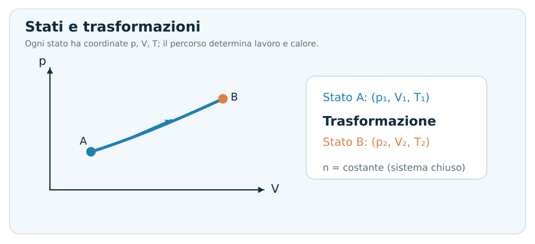
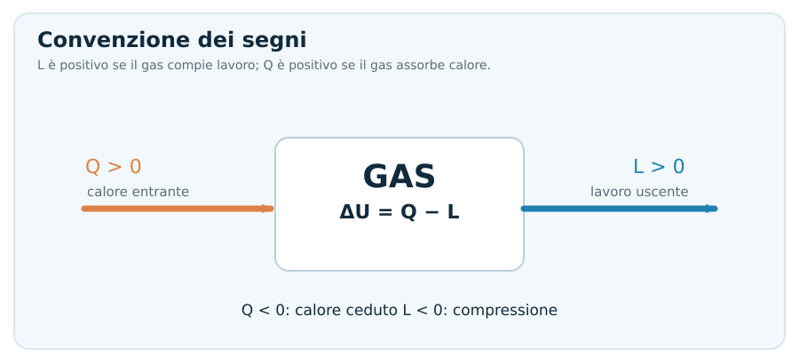
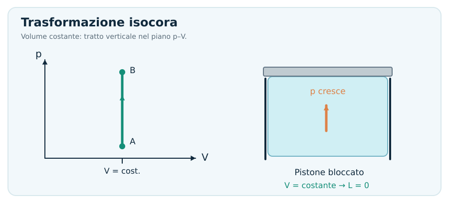
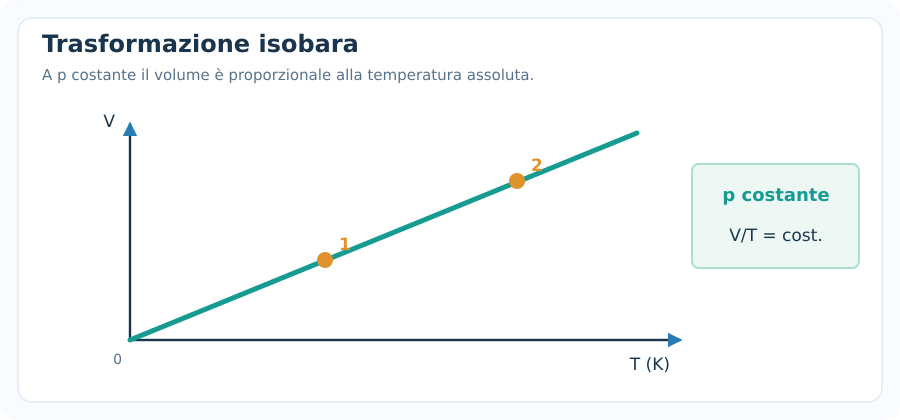
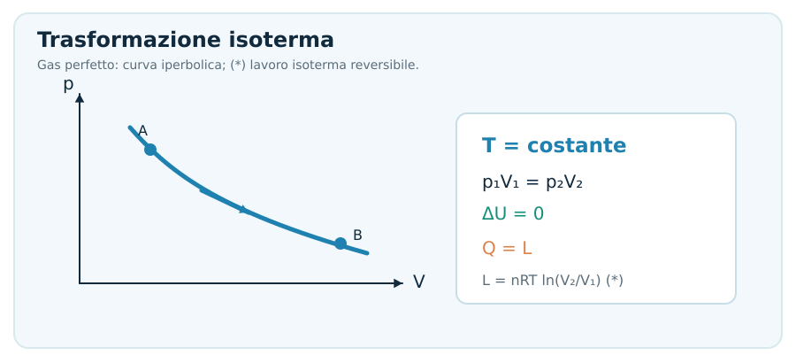
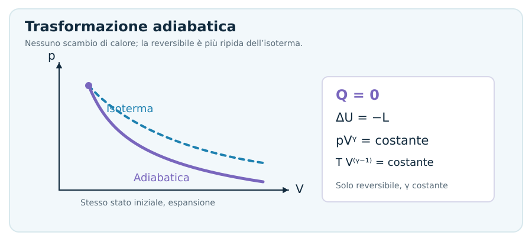
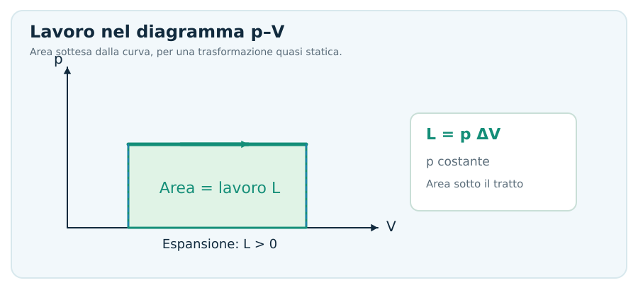
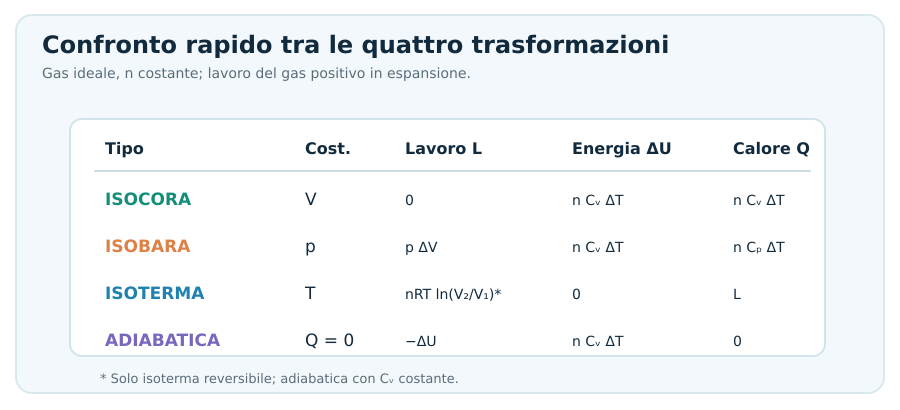
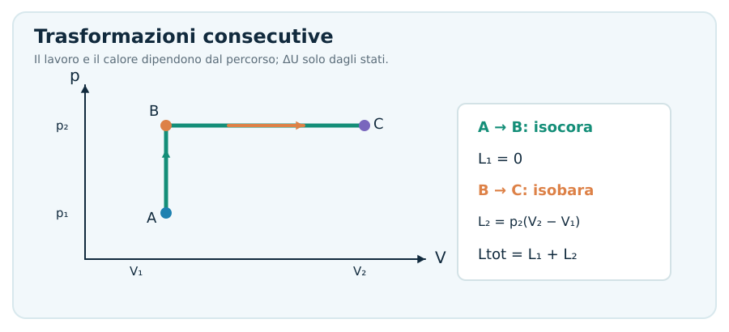
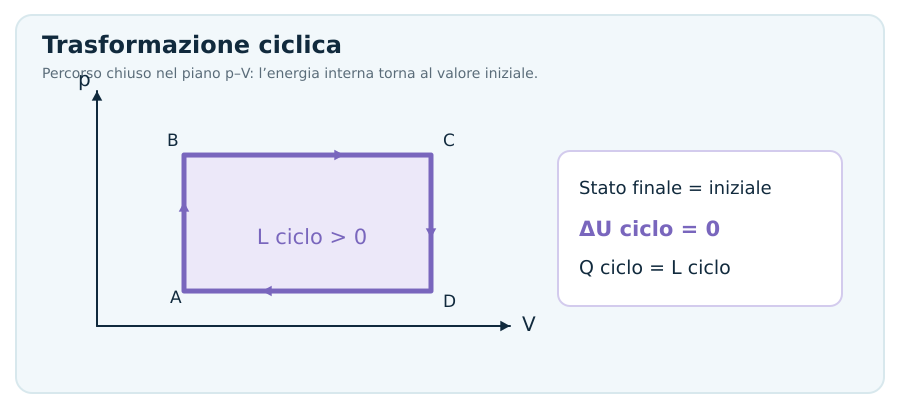

# Trasformazioni Termodinamiche

> [!abstract] Obiettivo della nota
> Riconoscere **isocora, isobara, isoterma e adiabatica**; scegliere le formule corrette per un **gas perfetto**; calcolare **lavoro** $L$, **calore** $Q$ e **variazione di energia interna** $\Delta U$ senza integrali. La nota segue la convenzione di [[Primo principio della termodinamica]]: $\Delta U=Q-L$.

## 1. Cos'è una trasformazione termodinamica?

Una **trasformazione termodinamica** porta un sistema da uno stato iniziale $A$ a uno finale $B$. Per un gas, gli stati di equilibrio sono descritti da **pressione** $p$, **volume** $V$, **temperatura assoluta** $T$ e quantità di sostanza $n$.

Per un **gas perfetto in un sistema chiuso**, con numero di moli costante:

$$
\boxed{pV=nRT}
$$

Tra due stati dello stesso gas:

$$
\boxed{\frac{p_1V_1}{T_1}=\frac{p_2V_2}{T_2}}
$$

Dove $R=8{,}314\ \mathrm{J/(mol\,K)}$ e **$T$ deve essere in kelvin**.

### Grandezze di stato e grandezze di percorso

- **$U$ (energia interna)** è una funzione di stato: $\Delta U=U_B-U_A$ dipende solo dagli stati iniziale e finale.
- **$Q$ (calore scambiato)** e **$L$ (lavoro)** dipendono dal *percorso* seguito per andare da $A$ a $B$.
- La stessa variazione di temperatura può essere ottenuta con scambi diversi di calore e lavoro.

> [!important] Ipotesi che useremo
> Negli esercizi standard consideriamo un **gas perfetto**, in **sistema chiuso** ($n$ costante), con capacità termiche costanti nell'intervallo di temperatura. Le formule del lavoro $p\Delta V$ e $nRT\ln(V_f/V_i)$ richiedono inoltre le condizioni specifiche chiarite nelle sezioni seguenti. Non sono leggi universali applicabili a ogni trasformazione.

---

## 2. Primo principio e convenzione dei segni

Per questa nota utilizziamo sempre:

$$
\boxed{\Delta U=Q-L}
$$

- **$Q>0$**: calore **assorbito** dal gas.
- **$Q<0$**: calore **ceduto** dal gas.
- **$L>0$**: lavoro **compiuto dal gas** (tipicamente espansione).
- **$L<0$**: lavoro **compiuto sul gas** (tipicamente compressione).
- **$\Delta U>0$**: aumenta l'energia interna; **$\Delta U<0$**: diminuisce.

Formule inverse:

$$
\boxed{Q=\Delta U+L}\qquad \boxed{L=Q-\Delta U}
$$

Per un gas perfetto con gradi di libertà quadratici attivi $\ell$ costanti:

$$
\boxed{\Delta U=\frac{\ell}{2}nR(T_f-T_i)=nC_V\Delta T}
$$

Con $C_V$ **capacità termica molare a volume costante**:

$$
C_V=\frac{\ell}{2}R
$$

Valori comunemente usati:

| Gas ideale | $\ell$ | $C_V$ | $C_P$ |
|---|---:|---|---|
| Monoatomico | $3$ | $\frac32R$ | $\frac52R$ |
| Biatomico a temperature ordinarie, vibrazioni trascurate | $5$ | $\frac52R$ | $\frac72R$ |

La relazione di Mayer, per **gas perfetti**:

$$
\boxed{C_P=C_V+R}
$$

> [!warning] $Q$ e $\Delta U$ non sono sinonimi
> Un gas può ricevere calore e compiere lavoro nello stesso processo: la sua energia interna aumenta solo della differenza $Q-L$.

---

## 3. Trasformazione isocora: volume costante

Una **isocora** avviene a **volume costante**:

$$
\boxed{V_f=V_i}
$$

Applicando l'equazione dei gas perfetti a $n$ costante:

$$
\boxed{\frac{p_i}{T_i}=\frac{p_f}{T_f}}
$$

Nel diagramma $p$–$V$ è rappresentata da una **retta verticale**.

### Lavoro, energia e calore

Poiché il volume non cambia, il lavoro meccanico di espansione è nullo:

$$
\boxed{L=0}
$$

Dal primo principio:

$$
\boxed{Q=\Delta U=nC_V(T_f-T_i)=\frac{\ell}{2}nR(T_f-T_i)}
$$

**Interpretazione:** riscaldando un gas a volume fisso aumentano la temperatura e la pressione; l'energia assorbita come calore non viene spesa nel lavoro di espansione.

### Esempio svolto

Un recipiente rigido contiene $n=2{,}0\ \mathrm{mol}$ di gas perfetto **monoatomico**. La temperatura aumenta da $300\ \mathrm{K}$ a $360\ \mathrm{K}$. Calcolare $\Delta U$, $L$ e $Q$.

$$
\Delta T=360-300=60\ \mathrm{K}
$$

$$
\Delta U=\frac32nR\Delta T=\frac32\cdot2\cdot8{,}314\cdot60
$$

$$
\boxed{\Delta U\simeq1497\ \mathrm{J}},\qquad \boxed{L=0},\qquad \boxed{Q\simeq1497\ \mathrm{J}}
$$

---

## 4. Trasformazione isobara: pressione costante

Una **isobara** avviene a **pressione costante**:

$$
\boxed{p_f=p_i}
$$

Per un gas perfetto con $n$ costante:

$$
\boxed{\frac{V_i}{T_i}=\frac{V_f}{T_f}}
$$

Nel diagramma $p$–$V$ compare come una **retta orizzontale**.

### Lavoro, energia e calore

Se la pressione del gas rimane costante e l'unico lavoro è quello di espansione/compressione:

$$
\boxed{L=p(V_f-V_i)=nR(T_f-T_i)}
$$

Per un gas perfetto:

$$
\boxed{\Delta U=nC_V\Delta T=\frac{\ell}{2}nR\Delta T}
$$

$$
\boxed{Q=\Delta U+L=nC_P\Delta T}
$$

con $C_P=C_V+R$.

- Espansione ($V_f>V_i$): $L>0$.
- Compressione ($V_f<V_i$): $L<0$.

### Esempio svolto

Una mole di gas perfetto monoatomico viene riscaldata **a pressione costante** da $300\ \mathrm{K}$ a $400\ \mathrm{K}$. Trovare lavoro, energia interna e calore.

$$
\Delta T=100\ \mathrm{K}
$$

$$
L=nR\Delta T=1\cdot8{,}314\cdot100=\boxed{831{,}4\ \mathrm{J}}
$$

$$
\Delta U=\frac32nR\Delta T=\boxed{1247{,}1\ \mathrm{J}}
$$

$$
Q=\Delta U+L=\boxed{2078{,}5\ \mathrm{J}}
$$

> [!tip] Controllo numerico
> Se la temperatura aumenta in un'isobara, per un gas perfetto aumentano anche il volume, l'energia interna e (in questo esempio) il calore assorbito. Il gas inoltre compie lavoro positivo.

---

## 5. Trasformazione isoterma: temperatura costante

Una **isoterma** avviene a **temperatura costante**:

$$
\boxed{T_f=T_i}
$$

Per un gas perfetto a $n$ costante (legge di Boyle):

$$
\boxed{p_iV_i=p_fV_f}
$$

Nel diagramma $p$–$V$ è una **curva iperbolica**.

### Energia interna

Poiché l'energia interna di un gas perfetto dipende solo da $T$:

$$
\boxed{\Delta U=0}
$$

Di conseguenza, dal primo principio:

$$
\boxed{Q=L}
$$

**Attenzione:** questa è una relazione fra *calore* e *lavoro*. Non stabilisce ancora quanto valgano numericamente.

### Lavoro di un'isoterma reversibile

Se la trasformazione isoterma è **reversibile (quasi statica)** e il gas è perfetto:

$$
\boxed{L=nRT\ln\!\left(\frac{V_f}{V_i}\right)}
$$

Formule equivalenti, **nelle stesse condizioni**:

$$
\boxed{L=nRT\ln\!\left(\frac{p_i}{p_f}\right)=Q}
$$

Se l'espansione isoterma è **irreversibile**, non puoi usare automaticamente la formula logaritmica: occorre conoscere come viene effettuata la trasformazione.

### Esempio svolto

Mezza mole di gas perfetto a $T=300\ \mathrm{K}$ si espande **reversibilmente e isotermicamente** da $V_i=0{,}010\ \mathrm{m^3}$ a $V_f=0{,}020\ \mathrm{m^3}$.

$$
L=0{,}5\cdot8{,}314\cdot300\cdot\ln(2)
$$

$$
\boxed{L\approx864{,}4\ \mathrm{J}},\quad\boxed{\Delta U=0},\quad\boxed{Q\approx864{,}4\ \mathrm{J}}
$$

> [!important] Espansione libera nel vuoto
> Un gas perfetto che si espande **liberamente nel vuoto** in un contenitore isolato può avere $Q=0$, $L=0$ e $\Delta U=0$. Anche se $T$ non cambia, **non** è una trasformazione isoterma reversibile e **non** si usa la formula logaritmica del lavoro.

---

## 6. Trasformazione adiabatica: calore nullo

Una **adiabatica** avviene senza scambio di calore con l'esterno:

$$
\boxed{Q=0}
$$

Per il primo principio:

$$
\boxed{\Delta U=-L}\qquad\boxed{L=-nC_V(T_f-T_i)}
$$

Per un gas perfetto con $C_V$ costante:

$$
\boxed{L=nC_V(T_i-T_f)=\frac{\ell}{2}nR(T_i-T_f)}
$$

In un'espansione adiabatica in cui il gas compie lavoro positivo, normalmente $T_f<T_i$: il gas si raffredda.

### Formule di Poisson: solo adiabatica **reversibile**

Se il gas è perfetto, la trasformazione è **reversibile** e le capacità termiche sono costanti:

$$
\boxed{p_iV_i^{\gamma}=p_fV_f^{\gamma}}
$$

$$
\boxed{T_iV_i^{\gamma-1}=T_fV_f^{\gamma-1}}
$$

$$
\boxed{\frac{T_f}{T_i}=\left(\frac{V_i}{V_f}\right)^{\gamma-1}}
$$

Con:

$$
\boxed{\gamma=\frac{C_P}{C_V}=\frac{\ell+2}{\ell}}
$$

Valori abituali: gas **monoatomico** $\gamma=5/3$; gas **biatomico** (senza vibrazioni attive) $\gamma=7/5$.

Altra formula per il lavoro **reversibile**, nelle medesime ipotesi:

$$
\boxed{L=\frac{p_iV_i-p_fV_f}{\gamma-1}}
$$

> [!warning] Non tutte le adiabatiche seguono Poisson
> Se la trasformazione è adiabatica ma **irreversibile**, valgono $Q=0$ e $\Delta U=-L$, ma **non puoi supporre** $pV^{\gamma}=\mathrm{costante}$.

### Esempio svolto

Una mole di gas perfetto monoatomico subisce un'espansione **adiabatica reversibile** da $T_i=600\ \mathrm{K}$ fino a $V_f=2V_i$. Calcolare $T_f$ e il lavoro del gas.

$$
T_f=T_i\left(\frac{V_i}{V_f}\right)^{\gamma-1}=600\left(\frac12\right)^{2/3}
$$

$$
\boxed{T_f\approx378\ \mathrm{K}}
$$

$$
L=\frac32nR(T_i-T_f)=\frac32\cdot1\cdot8{,}314\cdot(600-378)
$$

$$
\boxed{L\approx2{,}77\cdot10^3\ \mathrm{J}},\qquad \boxed{Q=0}
$$

---

## 7. Come leggere il lavoro nel diagramma p–V

In una trasformazione **quasi statica**, con solo lavoro meccanico pressione-volume, il lavoro del gas corrisponde all'**area con segno sotto la curva** nel diagramma $p$–$V$.

- Se il volume **aumenta** lungo il percorso, il lavoro è positivo.
- Se il volume **diminuisce**, il lavoro è negativo.
- Se il volume **rimane costante**, il lavoro è nullo.
- Se la pressione è **costante**, l'area è un rettangolo e $L=p\Delta V$.

Per un percorso in più tratti, il lavoro totale è **la somma algebrica dei lavori**:

$$
\boxed{L_{\mathrm{tot}}=L_1+L_2+\cdots}
$$

### Attenzione alle unità

$$
\boxed{1\ \mathrm{Pa\,m^3}=1\ \mathrm{J}}
$$

Le pressioni vanno in pascal e i volumi in metri cubi se vuoi ottenere il lavoro in joule.

---

## 8. Tabella di confronto delle trasformazioni

| Trasformazione | Grandezza costante | Legge per $p,V,T$ | Lavoro $L$ | Energia interna $\Delta U$ | Calore $Q$ |
|---|---|---|---|---|---|
| **Isocora** | $V$ | $p/T=\mathrm{cost.}$ | $0$ | $nC_V\Delta T$ | $nC_V\Delta T$ |
| **Isobara** | $p$ | $V/T=\mathrm{cost.}$ | $p\Delta V=nR\Delta T$ | $nC_V\Delta T$ | $nC_P\Delta T$ |
| **Isoterma** | $T$ | $pV=\mathrm{cost.}$ | $nRT\ln(V_f/V_i)$ * | $0$ | $L$ |
| **Adiabatica** | $Q=0$ | $pV^\gamma=\mathrm{cost.}$ ** | $-nC_V\Delta T$ | $nC_V\Delta T$ | $0$ |

\* Lavoro **solo per isoterma reversibile** di gas perfetto.  
\** Relazione di Poisson **solo per adiabatica reversibile** con capacità termiche costanti.

> [!important] Isoterma e adiabatica non sono la stessa cosa
> Nell'**isoterma** non cambia la temperatura; nell'**adiabatica** non viene scambiato calore. L'adiabatica può cambiare temperatura, mentre un'isoterma può richiedere scambio di calore.

---

## 9. Trasformazioni composte: come risolverle

Quando un gas attraversa più trasformazioni consecutive, **separa sempre i tratti**.

### Metodo in sei passaggi

1. Disegna o annota gli stati $A$, $B$, $C$, con $p,V,T$ di ciascuno.
2. Individua per ogni tratto la grandezza costante o la condizione ($V$, $p$, $T$, oppure $Q=0$).
3. Usa $pV=nRT$ per trovare gli stati mancanti.
4. Calcola **$L$** di ogni tratto con la formula adatta.
5. Calcola **$\Delta U=nC_V\Delta T$** di ogni tratto, poi $Q=\Delta U+L$.
6. Somma i risultati e verifica il primo principio sull'intero percorso.

### Esempio: un'isocora seguita da un'isobara

Una mole di gas perfetto **monoatomico** passa da $T_A=300\ \mathrm{K}$ a $T_B=450\ \mathrm{K}$ mediante riscaldamento **isocoro**; poi da $T_B=450\ \mathrm{K}$ a $T_C=600\ \mathrm{K}$ mediante riscaldamento **isobaro**.

**A → B, isocora:** $\Delta T=150\ \mathrm{K}$.

$$
L_{AB}=0
$$

$$
\Delta U_{AB}=\frac32R(150)\approx1870{,}7\ \mathrm{J}
$$

$$
Q_{AB}\approx1870{,}7\ \mathrm{J}
$$

**B → C, isobara:** $\Delta T=150\ \mathrm{K}$.

$$
L_{BC}=R(150)\approx1247{,}1\ \mathrm{J}
$$

$$
\Delta U_{BC}=\frac32R(150)\approx1870{,}7\ \mathrm{J}
$$

$$
Q_{BC}=\Delta U_{BC}+L_{BC}\approx3117{,}8\ \mathrm{J}
$$

**Risultati totali:**

$$
\boxed{L_{\mathrm{tot}}\approx1247{,}1\ \mathrm{J}}
$$

$$
\boxed{\Delta U_{\mathrm{tot}}\approx3741{,}3\ \mathrm{J}}
$$

$$
\boxed{Q_{\mathrm{tot}}\approx4988{,}4\ \mathrm{J}}
$$

Verifica: $Q_{\mathrm{tot}}-L_{\mathrm{tot}}\approx3741{,}3\ \mathrm{J}=\Delta U_{\mathrm{tot}}$.

---

## 10. Trasformazioni cicliche

Una **trasformazione ciclica** riporta il gas allo **stato iniziale**: $A\rightarrow B\rightarrow\dots\rightarrow A$.

Poiché l'energia interna è una funzione di stato:

$$
\boxed{\Delta U_{\mathrm{ciclo}}=0}
$$

Dal primo principio:

$$
\boxed{Q_{\mathrm{netto,ciclo}}=L_{\mathrm{netto,ciclo}}}
$$

Nel diagramma $p$–$V$, per un ciclo **quasi statico**:

- Percorso **orario**: lavoro netto del gas **positivo**.
- Percorso **antiorario**: lavoro netto del gas **negativo**.
- Il **modulo** del lavoro netto è l'area racchiusa dal ciclo.

Per macchine termiche e rendimento, vedi [[Macchine termiche e Carnot]].

---

## 11. Errori da evitare all'esame

### Confondere isoterma e adiabatica

- **Isoterma:** $\Delta T=0$, e quindi $\Delta U=0$ **per un gas perfetto**.
- **Adiabatica:** $Q=0$, ma $\Delta T$ può essere diverso da zero.

### Scrivere $L=p\Delta V$ senza pressione costante

Questa formula è corretta **solo quando il lavoro di espansione avviene a pressione costante**. Se $p$ cambia, serve la formula specifica del processo o un'informazione equivalente.

### Dimenticare che $L$ può essere negativo

In compressione, con il lavoro del gas come convenzione, $L<0$.

### Utilizzare Celsius nelle leggi dei gas

La temperatura deve essere **assoluta**:

$$
\boxed{T(\mathrm{K})=t(^{\circ}\mathrm{C})+273{,}15}
$$

Una **differenza** di temperatura ha invece lo stesso valore numerico in kelvin e gradi Celsius.

### Scegliere automaticamente $C_V=\frac32R$

Vale per un **gas perfetto monoatomico**. Per un gas biatomico a temperature ordinarie (approssimazione senza vibrazioni) si usa $C_V\simeq\frac52R$. Se il testo fornisce $C_V$, usa quello.

### Applicare Poisson a un'adiabatica irreversibile

La relazione $pV^\gamma=\mathrm{costante}$ richiede una **adiabatica reversibile** con $\gamma$ costante.

### Confondere il lavoro con la variazione di energia interna

$\Delta U$ dipende dagli stati; $L$ e $Q$ dipendono dal percorso. Prima riconosci la trasformazione, poi scegli le formule.

---

## 12. Formulario operativo per gli esercizi

**Valido per un gas perfetto con $n$ costante**, salvo condizioni più specifiche esplicitate:

| Dato nel testo | Parti da... |
|---|---|
| Un qualunque stato del gas | $pV=nRT$ |
| Volume costante | $p_i/T_i=p_f/T_f$, $L=0$ |
| Pressione costante | $V_i/T_i=V_f/T_f$, $L=p(V_f-V_i)$ |
| Temperatura costante | $p_iV_i=p_fV_f$, $\Delta U=0$ |
| Isoterma **reversibile** | $L=nRT\ln(V_f/V_i)$ |
| Nessun calore scambiato | $Q=0$, $L=-\Delta U$ |
| Adiabatica **reversibile**, $\gamma$ costante | $p_iV_i^\gamma=p_fV_f^\gamma$ |
| Variazione di temperatura | $\Delta U=nC_V\Delta T$ |
| Calore, lavoro o energia incogniti | $\Delta U=Q-L$ |
| Più tratti in successione | $L_{\mathrm{tot}}=\sum L_i$, $Q_{\mathrm{tot}}=\sum Q_i$, $\Delta U_{\mathrm{tot}}=\sum\Delta U_i$ |
| Ciclo completo | $\Delta U=0$, $Q_{\mathrm{netto}}=L_{\mathrm{netto}}$ |

---

## 13. Domande di verifica

1. In un'isocora, che cosa puoi dire del lavoro? E della relazione fra $Q$ e $\Delta U$?
2. In un'isobara, come si ricava $L$ dai due volumi? E dalle temperature?
3. In un'isoterma di gas perfetto, perché $\Delta U$ è nullo? Il calore deve necessariamente essere nullo?
4. È corretto utilizzare $L=nRT\ln(V_f/V_i)$ per ogni espansione isoterma? Perché?
5. In un'adiabatica reversibile, se il gas raddoppia il volume, la temperatura aumenta o diminuisce?
6. Perché due percorsi diversi tra gli stessi stati possono dare lavori diversi, ma lo stesso $\Delta U$?
7. Nel ciclo $p$–$V$ orario, il lavoro netto del gas è positivo o negativo?
8. Un gas è biatomico a temperatura ordinaria: quale valore di $\ell$ useresti se il testo autorizza l'approssimazione senza vibrazioni?

> [!success] Obiettivo raggiunto
> Sai riconoscere **cosa rimane costante**, usare la relazione appropriata fra $p,V,T$, calcolare $\Delta U$ con $\frac{\ell}{2}nR\Delta T$ e infine trovare $Q$ e $L$ con **$\Delta U=Q-L$**. Per le prove UPO, è questo il procedimento da rendere automatico.
