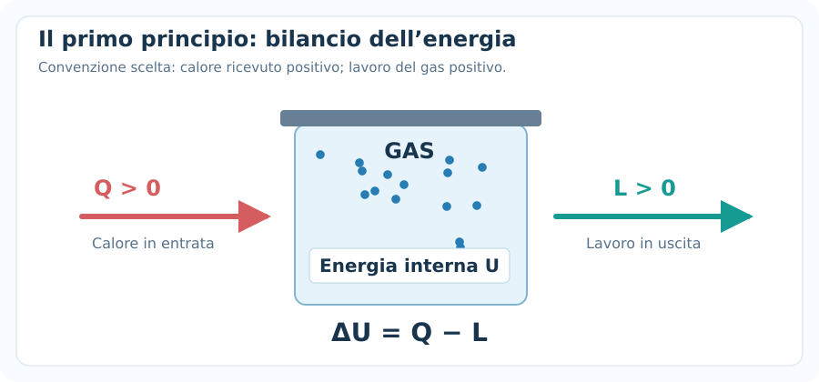
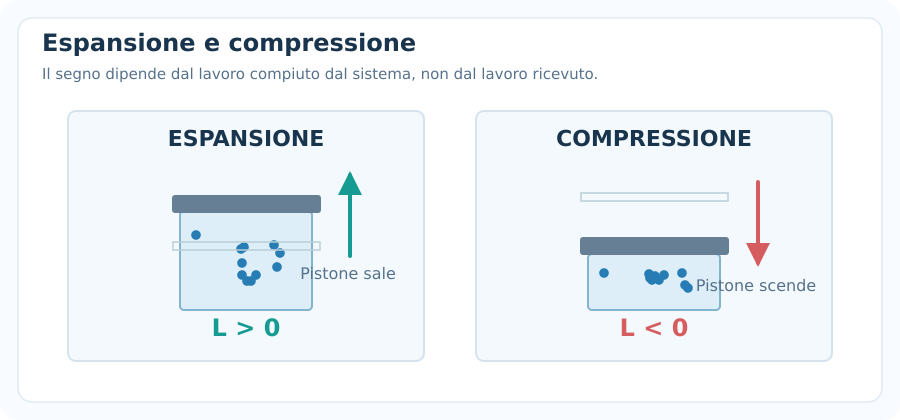
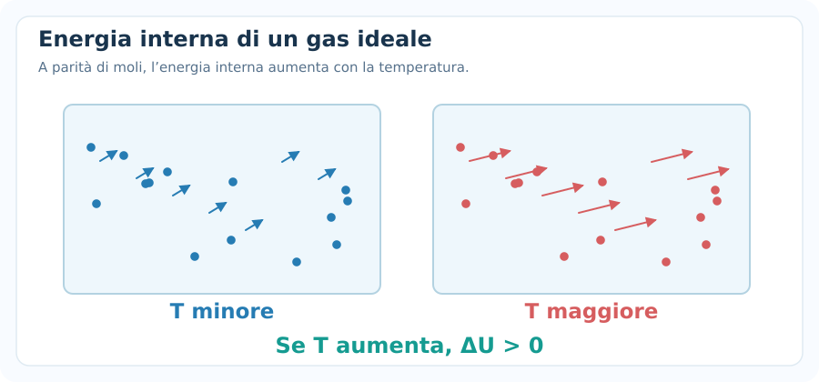
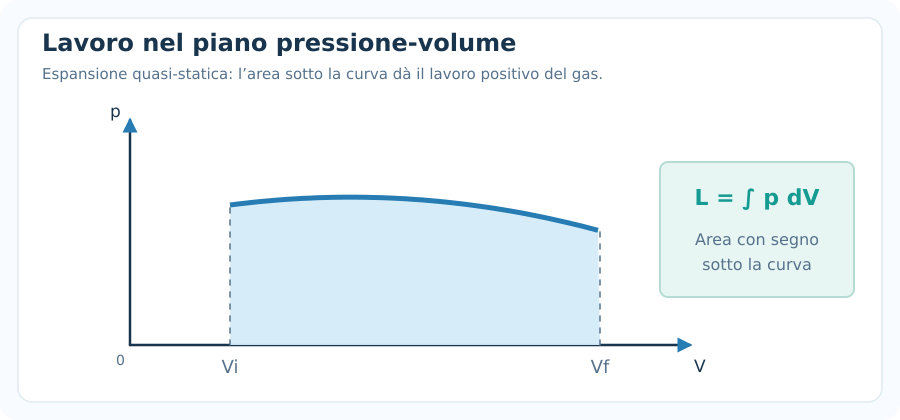
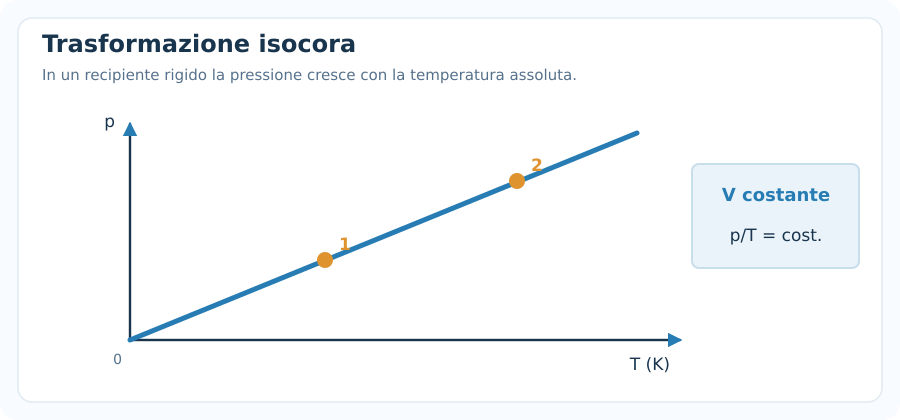
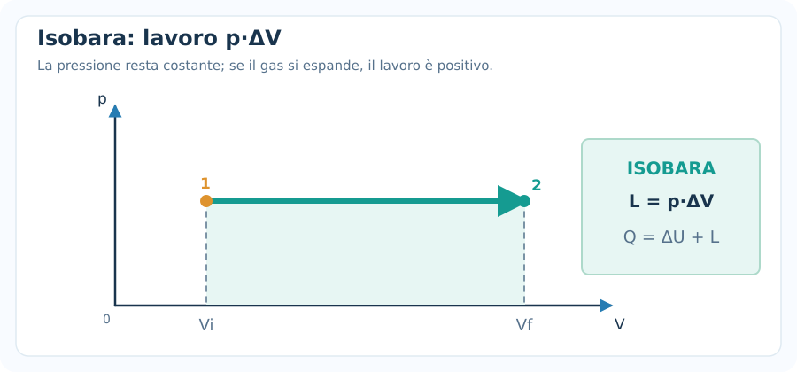
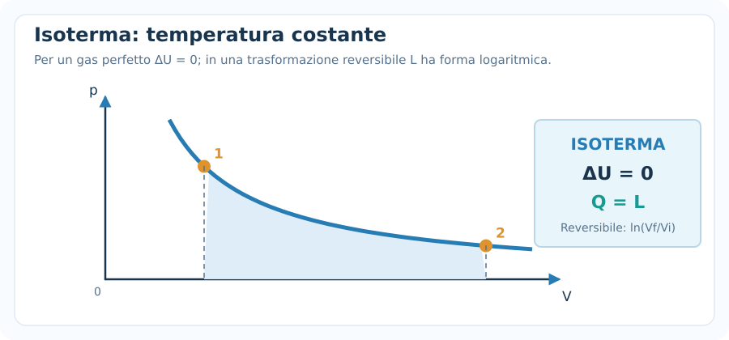
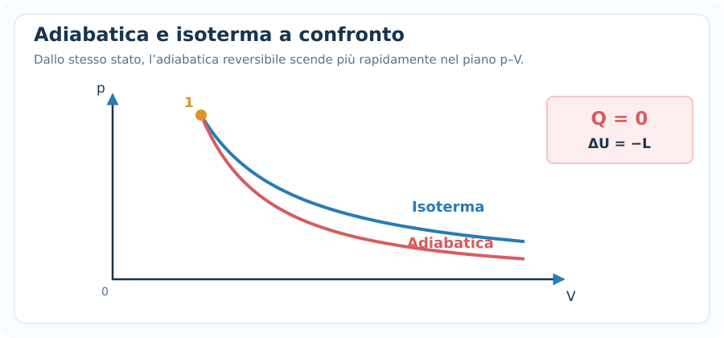
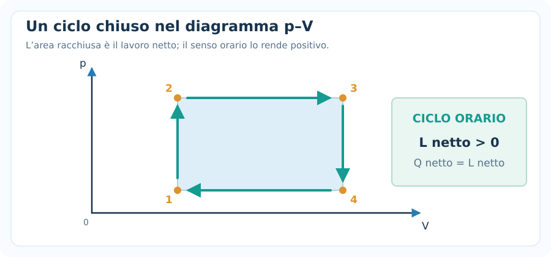
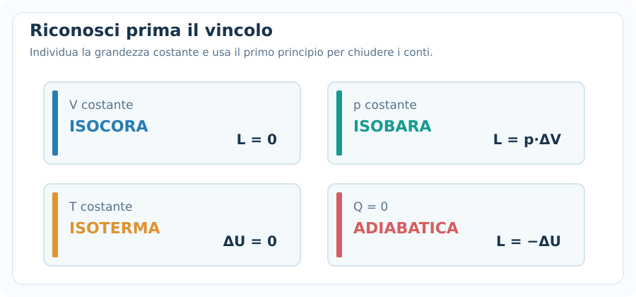

# Primo principio della termodinamica

> [!abstract] Obiettivo della nota
> Imparare a collegare **calore**, **lavoro** ed **energia interna** tramite il primo principio della termodinamica. Riconoscere le trasformazioni **isocore, isobare, isoterme e adiabatiche** e impostare gli esercizi senza confondere segni, formule e condizioni di applicabilità.

## 1. Che cosa studia il primo principio?

La termodinamica descrive come un **sistema** scambia energia con l'ambiente. Possiamo immaginare, per esempio, un gas racchiuso in un cilindro dotato di un pistone mobile.

- Il gas può ricevere o cedere **calore** $Q$.
- Il gas può compiere o subire **lavoro** $L$.
- La sua **energia interna** $U$ può aumentare o diminuire.

Il **primo principio della termodinamica** è il principio di **conservazione dell'energia** applicato a questi scambi.

### Sistema, ambiente e trasformazione

- **Sistema:** ciò che studiamo (per esempio, il gas).
- **Ambiente:** tutto ciò che è esterno al sistema.
- **Stato termodinamico:** descritto da variabili come $p$, $V$ e $T$.
- **Trasformazione:** passaggio da uno stato iniziale a uno stato finale.

Qui ci concentriamo soprattutto sui **sistemi chiusi**, nei quali la quantità di materia non attraversa il confine del sistema. Trascuriamo, se non specificato, le variazioni di energia cinetica e potenziale macroscopica del sistema.

---

## 2. Formula fondamentale e convenzione dei segni

**In questa nota scegliamo una sola convenzione:** $L$ è il **lavoro compiuto dal gas sull'ambiente**.

$$
\boxed{\Delta U=Q-L}
$$

Dove:

- $\Delta U=U_f-U_i$: variazione di energia interna, in joule ($\mathrm{J}$).
- $Q$: calore scambiato **con il sistema**, in joule.
- $L$: lavoro **compiuto dal sistema**, in joule.

Formule inverse:

$$
\boxed{Q=\Delta U+L}
$$

$$
\boxed{L=Q-\Delta U}
$$

### Segni da utilizzare

| Grandezza | Segno positivo | Segno negativo |
|---|---|---|
| $Q$ | Il gas **assorbe** calore | Il gas **cede** calore |
| $L$ | Il gas **compie** lavoro (tipicamente si espande) | L'ambiente **compie** lavoro sul gas (tipicamente lo comprime) |
| $\Delta U$ | L'energia interna **aumenta** | L'energia interna **diminuisce** |

> [!warning] Attenzione alla convenzione
> Alcuni libri scrivono $\Delta U=Q+L_{\mathrm{su}}$, dove $L_{\mathrm{su}}$ è il **lavoro compiuto sul gas**. Le due formule sono equivalenti perché $L_{\mathrm{su}}=-L$. **Non mescolare i due significati di lavoro nello stesso esercizio.**

### Esempio immediato

Un gas riceve $Q=500\ \mathrm{J}$ di calore e compie $L=180\ \mathrm{J}$ di lavoro.

$$
\Delta U=Q-L=500-180
$$

$$
\boxed{\Delta U=+320\ \mathrm{J}}
$$

L'energia interna aumenta di $320\ \mathrm{J}$: non tutto il calore ricevuto rimane nel gas, perché una parte viene trasferita all'ambiente come lavoro.

---

## 3. Energia interna di un gas perfetto

Per un **gas perfetto**, l'energia interna dipende soltanto dalla **temperatura**, nel modello in cui i gradi di libertà attivi restano gli stessi.

Useremo la notazione adottata nella nota **Gas perfetti**:

$$
\boxed{U=\frac{\ell}{2}nRT}
$$

$$
\boxed{\Delta U=\frac{\ell}{2}nR\Delta T}
$$

Dove:

- $\ell$: numero di gradi di libertà quadratici attivi.
- $n$: moli di gas.
- $R=8{,}314\ \mathrm{J/(mol\,K)}$: costante dei gas.
- $\Delta T=T_f-T_i$: variazione di temperatura.

### Casi usuali negli esercizi

| Gas perfetto | $\ell$ (approssimazione tipica) | Variazione di energia interna |
|---|---:|---|
| Monoatomico | $3$ | $\Delta U=\frac32 nR\Delta T$ |
| Biatomico a temperatura ordinaria, vibrazioni trascurabili | $5$ | $\Delta U=\frac52 nR\Delta T$ |

> [!important] Una conseguenza decisiva
> Se un **gas perfetto** non cambia temperatura, allora $\Delta U=0$, **anche se cambia volume o pressione**. Viceversa, se $T$ aumenta, $\Delta U>0$; se $T$ diminuisce, $\Delta U<0$.

### Esempio

Due moli di gas perfetto monoatomico vengono riscaldate da $300\ \mathrm K$ a $350\ \mathrm K$.

$$
\Delta U=\frac32\cdot2\cdot8{,}314\cdot(350-300)
$$

$$
\boxed{\Delta U\approx1247\ \mathrm J}
$$

Il dato importante è la **differenza** di temperatura: per $\Delta T$ lo scarto numerico è identico in kelvin e in gradi Celsius.

---

## 4. Calore, lavoro ed energia interna: non sono la stessa cosa

- $U$ è una **funzione di stato**: la sua variazione dipende soltanto dallo stato iniziale e da quello finale.
- $Q$ e $L$ sono **scambi di energia durante una trasformazione**: dipendono dal percorso seguito.
- Un corpo non «contiene calore»: possiede energia interna e può scambiare energia **sotto forma di calore**.

Due trasformazioni che collegano lo stesso stato iniziale e finale hanno la **stessa $\Delta U$**, ma possono avere **$Q$ e $L$ differenti**.

### Caso particolare: gas che non scambia calore

Se $Q=0$:

$$
\Delta U=-L
$$

Se il gas compie lavoro senza ricevere calore, l'energia necessaria viene dalla sua energia interna, che diminuisce.

---

## 5. Il lavoro di un gas: il pistone

Un gas può compiere lavoro spingendo un pistone mobile.

Per un pistone di area $A$, spostato di $\Delta x$ da una pressione esterna costante $p_{\mathrm{ext}}$:

$$
F=p_{\mathrm{ext}}A
$$

$$
L=F\Delta x=p_{\mathrm{ext}}A\Delta x
$$

Poiché $\Delta V=A\Delta x$:

$$
\boxed{L=p_{\mathrm{ext}}\Delta V}
$$

Nelle trasformazioni **quasi-statiche**, quando la pressione del gas è ben definita e differisce solo infinitesimamente da quella esterna, per una trasformazione finita:

$$
\boxed{L=\int_{V_i}^{V_f}p(V)\,dV}
$$

Questa è l'**area con segno sotto la curva** della trasformazione nel diagramma $p$–$V$.

### Segno del lavoro

- **Espansione:** $V_f>V_i\Rightarrow L>0$ quando la pressione esterna è positiva.
- **Compressione:** $V_f<V_i\Rightarrow L<0$.
- **Volume costante:** $\Delta V=0\Rightarrow L=0$ per il solo lavoro di espansione/compressione.

### Attenzione

La formula **$L=p\Delta V$** si applica direttamente se la **pressione rilevante è costante** (per esempio, un'isobara quasi-statica). Se la pressione cambia, non possiamo sostituirla con un valore qualsiasi: va considerato l'andamento della pressione durante il processo.

---

## 6. Capacità termiche: $C_V$ e $C_P$

Il calore necessario a modificare la temperatura di un gas dipende anche da **come avviene la trasformazione**.

La **capacità termica molare a volume costante** è $C_{V,m}$; quella **a pressione costante** è $C_{P,m}$.

Per un gas perfetto con $\ell$ costante:

$$
\boxed{C_{V,m}=\frac{\ell}{2}R}
$$

$$
\boxed{C_{P,m}=C_{V,m}+R=\frac{\ell+2}{2}R}
$$

Quindi:

$$
\boxed{C_{P,m}-C_{V,m}=R}
$$

### Valori tipici

| Gas | $C_{V,m}$ | $C_{P,m}$ |
|---|---|---|
| Monoatomico | $\frac32 R$ | $\frac52R$ |
| Biatomico, vibrazioni trascurabili | $\frac52R$ | $\frac72R$ |

La variazione di energia interna di un gas perfetto resta:

$$
\boxed{\Delta U=nC_{V,m}\Delta T}
$$

Attenzione: **$\Delta U=nC_{V,m}\Delta T$ vale anche se la trasformazione non è isocora** (purché si tratti del modello ideale con capacità termica costante nell'intervallo). È invece il calore $Q$ ad assumere espressioni diverse a seconda della trasformazione.

> [!tip] Perché $C_{P,m}>C_{V,m}$?
> A volume costante non c'è lavoro di espansione: il calore fornito aumenta soltanto l'energia interna. A pressione costante, se il gas si riscalda ed espande, una parte del calore serve anche a compiere lavoro.

---

## 7. Trasformazione isocora — volume costante

Una trasformazione è **isocora** quando:

$$
\boxed{V=\mathrm{costante}}
$$

Il pistone non si sposta, quindi il lavoro di espansione/compressione è nullo:

$$
\boxed{L=0}
$$

Dal primo principio:

$$
\Delta U=Q-L
$$

Segue:

$$
\boxed{Q=\Delta U=nC_{V,m}\Delta T}
$$

### Sul diagramma $p$–$V$

Un'isocora è una **retta verticale**: cambia $p$, non cambia $V$.

### Esempio svolto

Due moli di gas monoatomico vengono scaldate da $300$ a $350\ \mathrm K$ in un contenitore rigido.

$$
\Delta U=\frac32 nR\Delta T=1247{,}1\ \mathrm J
$$

$$
L=0
$$

$$
\boxed{Q=+1247{,}1\ \mathrm J}
$$

**Da riconoscere nel testo:** «recipiente rigido», «volume costante», «pistone bloccato».

---

## 8. Trasformazione isobara — pressione costante

Una trasformazione è **isobara** quando:

$$
\boxed{p=\mathrm{costante}}
$$

Se il processo è quasi-statico e il gas è perfetto, il lavoro è:

$$
\boxed{L=p(V_f-V_i)}
$$

Da $pV=nRT$, con $n$ costante:

$$
p\Delta V=nR\Delta T
$$

Quindi:

$$
\boxed{L=nR\Delta T}
$$

La variazione di energia interna è:

$$
\Delta U=nC_{V,m}\Delta T
$$

E il calore scambiato:

$$
Q=\Delta U+L
$$

$$
\boxed{Q=nC_{P,m}\Delta T}
$$

### Esempio svolto

Una mole di gas perfetto monoatomico passa da $300$ a $400\ \mathrm K$ a pressione costante.

**1. Energia interna**

$$
\Delta U=\frac32\cdot1\cdot8{,}314\cdot100
=\boxed{1247{,}1\ \mathrm J}
$$

**2. Lavoro compiuto dal gas**

$$
L=nR\Delta T=1\cdot8{,}314\cdot100
=\boxed{+831{,}4\ \mathrm J}
$$

**3. Calore assorbito**

$$
Q=\Delta U+L=1247{,}1+831{,}4
$$

$$
\boxed{Q=+2078{,}5\ \mathrm J}
$$

**Da riconoscere nel testo:** «pressione costante», «pistone mobile sotto pressione costante».

---

## 9. Trasformazione isoterma — temperatura costante

Una trasformazione è **isoterma** quando:

$$
\boxed{T=\mathrm{costante}}
$$

Per un **gas perfetto**:

$$
\boxed{\Delta U=0}
$$

Di conseguenza il primo principio diventa:

$$
\boxed{Q=L}
$$

Per una trasformazione **isoterma reversibile** (quasi-statica) di un gas perfetto:

$$
\boxed{L=nRT\ln\!\left(\frac{V_f}{V_i}\right)}
$$

Si può scrivere anche:

$$
L=nRT\ln\!\left(\frac{p_i}{p_f}\right)
$$

perché, a temperatura costante, $p_iV_i=p_fV_f$.

### Segno del logaritmo

- Se $V_f>V_i$, il logaritmo è positivo: $L>0$ e $Q>0$.
- Se $V_f<V_i$, il logaritmo è negativo: $L<0$ e $Q<0$.

### Esempio svolto

Una mole di gas ideale a $T=300\ \mathrm K$ si espande **reversibilmente** da $10\ \mathrm L$ a $20\ \mathrm L$.

$$
L=nRT\ln\!\left(\frac{20}{10}\right)
$$

$$
L=1\cdot8{,}314\cdot300\cdot\ln 2
$$

$$
\boxed{L\approx+1729\ \mathrm J}
$$

Poiché $\Delta U=0$:

$$
\boxed{Q\approx+1729\ \mathrm J}
$$

> [!warning] Distinzione importante
> La relazione $\Delta U=0$ vale per **qualsiasi trasformazione isoterma di un gas ideale**. La formula con il **logaritmo** per il lavoro richiede invece le condizioni di **isoterma reversibile**; non va applicata automaticamente a un'espansione libera o irreversibile.

---

## 10. Trasformazione adiabatica — nessuno scambio di calore

Una trasformazione è **adiabatica** quando:

$$
\boxed{Q=0}
$$

Dal primo principio:

$$
\Delta U=-L
$$

Quindi:

$$
\boxed{L=-\Delta U=nC_{V,m}(T_i-T_f)}
$$

### Conseguenze

- **Espansione adiabatica:** il gas compie lavoro, quindi $L>0$ e, per un gas perfetto, normalmente $T_f<T_i$.
- **Compressione adiabatica:** si compie lavoro sul gas, quindi $L<0$ e normalmente $T_f>T_i$.

### Equazioni aggiuntive: SOLO se l'adiabatica è reversibile

Definiamo:

$$
\boxed{\gamma=\frac{C_{P,m}}{C_{V,m}}=\frac{\ell+2}{\ell}}
$$

Per un gas perfetto con capacità termiche costanti, in trasformazione **adiabatica reversibile**:

$$
\boxed{pV^{\gamma}=\mathrm{costante}}
$$

$$
\boxed{TV^{\gamma-1}=\mathrm{costante}}
$$

$$
\boxed{L=\frac{p_iV_i-p_fV_f}{\gamma-1}}
$$

Per i gas perfetti monoatomici $\gamma=5/3$; per i biatomici con vibrazioni trascurabili $\gamma=7/5$.

### Esempio svolto

Una mole di gas perfetto monoatomico si espande adiabaticamente raffreddandosi da $400$ a $300\ \mathrm K$. Trascuriamo le variazioni di energia diverse da quella interna.

$$
\Delta U=\frac32\cdot1\cdot8{,}314\cdot(300-400)
$$

$$
\boxed{\Delta U=-1247{,}1\ \mathrm J}
$$

Essendo $Q=0$:

$$
\boxed{L=+1247{,}1\ \mathrm J}
$$

Il gas compie lavoro consumando parte della sua energia interna.

> [!important] Non confondere
> **Adiabatica** significa $Q=0$; **isoterma** significa $\Delta T=0$. Non sono sinonimi. Un'adiabatica **irreversibile** non obbedisce in generale a $pV^\gamma=\mathrm{costante}$.

---

## 11. Trasformazione ciclica

Un **ciclo termodinamico** riporta il sistema allo **stato iniziale**.

Poiché l'energia interna è una funzione di stato:

$$
\boxed{\Delta U_{\mathrm{ciclo}}=0}
$$

Dal primo principio segue:

$$
\boxed{Q_{\mathrm{netto}}=L_{\mathrm{netto}}}
$$

Nel diagramma $p$–$V$, per un ciclo quasi-statico, il lavoro netto è pari all'**area racchiusa** dalla curva, con segno:

- **Senso orario:** $L_{\mathrm{netto}}>0$.
- **Senso antiorario:** $L_{\mathrm{netto}}<0$.

### Esempio: ciclo rettangolare

Un gas percorre in senso orario un ciclo rettangolare con:

$$
p_{\min}=1{,}0\cdot10^5\ \mathrm{Pa},\qquad p_{\max}=2{,}0\cdot10^5\ \mathrm{Pa}
$$

$$
V_{\min}=0{,}010\ \mathrm{m^3},\qquad V_{\max}=0{,}020\ \mathrm{m^3}
$$

Il lavoro netto è l'area:

$$
L_{\mathrm{netto}}=(p_{\max}-p_{\min})(V_{\max}-V_{\min})
$$

$$
L_{\mathrm{netto}}=(10^5)(0{,}010)=\boxed{+1000\ \mathrm J}
$$

Quindi:

$$
\boxed{Q_{\mathrm{netto}}=+1000\ \mathrm J}
$$

---

## 12. Tabella completa delle trasformazioni

Per un **gas perfetto**, assumendo $n$ costante e, ove necessario, trasformazioni quasi-statiche:

| Trasformazione | Grandezza costante | Lavoro $L$ | Energia interna $\Delta U$ | Calore $Q$ |
|---|---|---|---|---|
| **Isocora** | $V$ | $0$ | $nC_{V,m}\Delta T$ | $\Delta U$ |
| **Isobara** | $p$ | $p\Delta V=nR\Delta T$ | $nC_{V,m}\Delta T$ | $nC_{P,m}\Delta T$ |
| **Isoterma** | $T$ | $nRT\ln(V_f/V_i)$ **se reversibile** | $0$ | $L$ |
| **Adiabatica** | $Q=0$ | $-\Delta U$ | $nC_{V,m}\Delta T$ | $0$ |
| **Ciclica** | Stato finale = iniziale | $L_{\mathrm{netto}}$ | $0$ | $L_{\mathrm{netto}}$ |

**Attenzione:** le prime tre trasformazioni identificano una grandezza di stato costante; «adiabatica» identifica invece l'assenza di scambio di calore.

---

## 13. Come riconoscere la trasformazione dal testo

| Parola o condizione nel problema | Prima conseguenza |
|---|---|
| «Recipiente rigido», «volume costante» | Isocora $\Rightarrow L=0$ |
| «Pressione costante» | Isobara $\Rightarrow L=p\Delta V$ |
| «Temperatura costante» | Isoterma, gas ideale $\Rightarrow \Delta U=0$ |
| «Pareti termicamente isolanti», «nessun calore scambiato» | Adiabatica $\Rightarrow Q=0$ |
| «Torna allo stato iniziale», «ciclo chiuso» | Ciclica $\Rightarrow \Delta U_{\mathrm{ciclo}}=0$ |
| «Espansione» | $\Delta V>0$, lavoro di espansione normalmente positivo |
| «Compressione» | $\Delta V<0$, lavoro di compressione normalmente negativo |

### Non fare deduzioni indebite

- **Isocora** non implica $Q=0$.
- **Adiabatica** non implica $T$ costante.
- **Isoterma** non implica $Q=0$.
- **Isolato termicamente** non significa necessariamente che non possa esserci lavoro: un cilindro isolato con pistone mobile può subire una compressione adiabatica.
- **Compressione/espansione** da sola non determina quanto lavoro viene compiuto: occorre conoscere il percorso o la pressione esterna.

---

## 14. Esercizi misti: metodo meccanico in 6 passaggi

1. **Individua il sistema** (di solito il gas) e scegli la convenzione $\Delta U=Q-L$.
2. **Leggi il vincolo**: $V$ costante? $p$ costante? $T$ costante? $Q=0$? Ciclo?
3. **Converti le unità**: $T$ in kelvin, $V$ in $\mathrm{m^3}$, $p$ in pascal, $n$ in moli.
4. **Calcola prima $\Delta U$**, quando conosci $n$ e $\Delta T$:

   $$
   \Delta U=\frac{\ell}{2}nR\Delta T
   $$

5. **Calcola il lavoro $L$** con la formula valida per il percorso (oppure usa il vincolo $L=0$, $Q=0$ o $\Delta U=0$).
6. **Chiudi il bilancio** con $\Delta U=Q-L$ e controlla i segni.

### Esempio completo combinato

Una mole di gas perfetto monoatomico viene riscaldata **a pressione costante** da $300$ a $360\ \mathrm K$. Determina $\Delta U$, $L$ e $Q$.

**1. Riconoscimento:** isobara, $\Delta T=+60\ \mathrm K$.

**2. Energia interna:**

$$
\Delta U=\frac32\cdot1\cdot8{,}314\cdot60
=\boxed{+748{,}26\ \mathrm J}
$$

**3. Lavoro:**

$$
L=nR\Delta T=1\cdot8{,}314\cdot60
=\boxed{+498{,}84\ \mathrm J}
$$

**4. Calore:**

$$
Q=\Delta U+L=748{,}26+498{,}84
$$

$$
\boxed{Q=+1247{,}10\ \mathrm J}
$$

**Controllo:** il gas si scalda ($\Delta U>0$), si espande ($L>0$) e riceve abbastanza calore per entrambe le cose ($Q>0$).

---

## 15. Errori frequenti all'esame

### Errore 1 — Confondere il segno del lavoro

Se il lavoro è **compiuto dal gas**, si usa:

$$
\Delta U=Q-L
$$

Per una compressione, il lavoro del gas è normalmente **negativo**. Se compare un'altra convenzione nel testo, esplicitala prima di calcolare.

### Errore 2 — Sostituire sempre $Q=mc\Delta T$

La formula $Q=mc\Delta T$ non è una formula universale per qualsiasi riscaldamento di un gas. Nei gas perfetti, per i processi standard, distingui $C_V$ e $C_P$ e usa il primo principio.

### Errore 3 — Pensare che $Q$ e $\Delta U$ siano sempre uguali

Questo vale nell'isocora (quando l'unico lavoro possibile è quello di volume). In un'isobara il gas può anche compiere lavoro.

### Errore 4 — Usare $L=p\Delta V$ in un'isoterma generica

In un'isoterma reversibile la pressione varia come $p=nRT/V$: il lavoro si ottiene con il **logaritmo**, non con una pressione arbitraria costante.

### Errore 5 — Trattare un'adiabatica come un'isoterma

- Adiabatica: $Q=0$.
- Isoterma: $\Delta T=0$.

Sono vincoli differenti.

### Errore 6 — Applicare $pV^\gamma=\mathrm{costante}$ a un'adiabatica irreversibile

Questa relazione richiede anche la **reversibilità** e un gas ideale con $\gamma$ costante.

### Errore 7 — Confondere un ciclo con una singola espansione

In un ciclo completo il sistema torna allo stato iniziale e perciò $\Delta U_{\mathrm{ciclo}}=0$. Il lavoro netto può invece essere diverso da zero.

### Errore 8 — Dimenticare i kelvin

In $pV=nRT$ servono i kelvin. Nelle formule che impiegano soltanto $\Delta T$, una variazione di $10\,^{\circ}\mathrm C$ equivale a $10\ \mathrm K$.

---

## 16. Formulario essenziale

| Richiesta | Formula | Quando usarla |
|---|---|---|
| Primo principio | $\boxed{\Delta U=Q-L}$ | Sistema chiuso; $L$ compiuto dal gas |
| Energia interna gas ideale | $\boxed{\Delta U=\frac\ell2nR\Delta T}$ | $\ell$ costante nell'intervallo |
| Capacità molare a volume costante | $C_{V,m}=\frac\ell2 R$ | Gas ideale |
| Capacità molare a pressione costante | $C_{P,m}=C_{V,m}+R$ | Gas ideale |
| Lavoro generale quasi-statico | $L=\int p\,dV$ | Pressione interna definita durante il percorso |
| Lavoro isobaro | $L=p\Delta V=nR\Delta T$ | Isobara quasi-statica di gas ideale |
| Isocora | $L=0$, $Q=\Delta U$ | Volume costante |
| Isoterma gas ideale | $\Delta U=0$, $Q=L$ | Temperatura costante |
| Lavoro isoterma reversibile | $L=nRT\ln(V_f/V_i)$ | Isoterma reversibile di gas ideale |
| Adiabatica | $Q=0$, $L=-\Delta U$ | Nessuno scambio termico |
| Adiabatica reversibile | $pV^\gamma=\text{cost.}$ | Gas ideale, $\gamma$ costante |
| Ciclo | $\Delta U=0$, $Q_{\rm netto}=L_{\rm netto}$ | Stato finale = iniziale |

---

## 17. Domande di verifica

1. Un gas assorbe $600\ \mathrm J$ e compie $250\ \mathrm J$ di lavoro: quanto vale $\Delta U$?
2. Un gas viene compresso adiabaticamente. Qual è il segno di $L$? E, per un gas perfetto, come varia normalmente $T$?
3. Una mole di gas monoatomico si scalda di $40\ \mathrm K$: quanto vale $\Delta U$? Dipende dal fatto che la trasformazione sia isobara o isocora?
4. Perché nell'isocora $Q=\Delta U$?
5. Perché in un'isoterma di gas perfetto $Q=L$?
6. È sempre corretto usare $L=nRT\ln(V_f/V_i)$ in una trasformazione isoterma? Che cosa bisogna verificare?
7. In un ciclo chiuso, $\Delta U$ è zero: significa che anche $Q$ e $L$ sono separatamente zero?
8. In un diagramma $p$–$V$, che cosa rappresenta l'area sotto la curva? Che cosa rappresenta l'area racchiusa da un ciclo?
9. A pari aumento di temperatura e stesso gas, perché in un'isobara serve più calore rispetto a un'isocora?
10. Un gas riceve calore e tuttavia la sua temperatura diminuisce: è possibile? Quale relazione devi verificare?

> [!summary] Da fissare per l'esame
> Per risolvere bene gli esercizi devi riconoscere **il vincolo della trasformazione** e usare correttamente la convenzione: $\Delta U=Q-L$, con $L$ positivo quando è **il gas** a compiere lavoro. Tutto il resto deriva dalla combinazione di questa relazione con $pV=nRT$ e $\Delta U=\frac\ell2nR\Delta T$.
