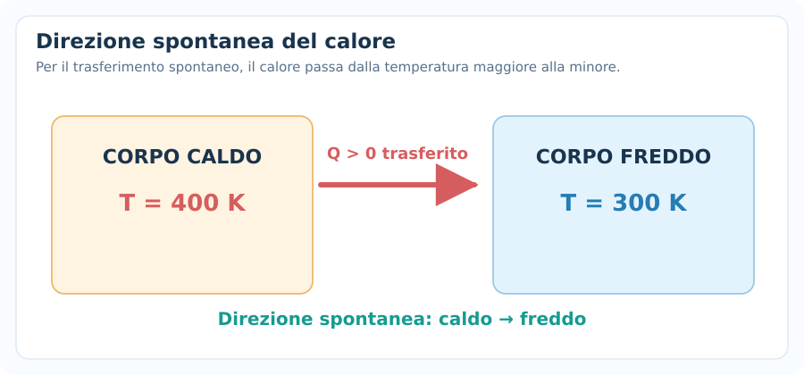
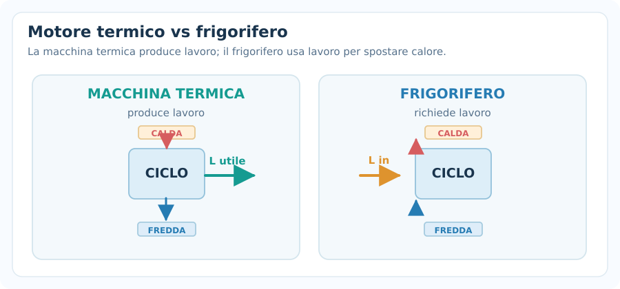
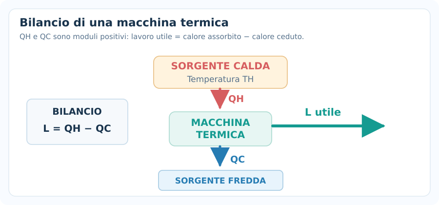
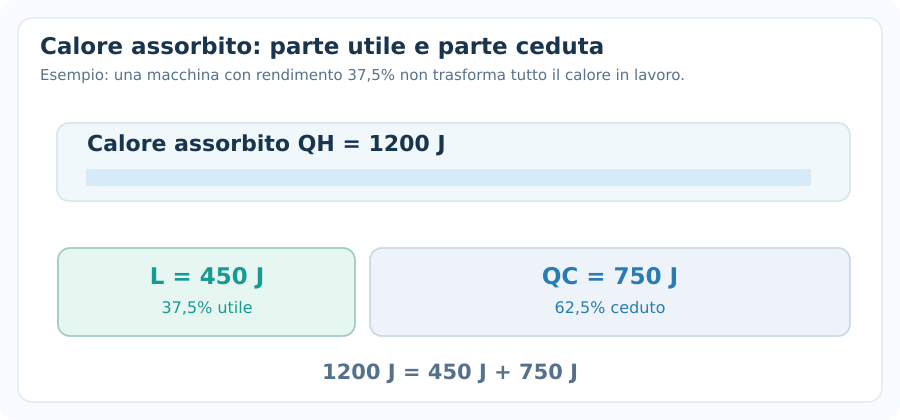
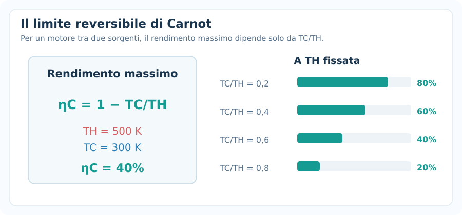
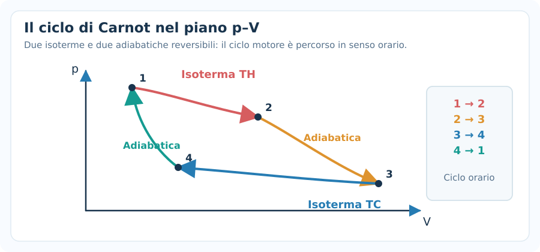
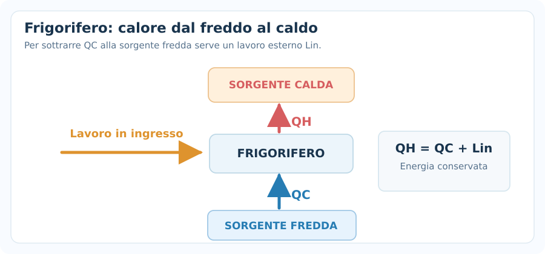
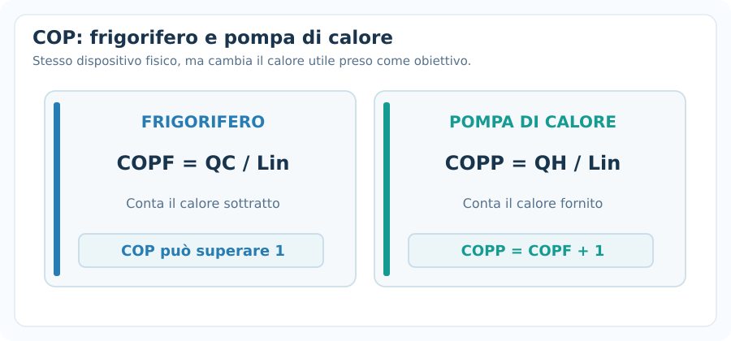
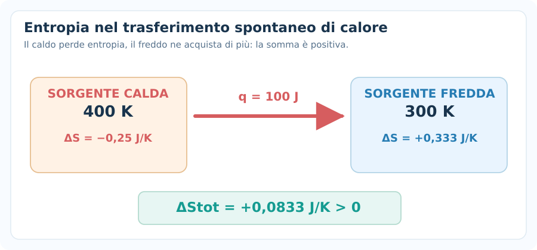
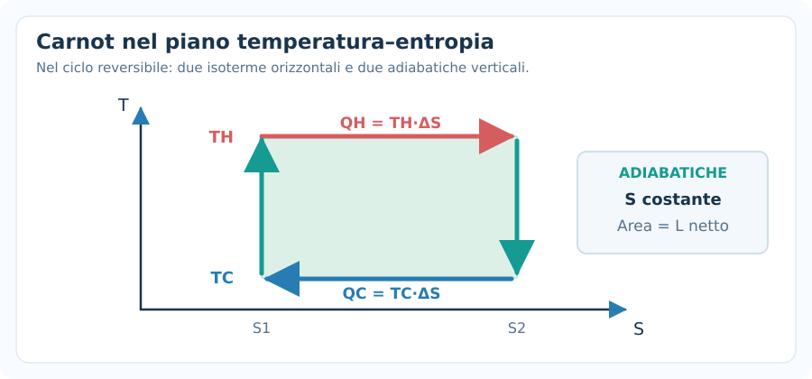

# Secondo principio della termodinamica

> [!abstract] Obiettivo della nota
> Comprendere **perché il calore ha una direzione spontanea**, distinguere il **primo** dal **secondo principio**, calcolare il **rendimento delle macchine termiche**, il **coefficiente di prestazione di frigoriferi e pompe di calore**, il **limite di Carnot** e le **variazioni di entropia**. Alla fine dovrai saper riconoscere il procedimento giusto negli esercizi.

## 1. Perché serve un secondo principio?

Il **primo principio** è una legge di conservazione dell'energia:

$$
\boxed{\Delta U=Q-L}
$$

In questa nota, come nella precedente, **$L$ è il lavoro compiuto dal sistema** sull'ambiente:

- $Q>0$: il sistema assorbe calore.
- $L>0$: il sistema compie lavoro.

Tuttavia, il primo principio **non dice quali trasformazioni avvengono spontaneamente**.

Esempio: se mettiamo un cucchiaio freddo nel tè caldo, il calore passa spontaneamente **dal tè al cucchiaio**, non viceversa. Il processo inverso richiederebbe un intervento esterno, o una compensazione altrove.

Il **secondo principio della termodinamica** stabilisce i vincoli di direzione dei processi e i limiti alla conversione di calore in lavoro.

### Differenza tra i due principi

| Primo principio | Secondo principio |
|---|---|
| L'energia si conserva. | Non tutte le trasformazioni energeticamente possibili sono spontanee. |
| Permette di calcolare $Q$, $L$, $\Delta U$. | Determina direzione spontanea e limiti del rendimento. |
| Non distingue da solo i processi reversibili dagli irreversibili. | Introduce l'**entropia** e la produzione di entropia. |

---

## 2. Sorgenti termiche e temperature

Una **sorgente termica** (o *serbatoio termico*) è un sistema sufficientemente grande da scambiare una certa quantità di calore senza cambiare sensibilmente temperatura.

Negli esercizi sulle macchine termiche consideriamo di solito:

- Una **sorgente calda** a temperatura $T_H$.
- Una **sorgente fredda** a temperatura $T_C$.

Con:

$$
\boxed{T_H>T_C>0}
$$

Le temperature nelle formule termodinamiche devono essere **assolute**, cioè espresse in kelvin:

$$
\boxed{T(\mathrm K)=t(^{\circ}\mathrm C)+273{,}15}
$$

> [!warning] Errore da evitare
> Un rapporto come $T_C/T_H$ va **sempre calcolato in kelvin**. Usare $20/100$ perché le temperature sono $20\,^{\circ}\mathrm C$ e $100\,^{\circ}\mathrm C$ porta a un risultato sbagliato.

---

## 3. Enunciato di Clausius

**Enunciato di Clausius:**

> È impossibile realizzare un processo il cui unico effetto sia trasferire calore da un corpo più freddo a uno più caldo.

Questo non significa che il trasferimento dal freddo al caldo sia impossibile in assoluto: un **frigorifero** lo realizza, ma richiede lavoro dall'esterno.

Per esempio:

- Spontaneamente: caldo $\rightarrow$ freddo.
- Con apporto di lavoro: possiamo trasferire calore dal freddo al caldo.

---

## 4. Enunciato di Kelvin–Planck

**Enunciato di Kelvin–Planck:**

> È impossibile costruire una macchina che, operando ciclicamente, trasformi **tutto** il calore assorbito da un'unica sorgente in lavoro, senza altri effetti.

Una macchina termica ciclica non può convertire il $100\%$ del calore ricevuto in lavoro: deve cedere una parte di calore a una sorgente più fredda, se opera tra due sole sorgenti.

Gli enunciati di Clausius e Kelvin–Planck sono due formulazioni equivalenti del secondo principio.

---

## 5. Macchina termica: funzionamento

Una **macchina termica** è un dispositivo che opera ciclicamente e trasforma **parte del calore assorbito** in lavoro utile.

Per una macchina che scambia energia con due sorgenti:

1. Assorbe calore $Q_H$ dalla sorgente calda.
2. Produce lavoro $L$ verso l'esterno.
3. Cede calore $Q_C$ alla sorgente fredda.

In questa sezione $Q_H$ e $Q_C$ indicano **moduli positivi** delle quantità di calore: $Q_H>0$ è assorbito, $Q_C>0$ è ceduto.

### Bilancio energetico di un ciclo

Poiché al termine di un ciclo completo il sistema ritorna allo stato iniziale:

$$
\boxed{\Delta U_{\mathrm{ciclo}}=0}
$$

Applicando il primo principio:

$$
0=(Q_H-Q_C)-L
$$

Da cui:

$$
\boxed{L=Q_H-Q_C}
$$

Formule inverse:

$$
Q_H=L+Q_C
$$

$$
Q_C=Q_H-L
$$

> [!important] Segni: la distinzione decisiva
> Il calore **netto con segno** che entra nel sistema è $Q_{\mathrm{netto}}=Q_H-Q_C$. Il simbolo $Q_C$ qui è invece il **modulo positivo** del calore scaricato. Non scrivere $L=Q_H+Q_C$ se usi questa convenzione.

---

## 6. Rendimento di una macchina termica

Il **rendimento termico** $\eta$ è il rapporto tra lavoro utile prodotto e calore assorbito dalla sorgente calda:

$$
\boxed{\eta=\frac{L}{Q_H}}
$$

Usando $L=Q_H-Q_C$:

$$
\boxed{\eta=1-\frac{Q_C}{Q_H}}
$$

Il rendimento è **adimensionale** e si esprime spesso in percentuale:

$$
\eta_{\%}=100\eta
$$

Per una macchina termica ciclica che opera tra due sorgenti con scambi positivi:

$$
\boxed{0<\eta<1}
$$

Nella pratica il rendimento è inferiore a $1$ e, per le macchine reali, inferiore al limite reversibile di Carnot.

### Esempio svolto

Una macchina assorbe dalla sorgente calda:

$$
Q_H=1200\ \mathrm J
$$

E cede alla sorgente fredda:

$$
Q_C=750\ \mathrm J
$$

**1. Calcoliamo il lavoro:**

$$
L=Q_H-Q_C=1200-750
$$

$$
\boxed{L=450\ \mathrm J}
$$

**2. Calcoliamo il rendimento:**

$$
\eta=\frac{450}{1200}=0{,}375
$$

$$
\boxed{\eta=37{,}5\%}
$$

**Controllo fisico:** $L<Q_H$ e il rendimento è inferiore al $100\%$: il risultato è coerente.

### Formule inverse utili

Se conosci $\eta$ e $Q_H$:

$$
\boxed{L=\eta Q_H}
$$

Se conosci $L$ e $\eta$:

$$
\boxed{Q_H=\frac{L}{\eta}}
$$

Se conosci $\eta$ e $Q_H$:

$$
\boxed{Q_C=Q_H(1-\eta)}
$$

---

## 7. Macchine reversibili e irreversibili

Una trasformazione **reversibile** è un processo ideale che può essere invertito ripristinando sia il sistema sia l'ambiente allo stato iniziale, senza cambiamenti residui.

Le trasformazioni reali sono generalmente **irreversibili**, per esempio a causa di:

- Attrito e viscosità.
- Trasferimento di calore tra corpi a temperature diverse.
- Espansione libera di un gas nel vuoto.
- Mescolamento spontaneo.

Le trasformazioni reversibili sono un **limite ideale**, utile per trovare il rendimento massimo teorico.

> [!important] Reversibile non significa semplicemente «molto lento»
> Una trasformazione quasi-statica può essere comunque irreversibile se sono presenti attriti o altri fenomeni dissipativi.

---

## 8. Teorema di Carnot

Il **teorema di Carnot** afferma che nessuna macchina termica operante tra due sorgenti a temperature fissate può avere rendimento superiore a quello di una macchina reversibile che lavora tra le stesse temperature.

Per una macchina reversibile di Carnot:

$$
\boxed{\eta_C=1-\frac{T_C}{T_H}}
$$

Con **$T_C$ e $T_H$ in kelvin**.

Per qualsiasi macchina termica tra le stesse due sorgenti:

$$
\boxed{\eta\leq\eta_C}
$$

L'uguaglianza vale per una macchina reversibile ideale.

### Conseguenze

- Se $T_H$ aumenta a $T_C$ fissata, $\eta_C$ aumenta.
- Se $T_C$ diminuisce a $T_H$ fissata, $\eta_C$ aumenta.
- Se $T_C=T_H$, il rendimento massimo è zero: due sorgenti alla stessa temperatura non permettono di produrre lavoro attraverso una macchina termica ciclica a due sorgenti.
- Il rendimento di Carnot dipende **soltanto dalle temperature**, non dal gas usato o dalle dimensioni della macchina.

### Esempio svolto

Una macchina lavora tra:

$$
T_H=500\ \mathrm K,\qquad T_C=300\ \mathrm K
$$

Il massimo rendimento teorico è:

$$
\eta_C=1-\frac{300}{500}=0{,}40
$$

$$
\boxed{\eta_C=40\%}
$$

Se il motore assorbe $2000\ \mathrm J$ per ciclo, il suo lavoro non può superare:

$$
L_{\max}=\eta_C Q_H=0{,}40\cdot2000
$$

$$
\boxed{L_{\max}=800\ \mathrm J}
$$

**Attenzione:** una macchina reale che lavora tra queste temperature avrà rendimento inferiore al $40\%$.

---

## 9. Il ciclo di Carnot

Il **ciclo di Carnot** è un ciclo reversibile ideale costituito da quattro trasformazioni:

1. **Espansione isoterma** alla temperatura $T_H$: il gas assorbe $Q_H$.
2. **Espansione adiabatica reversibile**: la temperatura scende da $T_H$ a $T_C$ e $Q=0$.
3. **Compressione isoterma** alla temperatura $T_C$: il gas cede $Q_C$.
4. **Compressione adiabatica reversibile**: la temperatura risale da $T_C$ a $T_H$ e $Q=0$.

### Bilancio dell'energia

Sul ciclo intero:

$$
\Delta U_{\mathrm{ciclo}}=0
$$

Quindi:

$$
L_{\mathrm{netto}}=Q_H-Q_C
$$

Per una macchina reversibile di Carnot vale inoltre:

$$
\boxed{\frac{Q_C}{Q_H}=\frac{T_C}{T_H}}
$$

Da cui segue immediatamente:

$$
\eta_C=1-\frac{T_C}{T_H}
$$

### Grafico $p$–$V$

Nel piano pressione-volume, il lavoro totale di un ciclo quasi-statico è l'**area con segno racchiusa dal ciclo**.

- Ciclo percorso in **senso orario**: $L_{\mathrm{netto}}>0$ (macchina motrice).
- Ciclo percorso in **senso antiorario**: $L_{\mathrm{netto}}<0$ (lavoro netto fornito al sistema).

---

## 10. Frigorifero: lavoro per trasferire calore dal freddo al caldo

Un **frigorifero** usa lavoro esterno per sottrarre calore a una sorgente fredda e cederlo a una sorgente più calda.

Indichiamo con:

- $Q_C>0$: modulo del calore **prelevato dalla sorgente fredda**.
- $Q_H>0$: modulo del calore **ceduto alla sorgente calda**.
- $L_{\mathrm{in}}>0$: modulo del **lavoro fornito al frigorifero**.

Il bilancio energetico su un ciclo dà:

$$
\boxed{Q_H=Q_C+L_{\mathrm{in}}}
$$

### Coefficiente di prestazione del frigorifero

Si chiama **COP frigorifero** (o coefficiente di prestazione):

$$
\boxed{\mathrm{COP}_F=\frac{Q_C}{L_{\mathrm{in}}}}
$$

Può essere maggiore di $1$, perché non rappresenta una frazione dell'energia convertita in lavoro: misura **quanto calore viene sottratto al freddo per ogni joule di lavoro fornito**.

Per un frigorifero reversibile di Carnot:

$$
\boxed{\mathrm{COP}_{F,C}=\frac{T_C}{T_H-T_C}}
$$

### Esempio svolto

Un frigorifero preleva $Q_C=600\ \mathrm J$ dalla cella fredda e richiede $L_{\mathrm{in}}=200\ \mathrm J$ per ciclo.

$$
Q_H=600+200=800\ \mathrm J
$$

$$
\mathrm{COP}_F=\frac{600}{200}=3
$$

$$
\boxed{Q_H=800\ \mathrm J,\qquad \mathrm{COP}_F=3}
$$

---

## 11. Pompa di calore

Una **pompa di calore** segue lo stesso principio fisico del frigorifero, ma ciò che interessa è il **calore ceduto alla sorgente calda**, per esempio a un ambiente da riscaldare.

Il suo coefficiente di prestazione è:

$$
\boxed{\mathrm{COP}_{P}=\frac{Q_H}{L_{\mathrm{in}}}}
$$

Dato che $Q_H=Q_C+L_{\mathrm{in}}$:

$$
\boxed{\mathrm{COP}_P=\mathrm{COP}_F+1}
$$

Per una pompa di calore reversibile di Carnot:

$$
\boxed{\mathrm{COP}_{P,C}=\frac{T_H}{T_H-T_C}}
$$

### Esempio

Una pompa di calore trasferisce $Q_H=1500\ \mathrm J$ in un locale consumando $L_{\mathrm{in}}=300\ \mathrm J$.

$$
\mathrm{COP}_P=\frac{1500}{300}=5
$$

Il calore prelevato dall'esterno è:

$$
Q_C=Q_H-L_{\mathrm{in}}=1500-300
$$

$$
\boxed{Q_C=1200\ \mathrm J}
$$

---

## 12. Entropia: significato fisico

L'**entropia**, indicata con $S$, è una grandezza di stato fondamentale per descrivere la direzione dei processi termodinamici.

Per una trasformazione reversibile infinitesima:

$$
\boxed{dS=\frac{\delta Q_{\mathrm{rev}}}{T}}
$$

Per una trasformazione reversibile **isoterma**:

$$
\boxed{\Delta S=\frac{Q_{\mathrm{rev}}}{T}}
$$

Dove:

- $S$: entropia, in $\mathrm{J/K}$.
- $Q_{\mathrm{rev}}$: calore scambiato lungo un **percorso reversibile**.
- $T$: temperatura assoluta, in kelvin.

### L'aspetto più importante

L'entropia è una **funzione di stato**: $\Delta S$ dipende soltanto dagli stati iniziale e finale.

Anche se la trasformazione reale è irreversibile, puoi calcolare la variazione di entropia del sistema usando un **percorso reversibile immaginario** che colleghi gli stessi stati, purché i dati siano sufficienti.

> [!warning] Attenzione
> Non utilizzare automaticamente $\Delta S=Q/T$ per qualsiasi trasformazione irreversibile. La relazione con il calore vale come integrale lungo un percorso **reversibile**; la formula semplice $Q_{\mathrm{rev}}/T$ richiede anche temperatura costante durante lo scambio.

---

## 13. Secondo principio in termini di entropia

Per un sistema **isolato**:

$$
\boxed{\Delta S_{\mathrm{isolato}}\geq0}
$$

Più precisamente:

- **Processo reversibile:** $\Delta S_{\mathrm{isolato}}=0$.
- **Processo irreversibile spontaneo:** $\Delta S_{\mathrm{isolato}}>0$.

Per un sistema e il suo ambiente, trattati complessivamente come isolati:

$$
\boxed{\Delta S_{\mathrm{tot}}=\Delta S_{\mathrm{sistema}}+\Delta S_{\mathrm{ambiente}}\geq0}
$$

L'entropia del **solo sistema** può anche diminuire, purché l'aumento nell'ambiente compensi almeno tale diminuzione.

### Perché il calore passa spontaneamente dal caldo al freddo?

Supponiamo che una quantità di calore $q>0$ passi da una sorgente calda $T_H$ a una fredda $T_C$.

Le variazioni di entropia delle sorgenti sono:

$$
\Delta S_H=-\frac{q}{T_H}
$$

$$
\Delta S_C=+\frac{q}{T_C}
$$

La variazione complessiva è:

$$
\boxed{\Delta S_{\mathrm{tot}}=q\left(\frac{1}{T_C}-\frac{1}{T_H}\right)>0}
$$

perché $T_H>T_C$.

### Esempio numerico

$100\ \mathrm J$ passano spontaneamente da $400\ \mathrm K$ a $300\ \mathrm K$.

$$
\Delta S_H=-\frac{100}{400}=-0{,}25\ \mathrm{J/K}
$$

$$
\Delta S_C=+\frac{100}{300}\approx+0{,}333\ \mathrm{J/K}
$$

$$
\boxed{\Delta S_{\mathrm{tot}}\approx+0{,}0833\ \mathrm{J/K}}
$$

Il segno positivo conferma che il trasferimento è compatibile con un processo spontaneo.

---

## 14. Entropia durante il riscaldamento senza cambiamento di fase

Per un corpo con massa $m$ e calore specifico $c$ **costante**, riscaldato da $T_i$ a $T_f$, la sua variazione di entropia è:

$$
\boxed{\Delta S=mc\ln\left(\frac{T_f}{T_i}\right)}
$$

Le temperature devono essere espresse in **kelvin**.

Se usiamo invece la capacità termica totale $C=mc$:

$$
\boxed{\Delta S=C\ln\left(\frac{T_f}{T_i}\right)}
$$

### Esempio

Un corpo con capacità termica costante $C=200\ \mathrm{J/K}$ passa da $300\ \mathrm K$ a $330\ \mathrm K$.

$$
\Delta S=200\ln\left(\frac{330}{300}\right)
$$

$$
\boxed{\Delta S\approx19{,}06\ \mathrm{J/K}}
$$

Il corpo si riscalda, quindi la sua entropia aumenta.

---

## 15. Entropia di un gas perfetto

Per un gas perfetto con capacità termica molare a volume costante $C_{V,m}$ approssimativamente costante:

$$
\boxed{\Delta S=nC_{V,m}\ln\left(\frac{T_f}{T_i}\right)+nR\ln\left(\frac{V_f}{V_i}\right)}
$$

Una forma equivalente è:

$$
\boxed{\Delta S=nC_{P,m}\ln\left(\frac{T_f}{T_i}\right)-nR\ln\left(\frac{p_f}{p_i}\right)}
$$

### Caso 1 — Isoterma reversibile ($T_f=T_i$)

$$
\boxed{\Delta S=nR\ln\left(\frac{V_f}{V_i}\right)}
$$

Se il gas si espande isotermicamente ($V_f>V_i$), $\Delta S>0$.

### Caso 2 — Isocora ($V_f=V_i$)

$$
\boxed{\Delta S=nC_{V,m}\ln\left(\frac{T_f}{T_i}\right)}
$$

### Caso 3 — Adiabatica reversibile

$$
\boxed{\Delta S=0}
$$

Una trasformazione di questo tipo è detta **isentropica**.

> [!important] Differenza da ricordare
> **Adiabatica** significa $Q=0$. Non significa automaticamente $\Delta S=0$! Una trasformazione adiabatica *irreversibile* di un sistema chiuso può avere $\Delta S>0$.

---

## 16. Diagramma temperatura-entropia ($T$–$S$)

Nel diagramma $T$–$S$, per una trasformazione reversibile:

$$
\delta Q_{\mathrm{rev}}=T\,dS
$$

Quindi il calore scambiato reversibilmente corrisponde all'**area con segno** sotto la curva $T(S)$.

Nel ciclo reversibile di Carnot:

- Le due **isoterme** sono segmenti orizzontali ($T_H$ e $T_C$).
- Le due **adiabatiche reversibili** sono segmenti verticali ($S$ costante).
- L'area racchiusa è il calore netto del ciclo e, per il primo principio, il lavoro netto.

Questo diagramma collega visivamente **reversibilità, calore ed entropia**.

---

## 17. Esercizio combinato: macchina con limite di Carnot

Una macchina opera tra $T_H=600\ \mathrm K$ e $T_C=300\ \mathrm K$. Assorbe $Q_H=1000\ \mathrm J$ e produce $L=350\ \mathrm J$ per ciclo.

### Punto A — Rendimento reale

$$
\eta=\frac{350}{1000}=0{,}35
$$

$$
\boxed{\eta=35\%}
$$

### Punto B — Rendimento massimo teorico

$$
\eta_C=1-\frac{300}{600}=0{,}50
$$

$$
\boxed{\eta_C=50\%}
$$

### Punto C — Calore ceduto

$$
Q_C=Q_H-L=1000-350
$$

$$
\boxed{Q_C=650\ \mathrm J}
$$

### Punto D — La macchina è fisicamente ammissibile?

Sì: $\eta=35\%$ è **inferiore** al limite $\eta_C=50\%$.

Se avessimo trovato $\eta=60\%$ con le stesse sorgenti, il risultato contraddirebbe il secondo principio.

---

## 18. Esercizio combinato: frigorifero di Carnot

Un frigorifero ideale reversibile opera tra:

$$
T_C=270\ \mathrm K,\qquad T_H=300\ \mathrm K
$$

Per ciclo preleva $Q_C=900\ \mathrm J$ dalla sorgente fredda.

### Punto A — COP massimo

$$
\mathrm{COP}_{F,C}=\frac{T_C}{T_H-T_C}
$$

$$
\mathrm{COP}_{F,C}=\frac{270}{300-270}=9
$$

### Punto B — Lavoro richiesto

$$
L_{\mathrm{in}}=\frac{Q_C}{\mathrm{COP}_F}=\frac{900}{9}
$$

$$
\boxed{L_{\mathrm{in}}=100\ \mathrm J}
$$

### Punto C — Calore ceduto all'ambiente caldo

$$
Q_H=Q_C+L_{\mathrm{in}}=900+100
$$

$$
\boxed{Q_H=1000\ \mathrm J}
$$

Un frigorifero reale, alle stesse temperature, richiederebbe almeno lo stesso lavoro e in genere di più per sottrarre $900\ \mathrm J$.

---

## 19. Errori frequenti

### 1. Usare i gradi Celsius nel rendimento di Carnot

**Sbagliato:** $1-20/100$ per due sorgenti a $20\,^{\circ}\mathrm C$ e $100\,^{\circ}\mathrm C$.

**Corretto:** convertire entrambe le temperature in kelvin prima del rapporto.

### 2. Confondere $Q_C$ positivo con il calore netto con segno

Nel bilancio di macchina termica, $Q_C$ è il **modulo positivo ceduto**. Quindi:

$$
L=Q_H-Q_C
$$

### 3. Confondere rendimento e COP

$$
\eta=\frac{L}{Q_H}
$$

$$
\mathrm{COP}_F=\frac{Q_C}{L_{\mathrm{in}}}
$$

$$
\mathrm{COP}_P=\frac{Q_H}{L_{\mathrm{in}}}
$$

Il COP può essere maggiore di $1$; il rendimento di una macchina termica ciclica no.

### 4. Pensare che una macchina reale possa superare Carnot

Per due sorgenti fissate:

$$
\eta\leq1-\frac{T_C}{T_H}
$$

### 5. Pensare che l'entropia del sistema debba sempre aumentare

L'entropia del **sistema** può diminuire. È l'entropia totale di un sistema **isolato** a non diminuire.

### 6. Usare $\Delta S=Q/T$ in un processo irreversibile qualsiasi

Per calcolare l'entropia bisogna riferirsi a un **percorso reversibile**, oppure utilizzare una formula di stato valida.

### 7. Credere che ogni adiabatica sia isentropica

Una **adiabatica reversibile** è isentropica. Una adiabatica irreversibile può produrre entropia.

### 8. Applicare il primo principio a un ciclo senza azzerare $\Delta U$

Su ogni ciclo completo:

$$
\boxed{\Delta U_{\mathrm{ciclo}}=0}
$$

ma questo **non** significa che $Q_H$, $Q_C$ o il lavoro siano individualmente nulli.

---

## 20. Metodo meccanico per gli esercizi

**Passaggio 1 — Identifica il dispositivo.**

È una macchina termica, un frigorifero, una pompa di calore oppure un problema di entropia?

**Passaggio 2 — Disegna i flussi di energia.**

Segna sorgente calda, sorgente fredda, $Q_H$, $Q_C$ e lavoro. Ricorda che nella nostra convenzione $Q_H$ e $Q_C$ sono moduli positivi.

**Passaggio 3 — Verifica se si tratta di un ciclo.**

Se sì, allora $\Delta U_{\mathrm{ciclo}}=0$.

**Passaggio 4 — Scrivi il bilancio energetico.**

- Motore: $L=Q_H-Q_C$.
- Frigorifero e pompa: $Q_H=Q_C+L_{\mathrm{in}}$.

**Passaggio 5 — Scegli la grandezza richiesta.**

- Rendimento: $\eta=L/Q_H$.
- COP frigorifero: $\mathrm{COP}_F=Q_C/L_{\mathrm{in}}$.
- COP pompa: $\mathrm{COP}_P=Q_H/L_{\mathrm{in}}$.

**Passaggio 6 — Solo se richiesto, applica Carnot.**

Converti le temperature in kelvin e calcola il **limite teorico**.

**Passaggio 7 — Se compare l'entropia, definisci il sistema.**

Calcola $\Delta S$ per ogni parte e, se richiesto, somma le variazioni per determinare $\Delta S_{\mathrm{tot}}$.

**Passaggio 8 — Controlla il senso fisico.**

Verifica che il rendimento non superi Carnot, che il lavoro e le quantità di calore abbiano unità coerenti e che $\Delta S_{\mathrm{isolato}}\geq0$.

---

## 21. Come riconoscere la formula giusta all'esame

| Se il testo chiede... | Formula |
|---|---|
| Lavoro netto del motore per ciclo | $L=Q_H-Q_C$ |
| Rendimento del motore | $\eta=L/Q_H=1-Q_C/Q_H$ |
| Lavoro da rendimento e calore assorbito | $L=\eta Q_H$ |
| Rendimento massimo tra due temperature | $\eta_C=1-T_C/T_H$ |
| Lavoro netto in un ciclo | $\Delta U=0\Rightarrow L=Q_{\mathrm{netto}}$ |
| Calore ceduto da un frigorifero | $Q_H=Q_C+L_{\mathrm{in}}$ |
| COP frigorifero | $\mathrm{COP}_F=Q_C/L_{\mathrm{in}}$ |
| COP pompa di calore | $\mathrm{COP}_P=Q_H/L_{\mathrm{in}}$ |
| COP ideale di Carnot (frigorifero) | $T_C/(T_H-T_C)$ |
| COP ideale di Carnot (pompa) | $T_H/(T_H-T_C)$ |
| Entropia in isoterma reversibile | $\Delta S=Q_{\mathrm{rev}}/T$ |
| Entropia per $c$ costante | $\Delta S=mc\ln(T_f/T_i)$ |
| Entropia gas ideale, isoterma | $\Delta S=nR\ln(V_f/V_i)$ |
| Entropia totale | $\Delta S_{\mathrm{tot}}=\sum_i\Delta S_i$ |

---

## 22. Formulario essenziale

### Primo principio (convenzione: lavoro compiuto dal sistema)

$$
\boxed{\Delta U=Q-L}
$$

### Ciclo completo

$$
\boxed{\Delta U_{\mathrm{ciclo}}=0}
$$

### Motore termico

$$
\boxed{L=Q_H-Q_C}
$$

$$
\boxed{\eta=\frac{L}{Q_H}=1-\frac{Q_C}{Q_H}}
$$

### Limite di Carnot

$$
\boxed{\eta_C=1-\frac{T_C}{T_H}}
$$

### Frigorifero

$$
\boxed{\mathrm{COP}_F=\frac{Q_C}{L_{\mathrm{in}}}}
$$

### Pompa di calore

$$
\boxed{\mathrm{COP}_P=\frac{Q_H}{L_{\mathrm{in}}}}
$$

### Entropia (scambio reversibile isotermo)

$$
\boxed{\Delta S=\frac{Q_{\mathrm{rev}}}{T}}
$$

### Entropia totale per sistema isolato

$$
\boxed{\Delta S_{\mathrm{tot}}\geq0}
$$

---

## 23. Verifica della comprensione

1. Perché il primo principio da solo non basta a stabilire la direzione spontanea del calore?
2. Una macchina assorbe $800\ \mathrm J$ e cede $500\ \mathrm J$: quanto lavoro produce? Qual è il rendimento?
3. Una macchina lavora tra $400\ \mathrm K$ e $300\ \mathrm K$. Qual è il rendimento massimo teorico?
4. Un frigorifero sottrae $600\ \mathrm J$ dalla sorgente fredda usando $200\ \mathrm J$ di lavoro: qual è il COP? Quanto calore cede all'ambiente?
5. Perché il COP può essere maggiore di $1$ senza violare la conservazione dell'energia?
6. È possibile che l'entropia di un sistema diminuisca? In quali condizioni è permesso dal secondo principio?
7. Un gas perfetto subisce un'espansione adiabatica **reversibile**: come varia la sua entropia?
8. Due sorgenti a $400\ \mathrm K$ e $300\ \mathrm K$ si scambiano spontaneamente $120\ \mathrm J$ di calore. Qual è il segno di $\Delta S_{\mathrm{tot}}$?

L'obiettivo è distinguere con sicurezza **energia conservata**, **lavoro utile**, **limiti di Carnot** e **direzione dei processi**.
