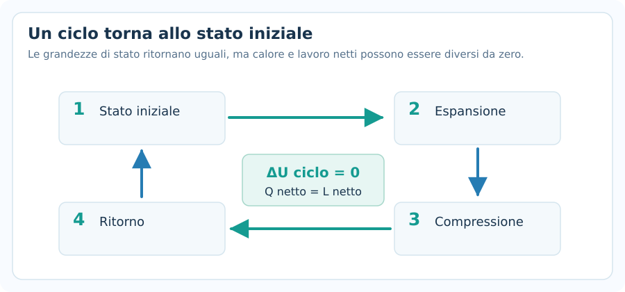
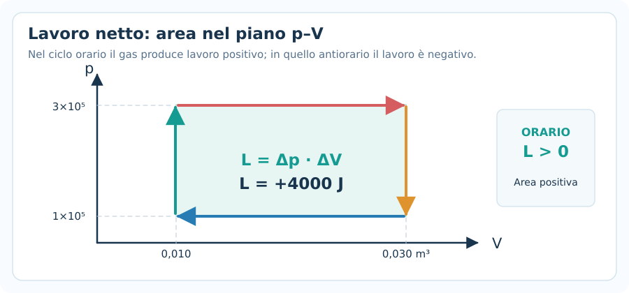
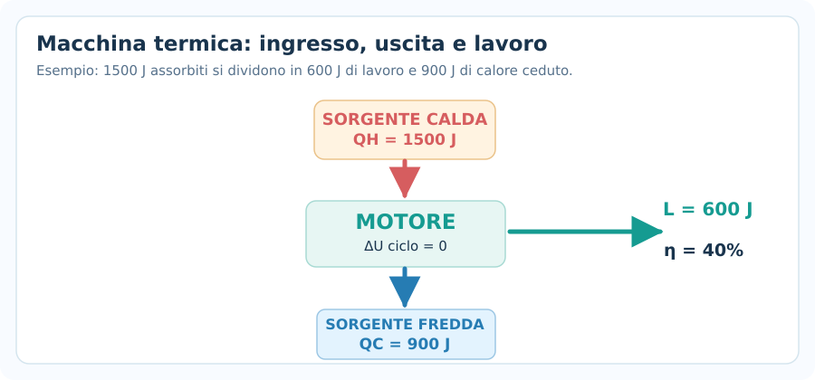
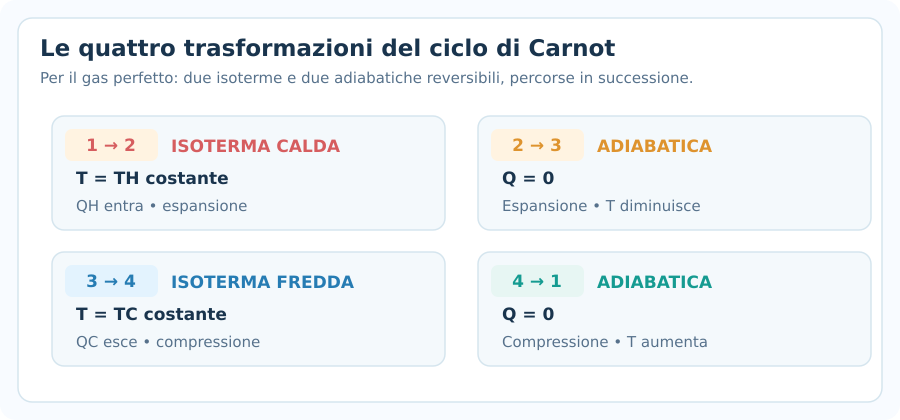
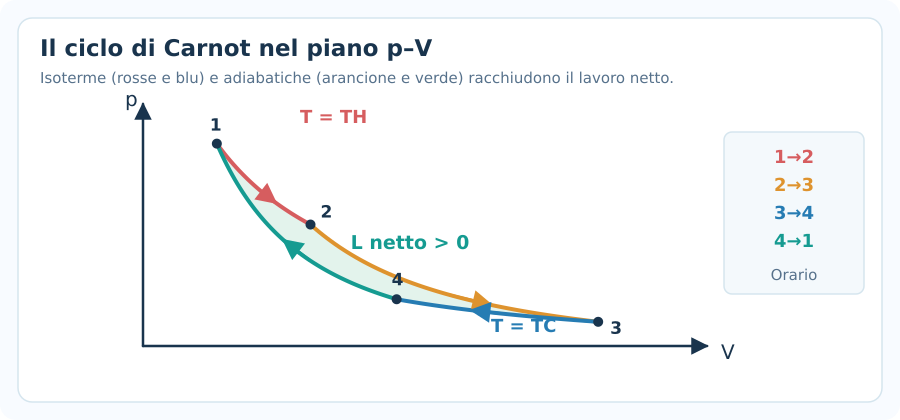
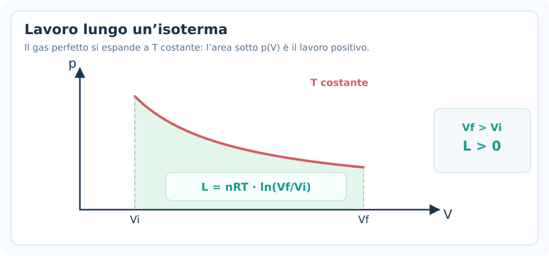
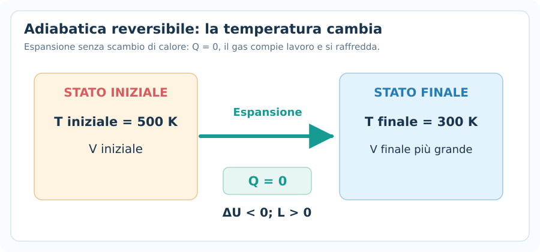
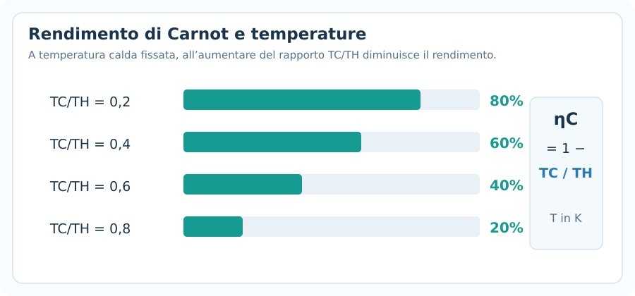
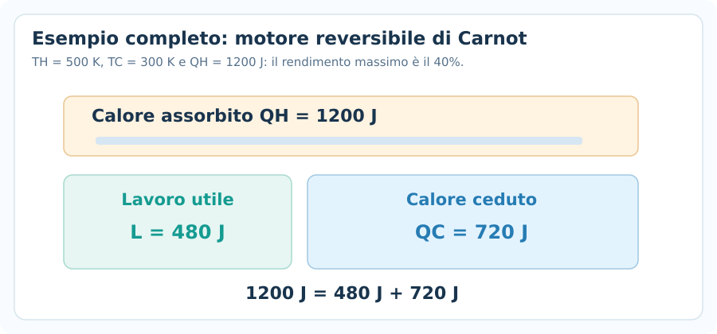
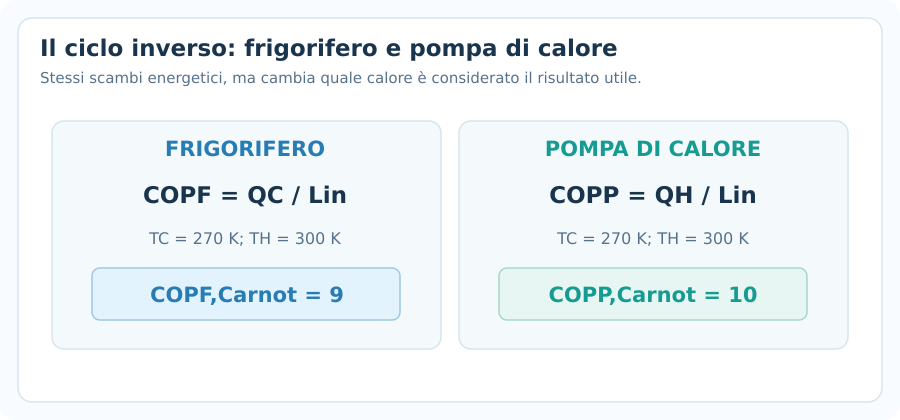

# Macchine termiche e Carnot

> [!abstract] Obiettivo della nota
> Imparare a leggere un **ciclo termodinamico** nel piano $p$–$V$, calcolare **lavoro netto, calore assorbito e ceduto, rendimento**, interpretare le **quattro trasformazioni del ciclo di Carnot** e risolvere problemi su **motori, frigoriferi e pompe di calore**. Questa nota approfondisce le applicazioni del secondo principio.

## 1. Convenzioni dei segni e lessico

Manteniamo la convenzione usata nel [[5. Primo principio della termodinamica]]:

$$
\boxed{\Delta U=Q-L}
$$

- $Q>0$: **calore assorbito** dal sistema.
- $Q<0$: **calore ceduto** dal sistema.
- $L>0$: **lavoro compiuto dal gas** durante un'espansione.
- $L<0$: **lavoro subito dal gas** durante una compressione.

Per una macchina che funziona tra due sorgenti, useremo **$Q_H>0$ e $Q_C>0$ come moduli**: $Q_H$ è il calore ricevuto dalla sorgente calda, $Q_C$ quello rifiutato alla sorgente fredda. Quindi il calore *netto con segno* ricevuto dalla macchina è $Q_H-Q_C$.

La sorgente calda ha temperatura $T_H$ e quella fredda $T_C$, con $T_H>T_C$. Nelle formule di Carnot le temperature **devono essere in kelvin**.

## 2. Che cos'è un ciclo termodinamico?

Un **ciclo** è una successione di trasformazioni al termine della quale il sistema ritorna allo **stato iniziale**: pressione, volume e temperatura finali coincidono con i valori iniziali.

L'energia interna è una **funzione di stato**, perciò:

$$
\boxed{\Delta U_{\mathrm{ciclo}}=0}
$$

Applicando il primo principio all'intero ciclo:

$$
0=Q_{\mathrm{netto}}-L_{\mathrm{netto}}
$$

$$
\boxed{L_{\mathrm{netto}}=Q_{\mathrm{netto}}}
$$

> [!important] Cosa non significa
> $\Delta U_{\mathrm{ciclo}}=0$ **non** significa che il calore o il lavoro siano entrambi nulli. Significa che **il loro bilancio netto è uguale**.

### Come interpretare il verso nel diagramma $p$–$V$

Per una trasformazione quasi statica, il lavoro infinitesimo del gas è $dL=p\,dV$.

$$
\boxed{L=\int_{V_i}^{V_f}p\,dV}
$$

- **Espansione** ($V_f>V_i$): lavoro del gas positivo.
- **Compressione** ($V_f<V_i$): lavoro del gas negativo.
- **Ciclo percorso in senso orario**: area racchiusa **positiva**, quindi $L_{\mathrm{netto}}>0$.
- **Ciclo antiorario**: area racchiusa **negativa**, quindi $L_{\mathrm{netto}}<0$.

Il segno del lavoro non dipende dal fatto che il tratto del grafico salga o scenda: dipende dalla variazione del **volume**.

## 3. Area del ciclo e lavoro netto

Un esempio geometrico semplice è un ciclo rettangolare nel piano $p$–$V$, composto da due isobare e due isocore.

Per il rettangolo percorso in senso orario:

$$
\boxed{L_{\mathrm{netto}}=(p_H-p_L)(V_D-V_S)}
$$

**Esempio.** Siano $p_H=3\cdot10^5\,\mathrm{Pa}$, $p_L=1\cdot10^5\,\mathrm{Pa}$, $V_S=0{,}010\,\mathrm{m^3}$ e $V_D=0{,}030\,\mathrm{m^3}$.

$$
L_{\mathrm{netto}}=(3-1)\cdot10^5(0{,}030-0{,}010)
$$

$$
\boxed{L_{\mathrm{netto}}=4000\,\mathrm{J}}
$$

Il risultato ha unità di energia: $\mathrm{Pa\,m^3}=\mathrm{J}$.

Se percorressimo **lo stesso ciclo in senso opposto**, il lavoro netto sarebbe $-4000\,\mathrm{J}$.

## 4. Motore termico: il bilancio energetico

Un **motore termico** utilizza un fluido di lavoro che attraversa ciclicamente diverse trasformazioni:

1. Riceve $Q_H$ dalla sorgente calda.
2. Trasforma **una parte** di tale energia in lavoro utile $L>0$.
3. Cede $Q_C$ alla sorgente fredda.

Poiché sul ciclo $\Delta U=0$:

$$
\boxed{L=Q_H-Q_C}
$$

In queste formule $Q_H$ e $Q_C$ sono **quantità positive**. Se usi $Q$ con segno nel primo principio, il calore ceduto è invece $-Q_C$.

### Rendimento di un motore

Il **rendimento** è il rapporto tra lavoro utile prodotto e calore ricevuto dalla sorgente calda:

$$
\boxed{\eta=\frac{L}{Q_H}}
$$

Sostituendo il bilancio:

$$
\boxed{\eta=1-\frac{Q_C}{Q_H}}
$$

Di norma $0<\eta<1$ per un motore che lavora tra due sorgenti a temperature finite.

Per esprimere il rendimento in percentuale:

$$
\eta_\%=100\eta
$$

### Esempio: calore assorbito e ceduto

Una macchina assorbe $Q_H=1500\,\mathrm{J}$ e cede $Q_C=900\,\mathrm{J}$ per ciclo.

$$
L=1500-900=\boxed{600\,\mathrm J}
$$

$$
\eta=\frac{600}{1500}=0{,}40=\boxed{40\%}
$$

Non bisogna fare $L/Q_C$: il denominatore del rendimento è **sempre il calore assorbito** dalla sorgente calda.

## 5. Limite del secondo principio

Il primo principio da solo permetterebbe formalmente anche $Q_C=0$ e $L=Q_H$. Il **secondo principio**, nella formulazione di Kelvin–Planck, esclude però un motore ciclico che converta integralmente in lavoro il calore prelevato da **una sola sorgente** senza altri effetti.

Per una macchina che opera soltanto tra due sorgenti a temperature $T_H$ e $T_C$, il rendimento massimo teorico è ottenuto da una **macchina reversibile di Carnot**.

$$
\boxed{\eta\leq\eta_C=1-\frac{T_C}{T_H}}
$$

L'uguaglianza vale per una macchina **reversibile**. Una macchina reale operante tra le medesime sorgenti ha normalmente rendimento inferiore, per irreversibilità e dissipazioni.

## 6. Che cos'è il ciclo di Carnot?

Il ciclo di Carnot è un ciclo **completamente reversibile** che funziona tra due sorgenti a temperatura costante $T_H$ e $T_C$.

Per un **gas perfetto**, si può descrivere con quattro trasformazioni reversibili:

1. **$1\to2$: espansione isoterma a $T_H$**. Il gas riceve $Q_H$ e compie lavoro.
2. **$2\to3$: espansione adiabatica reversibile**. $Q=0$ e la temperatura scende da $T_H$ a $T_C$.
3. **$3\to4$: compressione isoterma a $T_C$**. Il gas cede $Q_C$ e subisce lavoro.
4. **$4\to1$: compressione adiabatica reversibile**. $Q=0$ e la temperatura risale da $T_C$ a $T_H$.

> [!important] Le quattro fasi
> **Due isoterme** (una calda, una fredda) e **due adiabatiche reversibili**. Il ciclo è un **motore** quando si percorre nel verso $1\to2\to3\to4\to1$.

## 7. Il ciclo di Carnot nel piano $p$–$V$

Nel piano $p$–$V$ le due isoterme sono curve del tipo $p\propto1/V$. Le due adiabatiche reversibili sono **più ripide** delle isoterme per un gas perfetto con $\gamma>1$.

L'area delimitata dal ciclo rappresenta il **lavoro netto positivo** prodotto dal motore di Carnot. Non è necessario conoscere la forma esatta delle curve per interpretare il verso e il segno dell'area.

### Formule utili per i quattro tratti

| Tratto | Tipo | $Q$ del gas | $\Delta U$ | $L$ del gas |
|---|---|---|---|---|
| $1\to2$ | Isoterma calda | $+Q_H$ | $0$ | $+Q_H$ |
| $2\to3$ | Adiabatica | $0$ | $<0$ | $>0$ |
| $3\to4$ | Isoterma fredda | $-Q_C$ | $0$ | $-Q_C$ |
| $4\to1$ | Adiabatica | $0$ | $>0$ | $<0$ |

I segni della tabella usano $\Delta U=Q-L$ e riguardano il gas perfetto lungo il ciclo di Carnot motore.

## 8. Il lavoro nelle trasformazioni di Carnot

### Isoterma reversibile di gas perfetto

Per un gas perfetto a temperatura costante, $\Delta U=0$, quindi $Q=L$.

$$
\boxed{L_{\mathrm{isot}}=nRT\ln\left(\frac{V_f}{V_i}\right)}
$$

- Nell'**espansione** $V_f>V_i$, il logaritmo è positivo: $L>0$.
- Nella **compressione** $V_f<V_i$, il logaritmo è negativo: $L<0$.

Per l'isoterma calda:

$$
Q_H=nRT_H\ln\left(\frac{V_2}{V_1}\right)
$$

Per la compressione isoterma fredda, $Q_C$ è il **modulo del calore ceduto**:

$$
Q_C=nRT_C\ln\left(\frac{V_3}{V_4}\right)
$$

### Adiabatica reversibile di gas perfetto

Lungo un'adiabatica reversibile $Q=0$, quindi:

$$
\boxed{\Delta U=-L}
$$

Per un gas perfetto con capacità termiche costanti e $\gamma=C_P/C_V$:

$$
\boxed{pV^\gamma=\text{costante}}
$$

$$
\boxed{TV^{\gamma-1}=\text{costante}}
$$

Ricordiamo inoltre, con $\ell$ gradi di libertà attivi:

$$
\boxed{\Delta U=\frac{\ell}{2}nR\Delta T}
$$

Dunque per un tratto adiabatico:

$$
\boxed{L=-\frac{\ell}{2}nR(T_f-T_i)}
$$

> [!warning] Ipotesi importanti
> Le relazioni $pV^\gamma=\text{costante}$ e $TV^{\gamma-1}=\text{costante}$ sono per **adiabatiche reversibili di gas perfetto** con $\gamma$ costante: non valgono per una qualunque trasformazione con $Q=0$.

## 9. Da dove nasce la formula di rendimento di Carnot?

Le due adiabatiche reversibili collegano gli stessi valori di temperatura; questo porta alla relazione fra i rapporti di volume:

$$
\boxed{\frac{V_2}{V_1}=\frac{V_3}{V_4}}
$$

Le due isoterme scambiano quantità di calore in modulo:

$$
Q_H=nRT_H\ln\left(\frac{V_2}{V_1}\right)
$$

$$
Q_C=nRT_C\ln\left(\frac{V_3}{V_4}\right)
$$

I logaritmi sono uguali, quindi:

$$
\boxed{\frac{Q_C}{Q_H}=\frac{T_C}{T_H}}
$$

Nel rendimento $\eta=1-Q_C/Q_H$ otteniamo:

$$
\boxed{\eta_C=1-\frac{T_C}{T_H}}
$$

**La sostanza di lavoro e la quantità di gas non compaiono**: fra due sorgenti fissate, tutte le macchine reversibili hanno lo stesso rendimento ideale.

## 10. Effetto delle temperature sul rendimento

Dalla formula di Carnot:

- A $T_H$ fissata, **abbassare $T_C$** aumenta il rendimento massimo.
- A $T_C$ fissata, **alzare $T_H$** aumenta il rendimento massimo.
- Se $T_C=T_H$, il rendimento di Carnot è **zero**: non c'è differenza di temperatura utile.
- Il rendimento **non può essere 100%** per due sorgenti a temperature finite con $T_C>0$.

### Esempio con Celsius e kelvin

Un motore reversibile lavora tra $227\,^{\circ}\mathrm C$ e $27\,^{\circ}\mathrm C$.

Convertiamo:

$$
T_H=500{,}15\,\mathrm K,\qquad T_C=300{,}15\,\mathrm K
$$

$$
\eta_C=1-\frac{300{,}15}{500{,}15}\approx\boxed{39{,}99\%}
$$

L'errore tipico sarebbe usare $27/227$: **le temperature devono essere assolute**.

## 11. Esempio completo: macchina di Carnot

Una macchina di Carnot opera tra $T_H=500\,\mathrm K$ e $T_C=300\,\mathrm K$ e assorbe $Q_H=1200\,\mathrm J$ per ciclo.

**Richieste:** rendimento, calore ceduto e lavoro netto per ciclo.

1. **Rendimento:**

$$
\eta_C=1-\frac{300}{500}=\boxed{0{,}40=40\%}
$$

2. **Lavoro:**

$$
L=\eta_CQ_H=0{,}40\cdot1200=\boxed{480\,\mathrm J}
$$

3. **Calore ceduto:**

$$
Q_C=Q_H-L=1200-480=\boxed{720\,\mathrm J}
$$

**Verifica indipendente:**

$$
\frac{Q_C}{Q_H}=\frac{720}{1200}=0{,}60=\frac{T_C}{T_H}
$$

## 12. Macchina reale e confronto con Carnot

Il rendimento reale $\eta$ non può superare $\eta_C$ se le macchine lavorano fra le **stesse due sorgenti**.

**Esempio.** Una macchina reale riceve $2000\,\mathrm J$ e cede $1400\,\mathrm J$, operando tra $600\,\mathrm K$ e $300\,\mathrm K$.

Rendimento reale:

$$
L=2000-1400=600\,\mathrm J
$$

$$
\eta=\frac{600}{2000}=\boxed{30\%}
$$

Limite di Carnot:

$$
\eta_C=1-\frac{300}{600}=\boxed{50\%}
$$

La macchina reale è coerente con il secondo principio: $30\%<50\%$.

Se dal calcolo risultasse $\eta>\eta_C$, dovremmo verificare **dati, unità, modello o interpretazione del testo**.

## 13. Motore e frigorifero: cicli inversi

Percorrendo un ciclo reversibile nel verso opposto possiamo descrivere un **frigorifero** o una **pompa di calore**:

- Il dispositivo **assorbe lavoro** dall'esterno ($L_{\mathrm{in}}>0$).
- Estrae calore $Q_C$ dalla sorgente fredda.
- Trasferisce calore $Q_H$ alla sorgente calda.

Bilancio energetico:

$$
\boxed{Q_H=Q_C+L_{\mathrm{in}}}
$$

### COP frigorifero

La prestazione utile è il calore estratto dall'ambiente freddo:

$$
\boxed{\mathrm{COP}_F=\frac{Q_C}{L_{\mathrm{in}}}}
$$

### COP pompa di calore

La prestazione utile è il calore **fornito** all'ambiente caldo:

$$
\boxed{\mathrm{COP}_P=\frac{Q_H}{L_{\mathrm{in}}}}
$$

Da $Q_H=Q_C+L_{\mathrm{in}}$ segue:

$$
\boxed{\mathrm{COP}_P=\mathrm{COP}_F+1}
$$

Nel **ciclo di Carnot inverso** i massimi teorici sono:

$$
\boxed{\mathrm{COP}_{F,C}=\frac{T_C}{T_H-T_C}}
$$

$$
\boxed{\mathrm{COP}_{P,C}=\frac{T_H}{T_H-T_C}}
$$

**Esempio.** Tra $T_H=300\,\mathrm K$ e $T_C=270\,\mathrm K$:

$$
\mathrm{COP}_{F,C}=\frac{270}{30}=\boxed{9}
$$

$$
\mathrm{COP}_{P,C}=\frac{300}{30}=\boxed{10}
$$

Un **COP maggiore di 1 non viola la conservazione dell'energia**: il dispositivo trasferisce calore oltre all'energia elettrica o meccanica impiegata.

## 14. Rendimento e potenza

Il **lavoro** prodotto in un ciclo è un'energia, espressa in joule. La **potenza** è il lavoro prodotto nell'unità di tempo:

$$
\boxed{\mathcal P=\frac{L}{\Delta t}}
$$

Se il motore compie $f$ cicli al secondo, ciascuno con lavoro $L_c$:

$$
\boxed{\mathcal P=fL_c}
$$

**Esempio.** Un motore compie $20$ cicli al secondo e produce $250\,\mathrm J$ per ciclo.

$$
\mathcal P=20\cdot250=\boxed{5000\,\mathrm W=5{,}0\,\mathrm{kW}}
$$

Non confondere **rendimento $\eta$** (numero adimensionale) con **potenza $\mathcal P$** (watt).

## 15. Metodo meccanico per risolvere gli esercizi

1. **Identifica il dispositivo:** motore ($L$ utile in uscita), frigorifero o pompa ($L_{\mathrm{in}}$ in ingresso).
2. **Scrivi le temperature** in kelvin e controlla $T_H>T_C$.
3. **Distingui i calori come moduli positivi:** $Q_H$ assorbito dal caldo, $Q_C$ ceduto al freddo per un motore.
4. **Usa il primo principio sul ciclo:** $\Delta U=0$, dunque $L=Q_H-Q_C$ per il motore.
5. **Scegli la prestazione:** $\eta=L/Q_H$, $\mathrm{COP}_F=Q_C/L_{\mathrm{in}}$ oppure $\mathrm{COP}_P=Q_H/L_{\mathrm{in}}$.
6. **Se il testo dice Carnot/reversibile**, applica $\eta_C=1-T_C/T_H$; altrimenti è un **limite**, non necessariamente il rendimento reale.
7. **Se compare un diagramma $p$–$V$**, individua il verso del ciclo e calcola l'area racchiusa per trovare il lavoro netto.
8. **Verifica il risultato:** $0\leq\eta\leq\eta_C<1$ per due sorgenti a $T_C>0$, e bilancio energetico rispettato.

## 16. Errori frequenti

### Confondere il lavoro netto con il lavoro in un singolo tratto

Durante un ciclo alcune fasi producono lavoro, altre lo assorbono. Occorre **sommarle con il segno** o trovare l'area orientata nel piano $p$–$V$.

### Dire che il ciclo ha $Q=L=0$ perché $\Delta U=0$

Corretto: $\boxed{Q_{\mathrm{netto}}=L_{\mathrm{netto}}}$. Nessuno dei due deve necessariamente essere zero.

### Usare $\eta_C$ per una macchina qualsiasi

La formula $\eta_C=1-T_C/T_H$ fornisce il **rendimento di Carnot** o un limite superiore, **non** il rendimento reale di ogni motore.

### Confondere $Q_C$ positivo con il calore con segno

Nel bilancio del motore, $Q_C$ è il **modulo** del calore ceduto. Perciò il calore netto scambiato dal gas è $Q_H-Q_C$, non $Q_H+Q_C$.

### Usare Celsius invece dei kelvin

Nei rapporti fra temperature assolute ($T_C/T_H$) si usano **sempre i kelvin**.

### Confondere una adiabatica con una isoterma

- Isoterma gas perfetto: **$\Delta T=0\Rightarrow\Delta U=0$**, ma $Q$ può essere non nullo.
- Adiabatica: **$Q=0$**, ma $\Delta U$ può cambiare.

### Pensare che un COP maggiore di uno sia impossibile

Il COP riguarda **calore trasferito per unità di lavoro fornito**, non la conversione diretta di lavoro in energia.

### Dimenticare il verso sul grafico $p$–$V$

Il ciclo orario produce lavoro positivo, quello antiorario ha lavoro del gas negativo.

## 17. Formulario essenziale

| Situazione | Formula |
|---|---|
| Primo principio | $\Delta U=Q-L$ |
| Ciclo completo | $\Delta U=0$ e $L_{\mathrm{netto}}=Q_{\mathrm{netto}}$ |
| Bilancio motore | $L=Q_H-Q_C$ |
| Rendimento motore | $\eta=L/Q_H=1-Q_C/Q_H$ |
| Massimo rendimento tra due sorgenti | $\eta_C=1-T_C/T_H$ |
| Rapporto dei calori, Carnot | $Q_C/Q_H=T_C/T_H$ |
| Lavoro isoterma gas perfetto | $L=nRT\ln(V_f/V_i)$ |
| Adiabatica reversibile | $pV^\gamma=\text{cost.}$; $TV^{\gamma-1}=\text{cost.}$ |
| Energia interna gas perfetto | $\Delta U=(\ell/2)nR\Delta T$ |
| Lavoro adiabatica | $L=-\Delta U$ |
| Lavoro ciclo rettangolare orario | $(p_H-p_L)(V_D-V_S)$ |
| Bilancio frigorifero | $Q_H=Q_C+L_{\mathrm{in}}$ |
| COP frigorifero | $\mathrm{COP}_F=Q_C/L_{\mathrm{in}}$ |
| COP pompa di calore | $\mathrm{COP}_P=Q_H/L_{\mathrm{in}}$ |
| COP Carnot frigorifero | $T_C/(T_H-T_C)$ |
| COP Carnot pompa | $T_H/(T_H-T_C)$ |
| Potenza motore | $\mathcal P=L/\Delta t=fL_c$ |

## 18. Autoverifica senza soluzioni

1. Un motore riceve $1800\,\mathrm J$ e cede $1260\,\mathrm J$ per ciclo. Qual è il lavoro netto? Qual è il rendimento?
2. Una macchina di Carnot lavora tra $600\,\mathrm K$ e $300\,\mathrm K$. Se assorbe $2000\,\mathrm J$, quanto lavoro produce e quanto calore cede?
3. Una macchina reale ha $\eta=45\%$ fra $500\,\mathrm K$ e $300\,\mathrm K$. È possibile? Motiva.
4. In un diagramma $p$–$V$ un ciclo rettangolare è percorso in senso antiorario. Qual è il segno del lavoro del gas?
5. Durante un'espansione adiabatica reversibile di gas perfetto, il gas si raffredda o si riscalda? Qual è il segno del lavoro del gas?
6. Un frigorifero riceve $200\,\mathrm J$ di lavoro ed estrae $800\,\mathrm J$ dalla sorgente fredda. Calcola il calore ceduto alla sorgente calda e i due COP.
7. Una macchina completa $10$ cicli al secondo, producendo $350\,\mathrm J$ per ciclo. Qual è la potenza media?
8. Perché un ciclo chiuso nel piano $p$–$V$ può produrre lavoro netto non nullo anche se il gas torna esattamente allo stato iniziale?

> [!summary] Idea chiave
> **Sul ciclo si annulla la variazione dell'energia interna, non il lavoro.** La macchina termica converte in lavoro una parte del calore assorbito, e il **limite di Carnot** dipende soltanto dalle temperature assolute delle due sorgenti.
